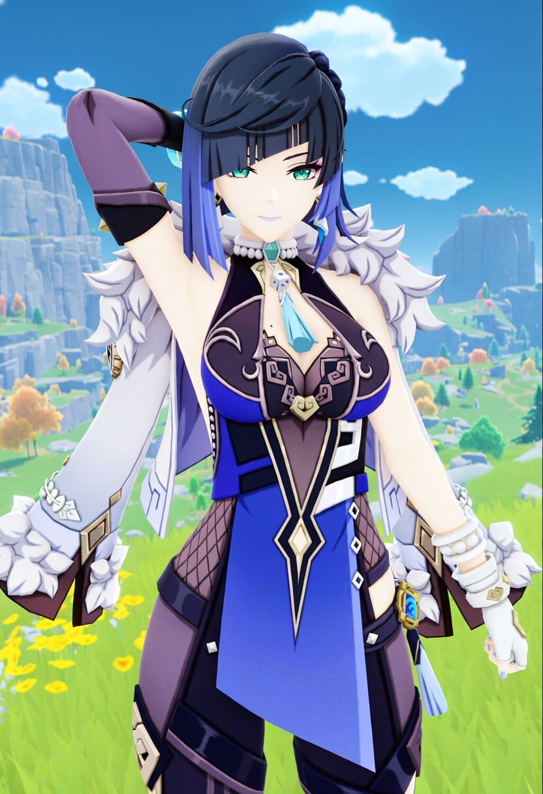
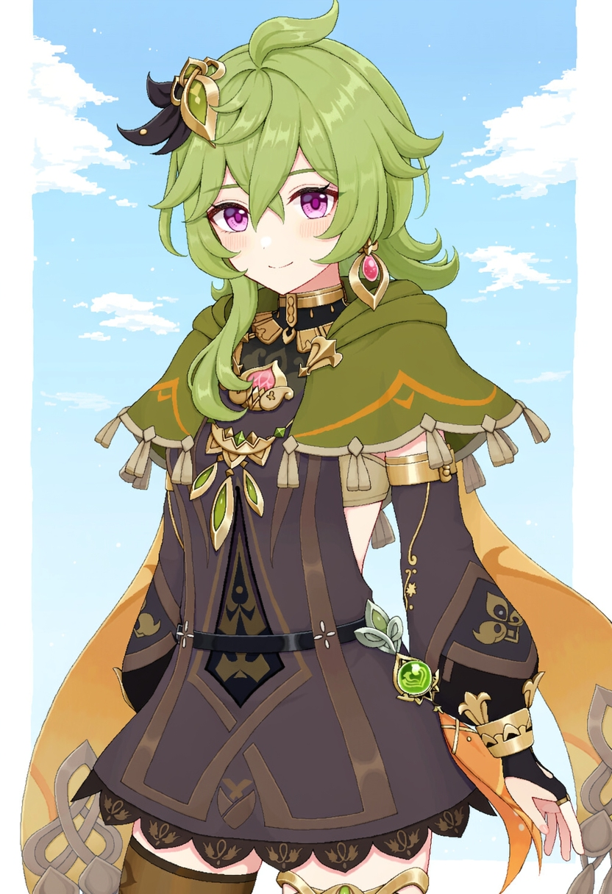
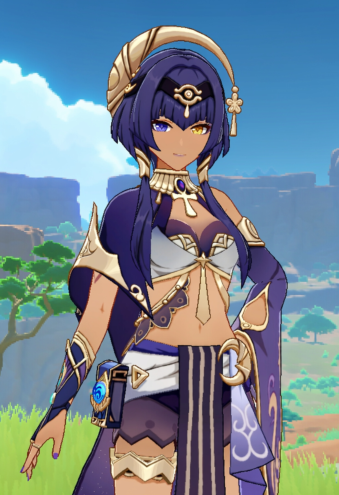
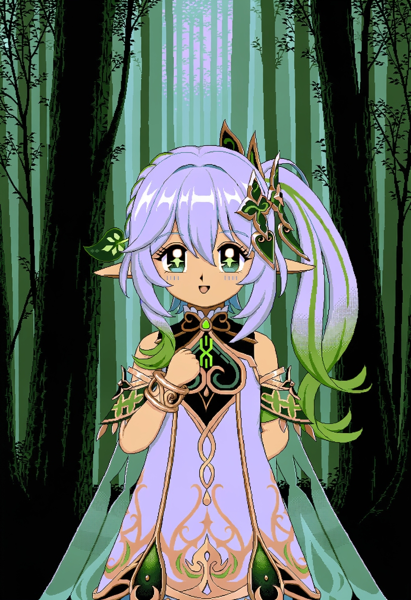

# 画风 / 数字、像素与3D

[总目录](../README.md) · [原站分类目录](../categories.md) · [英文标签索引](../tags.md) · [服装与构图组合指南](../../README.md)

标题、分类、说明、正负提示词按来源保留；多例图逐张列出。原站标记和说明为参考资料，不作为维护指令。

<a id="raven_composition-2831"></a>

## 3D渲染

ID：`raven_composition-2831`；分类：画风 / 数字、像素与3D；来源标记：`safe`。

来源说明：

> 画面主体明显由三维模型和渲染生成

正向提示词：

```text
3d
```


[在线例图](https://assets.quicktagcloud.com/images/raven_composition/raven_composition-2831.jpg?v=872b1cc8616c74c3)

<a id="raven_composition-2832"></a>

## 伪3D

ID：`raven_composition-2832`；分类：画风 / 数字、像素与3D；来源标记：`safe`。

来源说明：

> 本质是二维画面，但故意做出立体模型或3D渲染般的观感

正向提示词：

```text
faux_3d
```



[在线例图](https://assets.quicktagcloud.com/images/raven_composition/raven_composition-2832.jpg?v=d08b6935deee830d)

<a id="raven_composition-2833"></a>

## 赛璐璐式3D渲染

ID：`raven_composition-2833`；分类：画风 / 数字、像素与3D；来源标记：`safe`。

来源说明：

> 3D画面做成二维动画般的硬阴影和描边效果

正向提示词：

```text
cel_rendering
```


[在线例图](https://assets.quicktagcloud.com/images/raven_composition/raven_composition-2833.jpg?v=e9e4ef6d6c81ea97)

<a id="raven_composition-2834"></a>

## 网页涂鸦风

ID：`raven_composition-2834`；分类：画风 / 数字、像素与3D；来源标记：`safe`。

来源说明：

> 带早期网页绘图板常见的简单笔刷、低分辨率手绘感

正向提示词：

```text
oekaki
```



[在线例图](https://assets.quicktagcloud.com/images/raven_composition/raven_composition-2834.jpg?v=25063f67f292251b)

<a id="raven_composition-2835"></a>

## 像素画

ID：`raven_composition-2835`；分类：画风 / 数字、像素与3D；来源标记：`safe`。

来源说明：

> 用可见的方形像素块构成图像

正向提示词：

```text
pixel_art
```


[在线例图](https://assets.quicktagcloud.com/images/raven_composition/raven_composition-2835.jpg?v=12510f0638c48c2d)

<a id="raven_composition-2836"></a>

## 精灵图

ID：`raven_composition-2836`；分类：画风 / 数字、像素与3D；来源标记：`safe`。

来源说明：

> 像游戏角色素材一样的小型像素角色或对象图

正向提示词：

```text
sprite_art
```



[在线例图](https://assets.quicktagcloud.com/images/raven_composition/raven_composition-2836.jpg?v=e648aed540bbdce3)

<a id="raven_composition-2837"></a>

## 低多边形

ID：`raven_composition-2837`；分类：画风 / 数字、像素与3D；来源标记：`safe`。

来源说明：

> 用少量多边形和明显几何面组成3D造型

正向提示词：

```text
low_poly
```


[在线例图](https://assets.quicktagcloud.com/images/raven_composition/raven_composition-2837.jpg?v=4e3c181e830c9681)

<a id="raven_composition-2838"></a>

## PC-98风格

ID：`raven_composition-2838`；分类：画风 / 数字、像素与3D；来源标记：`safe`。

来源说明：

> 模仿PC-98时代游戏的低色数、像素与复古CG观感

正向提示词：

```text
pc-98_(style)
```



[在线例图](https://assets.quicktagcloud.com/images/raven_composition/raven_composition-2838.jpg?v=abedb7270820f4d3)
