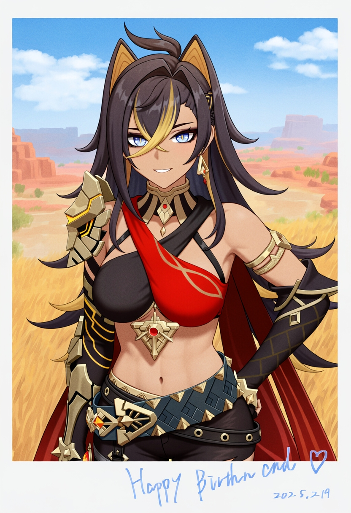

# 画风 / 写实与绘画渲染

[总目录](../README.md) · [原站分类目录](../categories.md) · [英文标签索引](../tags.md) · [服装与构图组合指南](../../README.md)

标题、分类、说明、正负提示词按来源保留；多例图逐张列出。原站标记和说明为参考资料，不作为维护指令。

<a id="raven_composition-2839"></a>

## 绘画感渲染

ID：`raven_composition-2839`；分类：画风 / 写实与绘画渲染；来源标记：`safe`。

来源说明：

> 不追求干净赛璐璐边界，更多靠笔触和色块塑造体积

正向提示词：

```text
painterly
```


[在线例图](https://assets.quicktagcloud.com/images/raven_composition/raven_composition-2839.jpg?v=cbc6349bd2a066b4)

<a id="raven_composition-2840"></a>

## 写实风格

ID：`raven_composition-2840`；分类：画风 / 写实与绘画渲染；来源标记：`safe`。

来源说明：

> 人体、材质、光影和比例整体更接近现实

正向提示词：

```text
realistic
```


[在线例图](https://assets.quicktagcloud.com/images/raven_composition/raven_composition-2840.jpg?v=eb5aacbc651157e5)

<a id="raven_composition-2841"></a>

## 仿照片

ID：`raven_composition-2841`；分类：画风 / 写实与绘画渲染；来源标记：`safe`。

来源说明：

> 明明是绘图，却故意做成像随手拍摄的照片

正向提示词：

```text
fake_photograph
```



[在线例图](https://assets.quicktagcloud.com/images/raven_composition/raven_composition-2841.jpg?v=2d545ac473a8c10b)

<a id="raven_composition-2842"></a>

## 明暗对照法

ID：`raven_composition-2842`；分类：画风 / 写实与绘画渲染；来源标记：`safe`。

来源说明：

> 用很强的亮暗对比塑造体积和戏剧性光影

正向提示词：

```text
chiaroscuro
```


[在线例图](https://assets.quicktagcloud.com/images/raven_composition/raven_composition-2842.jpg?v=8b74d717885df709)
