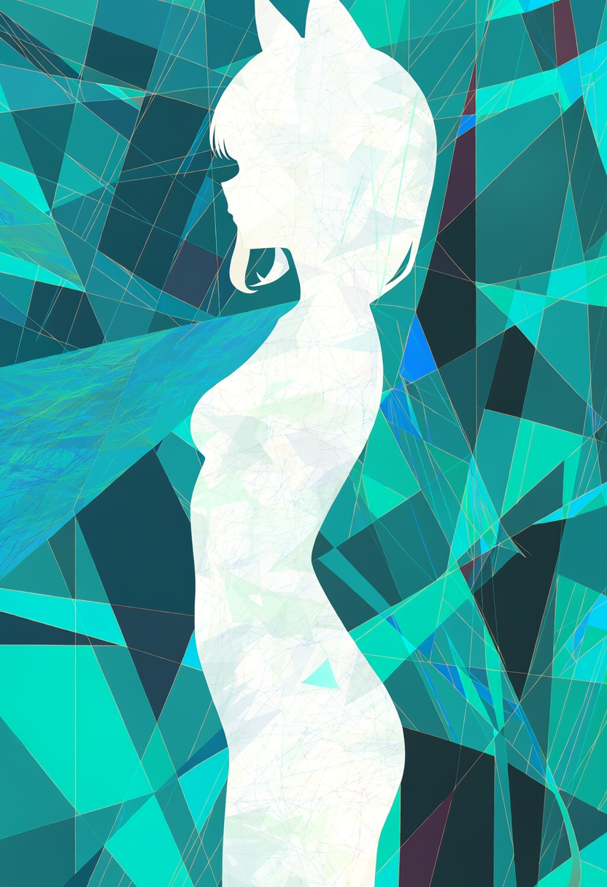
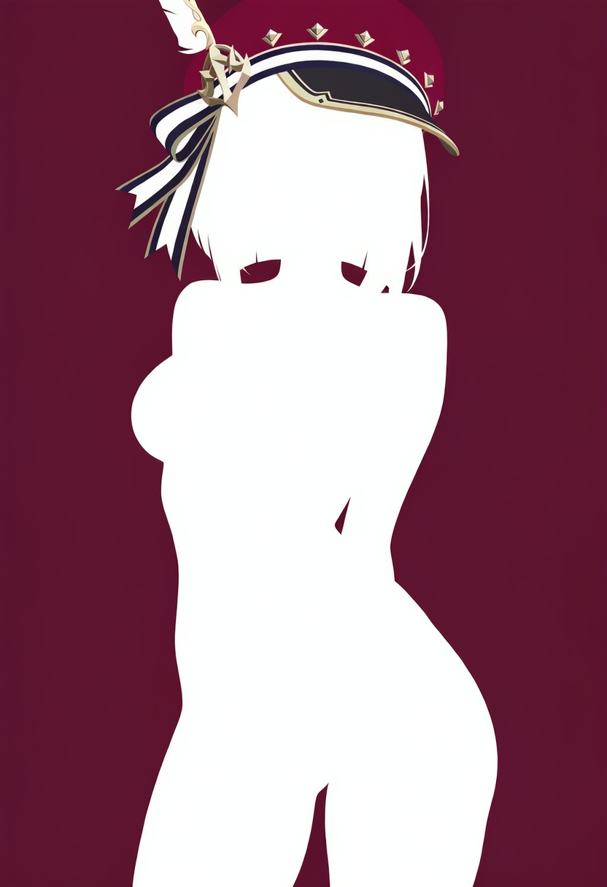
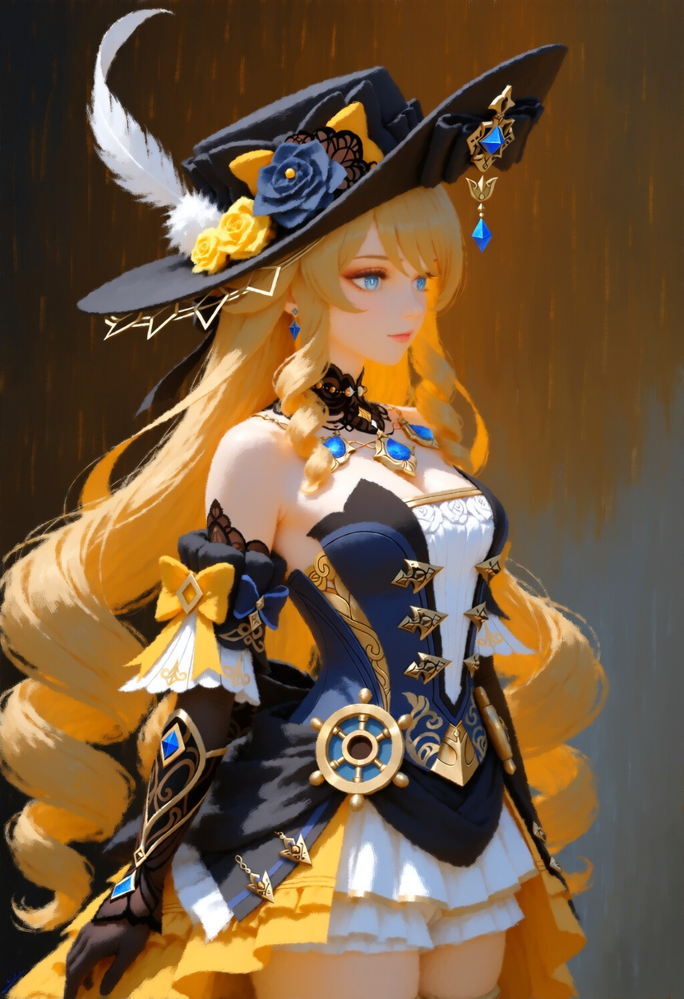
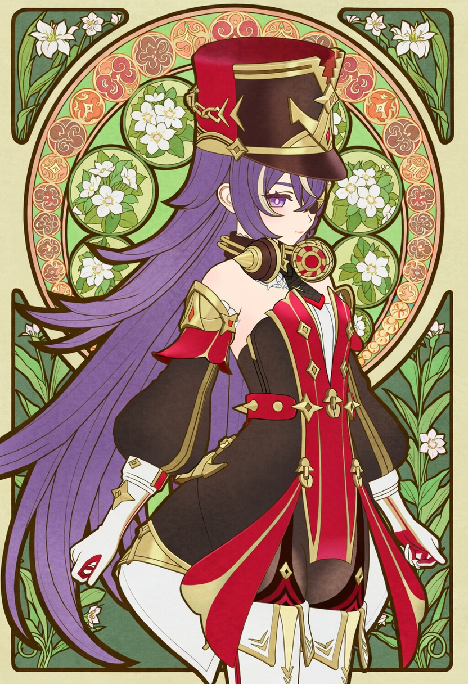
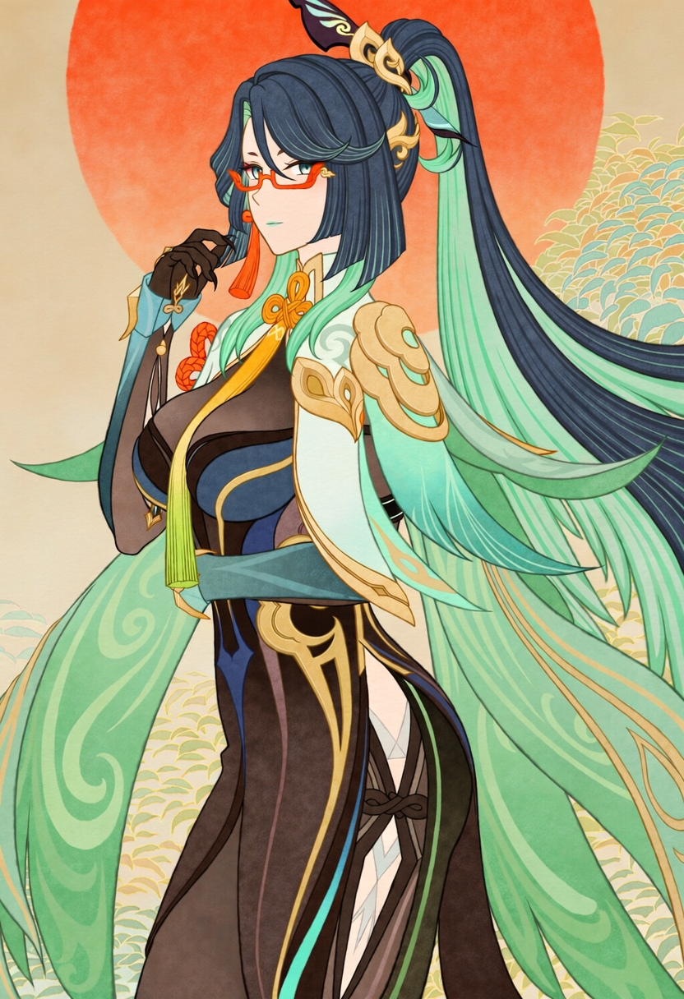
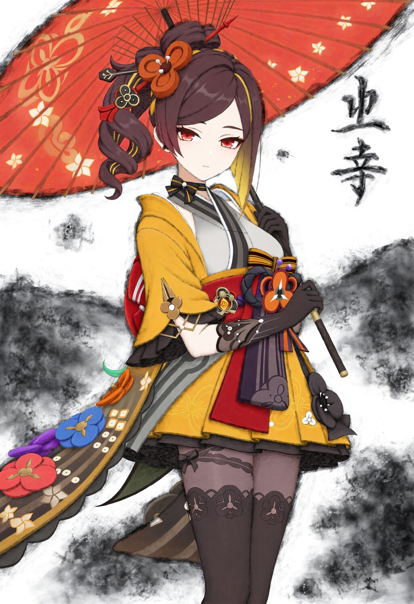
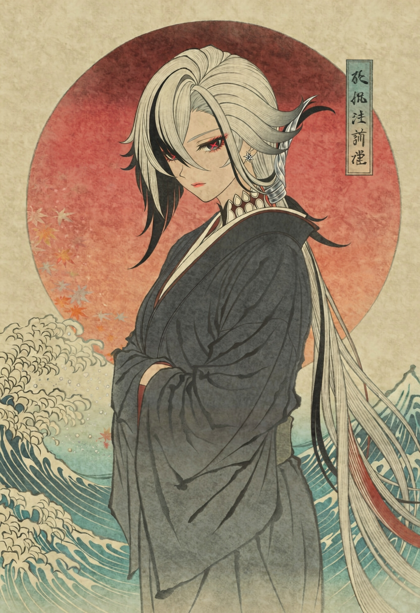
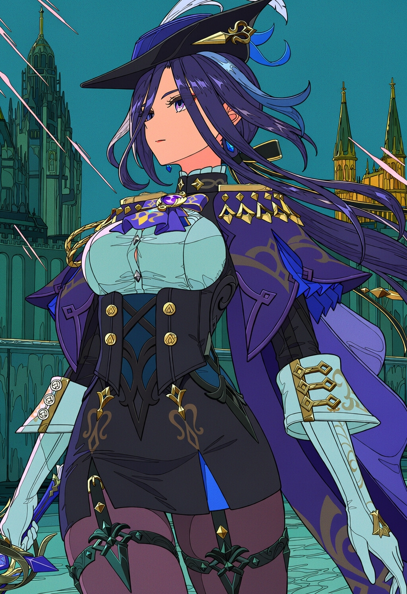

# 画风 / 艺术流派

[总目录](../README.md) · [原站分类目录](../categories.md) · [英文标签索引](../tags.md) · [服装与构图组合指南](../../README.md)

标题、分类、说明、正负提示词按来源保留；多例图逐张列出。原站标记和说明为参考资料，不作为维护指令。

<a id="raven_composition-2843"></a>

## 抽象艺术

ID：`raven_composition-2843`；分类：画风 / 艺术流派；来源标记：`safe`。

来源说明：

> 不强调真实物体，主要靠形状、颜色和结构表达

正向提示词：

```text
abstract
```



[在线例图](https://assets.quicktagcloud.com/images/raven_composition/raven_composition-2843.jpg?v=484e83b3edcbf022)

<a id="raven_composition-2844"></a>

## 极简主义

ID：`raven_composition-2844`；分类：画风 / 艺术流派；来源标记：`safe`。

来源说明：

> 元素很少，画面留白多，造型和颜色都尽量简化

正向提示词：

```text
minimalism
```



[在线例图](https://assets.quicktagcloud.com/images/raven_composition/raven_composition-2844.jpg?v=79394de304506c19)

<a id="raven_composition-2845"></a>

## 立体主义

ID：`raven_composition-2845`；分类：画风 / 艺术流派；来源标记：`safe`。

来源说明：

> 把人物和物体拆成几何块面，从多个角度同时重组画面

正向提示词：

```text
cubism
```


[在线例图](https://assets.quicktagcloud.com/images/raven_composition/raven_composition-2845.jpg?v=f54e69641ea46a11)

<a id="raven_composition-2846"></a>

## 印象派

ID：`raven_composition-2846`；分类：画风 / 艺术流派；来源标记：`safe`。

来源说明：

> 强调光色和松散笔触，不追求细节轮廓完全清楚

正向提示词：

```text
impressionism
```



[在线例图](https://assets.quicktagcloud.com/images/raven_composition/raven_composition-2846.jpg?v=13de7af88c833529)

<a id="raven_composition-2847"></a>

## 新艺术 / 穆夏风格

ID：`raven_composition-2847`；分类：画风 / 艺术流派；来源标记：`safe`。

来源说明：

> 典型穆夏式装饰画感：流动曲线、花草纹样、平涂和华丽圆形边框

正向提示词：

```text
art_nouveau
```



[在线例图](https://assets.quicktagcloud.com/images/raven_composition/raven_composition-2847.jpg?v=1198e7495f311478)

<a id="raven_composition-2848"></a>

## 日本画

ID：`raven_composition-2848`；分类：画风 / 艺术流派；来源标记：`safe`。

来源说明：

> 模仿或采用近现代日本传统绘画的材料和审美

正向提示词：

```text
nihonga
```



[在线例图](https://assets.quicktagcloud.com/images/raven_composition/raven_composition-2848.jpg?v=687339a8b23a9b65)

<a id="raven_composition-2849"></a>

## 墨绘 / 水墨写意风

ID：`raven_composition-2849`；分类：画风 / 艺术流派；来源标记：`safe`。

来源说明：

> 只用少量黑墨和简练线条表现对象，强调留白和概括

正向提示词：

```text
sumi-e
```



[在线例图](https://assets.quicktagcloud.com/images/raven_composition/raven_composition-2849.jpg?v=58318db517c33a9d)

<a id="raven_composition-2850"></a>

## 浮世绘

ID：`raven_composition-2850`；分类：画风 / 艺术流派；来源标记：`safe`。

来源说明：

> 模仿日本浮世绘版画的平面色块、线条和构图

正向提示词：

```text
ukiyo-e
```



[在线例图](https://assets.quicktagcloud.com/images/raven_composition/raven_composition-2850.jpg?v=a9985b79fb7e11c1)

<a id="raven_composition-2851"></a>

## 清线风格

ID：`raven_composition-2851`；分类：画风 / 艺术流派；来源标记：`safe`。

来源说明：

> 线条粗细均匀、清晰干净，色块平整，细节易读

正向提示词：

```text
ligne_claire
```



[在线例图](https://assets.quicktagcloud.com/images/raven_composition/raven_composition-2851.jpg?v=01d895a6243df366)

<a id="raven_composition-2852"></a>

## 超现实主义

ID：`raven_composition-2852`；分类：画风 / 艺术流派；来源标记：`safe`。

来源说明：

> 把现实物体以不合常理、梦境般的方式组合

正向提示词：

```text
surreal
```


[在线例图](https://assets.quicktagcloud.com/images/raven_composition/raven_composition-2852.jpg?v=5ac3fbc35b0ff5da)

<a id="raven_composition-2853"></a>

## 超扁平

ID：`raven_composition-2853`；分类：画风 / 艺术流派；来源标记：`safe`。

来源说明：

> 强调二维平面、扁平色块和日本流行视觉感

正向提示词：

```text
superflat
```


[在线例图](https://assets.quicktagcloud.com/images/raven_composition/raven_composition-2853.jpg?v=231a5a7fa7fbe261)

<a id="raven_composition-2854"></a>

## 迷幻风格

ID：`raven_composition-2854`；分类：画风 / 艺术流派；来源标记：`safe`。

来源说明：

> 颜色、形状和图案强烈扭曲，带眩晕或幻觉感

正向提示词：

```text
psychedelic
```


[在线例图](https://assets.quicktagcloud.com/images/raven_composition/raven_composition-2854.jpg?v=1edd2794dcb0b2f6)
