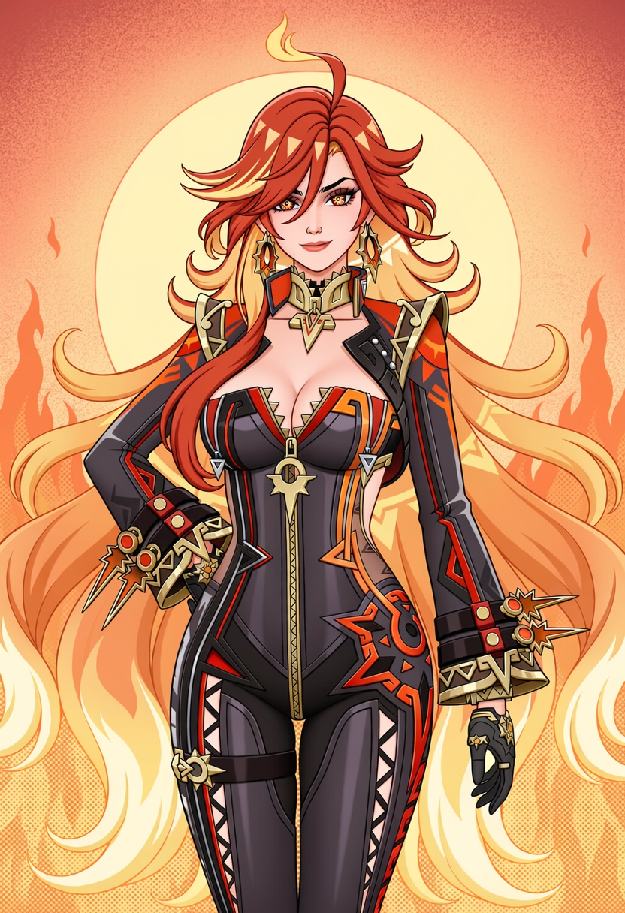
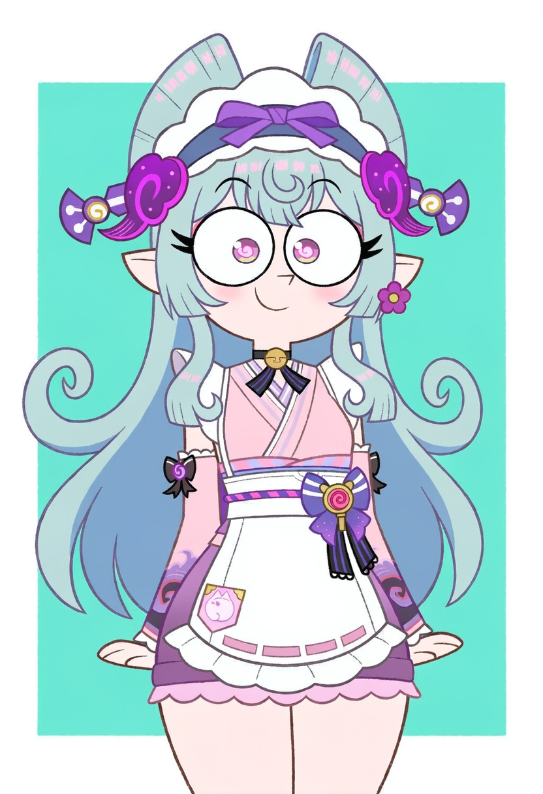
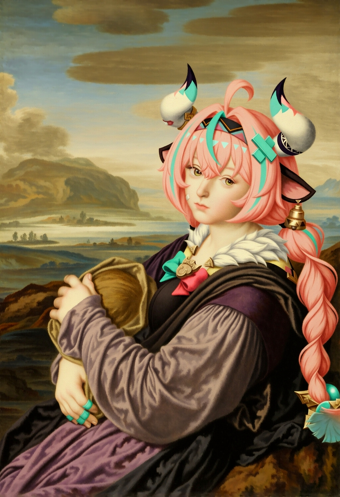
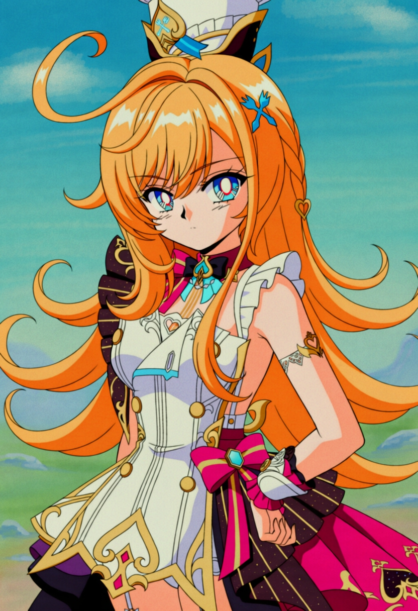
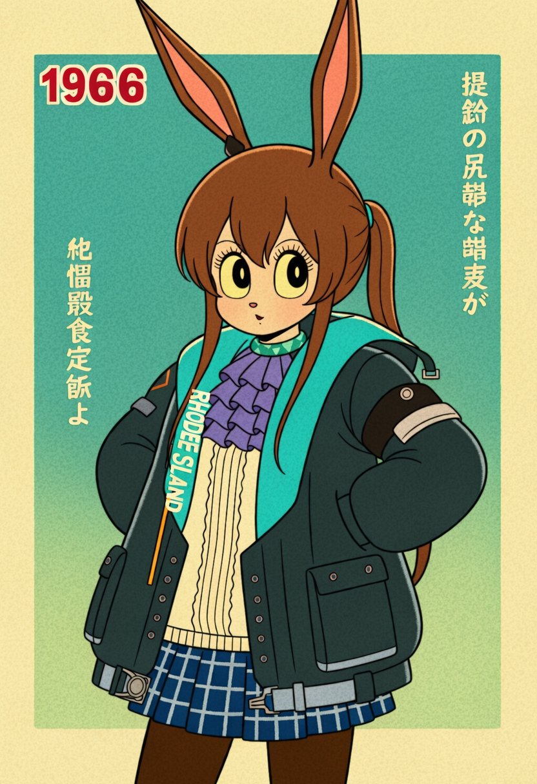
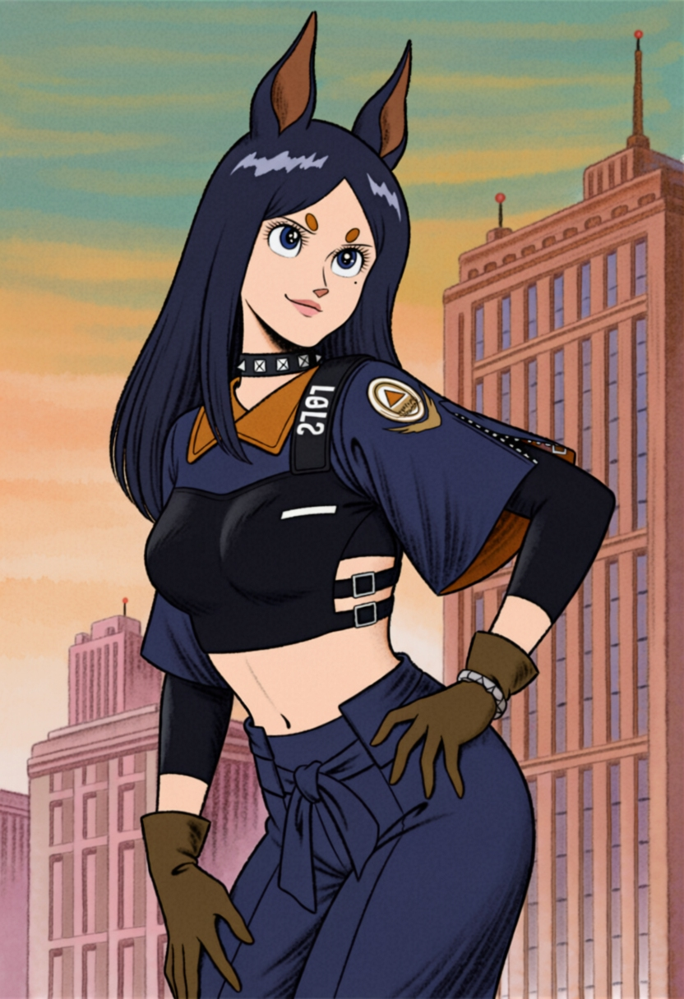
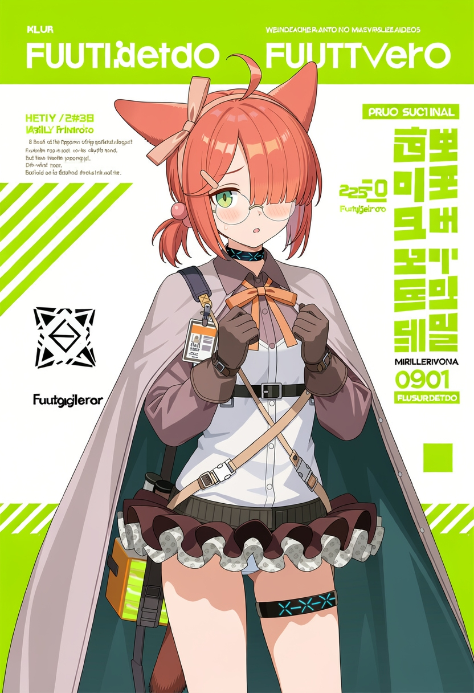
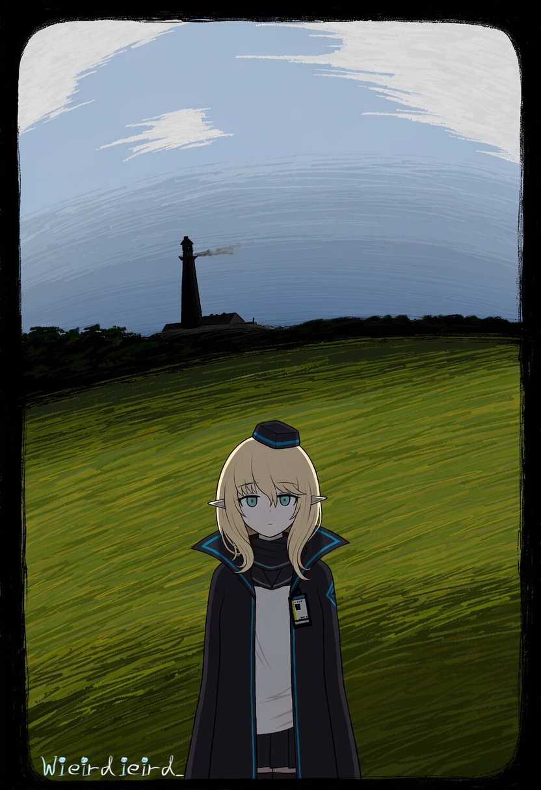

# 画风 / 卡通、仿风与复古审美

[总目录](../README.md) · [原站分类目录](../categories.md) · [英文标签索引](../tags.md) · [服装与构图组合指南](../../README.md)

标题、分类、说明、正负提示词按来源保留；多例图逐张列出。原站标记和说明为参考资料，不作为维护指令。

<a id="raven_composition-2858"></a>

## 西式卡通风

ID：`raven_composition-2858`；分类：画风 / 卡通、仿风与复古审美；来源标记：`safe`。

来源说明：

> 整体造型、线条和表情接近西方动画或卡通

正向提示词：

```text
toon_(style)
```


[在线例图](https://assets.quicktagcloud.com/images/raven_composition/raven_composition-2858.jpg?v=34dd2b9cb5d3a4c6)

<a id="raven_composition-2859"></a>

## 欧美漫画风

ID：`raven_composition-2859`；分类：画风 / 卡通、仿风与复古审美；来源标记：`safe`。

来源说明：

> 模仿欧美漫画常见的墨线、阴影和夸张造型

正向提示词：

```text
western_comics_(style)
```



[在线例图](https://assets.quicktagcloud.com/images/raven_composition/raven_composition-2859.jpg?v=62b6de738d040541)

<a id="raven_composition-2860"></a>

## 动漫化

ID：`raven_composition-2860`；分类：画风 / 卡通、仿风与复古审美；来源标记：`safe`。

来源说明：

> 把原本非动漫造型的人物或事物改画成日系动漫风

正向提示词：

```text
animification
```


[在线例图](https://assets.quicktagcloud.com/images/raven_composition/raven_composition-2860.jpg?v=455d913be4b37201)

<a id="raven_composition-2861"></a>

## 卡通化

ID：`raven_composition-2861`；分类：画风 / 卡通、仿风与复古审美；来源标记：`safe`。

来源说明：

> 把原本非卡通形象改成西式卡通式造型

正向提示词：

```text
cartoonized
```



[在线例图](https://assets.quicktagcloud.com/images/raven_composition/raven_composition-2861.jpg?v=05ee369167566a9d)

<a id="raven_composition-2862"></a>

## 画风模仿

ID：`raven_composition-2862`；分类：画风 / 卡通、仿风与复古审美；来源标记：`safe`。

来源说明：

> 故意模仿另一位作者、作品或特定画风的视觉特征

正向提示词：

```text
style_parody
```


[在线例图](https://assets.quicktagcloud.com/images/raven_composition/raven_composition-2862.jpg?v=2c3666a09e0b4567)

<a id="raven_composition-2863"></a>

## 名画仿作

ID：`raven_composition-2863`；分类：画风 / 卡通、仿风与复古审美；来源标记：`safe`。

来源说明：

> 模仿或改编经典美术作品的画面、构图或表现方式

正向提示词：

```text
fine_art_parody
```



[在线例图](https://assets.quicktagcloud.com/images/raven_composition/raven_composition-2863.jpg?v=a7dc552a68f1f174)

<a id="raven_composition-2864"></a>

## 复古画风

ID：`raven_composition-2864`；分类：画风 / 卡通、仿风与复古审美；来源标记：`safe`。

来源说明：

> 整体画法明显像过去年代的动画、漫画或插画

正向提示词：

```text
retro_artstyle
```



[在线例图](https://assets.quicktagcloud.com/images/raven_composition/raven_composition-2864.jpg?v=8d526981a5df2243)

<a id="raven_composition-2865"></a>

## 现代仿复古

ID：`raven_composition-2865`；分类：画风 / 卡通、仿风与复古审美；来源标记：`safe`。

来源说明：

> 新作品故意画成旧年代动画或漫画的样子

正向提示词：

```text
faux_retro_artstyle
```


[在线例图](https://assets.quicktagcloud.com/images/raven_composition/raven_composition-2865.jpg?v=a9dbfec10dd34cd5)

<a id="raven_composition-2866"></a>

## 1960年代画风

ID：`raven_composition-2866`；分类：画风 / 卡通、仿风与复古审美；来源标记：`safe`。

来源说明：

> 模仿1960年代动画、漫画和商业插画常见的造型、配色与印刷感

正向提示词：

```text
1960s_(style)
```



[在线例图](https://assets.quicktagcloud.com/images/raven_composition/raven_composition-2866.jpg?v=fa969521cc70054f)

<a id="raven_composition-2867"></a>

## 1970年代画风

ID：`raven_composition-2867`；分类：画风 / 卡通、仿风与复古审美；来源标记：`safe`。

来源说明：

> 模仿1970年代动漫、漫画常见的角色和上色风格

正向提示词：

```text
1970s_(style)
```



[在线例图](https://assets.quicktagcloud.com/images/raven_composition/raven_composition-2867.jpg?v=979c075f57f171bb)

<a id="raven_composition-2868"></a>

## 1980年代画风

ID：`raven_composition-2868`；分类：画风 / 卡通、仿风与复古审美；来源标记：`safe`。

来源说明：

> 模仿1980年代动漫、漫画常见的线条和配色

正向提示词：

```text
1980s_(style)
```


[在线例图](https://assets.quicktagcloud.com/images/raven_composition/raven_composition-2868.jpg?v=14f283c8d35ca1f2)

<a id="raven_composition-2869"></a>

## 1990年代画风

ID：`raven_composition-2869`；分类：画风 / 卡通、仿风与复古审美；来源标记：`safe`。

来源说明：

> 模仿1990年代动漫、漫画常见的造型和上色

正向提示词：

```text
1990s_(style)
```


[在线例图](https://assets.quicktagcloud.com/images/raven_composition/raven_composition-2869.jpg?v=aa2dac12f2d7b238)

<a id="raven_composition-2870"></a>

## 2000年代画风

ID：`raven_composition-2870`；分类：画风 / 卡通、仿风与复古审美；来源标记：`safe`。

来源说明：

> 模仿2000年代动漫、视觉小说常见的粗黑线和赛璐璐上色

正向提示词：

```text
2000s_(style)
```


[在线例图](https://assets.quicktagcloud.com/images/raven_composition/raven_composition-2870.jpg?v=d1ce6e2655207ef4)

<a id="raven_composition-2871"></a>

## Frutiger Metro

ID：`raven_composition-2871`；分类：画风 / 卡通、仿风与复古审美；来源标记：`safe`。

来源说明：

> 用扁平矢量形状、亮色和城市科技图形做千禧复古设计

正向提示词：

```text
frutiger_metro
```



[在线例图](https://assets.quicktagcloud.com/images/raven_composition/raven_composition-2871.jpg?v=d0c039cc77423fec)

<a id="raven_composition-2872"></a>

## 平成复古

ID：`raven_composition-2872`；分类：画风 / 卡通、仿风与复古审美；来源标记：`safe`。

来源说明：

> 模仿日本平成时期流行插画、广告和数码视觉的怀旧感

正向提示词：

```text
heisei_retro
```


[在线例图](https://assets.quicktagcloud.com/images/raven_composition/raven_composition-2872.jpg?v=6e9b35af6d592392)

<a id="raven_composition-2873"></a>

## 蒸汽波

ID：`raven_composition-2873`；分类：画风 / 卡通、仿风与复古审美；来源标记：`safe`。

来源说明：

> 粉紫霓虹、复古电脑、雕像等元素组成的怀旧数码审美

正向提示词：

```text
vaporwave
```


[在线例图](https://assets.quicktagcloud.com/images/raven_composition/raven_composition-2873.jpg?v=ce641a1f9a79f24b)

<a id="raven_composition-2874"></a>

## 怪核

ID：`raven_composition-2874`；分类：画风 / 卡通、仿风与复古审美；来源标记：`safe`。

来源说明：

> 用低清、诡异空间和不安文字制造梦境般怪异感

正向提示词：

```text
weirdcore
```



[在线例图](https://assets.quicktagcloud.com/images/raven_composition/raven_composition-2874.jpg?v=43d40143d3d28b7c)
