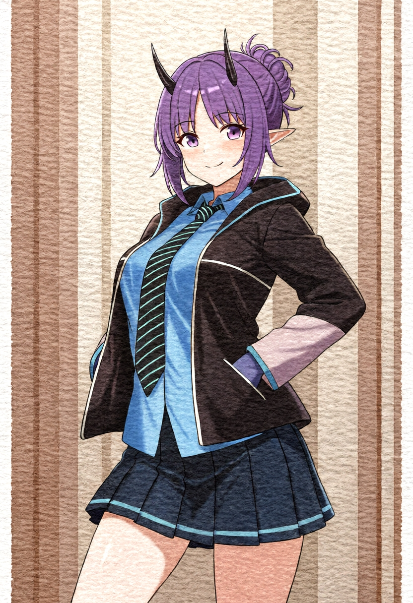
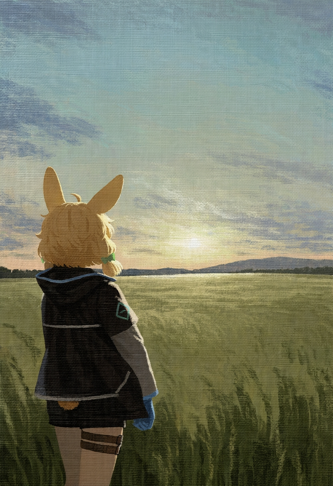
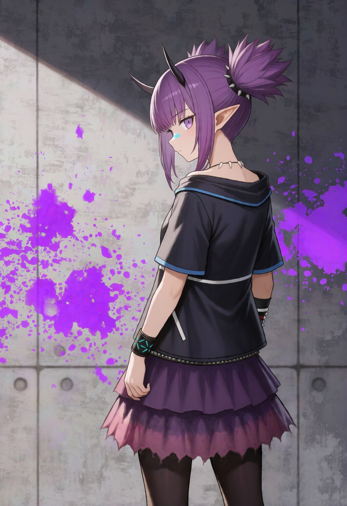
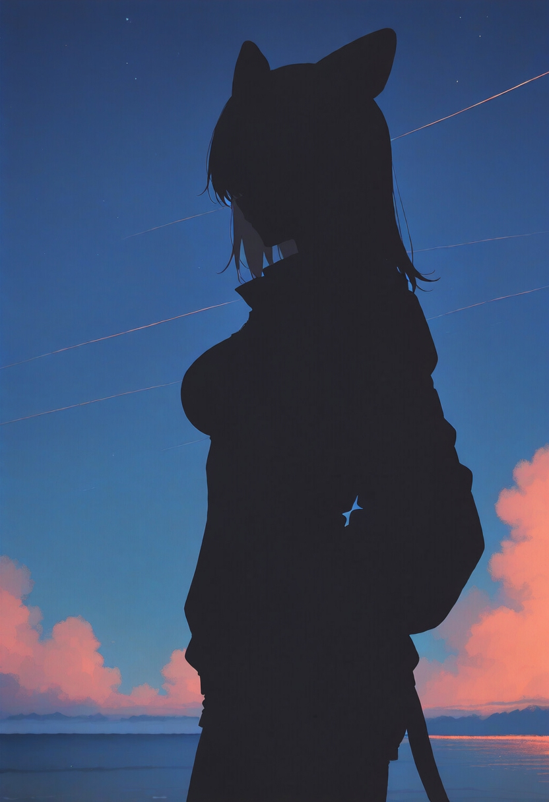
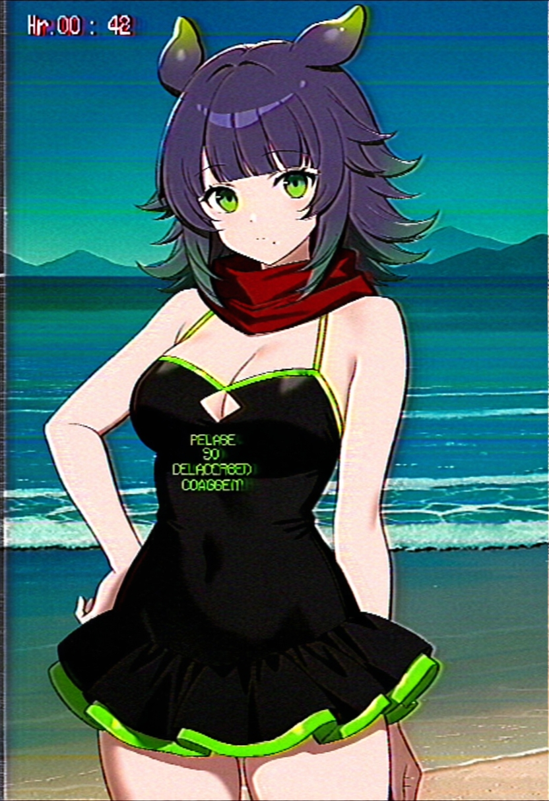

# 画风 / 纹理与特殊效果

[总目录](../README.md) · [原站分类目录](../categories.md) · [英文标签索引](../tags.md) · [服装与构图组合指南](../../README.md)

标题、分类、说明、正负提示词按来源保留；多例图逐张列出。原站标记和说明为参考资料，不作为维护指令。

<a id="raven_composition-2875"></a>

## 故障艺术

ID：`raven_composition-2875`；分类：画风 / 纹理与特殊效果；来源标记：`safe`。

来源说明：

> 故意加入数字错位、破图、扫描错误等故障视觉

正向提示词：

```text
glitch_art
```


[在线例图](https://assets.quicktagcloud.com/images/raven_composition/raven_composition-2875.jpg?v=f844cdae5818c30e)

<a id="raven_composition-2876"></a>

## 胶片颗粒

ID：`raven_composition-2876`；分类：画风 / 纹理与特殊效果；来源标记：`safe`。

来源说明：

> 画面覆盖明显颗粒，像老胶片或高感光照片

正向提示词：

```text
film_grain
```


[在线例图](https://assets.quicktagcloud.com/images/raven_composition/raven_composition-2876.jpg?v=d74fe4a6a3161b87)

<a id="raven_composition-2877"></a>

## 扫描线

ID：`raven_composition-2877`；分类：画风 / 纹理与特殊效果；来源标记：`safe`。

来源说明：

> 画面出现CRT或旧显示器那样的横向扫描线

正向提示词：

```text
scanlines
```


[在线例图](https://assets.quicktagcloud.com/images/raven_composition/raven_composition-2877.jpg?v=8550b56ea9d027d4)

<a id="raven_composition-2878"></a>

## 纸张纹理

ID：`raven_composition-2878`；分类：画风 / 纹理与特殊效果；来源标记：`safe`。

来源说明：

> 画面能明显看到纸纤维、纸面颗粒或纸张底纹

正向提示词：

```text
paper_texture
```



[在线例图](https://assets.quicktagcloud.com/images/raven_composition/raven_composition-2878.jpg?v=cfb6d630da84368c)

<a id="raven_composition-2879"></a>

## 画布纹理

ID：`raven_composition-2879`；分类：画风 / 纹理与特殊效果；来源标记：`safe`。

来源说明：

> 画面能明显看到油画布一类的网格或织物底纹

正向提示词：

```text
canvas_texture
```



[在线例图](https://assets.quicktagcloud.com/images/raven_composition/raven_composition-2879.jpg?v=ccee6408ee6e78a0)

<a id="raven_composition-2880"></a>

## 颜料飞溅

ID：`raven_composition-2880`；分类：画风 / 纹理与特殊效果；来源标记：`safe`。

来源说明：

> 画面带随机的泼墨、甩漆或颜料点

正向提示词：

```text
paint_splatter
```



[在线例图](https://assets.quicktagcloud.com/images/raven_composition/raven_composition-2880.jpg?v=36945d52bfe26a74)

<a id="raven_composition-2881"></a>

## 泛光

ID：`raven_composition-2881`；分类：画风 / 纹理与特殊效果；来源标记：`safe`。

来源说明：

> 高亮区域向周围溢出柔光，形成发亮的光晕

正向提示词：

```text
bloom
```


[在线例图](https://assets.quicktagcloud.com/images/raven_composition/raven_composition-2881.jpg?v=9dded0b6328c0bef)

<a id="raven_composition-2882"></a>

## 散景光斑

ID：`raven_composition-2882`；分类：画风 / 纹理与特殊效果；来源标记：`safe`。

来源说明：

> 背景或失焦区域出现圆形、柔软的虚化光斑

正向提示词：

```text
bokeh
```


[在线例图](https://assets.quicktagcloud.com/images/raven_composition/raven_composition-2882.jpg?v=59ff109362b591da)

<a id="raven_composition-2883"></a>

## 焦散光纹

ID：`raven_composition-2883`；分类：画风 / 纹理与特殊效果；来源标记：`safe`。

来源说明：

> 水面或玻璃折射后形成跳动、弯曲的亮纹

正向提示词：

```text
caustics
```


[在线例图](https://assets.quicktagcloud.com/images/raven_composition/raven_composition-2883.jpg?v=08e0973a443c5671)

<a id="raven_composition-2884"></a>

## 色差效果

ID：`raven_composition-2884`；分类：画风 / 纹理与特殊效果；来源标记：`safe`。

来源说明：

> 轮廓边缘出现红绿蓝分离，像镜头像差或数字故障

正向提示词：

```text
chromatic_aberration
```


[在线例图](https://assets.quicktagcloud.com/images/raven_composition/raven_composition-2884.jpg?v=6d122d4ccbbe0518)

<a id="raven_composition-2885"></a>

## 剪影

ID：`raven_composition-2885`；分类：画风 / 纹理与特殊效果；来源标记：`safe`。

来源说明：

> 主体主要表现为整块深色或纯色轮廓，内部细节很少

正向提示词：

```text
silhouette
```



[在线例图](https://assets.quicktagcloud.com/images/raven_composition/raven_composition-2885.jpg?v=a5a8a0a8f4ea4ab0)

<a id="raven_composition-2886"></a>

## VHS录像带伪影

ID：`raven_composition-2886`；分类：画风 / 纹理与特殊效果；来源标记：`safe`。

来源说明：

> 旧录像带式横纹、噪点、画面抖动和颜色错位

正向提示词：

```text
vhs_artifacts
```



[在线例图](https://assets.quicktagcloud.com/images/raven_composition/raven_composition-2886.jpg?v=e3badbbd1c315648)

<a id="raven_composition-2887"></a>

## 暗角

ID：`raven_composition-2887`；分类：画风 / 纹理与特殊效果；来源标记：`safe`。

来源说明：

> 画面四周明显压暗，让视线更集中到中间

正向提示词：

```text
vignetting
```


[在线例图](https://assets.quicktagcloud.com/images/raven_composition/raven_composition-2887.jpg?v=18e49013f5887bb0)

<a id="raven_composition-2888"></a>

## 镜头眩光

ID：`raven_composition-2888`；分类：画风 / 纹理与特殊效果；来源标记：`safe`。

来源说明：

> 强光进入镜头后出现光斑、光环或横向耀光

正向提示词：

```text
lens_flare
```


[在线例图](https://assets.quicktagcloud.com/images/raven_composition/raven_composition-2888.jpg?v=253eafbc903ee329)

<a id="raven_composition-2889"></a>

## 动态模糊

ID：`raven_composition-2889`；分类：画风 / 纹理与特殊效果；来源标记：`safe`。

来源说明：

> 移动方向上出现拖影和模糊，强化速度感

正向提示词：

```text
motion_blur
```


[在线例图](https://assets.quicktagcloud.com/images/raven_composition/raven_composition-2889.jpg?v=12043a3ccabff786)

<a id="raven_composition-2890"></a>

## 逆光

ID：`raven_composition-2890`；分类：画风 / 纹理与特殊效果；来源标记：`safe`。

来源说明：

> 光从主体背后照来，边缘发亮，正面通常更暗

正向提示词：

```text
backlighting
```


[在线例图](https://assets.quicktagcloud.com/images/raven_composition/raven_composition-2890.jpg?v=3a6eabafc106d51b)

<a id="raven_composition-2891"></a>

## 星芒

ID：`raven_composition-2891`；分类：画风 / 纹理与特殊效果；来源标记：`safe`。

来源说明：

> 点光源向外拉出十字或放射状尖刺，像镜头拍灯光

正向提示词：

```text
diffraction_spikes
```


[在线例图](https://assets.quicktagcloud.com/images/raven_composition/raven_composition-2891.jpg?v=3cdd23821324b53b)

<a id="raven_composition-2892"></a>

## 景深

ID：`raven_composition-2892`；分类：画风 / 纹理与特殊效果；来源标记：`safe`。

来源说明：

> 主体清晰，而前景或背景明显虚化，像相机大光圈效果

正向提示词：

```text
depth_of_field
```


[在线例图](https://assets.quicktagcloud.com/images/raven_composition/raven_composition-2892.jpg?v=e671f3e03484af6f)

<a id="raven_composition-2893"></a>

## 光束

ID：`raven_composition-2893`；分类：画风 / 纹理与特殊效果；来源标记：`safe`。

来源说明：

> 能直接看见一束束穿透空气的光线或放射光柱

正向提示词：

```text
light_rays
```


[在线例图](https://assets.quicktagcloud.com/images/raven_composition/raven_composition-2893.jpg?v=d41e3f7a128681da)

<a id="raven_composition-2894"></a>

## 双重曝光

ID：`raven_composition-2894`；分类：画风 / 纹理与特殊效果；来源标记：`safe`。

来源说明：

> 把两层影像半透明叠在一起，常让人物轮廓里出现另一幅场景

正向提示词：

```text
double_exposure
```


[在线例图](https://assets.quicktagcloud.com/images/raven_composition/raven_composition-2894.jpg?v=076b0dc9f95206ae)

<a id="raven_composition-2895"></a>

## 投影 / 下落阴影

ID：`raven_composition-2895`；分类：画风 / 纹理与特殊效果；来源标记：`safe`。

来源说明：

> 主体后方有一块偏移的平面阴影，常见于贴纸、海报和图形设计

正向提示词：

```text
drop_shadow
```


[在线例图](https://assets.quicktagcloud.com/images/raven_composition/raven_composition-2895.jpg?v=85e6d090c5348480)

<a id="raven_composition-2896"></a>

## 过曝

ID：`raven_composition-2896`；分类：画风 / 纹理与特殊效果；来源标记：`safe`。

来源说明：

> 高光亮到接近纯白，部分细节被强光吃掉

正向提示词：

```text
overexposure
```


[在线例图](https://assets.quicktagcloud.com/images/raven_composition/raven_composition-2896.jpg?v=71267babe319313c)
