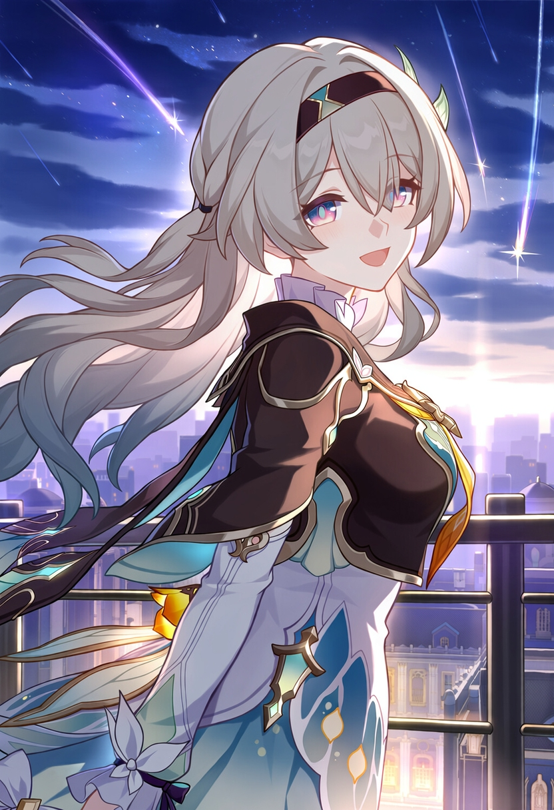

# 画风 / up喜欢

[总目录](../README.md) · [原站分类目录](../categories.md) · [英文标签索引](../tags.md) · [服装与构图组合指南](../../README.md)

标题、分类、说明、正负提示词按来源保留；多例图逐张列出。原站标记和说明为参考资料，不作为维护指令。

<a id="raven_composition-2897"></a>

## 星穹铁道画风

ID：`raven_composition-2897`；分类：画风 / up喜欢；来源标记：`safe`。

来源说明：

> 第一个tag为星铁的名字，更换为其他ip的tag可以模仿其他游戏的画风

正向提示词：

```text
honkai:star_rail,official_art,game_cg
```



[在线例图](https://assets.quicktagcloud.com/images/raven_composition/raven_composition-2897.jpg?v=4094b390a7197076)
