# 面部配饰 / 眼镜/护目镜

[总目录](../README.md) · [原站分类目录](../categories.md) · [英文标签索引](../tags.md) · [服装与构图组合指南](../../README.md)

标题、分类、说明、正负提示词按来源保留；多例图逐张列出。原站标记和说明为参考资料，不作为维护指令。

<a id="raven_composition-2898"></a>

## 眼镜

ID：`raven_composition-2898`；分类：面部配饰 / 眼镜/护目镜；来源标记：`safe`。

来源说明：

> 普通双镜片眼镜。

正向提示词：

```text
glasses
```


[在线例图](https://assets.quicktagcloud.com/images/raven_composition/raven_composition-2898.jpg?v=3e988a2d96de09a9)

<a id="raven_composition-2899"></a>

## 黑框眼镜

ID：`raven_composition-2899`；分类：面部配饰 / 眼镜/护目镜；来源标记：`safe`。

来源说明：

> 黑色镜框；纯颜色镜框只留这一种代表。

正向提示词：

```text
black-framed_eyewear
```


[在线例图](https://assets.quicktagcloud.com/images/raven_composition/raven_composition-2899.jpg?v=5302cb3101ee01ff)

<a id="raven_composition-2900"></a>

## 双色眼镜

ID：`raven_composition-2900`；分类：面部配饰 / 眼镜/护目镜；来源标记：`safe`。

来源说明：

> 镜框或眼镜主体有两种主要颜色。

正向提示词：

```text
two-tone_eyewear
```

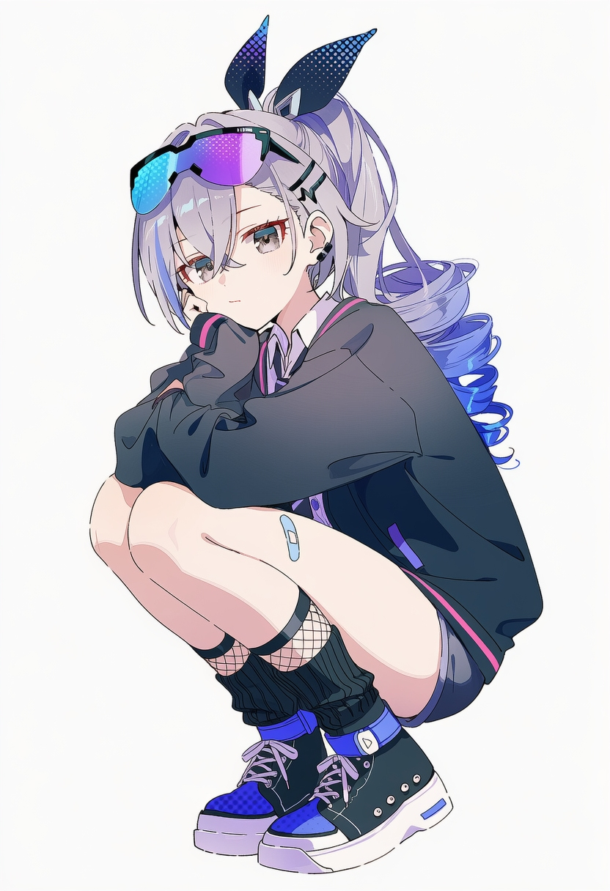

[在线例图](https://assets.quicktagcloud.com/images/raven_composition/raven_composition-2900.jpg?v=47a869b244811767)

<a id="raven_composition-2901"></a>

## 染色镜片眼镜

ID：`raven_composition-2901`；分类：面部配饰 / 眼镜/护目镜；来源标记：`safe`。

来源说明：

> 镜片带明显颜色，但不一定是太阳镜。

正向提示词：

```text
tinted_eyewear
```

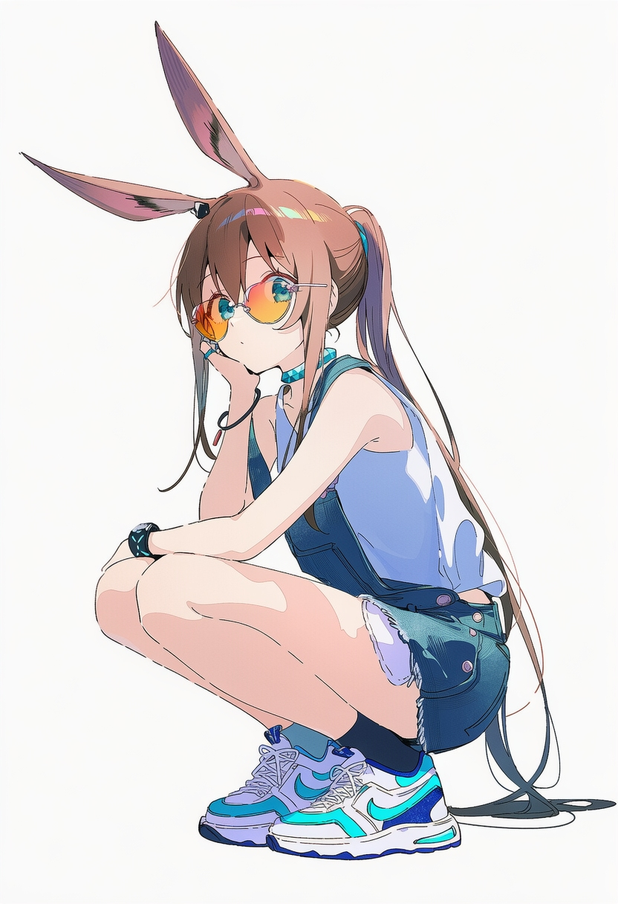

[在线例图](https://assets.quicktagcloud.com/images/raven_composition/raven_composition-2901.jpg?v=c8f8053c3db7d589)

<a id="raven_composition-2902"></a>

## 渐变镜片

ID：`raven_composition-2902`；分类：面部配饰 / 眼镜/护目镜；来源标记：`safe`。

来源说明：

> 镜片颜色呈渐变效果。

正向提示词：

```text
gradient-tinted_eyewear
```


[在线例图](https://assets.quicktagcloud.com/images/raven_composition/raven_composition-2902.jpg?v=5e51659cb299522b)

<a id="raven_composition-2903"></a>

## 多色镜片

ID：`raven_composition-2903`；分类：面部配饰 / 眼镜/护目镜；来源标记：`safe`。

来源说明：

> 镜片同时带多种颜色。

正向提示词：

```text
multicolor-tinted_eyewear
```

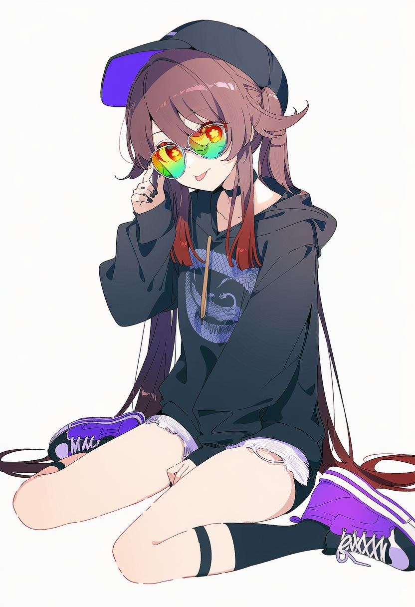

[在线例图](https://assets.quicktagcloud.com/images/raven_composition/raven_composition-2903.jpg?v=c01078a44f3f37a9)

<a id="raven_composition-2904"></a>

## 彩虹镜片

ID：`raven_composition-2904`；分类：面部配饰 / 眼镜/护目镜；来源标记：`safe`。

来源说明：

> 镜片呈彩虹式多色效果。

正向提示词：

```text
rainbow-tinted_eyewear
```

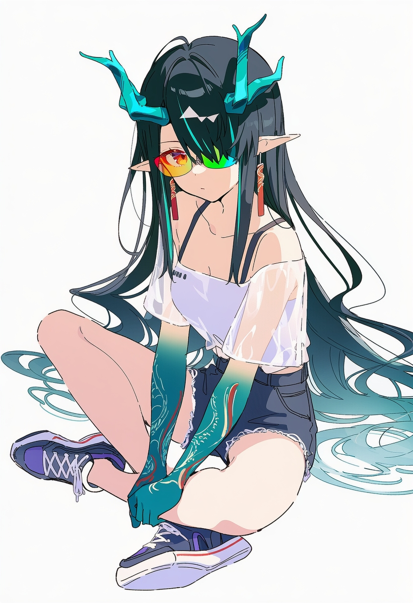

[在线例图](https://assets.quicktagcloud.com/images/raven_composition/raven_composition-2904.jpg?v=f174e5a1c4e2878c)

<a id="raven_composition-2905"></a>

## 圆框眼镜

ID：`raven_composition-2905`；分类：面部配饰 / 眼镜/护目镜；来源标记：`safe`。

来源说明：

> 镜片或镜框明显呈圆形。

正向提示词：

```text
round_eyewear
```


[在线例图](https://assets.quicktagcloud.com/images/raven_composition/raven_composition-2905.jpg?v=f6e486c75da28bee)

<a id="raven_composition-2906"></a>

## 方框眼镜

ID：`raven_composition-2906`；分类：面部配饰 / 眼镜/护目镜；来源标记：`safe`。

来源说明：

> 镜片或镜框呈矩形。

正向提示词：

```text
rectangular_eyewear
```

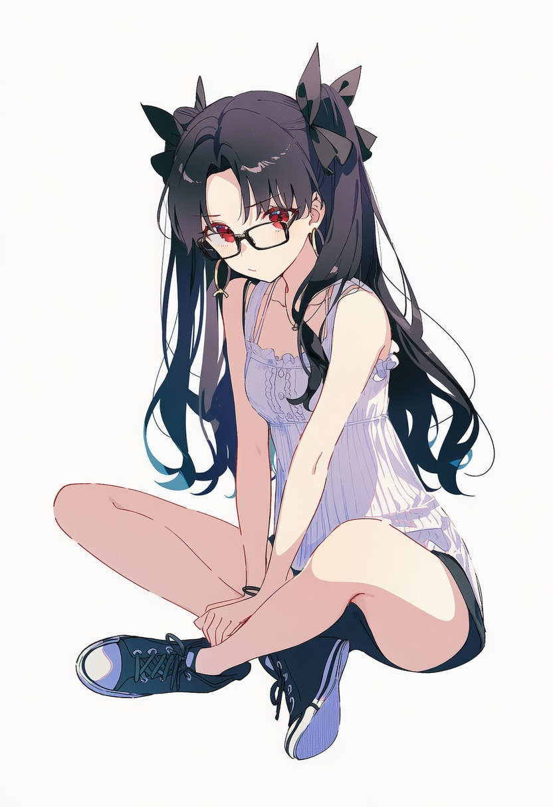

[在线例图](https://assets.quicktagcloud.com/images/raven_composition/raven_composition-2906.jpg?v=1f516564f6ae6ace)

<a id="raven_composition-2907"></a>

## 半圆框眼镜

ID：`raven_composition-2907`；分类：面部配饰 / 眼镜/护目镜；来源标记：`safe`。

来源说明：

> 镜框或镜片呈明显半圆形。

正向提示词：

```text
semi-circular_eyewear
```

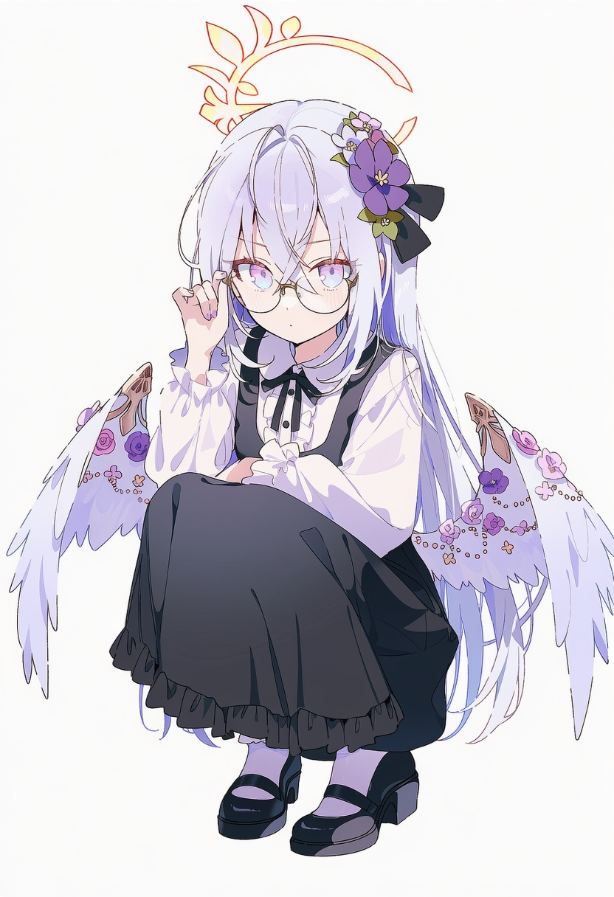

[在线例图](https://assets.quicktagcloud.com/images/raven_composition/raven_composition-2907.jpg?v=44c4a859d82cca84)

<a id="raven_composition-2908"></a>

## 无框眼镜

ID：`raven_composition-2908`；分类：面部配饰 / 眼镜/护目镜；来源标记：`safe`。

来源说明：

> 镜片周围没有完整镜框。

正向提示词：

```text
rimless_eyewear
```


[在线例图](https://assets.quicktagcloud.com/images/raven_composition/raven_composition-2908.jpg?v=ae3540f1a9ef858a)

<a id="raven_composition-2909"></a>

## 半框眼镜

ID：`raven_composition-2909`；分类：面部配饰 / 眼镜/护目镜；来源标记：`safe`。

来源说明：

> 镜片只有部分边缘有镜框。

正向提示词：

```text
semi-rimless_eyewear
```


[在线例图](https://assets.quicktagcloud.com/images/raven_composition/raven_composition-2909.jpg?v=9b3b0c282e210e42)

<a id="raven_composition-2910"></a>

## 上半框眼镜

ID：`raven_composition-2910`；分类：面部配饰 / 眼镜/护目镜；来源标记：`safe`。

来源说明：

> 镜框主要集中在镜片上缘。

正向提示词：

```text
over-rim_eyewear
```

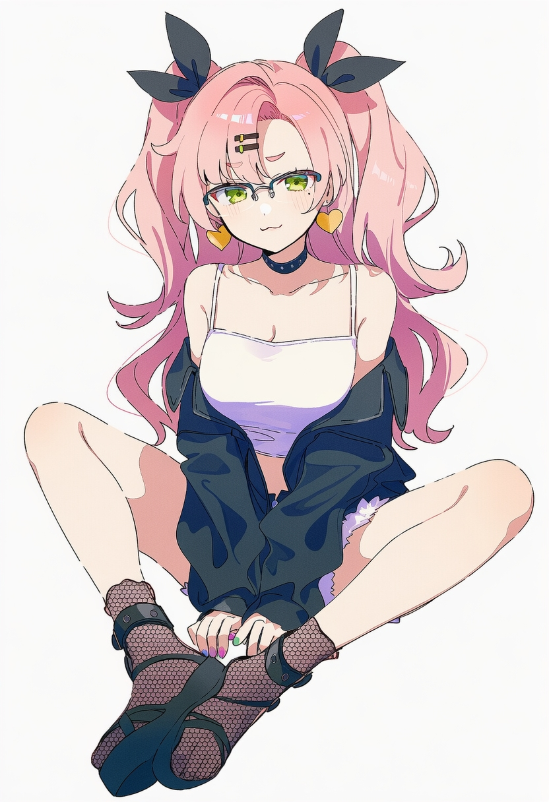

[在线例图](https://assets.quicktagcloud.com/images/raven_composition/raven_composition-2910.jpg?v=1d627e55b2629aa1)

<a id="raven_composition-2911"></a>

## 下半框眼镜

ID：`raven_composition-2911`；分类：面部配饰 / 眼镜/护目镜；来源标记：`safe`。

来源说明：

> 镜框主要集中在镜片下缘。

正向提示词：

```text
under-rim_eyewear
```

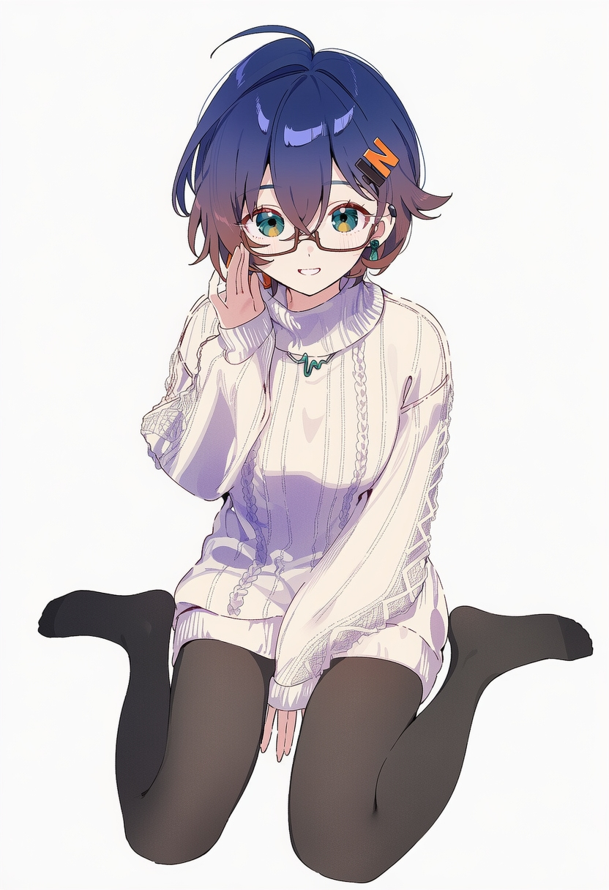

[在线例图](https://assets.quicktagcloud.com/images/raven_composition/raven_composition-2911.jpg?v=5f1f5809ef7b1fd5)

<a id="raven_composition-2912"></a>

## 猫眼框眼镜

ID：`raven_composition-2912`；分类：面部配饰 / 眼镜/护目镜；来源标记：`safe`。

来源说明：

> 外眼角上翘的猫眼形镜框。

正向提示词：

```text
cat_eye-framed_eyewear
```


[在线例图](https://assets.quicktagcloud.com/images/raven_composition/raven_composition-2912.jpg?v=713b0293906fb8cf)

<a id="raven_composition-2913"></a>

## 爱心眼镜

ID：`raven_composition-2913`；分类：面部配饰 / 眼镜/护目镜；来源标记：`safe`。

来源说明：

> 爱心形镜框或镜片。

正向提示词：

```text
heart-shaped_eyewear
```

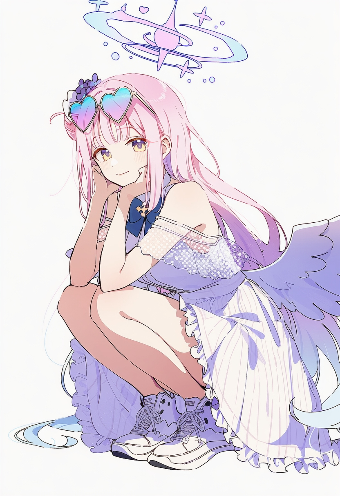

[在线例图](https://assets.quicktagcloud.com/images/raven_composition/raven_composition-2913.jpg?v=9ae09615f095a291)

<a id="raven_composition-2914"></a>

## 三角眼镜

ID：`raven_composition-2914`；分类：面部配饰 / 眼镜/护目镜；来源标记：`safe`。

来源说明：

> 三角形镜框或镜片。

正向提示词：

```text
triangular_eyewear
```


[在线例图](https://assets.quicktagcloud.com/images/raven_composition/raven_composition-2914.jpg?v=37d81f779d697e14)

<a id="raven_composition-2915"></a>

## 玳瑁纹眼镜

ID：`raven_composition-2915`；分类：面部配饰 / 眼镜/护目镜；来源标记：`safe`。

来源说明：

> 带玳瑁纹理的镜框。

正向提示词：

```text
tortoiseshell-framed_eyewear
```

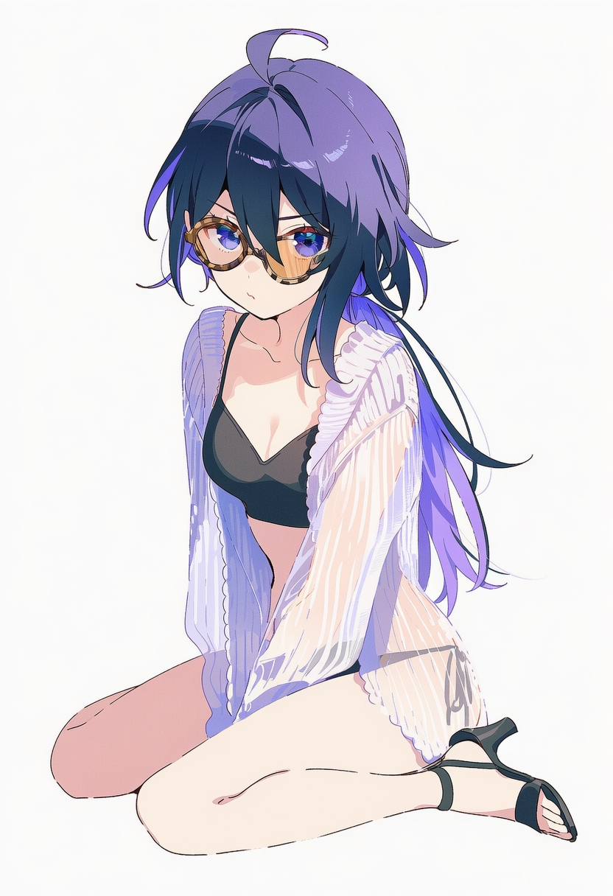

[在线例图](https://assets.quicktagcloud.com/images/raven_composition/raven_composition-2915.jpg?v=464fb1bed6e14726)

<a id="raven_composition-2916"></a>

## 动物主题眼镜

ID：`raven_composition-2916`；分类：面部配饰 / 眼镜/护目镜；来源标记：`safe`。

来源说明：

> 带动物造型或动物元素的眼镜。

正向提示词：

```text
animal-themed_eyewear
```

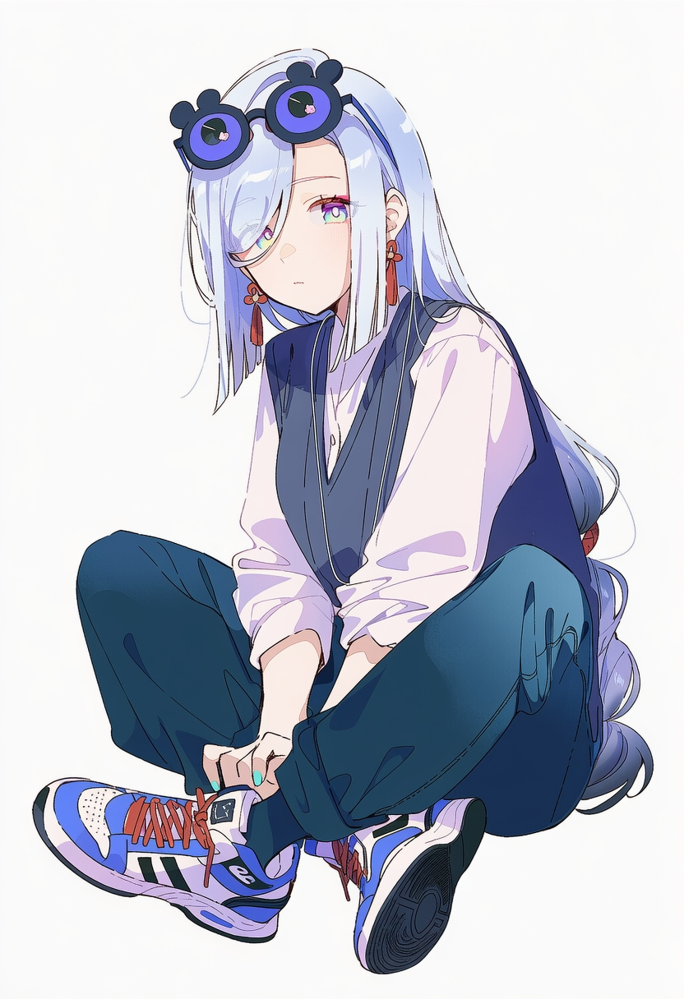

[在线例图](https://assets.quicktagcloud.com/images/raven_composition/raven_composition-2916.jpg?v=1aded15a8d34b1ab)

<a id="raven_composition-2917"></a>

## 食物主题眼镜

ID：`raven_composition-2917`；分类：面部配饰 / 眼镜/护目镜；来源标记：`safe`。

来源说明：

> 带食物造型或食物元素的眼镜。

正向提示词：

```text
food-themed_eyewear
```

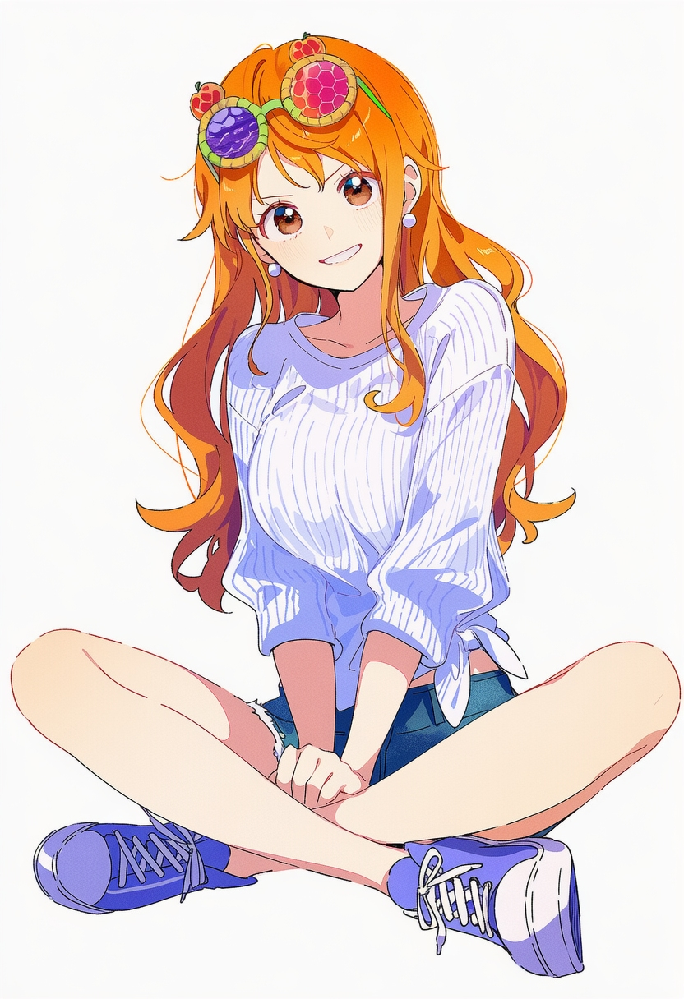

[在线例图](https://assets.quicktagcloud.com/images/raven_composition/raven_composition-2917.jpg?v=9cad759356204195)

<a id="raven_composition-2918"></a>

## 水滴框眼镜

ID：`raven_composition-2918`；分类：面部配饰 / 眼镜/护目镜；来源标记：`safe`。

来源说明：

> 镜框呈水滴或泪滴形。

正向提示词：

```text
teardrop-framed_glasses
```


[在线例图](https://assets.quicktagcloud.com/images/raven_composition/raven_composition-2918.jpg?v=2c2b1c192043257a)

<a id="raven_composition-2919"></a>

## 3D眼镜

ID：`raven_composition-2919`；分类：面部配饰 / 眼镜/护目镜；来源标记：`safe`。

来源说明：

> 观看立体影像使用的3D眼镜。

正向提示词：

```text
3d_glasses
```

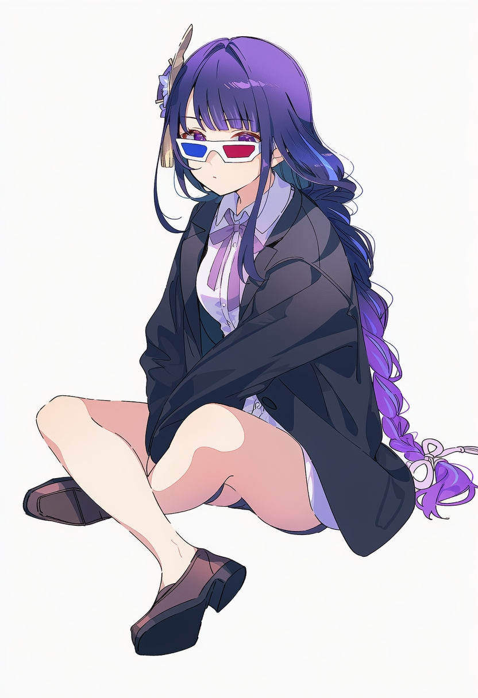

[在线例图](https://assets.quicktagcloud.com/images/raven_composition/raven_composition-2919.jpg?v=606b17ca2d5597cf)

<a id="raven_composition-2920"></a>

## 飞行员框眼镜

ID：`raven_composition-2920`；分类：面部配饰 / 眼镜/护目镜；来源标记：`safe`。

来源说明：

> 飞行员镜框造型的普通眼镜。

正向提示词：

```text
aviator_glasses
```

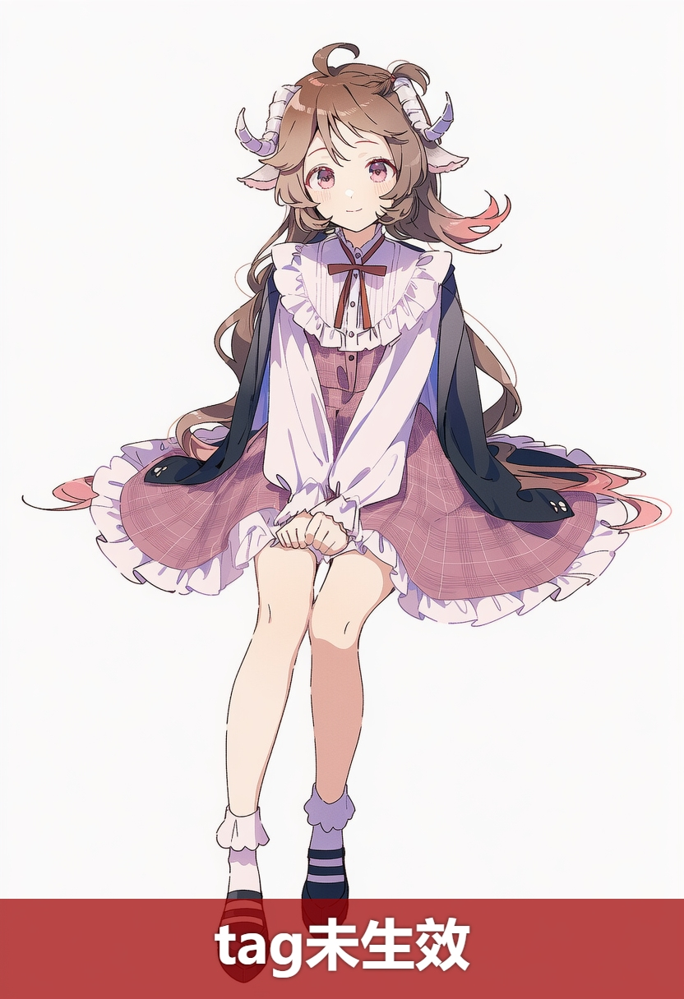

[在线例图](https://assets.quicktagcloud.com/images/raven_composition/raven_composition-2920.jpg?v=cd34676c08074f6d)

<a id="raven_composition-2921"></a>

## 厚底眼镜

ID：`raven_composition-2921`；分类：面部配饰 / 眼镜/护目镜；来源标记：`safe`。

来源说明：

> 镜片非常厚的高度数眼镜。

正向提示词：

```text
coke-bottle_glasses
```

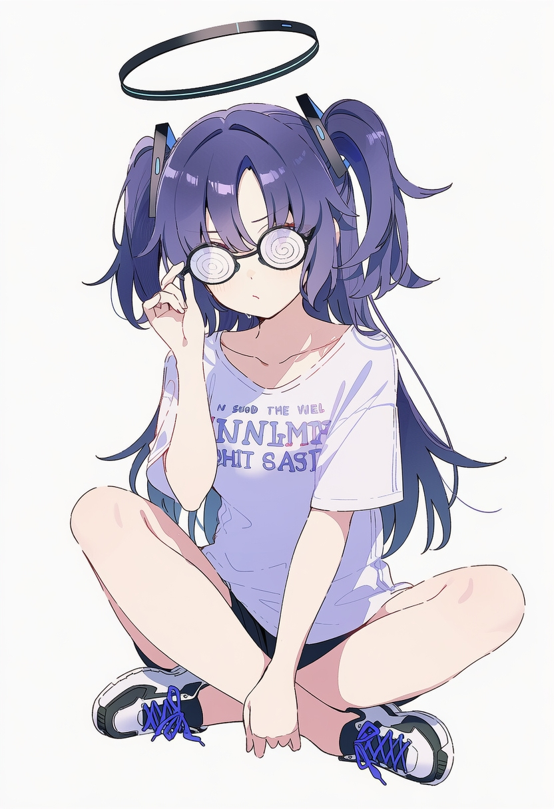

[在线例图](https://assets.quicktagcloud.com/images/raven_composition/raven_composition-2921.jpg?v=43e74dfccec07c07)

<a id="raven_composition-2922"></a>

## 趣味眼镜

ID：`raven_composition-2922`；分类：面部配饰 / 眼镜/护目镜；来源标记：`safe`。

来源说明：

> 造型夸张或搞怪的装饰眼镜。

正向提示词：

```text
novelty_glasses
```

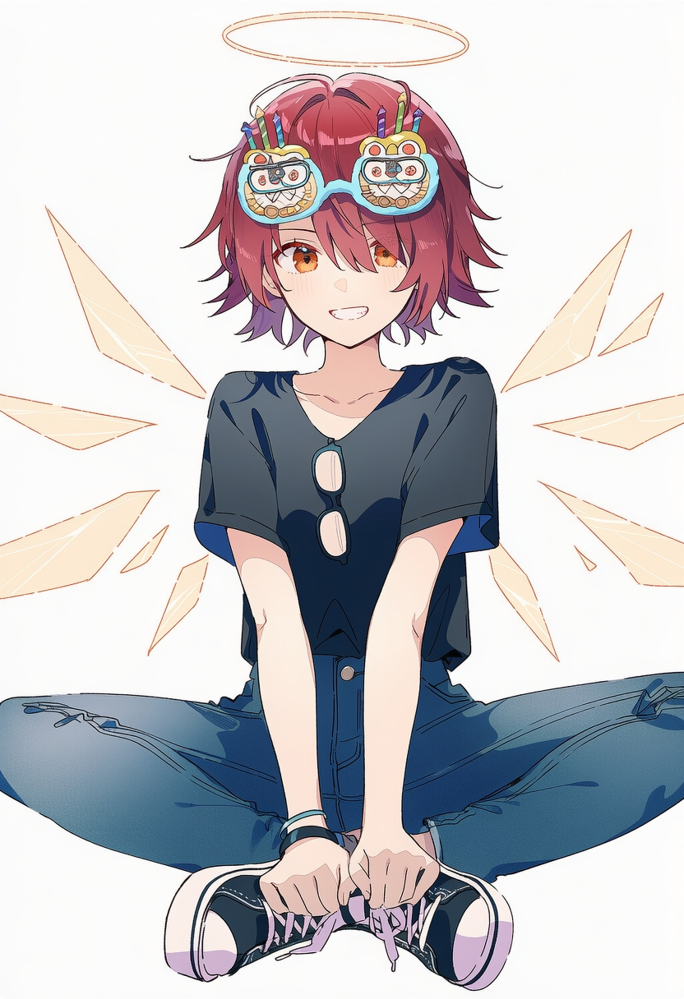

[在线例图](https://assets.quicktagcloud.com/images/raven_composition/raven_composition-2922.jpg?v=0eb8140ae27c52cd)

<a id="raven_composition-2923"></a>

## 星形眼镜

ID：`raven_composition-2923`；分类：面部配饰 / 眼镜/护目镜；来源标记：`safe`。

来源说明：

> 星星形镜框或镜片。

正向提示词：

```text
star-shaped_eyewear
```

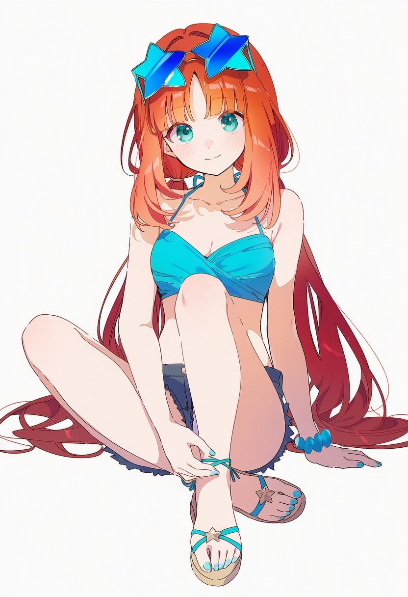

[在线例图](https://assets.quicktagcloud.com/images/raven_composition/raven_composition-2923.jpg?v=42bbb464ab4ffb25)

<a id="raven_composition-2924"></a>

## 搞怪伪装眼镜

ID：`raven_composition-2924`；分类：面部配饰 / 眼镜/护目镜；来源标记：`safe`。

来源说明：

> 带假鼻子、眉毛等的搞怪眼镜。

正向提示词：

```text
groucho_glasses
```

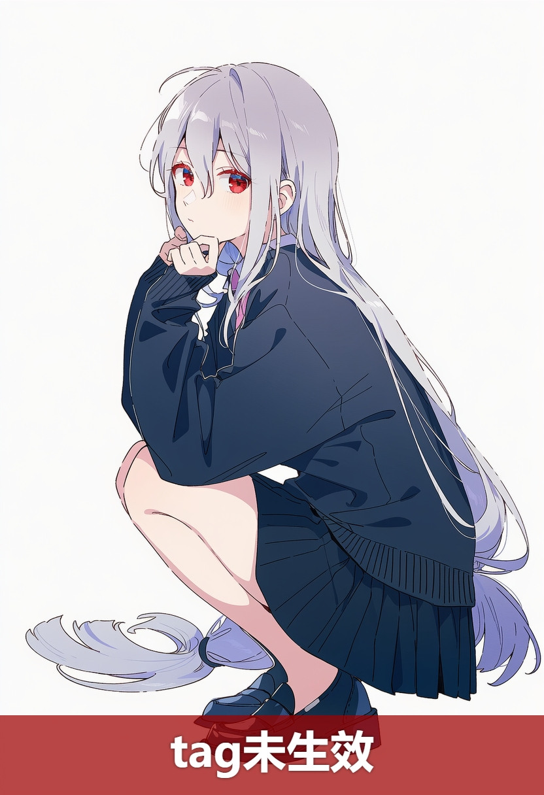

[在线例图](https://assets.quicktagcloud.com/images/raven_composition/raven_composition-2924.jpg?v=9b18bada4efabac3)

<a id="raven_composition-2925"></a>

## 手柄眼镜

ID：`raven_composition-2925`；分类：面部配饰 / 眼镜/护目镜；来源标记：`safe`。

来源说明：

> 带手柄、拿在眼前使用的眼镜。

正向提示词：

```text
lorgnette
```


[在线例图](https://assets.quicktagcloud.com/images/raven_composition/raven_composition-2925.jpg?v=591d68c1295b6e69)

<a id="raven_composition-2926"></a>

## 不透明眼镜

ID：`raven_composition-2926`；分类：面部配饰 / 眼镜/护目镜；来源标记：`safe`。

来源说明：

> 镜片不透明，看不到眼睛。

正向提示词：

```text
opaque_glasses
```

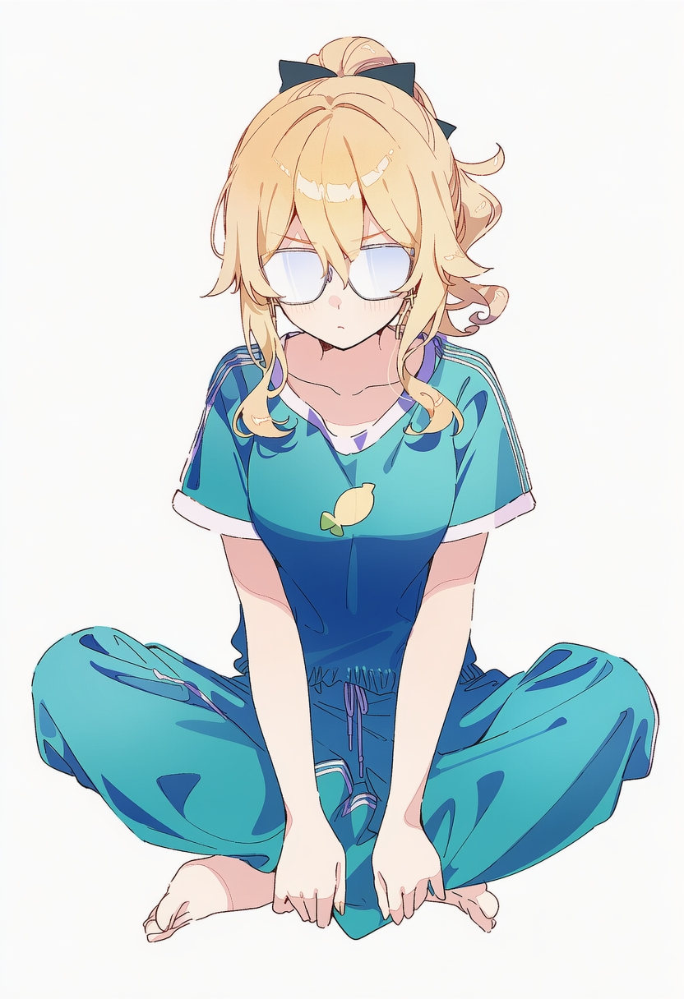

[在线例图](https://assets.quicktagcloud.com/images/raven_composition/raven_composition-2926.jpg?v=b6dd518986c21628)

<a id="raven_composition-2927"></a>

## 夹鼻眼镜

ID：`raven_composition-2927`；分类：面部配饰 / 眼镜/护目镜；来源标记：`safe`。

来源说明：

> 没有镜腿、直接夹在鼻梁上的眼镜。

正向提示词：

```text
pince-nez
```

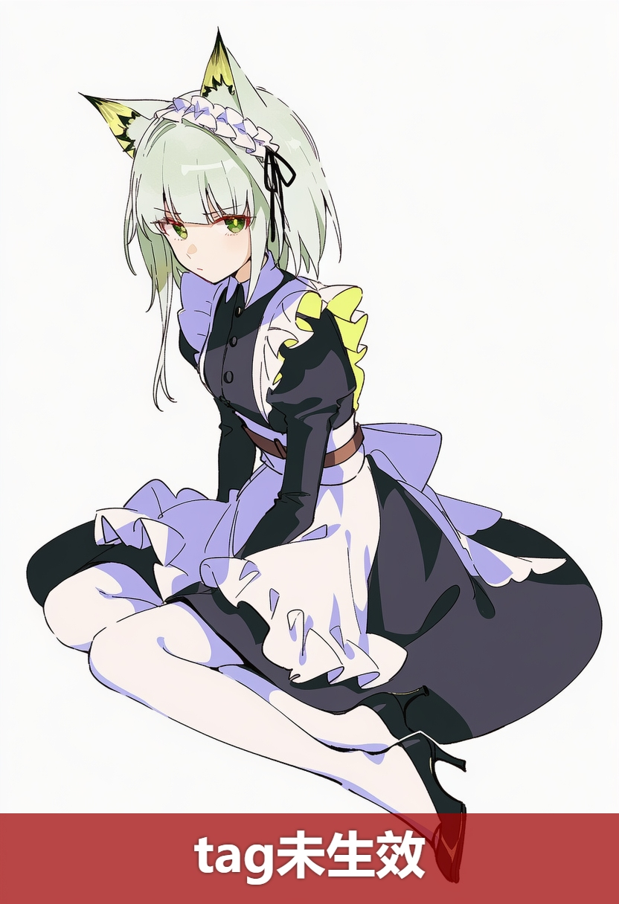

[在线例图](https://assets.quicktagcloud.com/images/raven_composition/raven_composition-2927.jpg?v=52f74220e16b8f81)

<a id="raven_composition-2928"></a>

## 护目安全眼镜

ID：`raven_composition-2928`；分类：面部配饰 / 眼镜/护目镜；来源标记：`safe`。

来源说明：

> 实验或工作防护用的透明眼镜。

正向提示词：

```text
safety_glasses
```


[在线例图](https://assets.quicktagcloud.com/images/raven_composition/raven_composition-2928.jpg?v=f4d02e55865e253f)

<a id="raven_composition-2929"></a>

## 护目镜

ID：`raven_composition-2929`；分类：面部配饰 / 眼镜/护目镜；来源标记：`safe`。

来源说明：

> 贴合眼部的防护型护目镜。

正向提示词：

```text
goggles
```


[在线例图](https://assets.quicktagcloud.com/images/raven_composition/raven_composition-2929.jpg?v=0584023ee43f41fc)

<a id="raven_composition-2930"></a>

## 飞行护目镜

ID：`raven_composition-2930`；分类：面部配饰 / 眼镜/护目镜；来源标记：`safe`。

来源说明：

> 老式飞行员常见的护目镜。

正向提示词：

```text
aviator_goggles
```

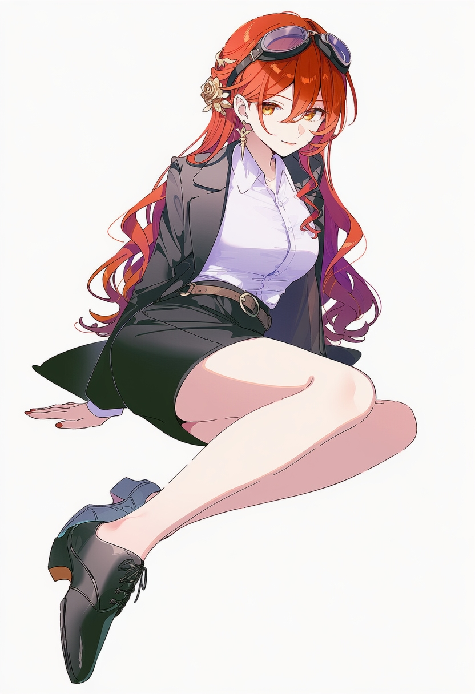

[在线例图](https://assets.quicktagcloud.com/images/raven_composition/raven_composition-2930.jpg?v=955b2a36391e501e)

<a id="raven_composition-2931"></a>

## 滑雪镜

ID：`raven_composition-2931`；分类：面部配饰 / 眼镜/护目镜；来源标记：`safe`。

来源说明：

> 覆盖眼周的大型滑雪护目镜。

正向提示词：

```text
ski_goggles
```

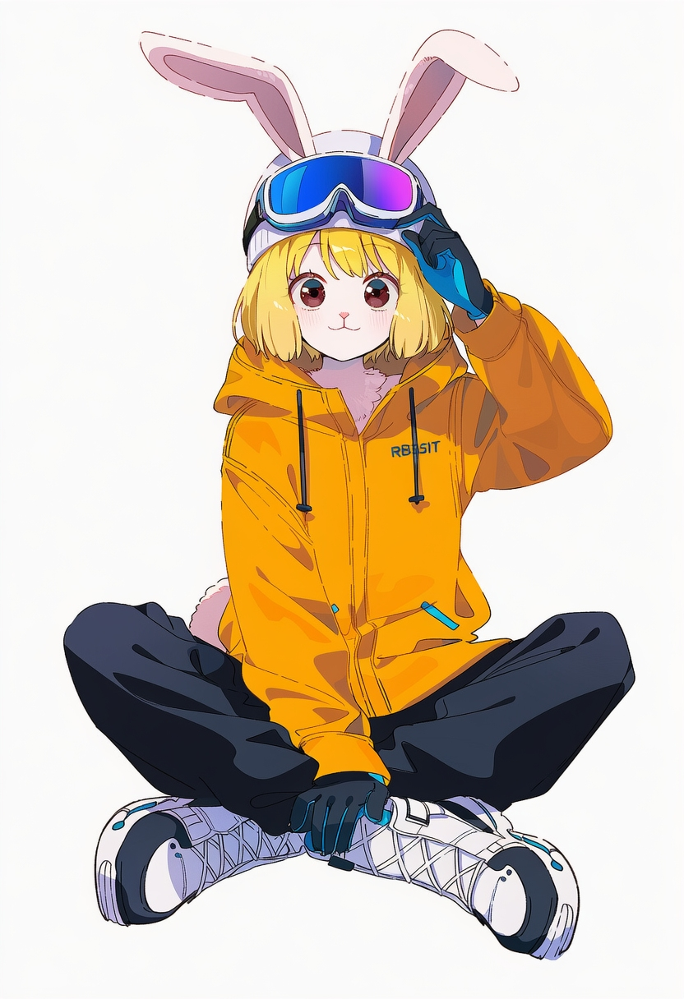

[在线例图](https://assets.quicktagcloud.com/images/raven_composition/raven_composition-2931.jpg?v=35f7bed837f25c65)

<a id="raven_composition-2932"></a>

## 单片眼镜

ID：`raven_composition-2932`；分类：面部配饰 / 眼镜/护目镜；来源标记：`safe`。

来源说明：

> 只覆盖一只眼睛的单片镜。

正向提示词：

```text
monocle
```

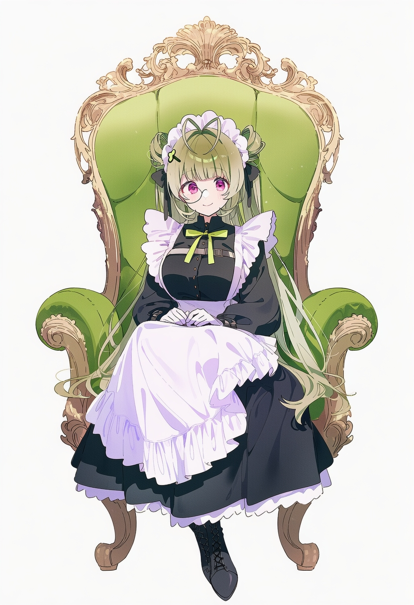

[在线例图](https://assets.quicktagcloud.com/images/raven_composition/raven_composition-2932.jpg?v=db22dfa7824db934)

<a id="raven_composition-2933"></a>

## 战斗力探测镜

ID：`raven_composition-2933`；分类：面部配饰 / 眼镜/护目镜；来源标记：`safe`。

来源说明：

> 单眼电子显示式镜片装置。

正向提示词：

```text
scouter
```

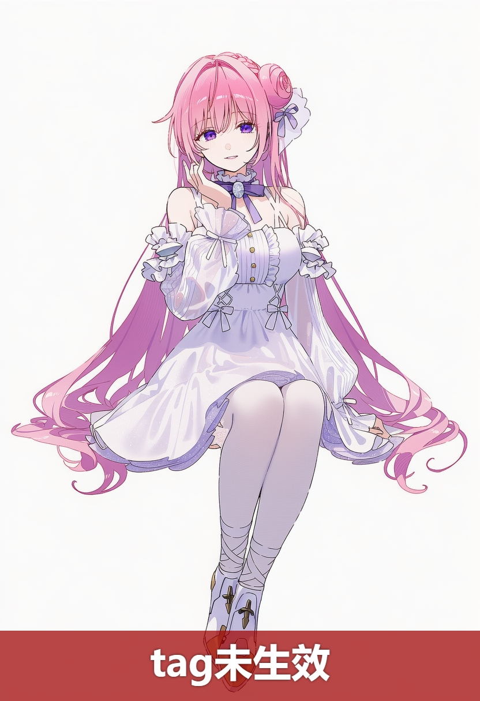

[在线例图](https://assets.quicktagcloud.com/images/raven_composition/raven_composition-2933.jpg?v=c377202a696a5d68)

<a id="raven_composition-2934"></a>

## 太阳镜

ID：`raven_composition-2934`；分类：面部配饰 / 眼镜/护目镜；来源标记：`safe`。

来源说明：

> 用于遮光或隐藏眼睛的深色眼镜。

正向提示词：

```text
sunglasses
```

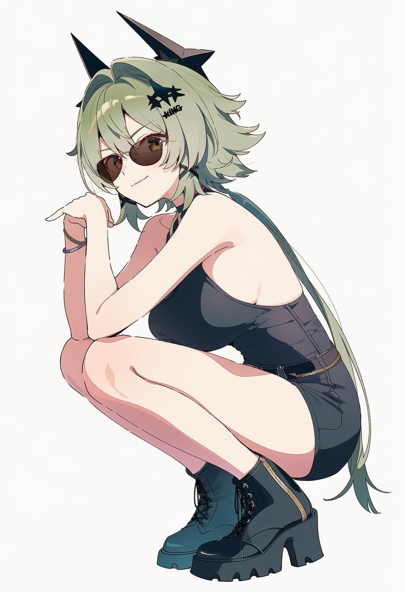

[在线例图](https://assets.quicktagcloud.com/images/raven_composition/raven_composition-2934.jpg?v=1ce4bd98e14134f7)

<a id="raven_composition-2935"></a>

## 飞行员太阳镜

ID：`raven_composition-2935`；分类：面部配饰 / 眼镜/护目镜；来源标记：`safe`。

来源说明：

> 经典泪滴形飞行员太阳镜。

正向提示词：

```text
aviator_sunglasses
```

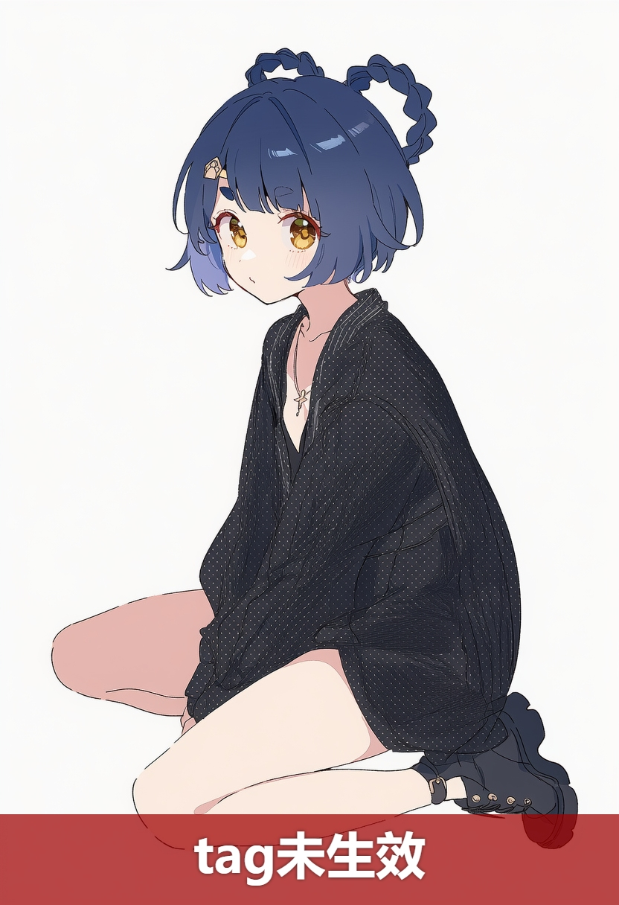

[在线例图](https://assets.quicktagcloud.com/images/raven_composition/raven_composition-2935.jpg?v=73c601a1f506b724)

<a id="raven_composition-2936"></a>

## 百叶窗眼镜

ID：`raven_composition-2936`；分类：面部配饰 / 眼镜/护目镜；来源标记：`safe`。

来源说明：

> 镜片位置是横向条栅结构。

正向提示词：

```text
shutter_shades
```

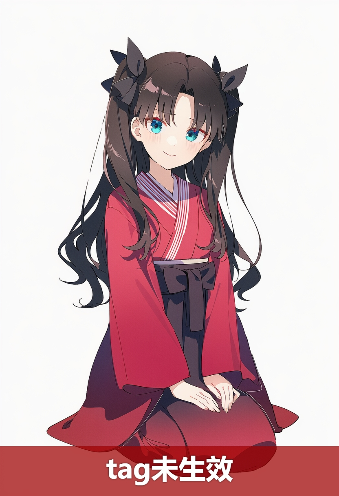

[在线例图](https://assets.quicktagcloud.com/images/raven_composition/raven_composition-2936.jpg?v=dfddf9a2e3e8476a)

<a id="raven_composition-2937"></a>

## 像素太阳镜

ID：`raven_composition-2937`；分类：面部配饰 / 眼镜/护目镜；来源标记：`safe`。

来源说明：

> 像素块风格的太阳镜。

正向提示词：

```text
pixel_sunglasses
```

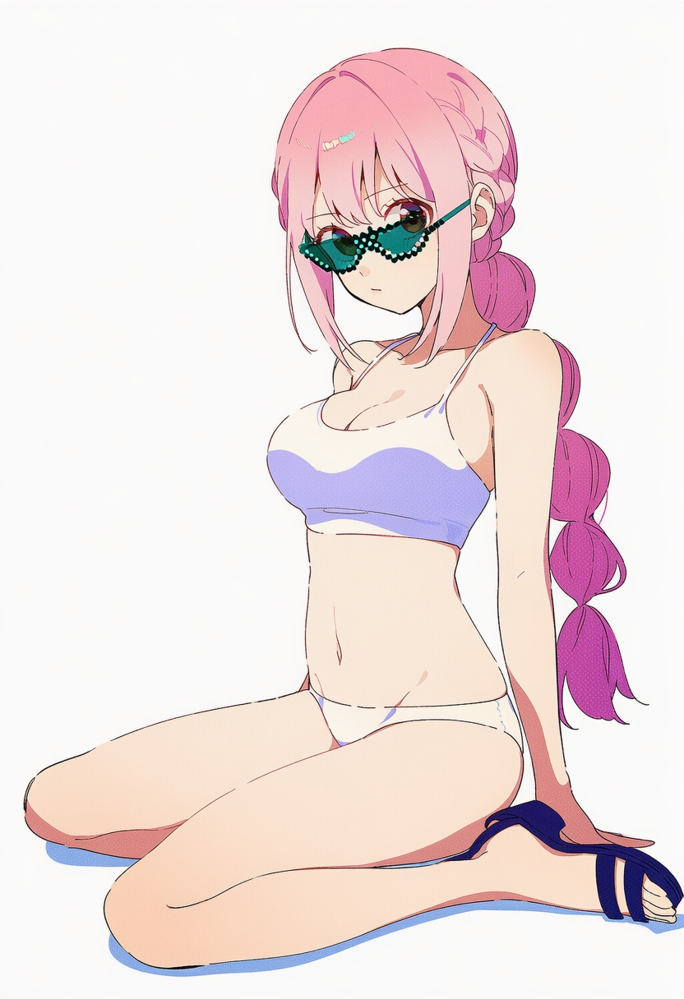

[在线例图](https://assets.quicktagcloud.com/images/raven_composition/raven_composition-2937.jpg?v=f13e686c49caca9b)

<a id="raven_composition-2938"></a>

## 运动太阳镜

ID：`raven_composition-2938`；分类：面部配饰 / 眼镜/护目镜；来源标记：`safe`。

来源说明：

> 包覆感较强的运动型太阳镜。

正向提示词：

```text
sports_sunglasses
```

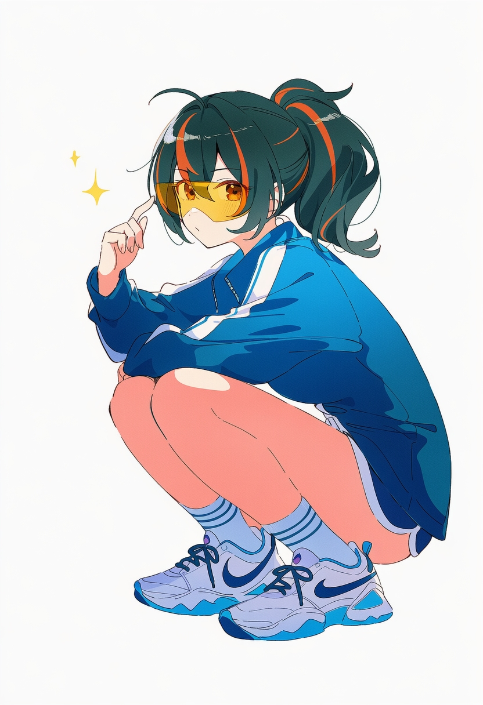

[在线例图](https://assets.quicktagcloud.com/images/raven_composition/raven_composition-2938.jpg?v=1c0aab1e96197cad)

<a id="raven_composition-2939"></a>

## 卡米那眼镜

ID：`raven_composition-2939`；分类：面部配饰 / 眼镜/护目镜；来源标记：`safe`。

来源说明：

> 尖锐夸张的红色三角太阳镜造型。

正向提示词：

```text
kamina_shades
```


[在线例图](https://assets.quicktagcloud.com/images/raven_composition/raven_composition-2939.jpg?v=ec87c6a99828c97a)
