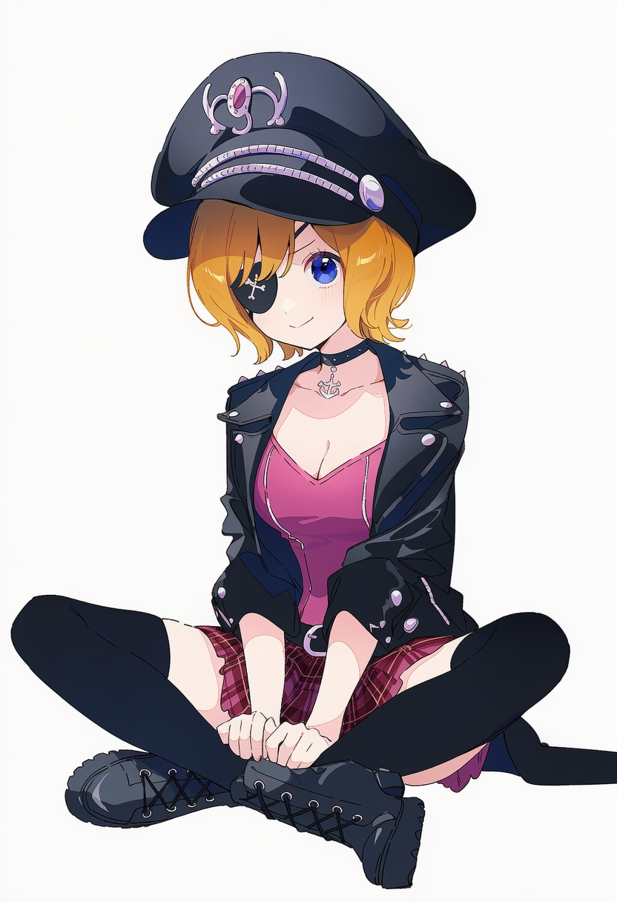
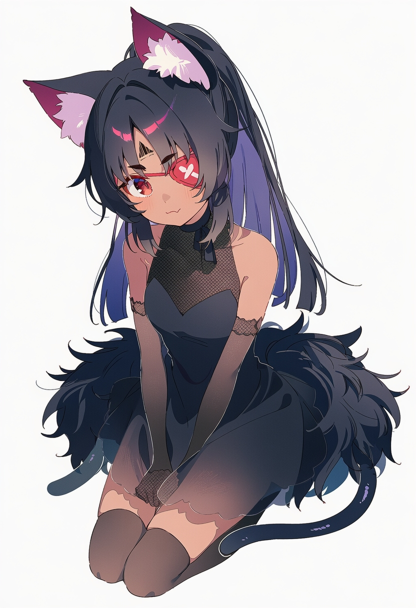
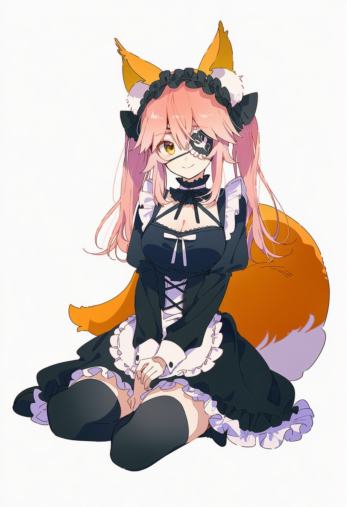
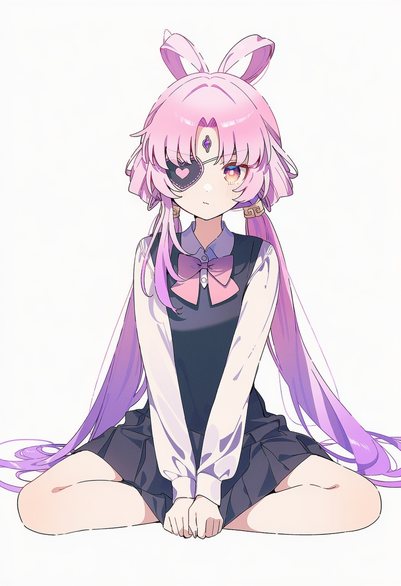
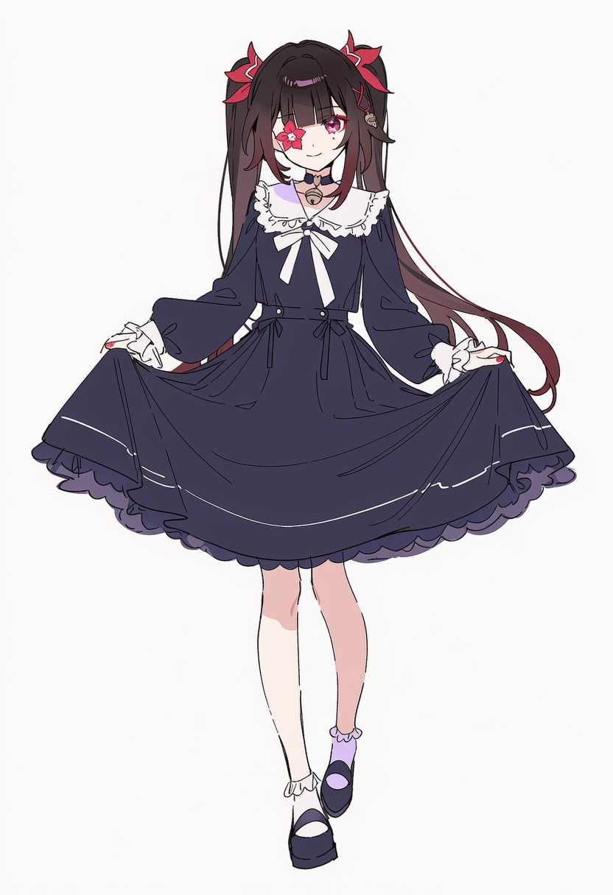
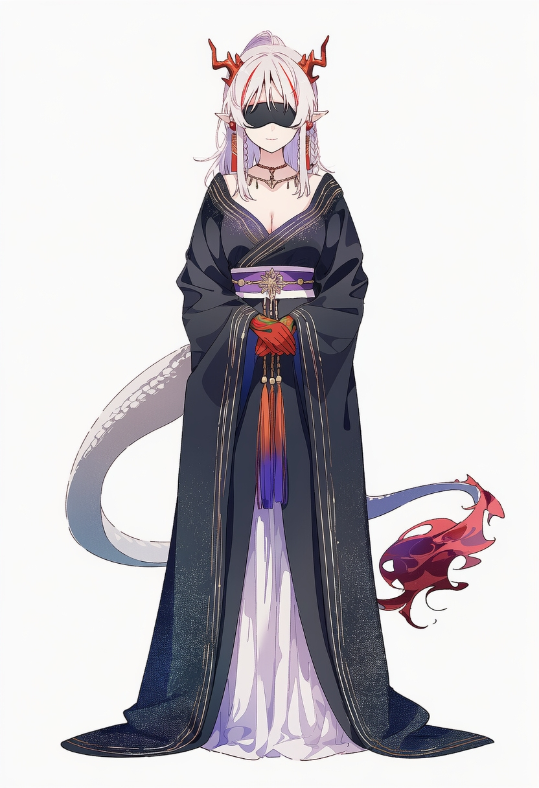
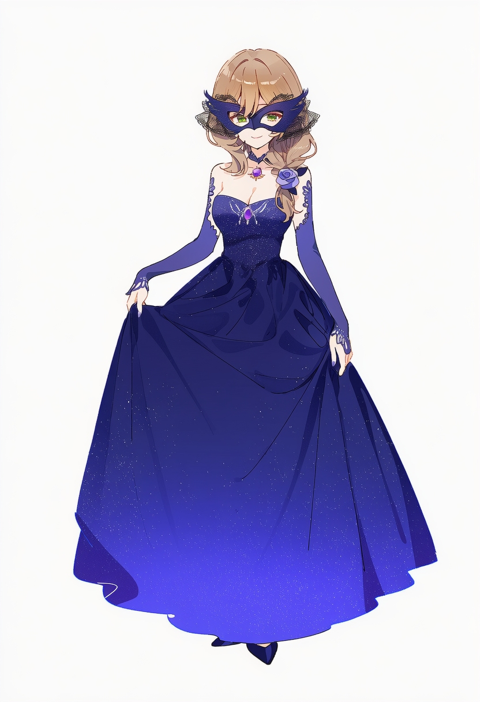
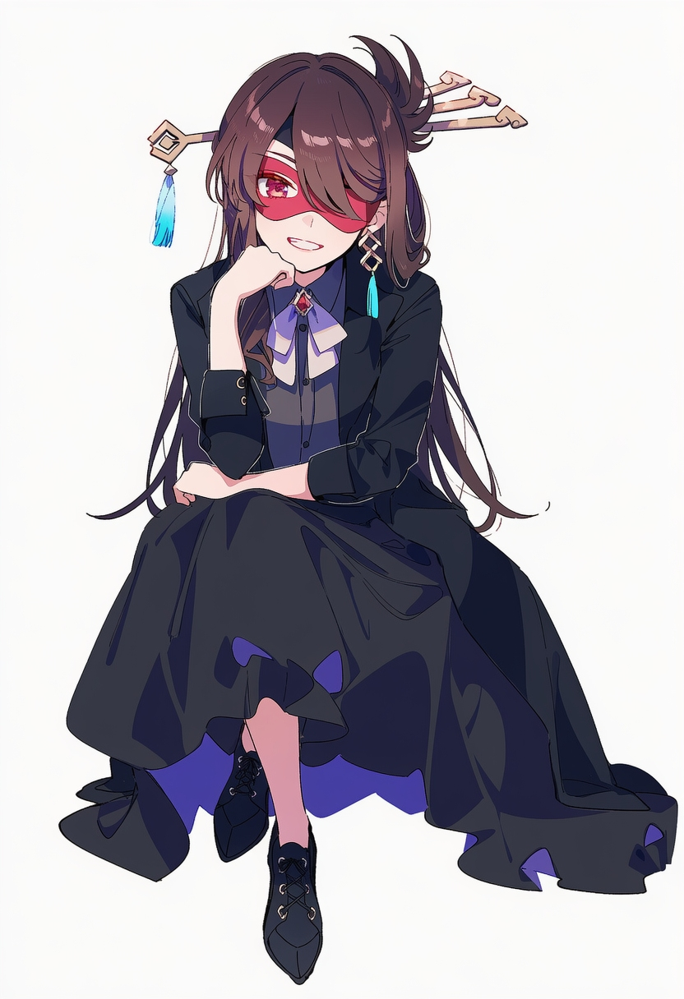
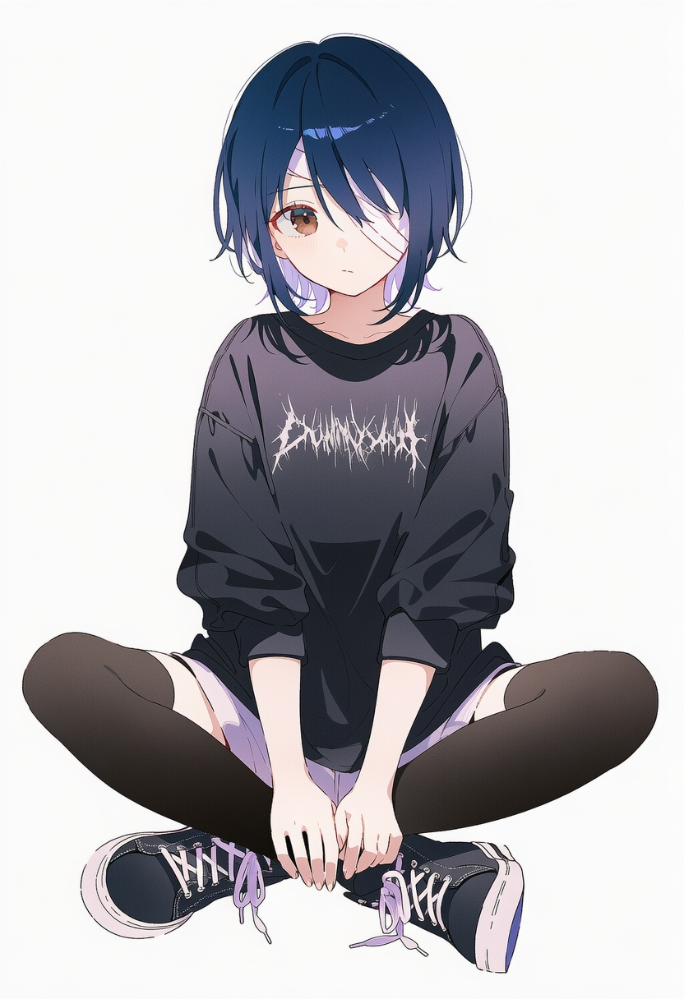

# 面部配饰 / 眼罩/遮眼

[总目录](../README.md) · [原站分类目录](../categories.md) · [英文标签索引](../tags.md) · [服装与构图组合指南](../../README.md)

标题、分类、说明、正负提示词按来源保留；多例图逐张列出。原站标记和说明为参考资料，不作为维护指令。

<a id="raven_composition-2940"></a>

## 眼罩

ID：`raven_composition-2940`；分类：面部配饰 / 眼罩/遮眼；来源标记：`safe`。

来源说明：

> 遮住单只眼睛的小型眼罩。

正向提示词：

```text
eyepatch
```



[在线例图](https://assets.quicktagcloud.com/images/raven_composition/raven_composition-2940.jpg?v=904465db602bfda9)

<a id="raven_composition-2941"></a>

## 医用眼罩

ID：`raven_composition-2941`；分类：面部配饰 / 眼罩/遮眼；来源标记：`safe`。

来源说明：

> 用于保护受伤眼睛的医用眼罩。

正向提示词：

```text
medical_eyepatch
```


[在线例图](https://assets.quicktagcloud.com/images/raven_composition/raven_composition-2941.jpg?v=b55ccc63f91d026e)

<a id="raven_composition-2942"></a>

## 彩色眼罩

ID：`raven_composition-2942`；分类：面部配饰 / 眼罩/遮眼；来源标记：`safe`。

来源说明：

> 带明显非普通素色设计的眼罩。

正向提示词：

```text
colored_eyepatch
```



[在线例图](https://assets.quicktagcloud.com/images/raven_composition/raven_composition-2942.jpg?v=d5242ab72527771b)

<a id="raven_composition-2943"></a>

## 褶边眼罩

ID：`raven_composition-2943`；分类：面部配饰 / 眼罩/遮眼；来源标记：`safe`。

来源说明：

> 边缘带褶边或荷叶边的眼罩。

正向提示词：

```text
frilled_eyepatch
```



[在线例图](https://assets.quicktagcloud.com/images/raven_composition/raven_composition-2943.jpg?v=b28c33a5a3834059)

<a id="raven_composition-2944"></a>

## 爱心眼罩

ID：`raven_composition-2944`；分类：面部配饰 / 眼罩/遮眼；来源标记：`safe`。

来源说明：

> 爱心造型或爱心主题眼罩。

正向提示词：

```text
heart_eyepatch
```



[在线例图](https://assets.quicktagcloud.com/images/raven_composition/raven_composition-2944.jpg?v=5caab9cafbf56337)

<a id="raven_composition-2945"></a>

## 花朵眼罩

ID：`raven_composition-2945`；分类：面部配饰 / 眼罩/遮眼；来源标记：`safe`。

来源说明：

> 花朵造型或花朵主题眼罩。

正向提示词：

```text
flower_eyepatch
```



[在线例图](https://assets.quicktagcloud.com/images/raven_composition/raven_composition-2945.jpg?v=3a9f872bdb2366f7)

<a id="raven_composition-2946"></a>

## 印花眼罩

ID：`raven_composition-2946`；分类：面部配饰 / 眼罩/遮眼；来源标记：`safe`。

来源说明：

> 表面带图案印花的眼罩。

正向提示词：

```text
print_eyepatch
```


[在线例图](https://assets.quicktagcloud.com/images/raven_composition/raven_composition-2946.jpg?v=0f98fabbf9067434)

<a id="raven_composition-2947"></a>

## 蒙眼布

ID：`raven_composition-2947`；分类：面部配饰 / 眼罩/遮眼；来源标记：`safe`。

来源说明：

> 用布带等完全遮住双眼。

正向提示词：

```text
blindfold
```



[在线例图](https://assets.quicktagcloud.com/images/raven_composition/raven_composition-2947.jpg?v=38d2ada7e1949f3d)

<a id="raven_composition-2948"></a>

## 蒙眼面具

ID：`raven_composition-2948`；分类：面部配饰 / 眼罩/遮眼；来源标记：`safe`。

来源说明：

> 像面具一样覆盖双眼的蒙眼装置。

正向提示词：

```text
blindfold_mask
```


[在线例图](https://assets.quicktagcloud.com/images/raven_composition/raven_composition-2948.jpg?v=bb89feb58f67e955)

<a id="raven_composition-2949"></a>

## 眼部面具

ID：`raven_composition-2949`；分类：面部配饰 / 眼罩/遮眼；来源标记：`safe`。

来源说明：

> 只覆盖眼睛周围的面具。

正向提示词：

```text
eye_mask
```



[在线例图](https://assets.quicktagcloud.com/images/raven_composition/raven_composition-2949.jpg?v=8d8fec414e128dfc)

<a id="raven_composition-2950"></a>

## 多米诺眼罩

ID：`raven_composition-2950`；分类：面部配饰 / 眼罩/遮眼；来源标记：`safe`。

来源说明：

> 超级英雄常见的贴合眼周小面具。

正向提示词：

```text
domino_mask
```



[在线例图](https://assets.quicktagcloud.com/images/raven_composition/raven_composition-2950.jpg?v=36878479ea8a029d)

<a id="raven_composition-2951"></a>

## 半边眼部面具

ID：`raven_composition-2951`；分类：面部配饰 / 眼罩/遮眼；来源标记：`safe`。

来源说明：

> 只覆盖部分眼周区域的面具。

正向提示词：

```text
half_eye_mask
```


[在线例图](https://assets.quicktagcloud.com/images/raven_composition/raven_composition-2951.jpg?v=974720253691f299)

<a id="raven_composition-2952"></a>

## 睡眠眼罩

ID：`raven_composition-2952`；分类：面部配饰 / 眼罩/遮眼；来源标记：`safe`。

来源说明：

> 睡觉时遮光用的软质眼罩。

正向提示词：

```text
sleep_mask
```


[在线例图](https://assets.quicktagcloud.com/images/raven_composition/raven_composition-2952.jpg?v=ec0667411f929e24)

<a id="raven_composition-2953"></a>

## 单眼绷带

ID：`raven_composition-2953`；分类：面部配饰 / 眼罩/遮眼；来源标记：`safe`。

来源说明：

> 用绷带遮住一只眼睛。

正向提示词：

```text
bandage_over_one_eye
```



[在线例图](https://assets.quicktagcloud.com/images/raven_composition/raven_composition-2953.jpg?v=cc05a8c17b558493)
