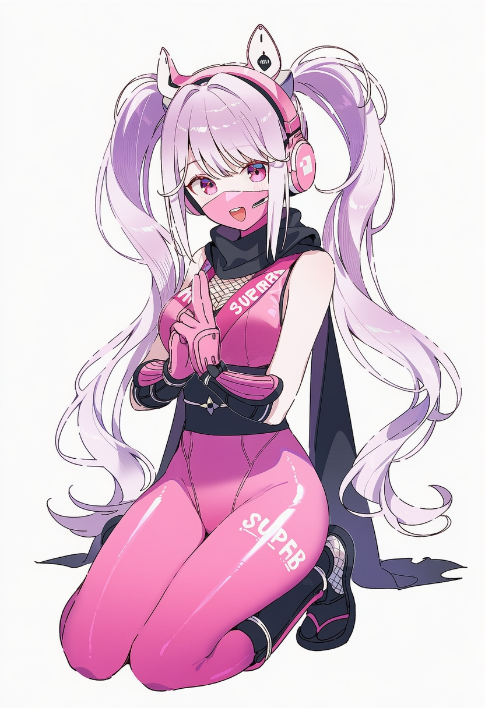
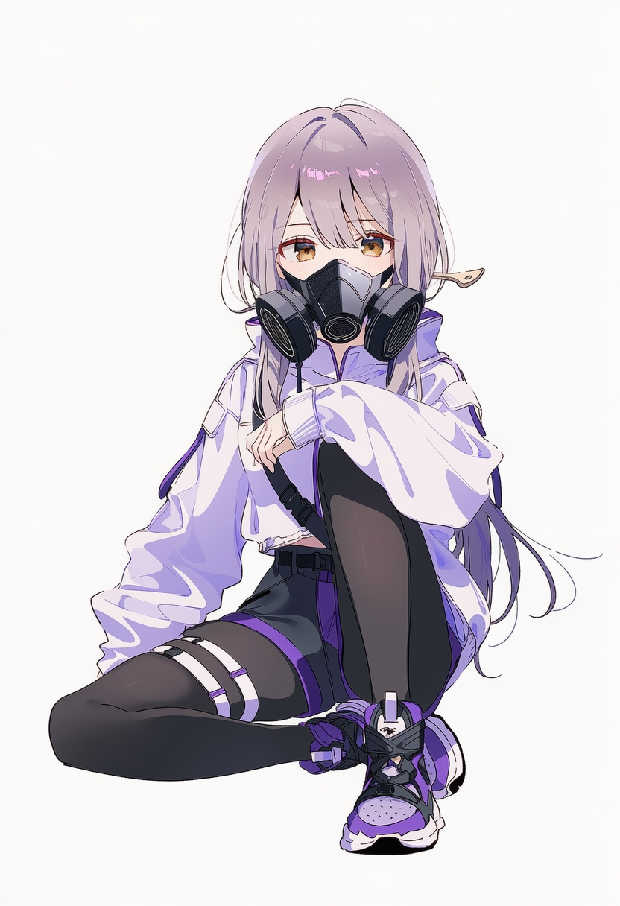
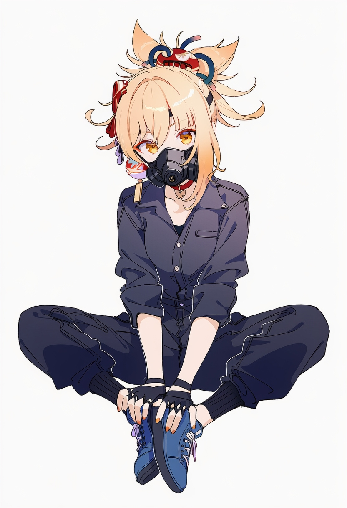

# 面部配饰 / 口鼻面罩

[总目录](../README.md) · [原站分类目录](../categories.md) · [英文标签索引](../tags.md) · [服装与构图组合指南](../../README.md)

标题、分类、说明、正负提示词按来源保留；多例图逐张列出。原站标记和说明为参考资料，不作为维护指令。

<a id="raven_composition-2954"></a>

## 口罩 / 口鼻面罩

ID：`raven_composition-2954`；分类：面部配饰 / 口鼻面罩；来源标记：`safe`。

来源说明：

> 只覆盖口鼻区域的面罩。

正向提示词：

```text
mouth_mask
```


[在线例图](https://assets.quicktagcloud.com/images/raven_composition/raven_composition-2954.jpg?v=c98f8584db1e3d95)

<a id="raven_composition-2955"></a>

## 黑色面罩

ID：`raven_composition-2955`；分类：面部配饰 / 口鼻面罩；来源标记：`safe`。

来源说明：

> 黑色面罩；纯颜色面罩只留这一种代表。

正向提示词：

```text
black_mask
```


[在线例图](https://assets.quicktagcloud.com/images/raven_composition/raven_composition-2955.jpg?v=e9ab0188b99b6d50)

<a id="raven_composition-2956"></a>

## 医用口罩

ID：`raven_composition-2956`；分类：面部配饰 / 口鼻面罩；来源标记：`safe`。

来源说明：

> 医生或日常防护使用的褶皱口罩。

正向提示词：

```text
surgical_mask
```


[在线例图](https://assets.quicktagcloud.com/images/raven_composition/raven_composition-2956.jpg?v=423d92cbe21c4e03)

<a id="raven_composition-2957"></a>

## 忍者面罩

ID：`raven_composition-2957`；分类：面部配饰 / 口鼻面罩；来源标记：`safe`。

来源说明：

> 遮住口鼻、常见于忍者造型的面罩。

正向提示词：

```text
ninja_mask
```



[在线例图](https://assets.quicktagcloud.com/images/raven_composition/raven_composition-2957.jpg?v=adadfac7459c1975)

<a id="raven_composition-2958"></a>

## 口部面纱

ID：`raven_composition-2958`；分类：面部配饰 / 口鼻面罩；来源标记：`safe`。

来源说明：

> 覆盖嘴部的轻薄面纱。

正向提示词：

```text
mouth_veil
```


[在线例图](https://assets.quicktagcloud.com/images/raven_composition/raven_composition-2958.jpg?v=629476f2f51ca4e0)

<a id="raven_composition-2959"></a>

## 呼吸防护面罩

ID：`raven_composition-2959`；分类：面部配饰 / 口鼻面罩；来源标记：`safe`。

来源说明：

> 带过滤结构、主要覆盖口鼻的呼吸面罩。

正向提示词：

```text
respirator
```



[在线例图](https://assets.quicktagcloud.com/images/raven_composition/raven_composition-2959.jpg?v=02ef00dbc7c06b00)

<a id="raven_composition-2960"></a>

## 氧气面罩

ID：`raven_composition-2960`；分类：面部配饰 / 口鼻面罩；来源标记：`safe`。

来源说明：

> 连接供氧设备、覆盖口鼻的面罩。

正向提示词：

```text
oxygen_mask
```


[在线例图](https://assets.quicktagcloud.com/images/raven_composition/raven_composition-2960.jpg?v=8174f5a482f9c342)

<a id="raven_composition-2961"></a>

## 防毒面具

ID：`raven_composition-2961`；分类：面部配饰 / 口鼻面罩；来源标记：`safe`。

来源说明：

> 覆盖眼睛和口鼻并带过滤器的防毒面具。

正向提示词：

```text
gas_mask
```



[在线例图](https://assets.quicktagcloud.com/images/raven_composition/raven_composition-2961.jpg?v=b36e2d3c3f4a4580)

<a id="raven_composition-2962"></a>

## 潜水面镜

ID：`raven_composition-2962`；分类：面部配饰 / 口鼻面罩；来源标记：`safe`。

来源说明：

> 潜水时覆盖眼鼻区域的密封面镜。

正向提示词：

```text
diving_mask
```


[在线例图](https://assets.quicktagcloud.com/images/raven_composition/raven_composition-2962.jpg?v=2ed272aea0af00c2)

<a id="raven_composition-2963"></a>

## 浮潜面罩

ID：`raven_composition-2963`；分类：面部配饰 / 口鼻面罩；来源标记：`safe`。

来源说明：

> 浮潜使用的面罩。

正向提示词：

```text
snorkel_mask
```


[在线例图](https://assets.quicktagcloud.com/images/raven_composition/raven_composition-2963.jpg?v=7e8a43a2c3c1acd7)

<a id="raven_composition-2964"></a>

## 美容面膜

ID：`raven_composition-2964`；分类：面部配饰 / 口鼻面罩；来源标记：`safe`。

来源说明：

> 敷在脸上的护肤面膜。

正向提示词：

```text
beauty_mask
```


[在线例图](https://assets.quicktagcloud.com/images/raven_composition/raven_composition-2964.jpg?v=00071ccd73422527)
