# 面部配饰 / 全脸/造型面具

[总目录](../README.md) · [原站分类目录](../categories.md) · [英文标签索引](../tags.md) · [服装与构图组合指南](../../README.md)

标题、分类、说明、正负提示词按来源保留；多例图逐张列出。原站标记和说明为参考资料，不作为维护指令。

<a id="raven_composition-2965"></a>

## 面具

ID：`raven_composition-2965`；分类：面部配饰 / 全脸/造型面具；来源标记：`safe`。

来源说明：

> 泛指用于遮挡脸部的面具。

正向提示词：

```text
mask
```

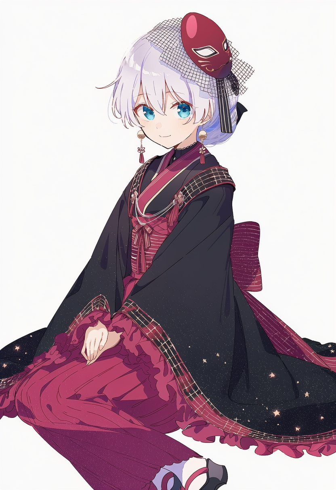

[在线例图](https://assets.quicktagcloud.com/images/raven_composition/raven_composition-2965.jpg?v=1b39e36cea7f6e76)

<a id="raven_composition-2966"></a>

## 多色面具

ID：`raven_composition-2966`；分类：面部配饰 / 全脸/造型面具；来源标记：`safe`。

来源说明：

> 面具由多种颜色组成。

正向提示词：

```text
multicolored_mask
```


[在线例图](https://assets.quicktagcloud.com/images/raven_composition/raven_composition-2966.jpg?v=60078d23122d8a2f)

<a id="raven_composition-2967"></a>

## 印花面具

ID：`raven_composition-2967`；分类：面部配饰 / 全脸/造型面具；来源标记：`safe`。

来源说明：

> 面具表面带明显图案。

正向提示词：

```text
print_mask
```

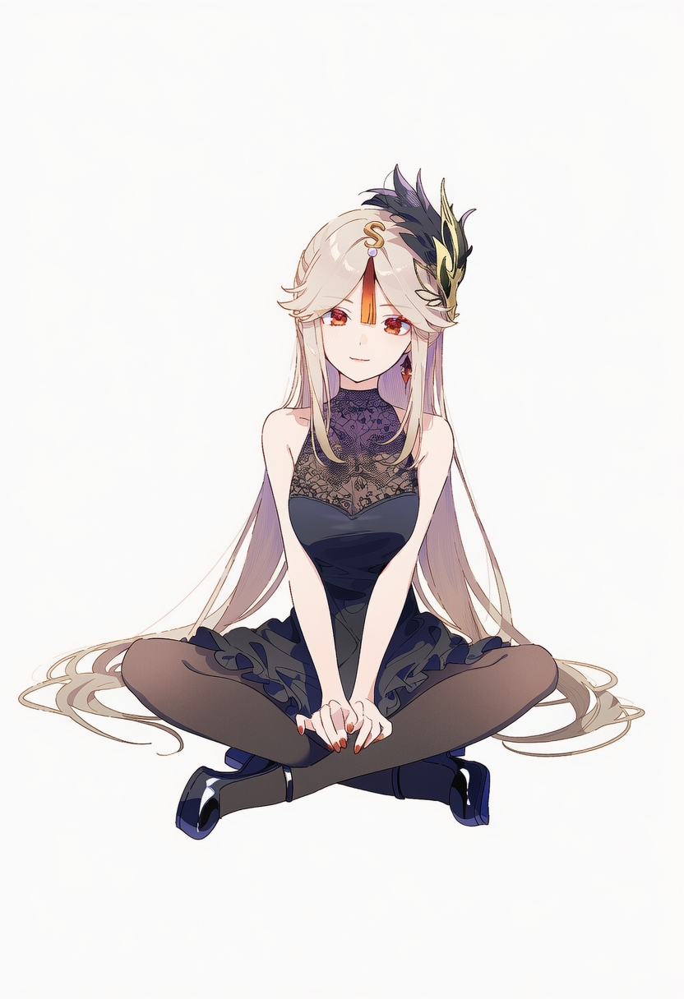

[在线例图](https://assets.quicktagcloud.com/images/raven_composition/raven_composition-2967.jpg?v=64c985a8f9de74a8)

<a id="raven_composition-2968"></a>

## 棋盘格面具

ID：`raven_composition-2968`；分类：面部配饰 / 全脸/造型面具；来源标记：`safe`。

来源说明：

> 带棋盘格图案的面具。

正向提示词：

```text
checkered_mask
```


[在线例图](https://assets.quicktagcloud.com/images/raven_composition/raven_composition-2968.jpg?v=f574dd96314dcd79)

<a id="raven_composition-2969"></a>

## 半脸面具

ID：`raven_composition-2969`；分类：面部配饰 / 全脸/造型面具；来源标记：`safe`。

来源说明：

> 只覆盖脸部一部分的面具。

正向提示词：

```text
half_mask
```


[在线例图](https://assets.quicktagcloud.com/images/raven_composition/raven_composition-2969.jpg?v=a4f96fcf867ddb33)

<a id="raven_composition-2970"></a>

## 化装舞会面具

ID：`raven_composition-2970`；分类：面部配饰 / 全脸/造型面具；来源标记：`safe`。

来源说明：

> 华丽的舞会式半脸面具。

正向提示词：

```text
masquerade_mask
```


[在线例图](https://assets.quicktagcloud.com/images/raven_composition/raven_composition-2970.jpg?v=a89a95cbd3e63f88)

<a id="raven_composition-2971"></a>

## 角色面具

ID：`raven_composition-2971`；分类：面部配饰 / 全脸/造型面具；来源标记：`safe`。

来源说明：

> 做成某个角色脸部造型的面具。

正向提示词：

```text
character_mask
```


[在线例图](https://assets.quicktagcloud.com/images/raven_composition/raven_composition-2971.jpg?v=d6a2a1715fb31030)

<a id="raven_composition-2972"></a>

## 小丑面具

ID：`raven_composition-2972`；分类：面部配饰 / 全脸/造型面具；来源标记：`safe`。

来源说明：

> 小丑脸造型的面具。

正向提示词：

```text
clown_mask
```


[在线例图](https://assets.quicktagcloud.com/images/raven_composition/raven_composition-2972.jpg?v=dcee0a3895580fb7)

<a id="raven_composition-2973"></a>

## 嘉年华面具

ID：`raven_composition-2973`；分类：面部配饰 / 全脸/造型面具；来源标记：`safe`。

来源说明：

> 节庆或嘉年华风格的装饰面具。

正向提示词：

```text
carnival_mask
```


[在线例图](https://assets.quicktagcloud.com/images/raven_composition/raven_composition-2973.jpg?v=e6a994d5b25bdf36)

<a id="raven_composition-2974"></a>

## 盖伊·福克斯面具

ID：`raven_composition-2974`；分类：面部配饰 / 全脸/造型面具；来源标记：`safe`。

来源说明：

> 经典笑脸胡须造型面具。

正向提示词：

```text
guy_fawkes_mask
```


[在线例图](https://assets.quicktagcloud.com/images/raven_composition/raven_composition-2974.jpg?v=28a27718ba0d6048)

<a id="raven_composition-2975"></a>

## 曲棍球面具

ID：`raven_composition-2975`；分类：面部配饰 / 全脸/造型面具；来源标记：`safe`。

来源说明：

> 带大量透气孔的硬质曲棍球面具。

正向提示词：

```text
hockey_mask
```


[在线例图](https://assets.quicktagcloud.com/images/raven_composition/raven_composition-2975.jpg?v=a7993566bd0c1de3)

<a id="raven_composition-2976"></a>

## 墨西哥摔角面具

ID：`raven_composition-2976`；分类：面部配饰 / 全脸/造型面具；来源标记：`safe`。

来源说明：

> 墨西哥摔角手风格的包头面具。

正向提示词：

```text
luchador_mask
```


[在线例图](https://assets.quicktagcloud.com/images/raven_composition/raven_composition-2976.jpg?v=e18ab9b278a3a2f4)

<a id="raven_composition-2977"></a>

## 摔角面具

ID：`raven_composition-2977`；分类：面部配饰 / 全脸/造型面具；来源标记：`safe`。

来源说明：

> 职业摔角风格的紧身面具。

正向提示词：

```text
wrestling_mask
```


[在线例图](https://assets.quicktagcloud.com/images/raven_composition/raven_composition-2977.jpg?v=297724292df576dd)

<a id="raven_composition-2978"></a>

## 焊接面罩

ID：`raven_composition-2978`；分类：面部配饰 / 全脸/造型面具；来源标记：`safe`。

来源说明：

> 焊接时保护脸部和眼睛的面罩。

正向提示词：

```text
welding_mask
```

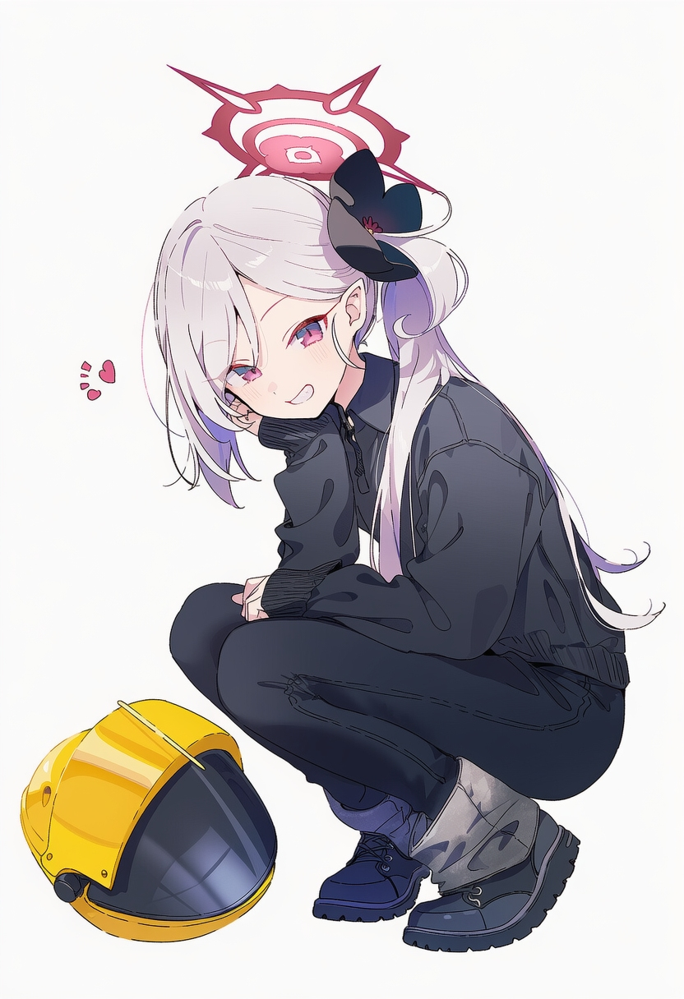

[在线例图](https://assets.quicktagcloud.com/images/raven_composition/raven_composition-2978.jpg?v=51e1e31566c9b81f)

<a id="raven_composition-2979"></a>

## 剑道面罩

ID：`raven_composition-2979`；分类：面部配饰 / 全脸/造型面具；来源标记：`safe`。

来源说明：

> 剑道护具中的面部护面。

正向提示词：

```text
kendo_mask
```

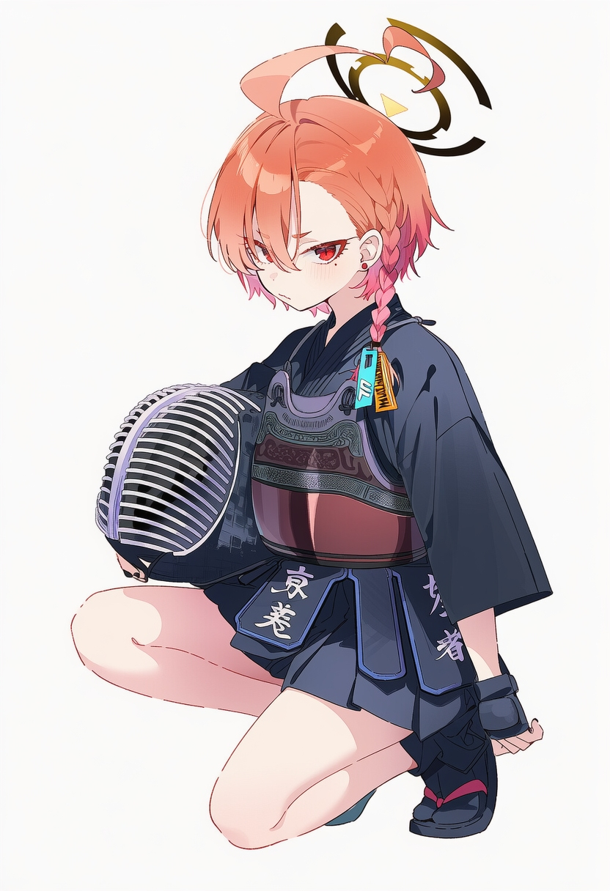

[在线例图](https://assets.quicktagcloud.com/images/raven_composition/raven_composition-2979.jpg?v=a46701f6e21bde92)

<a id="raven_composition-2980"></a>

## 能面

ID：`raven_composition-2980`；分类：面部配饰 / 全脸/造型面具；来源标记：`safe`。

来源说明：

> 日本能剧使用的传统面具。

正向提示词：

```text
noh_mask
```


[在线例图](https://assets.quicktagcloud.com/images/raven_composition/raven_composition-2980.jpg?v=992a2f3a63609612)

<a id="raven_composition-2981"></a>

## 火男面具

ID：`raven_composition-2981`；分类：面部配饰 / 全脸/造型面具；来源标记：`safe`。

来源说明：

> 歪嘴圆眼的日本传统火男面具。

正向提示词：

```text
hyottoko_mask
```


[在线例图](https://assets.quicktagcloud.com/images/raven_composition/raven_composition-2981.jpg?v=270e0ee97488b7d1)

<a id="raven_composition-2982"></a>

## 鬼面

ID：`raven_composition-2982`；分类：面部配饰 / 全脸/造型面具；来源标记：`safe`。

来源说明：

> 日本鬼怪 Oni 造型的面具。

正向提示词：

```text
oni_mask
```

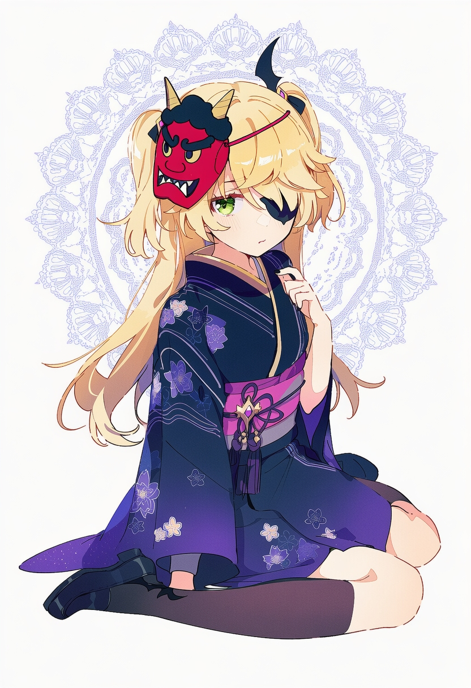

[在线例图](https://assets.quicktagcloud.com/images/raven_composition/raven_composition-2982.jpg?v=084b86d325511b2d)

<a id="raven_composition-2983"></a>

## 天狗面具

ID：`raven_composition-2983`；分类：面部配饰 / 全脸/造型面具；来源标记：`safe`。

来源说明：

> 长鼻天狗造型的日式面具。

正向提示词：

```text
tengu_mask
```


[在线例图](https://assets.quicktagcloud.com/images/raven_composition/raven_composition-2983.jpg?v=8ffd052dd6037517)

<a id="raven_composition-2984"></a>

## 狐狸面具

ID：`raven_composition-2984`；分类：面部配饰 / 全脸/造型面具；来源标记：`safe`。

来源说明：

> 狐狸脸造型的面具。

正向提示词：

```text
fox_mask
```


[在线例图](https://assets.quicktagcloud.com/images/raven_composition/raven_composition-2984.jpg?v=3cc0953303d4dc33)

<a id="raven_composition-2985"></a>

## 猫面具

ID：`raven_composition-2985`；分类：面部配饰 / 全脸/造型面具；来源标记：`safe`。

来源说明：

> 猫脸造型的面具。

正向提示词：

```text
cat_mask
```


[在线例图](https://assets.quicktagcloud.com/images/raven_composition/raven_composition-2985.jpg?v=cef2f527dd852784)

<a id="raven_composition-2986"></a>

## 兔子面具

ID：`raven_composition-2986`；分类：面部配饰 / 全脸/造型面具；来源标记：`safe`。

来源说明：

> 兔子脸造型的面具。

正向提示词：

```text
rabbit_mask
```

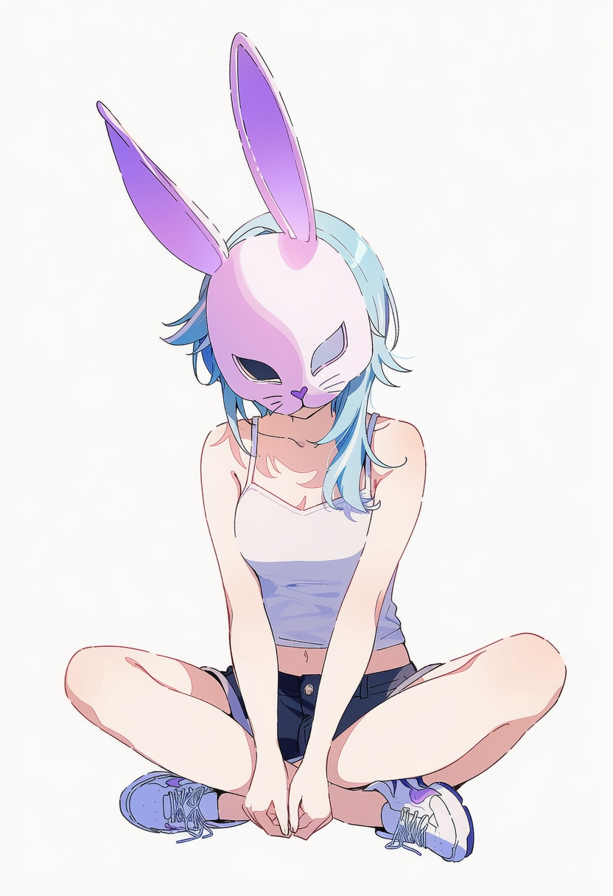

[在线例图](https://assets.quicktagcloud.com/images/raven_composition/raven_composition-2986.jpg?v=ec527b87a552b355)

<a id="raven_composition-2987"></a>

## 狼面具

ID：`raven_composition-2987`；分类：面部配饰 / 全脸/造型面具；来源标记：`safe`。

来源说明：

> 狼脸造型的面具。

正向提示词：

```text
wolf_mask
```

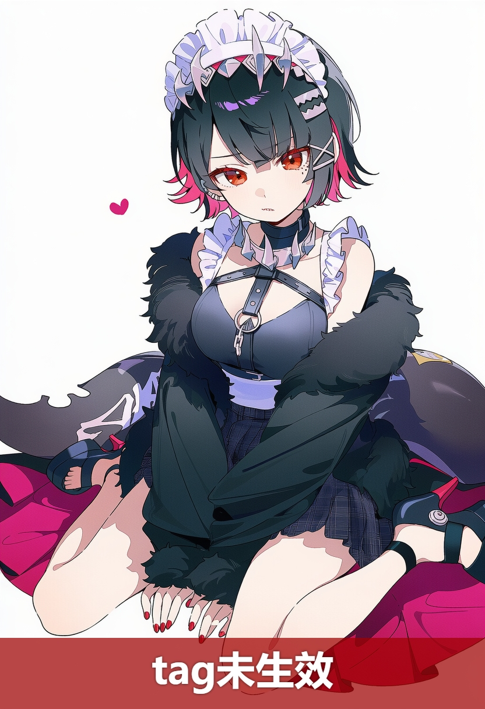

[在线例图](https://assets.quicktagcloud.com/images/raven_composition/raven_composition-2987.jpg?v=e4eb23d16ca197a2)

<a id="raven_composition-2988"></a>

## 熊面具

ID：`raven_composition-2988`；分类：面部配饰 / 全脸/造型面具；来源标记：`safe`。

来源说明：

> 熊脸造型的面具。

正向提示词：

```text
bear_mask
```


[在线例图](https://assets.quicktagcloud.com/images/raven_composition/raven_composition-2988.jpg?v=e65d8acd68254e40)

<a id="raven_composition-2989"></a>

## 鸟类面具

ID：`raven_composition-2989`；分类：面部配饰 / 全脸/造型面具；来源标记：`safe`。

来源说明：

> 鸟脸或鸟嘴造型的面具。

正向提示词：

```text
bird_mask
```


[在线例图](https://assets.quicktagcloud.com/images/raven_composition/raven_composition-2989.jpg?v=1511a0f8bdace3cb)

<a id="raven_composition-2990"></a>

## 马头面具

ID：`raven_composition-2990`；分类：面部配饰 / 全脸/造型面具；来源标记：`safe`。

来源说明：

> 马脸或马头造型的面具。

正向提示词：

```text
horse_mask
```

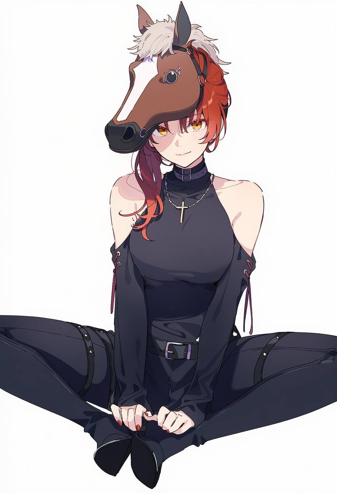

[在线例图](https://assets.quicktagcloud.com/images/raven_composition/raven_composition-2990.jpg?v=f822ddd5f297ee52)

<a id="raven_composition-2991"></a>

## 猴子面具

ID：`raven_composition-2991`；分类：面部配饰 / 全脸/造型面具；来源标记：`safe`。

来源说明：

> 猴脸造型的面具。

正向提示词：

```text
monkey_mask
```


[在线例图](https://assets.quicktagcloud.com/images/raven_composition/raven_composition-2991.jpg?v=3f8216e526b18235)

<a id="raven_composition-2992"></a>

## 熊猫面具

ID：`raven_composition-2992`；分类：面部配饰 / 全脸/造型面具；来源标记：`safe`。

来源说明：

> 熊猫脸造型的面具。

正向提示词：

```text
panda_mask
```


[在线例图](https://assets.quicktagcloud.com/images/raven_composition/raven_composition-2992.jpg?v=1fc5fcca190e1819)

<a id="raven_composition-2993"></a>

## 蝴蝶面具

ID：`raven_composition-2993`；分类：面部配饰 / 全脸/造型面具；来源标记：`safe`。

来源说明：

> 蝴蝶造型的眼部或半脸面具。

正向提示词：

```text
butterfly_mask
```


[在线例图](https://assets.quicktagcloud.com/images/raven_composition/raven_composition-2993.jpg?v=ad4f1ef00bdcbd0c)

<a id="raven_composition-2994"></a>

## 骷髅面具

ID：`raven_composition-2994`；分类：面部配饰 / 全脸/造型面具；来源标记：`safe`。

来源说明：

> 骷髅脸造型的面具。

正向提示词：

```text
skull_mask
```

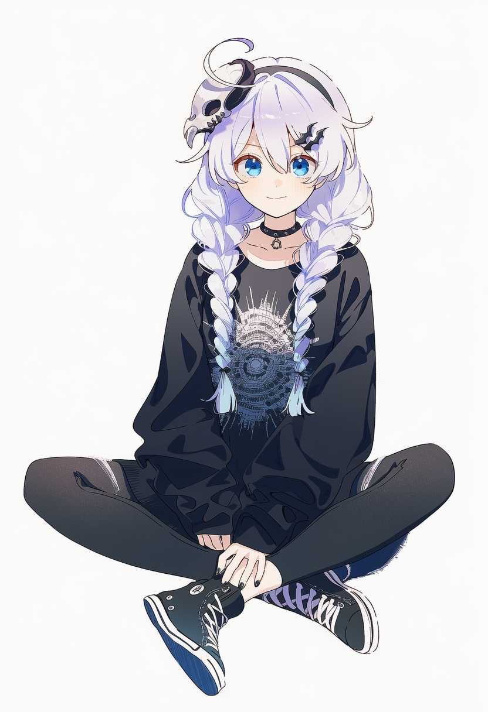

[在线例图](https://assets.quicktagcloud.com/images/raven_composition/raven_composition-2994.jpg?v=1c14ec48391711c7)

<a id="raven_composition-2995"></a>

## 瘟疫医生面具

ID：`raven_composition-2995`；分类：面部配饰 / 全脸/造型面具；来源标记：`safe`。

来源说明：

> 带长鸟嘴的瘟疫医生面具。

正向提示词：

```text
plague_doctor_mask
```


[在线例图](https://assets.quicktagcloud.com/images/raven_composition/raven_composition-2995.jpg?v=839d3bc67fb73ed3)

<a id="raven_composition-2996"></a>

## 不对称面具

ID：`raven_composition-2996`；分类：面部配饰 / 全脸/造型面具；来源标记：`safe`。

来源说明：

> 左右结构明显不对称的面具。

正向提示词：

```text
asymmetrical_mask
```

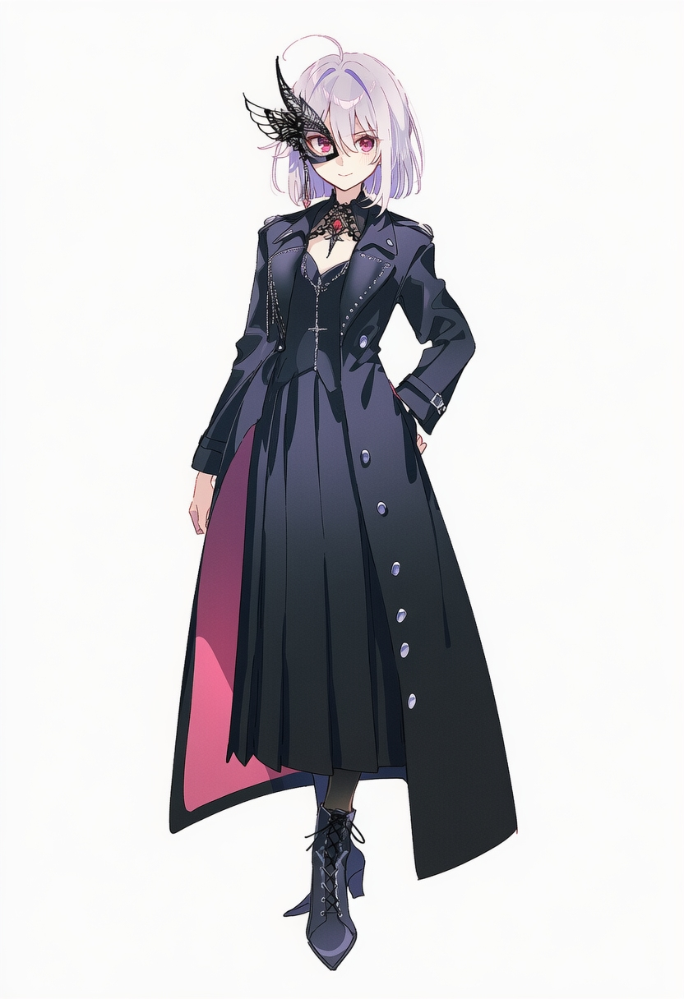

[在线例图](https://assets.quicktagcloud.com/images/raven_composition/raven_composition-2996.jpg?v=f60257ed6c05985a)

<a id="raven_composition-2997"></a>

## 破损面具

ID：`raven_composition-2997`；分类：面部配饰 / 全脸/造型面具；来源标记：`safe`。

来源说明：

> 有明显破裂或缺损的面具。

正向提示词：

```text
broken_mask
```

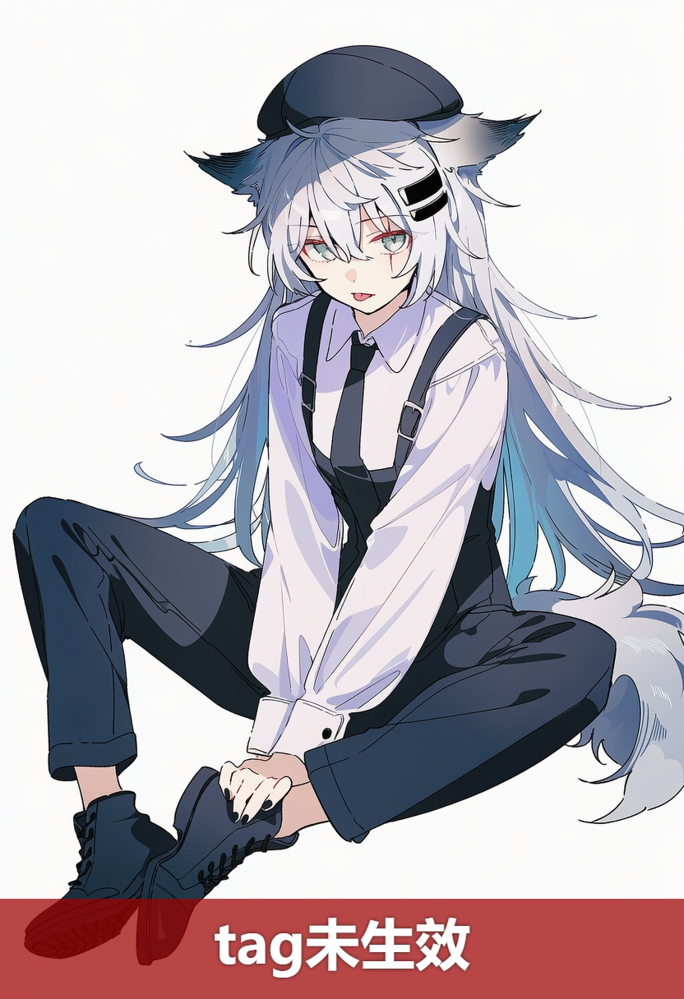

[在线例图](https://assets.quicktagcloud.com/images/raven_composition/raven_composition-2997.jpg?v=6d62d3f5b1cf06f4)

<a id="raven_composition-2998"></a>

## 裂纹面具

ID：`raven_composition-2998`；分类：面部配饰 / 全脸/造型面具；来源标记：`safe`。

来源说明：

> 表面有明显裂纹的面具。

正向提示词：

```text
cracked_mask
```

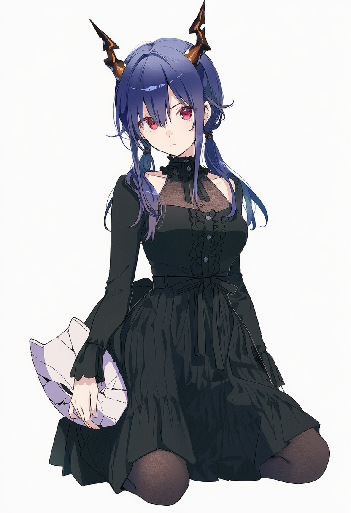

[在线例图](https://assets.quicktagcloud.com/images/raven_composition/raven_composition-2998.jpg?v=0f14cf9e7973600c)

<a id="raven_composition-2999"></a>

## 骨质面具

ID：`raven_composition-2999`；分类：面部配饰 / 全脸/造型面具；来源标记：`safe`。

来源说明：

> 骨头或骨质感构成的面具。

正向提示词：

```text
bone_mask
```


[在线例图](https://assets.quicktagcloud.com/images/raven_composition/raven_composition-2999.jpg?v=2ea701d25af9627a)

<a id="raven_composition-3000"></a>

## 发光面具

ID：`raven_composition-3000`；分类：面部配饰 / 全脸/造型面具；来源标记：`safe`。

来源说明：

> 面具本身带发光效果。

正向提示词：

```text
glowing_mask
```

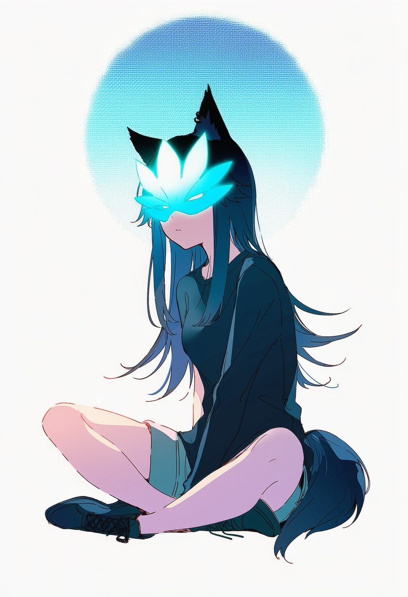

[在线例图](https://assets.quicktagcloud.com/images/raven_composition/raven_composition-3000.jpg?v=d5b69d068e039bdb)

<a id="raven_composition-3001"></a>

## 带角面具

ID：`raven_composition-3001`；分类：面部配饰 / 全脸/造型面具；来源标记：`safe`。

来源说明：

> 面具上长有明显角状结构。

正向提示词：

```text
horned_mask
```


[在线例图](https://assets.quicktagcloud.com/images/raven_composition/raven_composition-3001.jpg?v=81c3113405e21bfd)

<a id="raven_composition-3002"></a>

## 金属面具

ID：`raven_composition-3002`；分类：面部配饰 / 全脸/造型面具；来源标记：`safe`。

来源说明：

> 金属材质或金属质感面具。

正向提示词：

```text
metal_mask
```

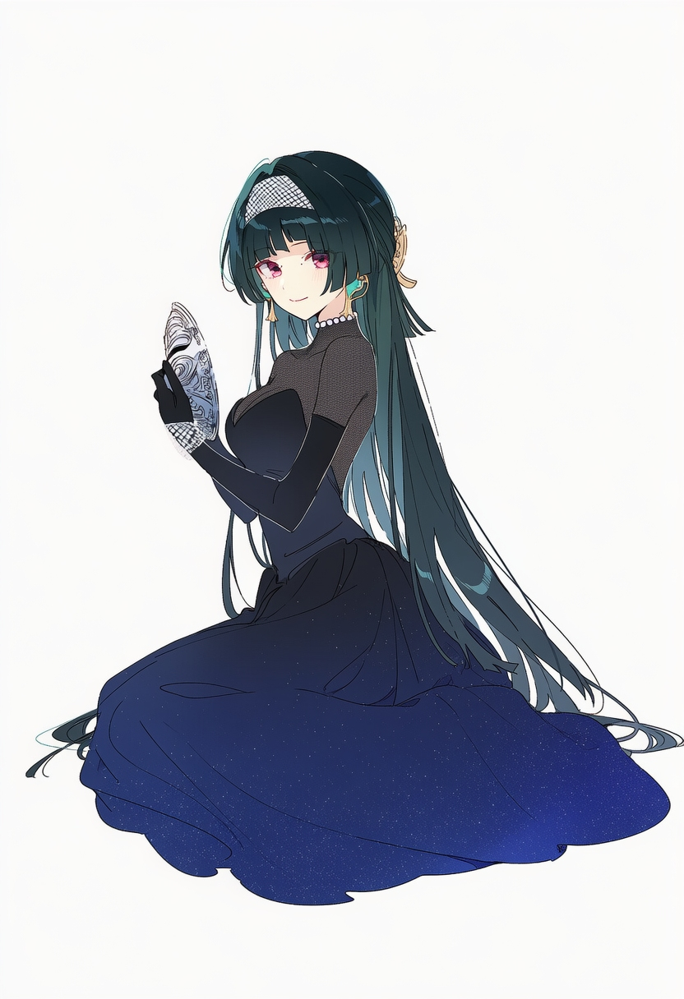

[在线例图](https://assets.quicktagcloud.com/images/raven_composition/raven_composition-3002.jpg?v=d683bf6b524257ba)

<a id="raven_composition-3003"></a>

## 透明面具

ID：`raven_composition-3003`；分类：面部配饰 / 全脸/造型面具；来源标记：`safe`。

来源说明：

> 可以透过面具看到后方脸部。

正向提示词：

```text
see-through_mask
```


[在线例图](https://assets.quicktagcloud.com/images/raven_composition/raven_composition-3003.jpg?v=ca443d0d4e6497dc)

<a id="raven_composition-3004"></a>

## 尖刺面具

ID：`raven_composition-3004`；分类：面部配饰 / 全脸/造型面具；来源标记：`safe`。

来源说明：

> 带明显尖刺结构的面具。

正向提示词：

```text
spiked_mask
```

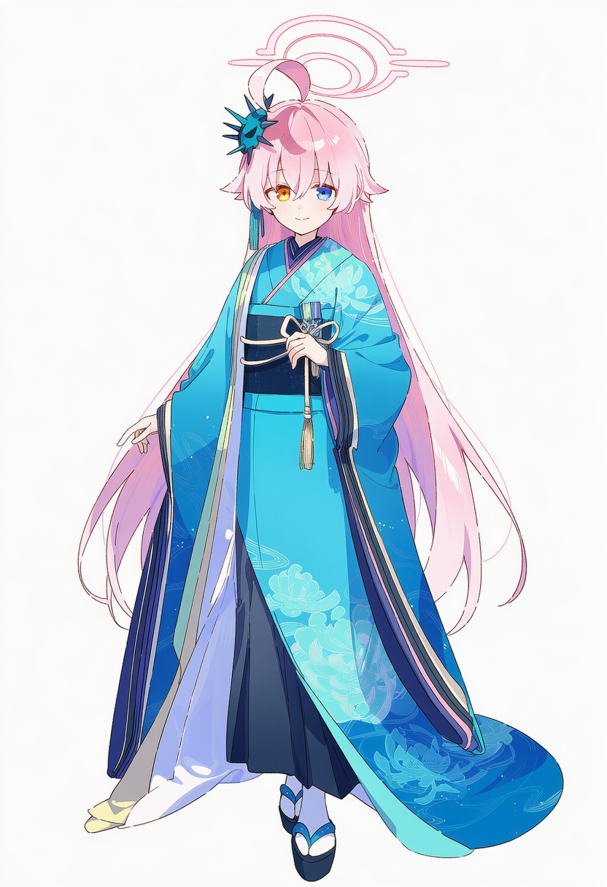

[在线例图](https://assets.quicktagcloud.com/images/raven_composition/raven_composition-3004.jpg?v=f1fa96c74b8767be)
