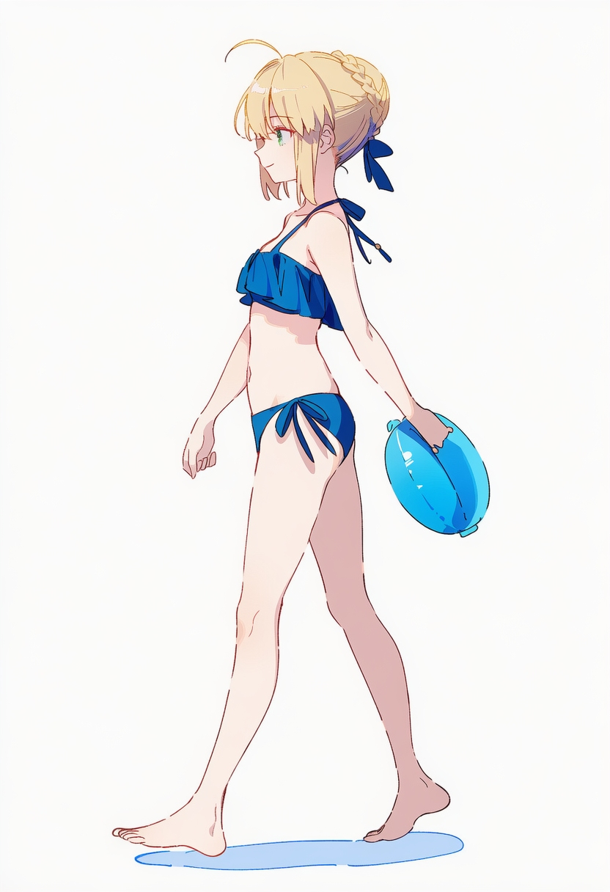
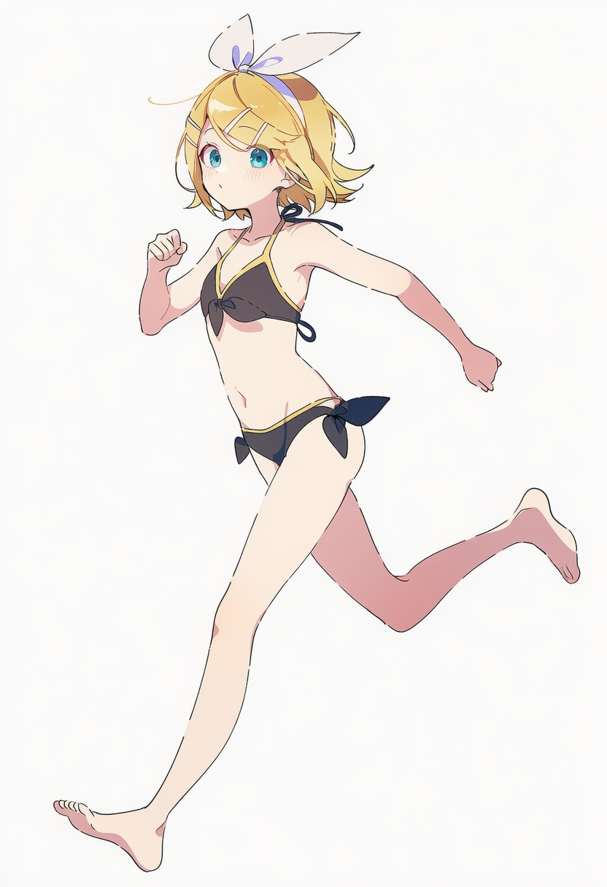
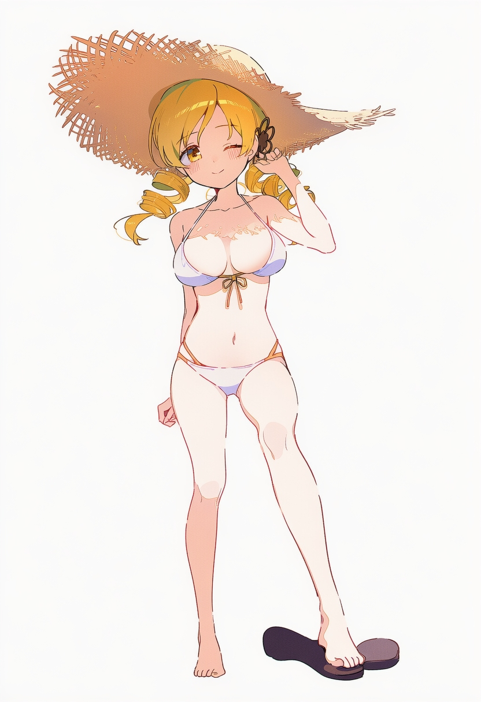
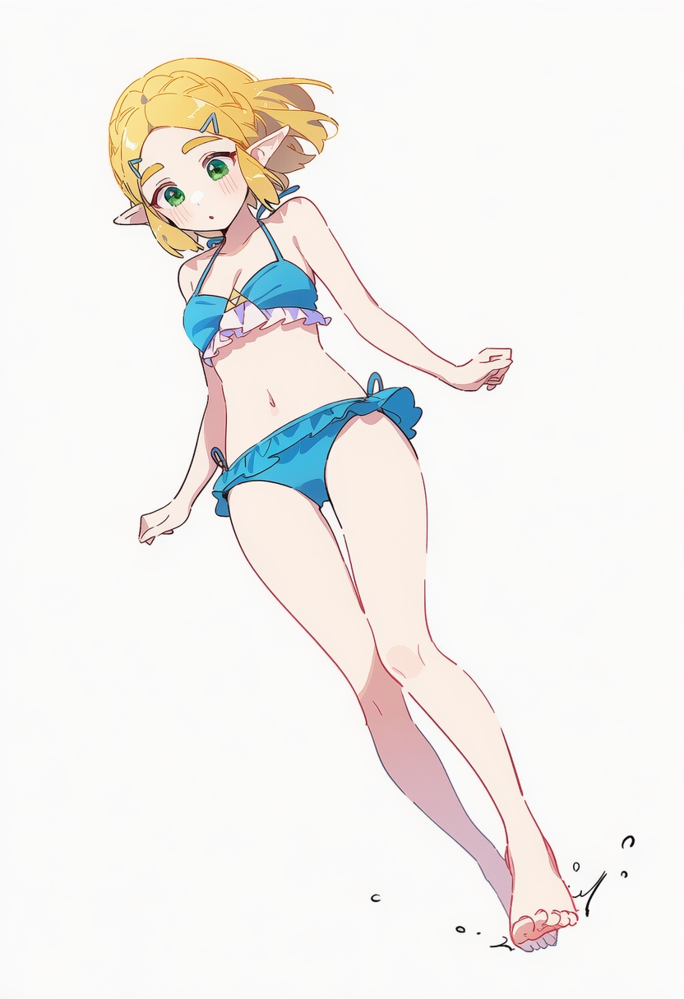
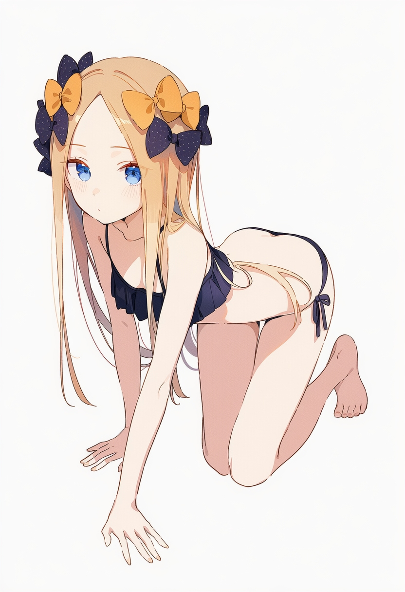
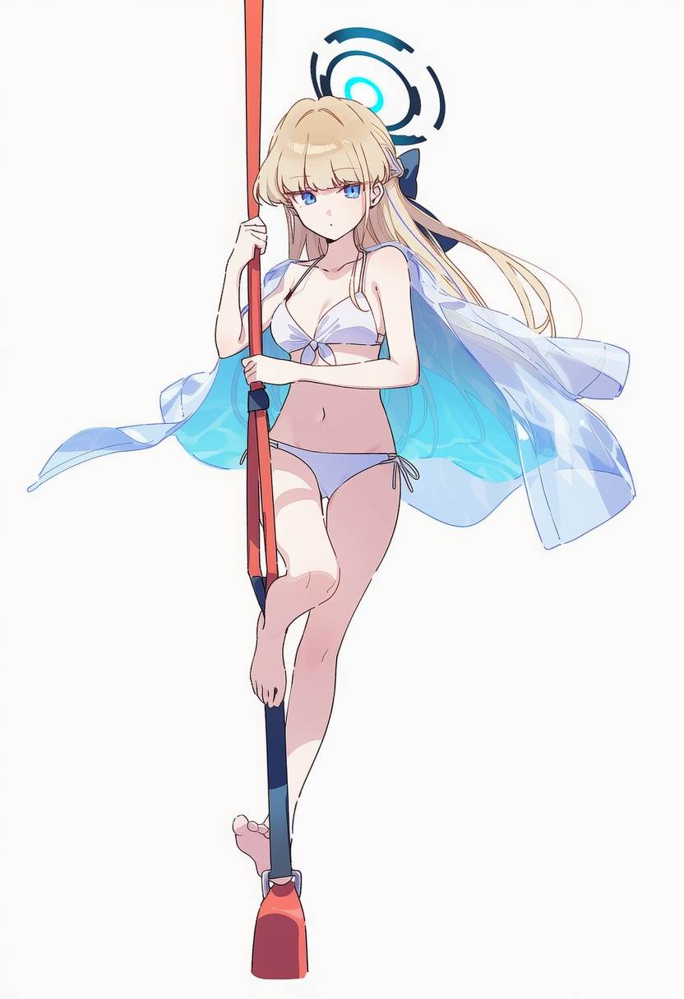
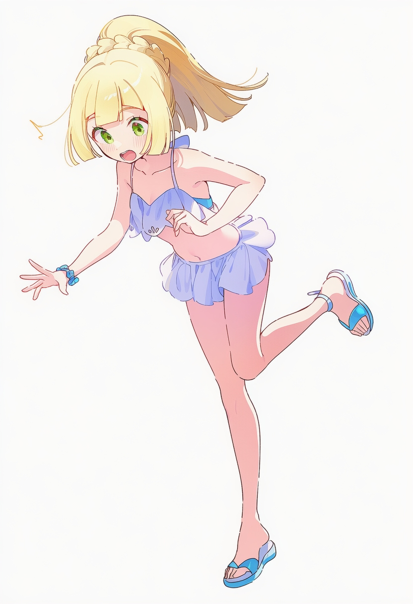
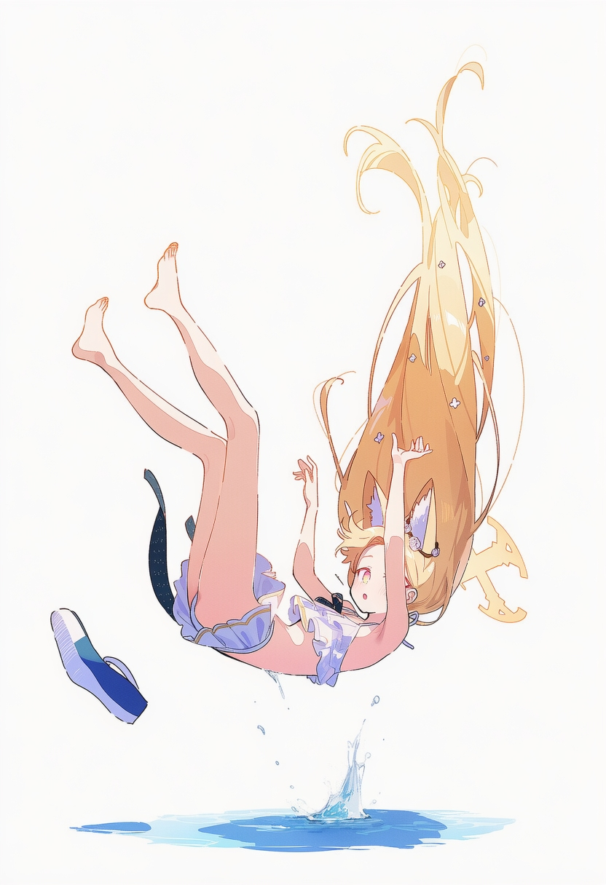

# 腿部姿势与移动 / 地面移动

[总目录](../README.md) · [原站分类目录](../categories.md) · [英文标签索引](../tags.md) · [服装与构图组合指南](../../README.md)

标题、分类、说明、正负提示词按来源保留；多例图逐张列出。原站标记和说明为参考资料，不作为维护指令。

<a id="raven_composition-3016"></a>

## 行走

ID：`raven_composition-3016`；分类：腿部姿势与移动 / 地面移动；来源标记：`safe`。

来源说明：

> 角色正在步行。

正向提示词：

```text
walking
```



[在线例图](https://assets.quicktagcloud.com/images/raven_composition/raven_composition-3016.jpg?v=3837acb6cdf99705)

<a id="raven_composition-3017"></a>

## 奔跑

ID：`raven_composition-3017`；分类：腿部姿势与移动 / 地面移动；来源标记：`safe`。

来源说明：

> 角色正在快速跑动。

正向提示词：

```text
running
```



[在线例图](https://assets.quicktagcloud.com/images/raven_composition/raven_composition-3017.jpg?v=95ec4e7977a3f400)

<a id="raven_composition-3018"></a>

## 行进 / 齐步走

ID：`raven_composition-3018`；分类：腿部姿势与移动 / 地面移动；来源标记：`safe`。

来源说明：

> 以整齐或有节奏的步伐前进。

正向提示词：

```text
marching
```


[在线例图](https://assets.quicktagcloud.com/images/raven_composition/raven_composition-3018.jpg?v=354ac6e6394eb38a)

<a id="raven_composition-3019"></a>

## 徒步

ID：`raven_composition-3019`；分类：腿部姿势与移动 / 地面移动；来源标记：`safe`。

来源说明：

> 在户外进行较长距离步行。

正向提示词：

```text
hiking
```


[在线例图](https://assets.quicktagcloud.com/images/raven_composition/raven_composition-3019.jpg?v=d1be3b46d30cbfb4)

<a id="raven_composition-3020"></a>

## 蹦跳前进

ID：`raven_composition-3020`；分类：腿部姿势与移动 / 地面移动；来源标记：`safe`。

来源说明：

> 以轻快的跳步方式向前移动。

正向提示词：

```text
skipping
```


[在线例图](https://assets.quicktagcloud.com/images/raven_composition/raven_composition-3020.jpg?v=2441a7b170c49c91)

<a id="raven_composition-3021"></a>

## 迈步

ID：`raven_composition-3021`；分类：腿部姿势与移动 / 地面移动；来源标记：`safe`。

来源说明：

> 正在抬脚或落脚迈出一步。

正向提示词：

```text
stepping
```



[在线例图](https://assets.quicktagcloud.com/images/raven_composition/raven_composition-3021.jpg?v=a901eed9c6e9422f)

<a id="raven_composition-3022"></a>

## 跺脚

ID：`raven_composition-3022`；分类：腿部姿势与移动 / 地面移动；来源标记：`safe`。

来源说明：

> 用脚重重踩下。

正向提示词：

```text
stomping
```



[在线例图](https://assets.quicktagcloud.com/images/raven_composition/raven_composition-3022.jpg?v=3da2a6d004295bd3)

<a id="raven_composition-3023"></a>

## 爬行

ID：`raven_composition-3023`；分类：腿部姿势与移动 / 地面移动；来源标记：`safe`。

来源说明：

> 身体贴近地面用四肢向前移动。

正向提示词：

```text
crawling
```



[在线例图](https://assets.quicktagcloud.com/images/raven_composition/raven_composition-3023.jpg?v=d1796f24847934d7)

<a id="raven_composition-3024"></a>

## 攀爬

ID：`raven_composition-3024`；分类：腿部姿势与移动 / 地面移动；来源标记：`safe`。

来源说明：

> 借助手脚向上或沿表面移动。

正向提示词：

```text
climbing
```


[在线例图](https://assets.quicktagcloud.com/images/raven_composition/raven_composition-3024.jpg?v=04b85822c224abbe)

<a id="raven_composition-3025"></a>

## 绳降

ID：`raven_composition-3025`；分类：腿部姿势与移动 / 地面移动；来源标记：`safe`。

来源说明：

> 借助绳索从高处向下移动。

正向提示词：

```text
rappelling
```



[在线例图](https://assets.quicktagcloud.com/images/raven_composition/raven_composition-3025.jpg?v=be6cbcd0f2a8ecd2)

<a id="raven_composition-3026"></a>

## 追赶

ID：`raven_composition-3026`；分类：腿部姿势与移动 / 地面移动；来源标记：`safe`。

来源说明：

> 快速移动追逐目标。

正向提示词：

```text
chasing
```


[在线例图](https://assets.quicktagcloud.com/images/raven_composition/raven_composition-3026.jpg?v=b20197917cea2e39)

<a id="raven_composition-3027"></a>

## 绊倒

ID：`raven_composition-3027`；分类：腿部姿势与移动 / 地面移动；来源标记：`safe`。

来源说明：

> 走或跑时失去平衡向前跌倒。

正向提示词：

```text
tripping
```



[在线例图](https://assets.quicktagcloud.com/images/raven_composition/raven_composition-3027.jpg?v=062540c4026bd327)

<a id="raven_composition-3028"></a>

## 滑倒

ID：`raven_composition-3028`；分类：腿部姿势与移动 / 地面移动；来源标记：`safe`。

来源说明：

> 因脚下打滑而失去平衡。

正向提示词：

```text
slipping
```



[在线例图](https://assets.quicktagcloud.com/images/raven_composition/raven_composition-3028.jpg?v=bc020edb60800250)

<a id="raven_composition-3029"></a>

## 滑行

ID：`raven_composition-3029`；分类：腿部姿势与移动 / 地面移动；来源标记：`safe`。

来源说明：

> 身体沿表面持续滑动。

正向提示词：

```text
sliding
```


[在线例图](https://assets.quicktagcloud.com/images/raven_composition/raven_composition-3029.jpg?v=8cdc97c10ab69b1f)
