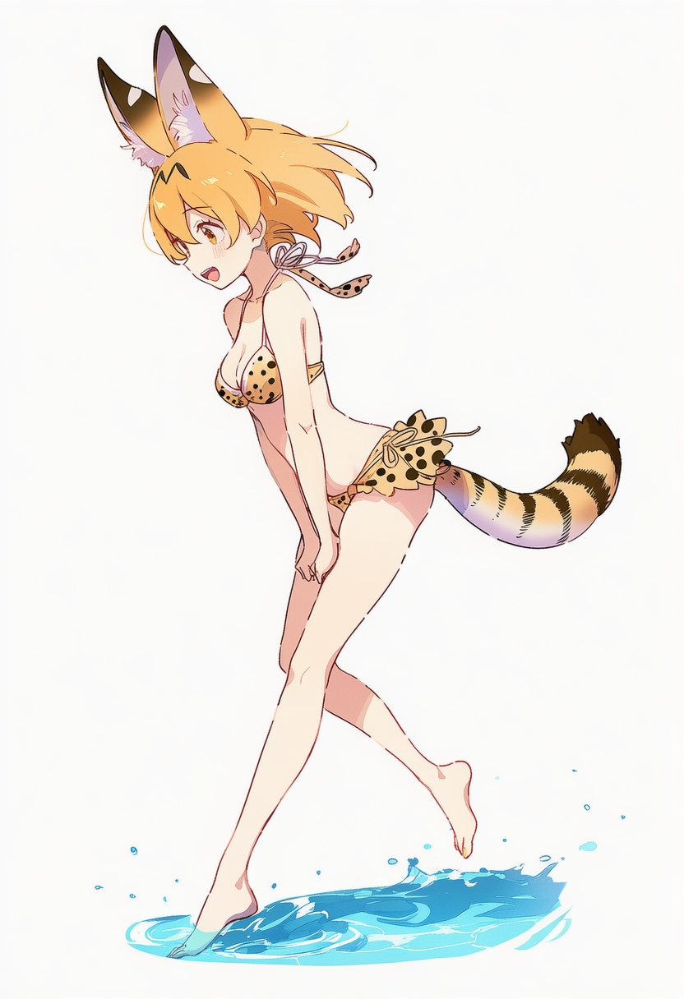
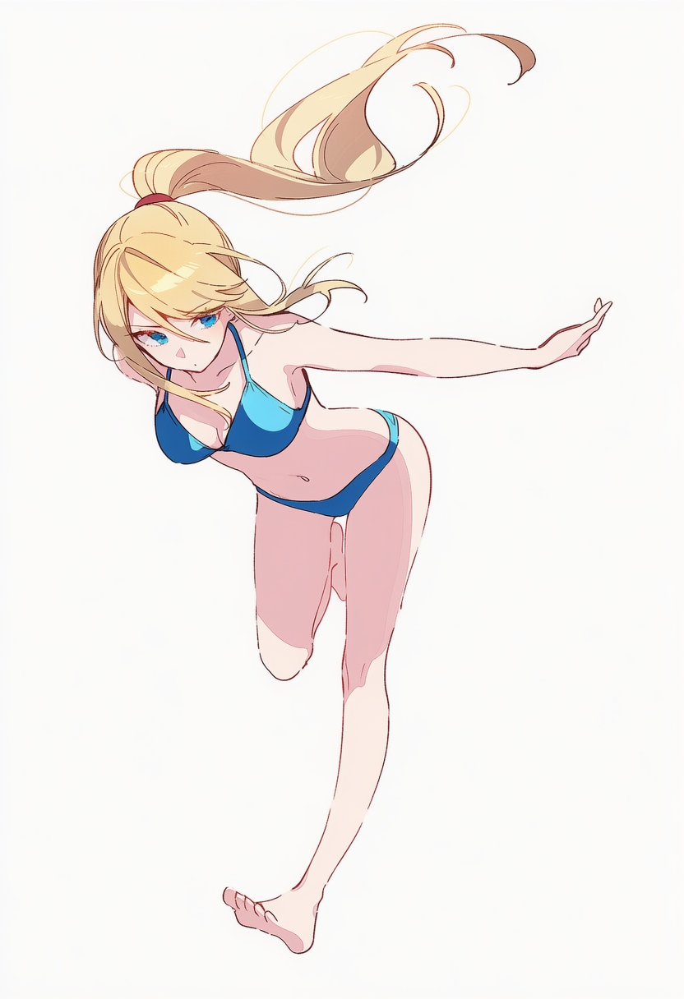
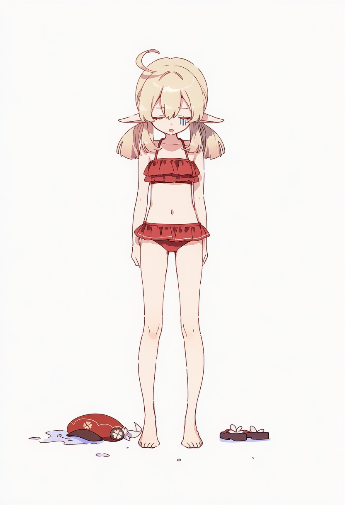

# 腿部姿势与移动 / 跳跃/落下

[总目录](../README.md) · [原站分类目录](../categories.md) · [英文标签索引](../tags.md) · [服装与构图组合指南](../../README.md)

标题、分类、说明、正负提示词按来源保留；多例图逐张列出。原站标记和说明为参考资料，不作为维护指令。

<a id="raven_composition-3030"></a>

## 跳跃

ID：`raven_composition-3030`；分类：腿部姿势与移动 / 跳跃/落下；来源标记：`safe`。

来源说明：

> 身体主动离开地面跃起。

正向提示词：

```text
jumping
```


[在线例图](https://assets.quicktagcloud.com/images/raven_composition/raven_composition-3030.jpg?v=6b58552184d319dd)

<a id="raven_composition-3031"></a>

## 单脚跳 / 小跳

ID：`raven_composition-3031`；分类：腿部姿势与移动 / 跳跃/落下；来源标记：`safe`。

来源说明：

> 以单脚或短促方式跳动。

正向提示词：

```text
hopping
```



[在线例图](https://assets.quicktagcloud.com/images/raven_composition/raven_composition-3031.jpg?v=d76cac09a40fa088)

<a id="raven_composition-3032"></a>

## 扑跃

ID：`raven_composition-3032`；分类：腿部姿势与移动 / 跳跃/落下；来源标记：`safe`。

来源说明：

> 朝目标或对象猛地跳扑过去。

正向提示词：

```text
pouncing
```


[在线例图](https://assets.quicktagcloud.com/images/raven_composition/raven_composition-3032.jpg?v=d4ca25c50a14ef81)

<a id="raven_composition-3033"></a>

## 落地

ID：`raven_composition-3033`；分类：腿部姿势与移动 / 跳跃/落下；来源标记：`safe`。

来源说明：

> 从空中下降并正在着地。

正向提示词：

```text
landing
```


[在线例图](https://assets.quicktagcloud.com/images/raven_composition/raven_composition-3033.jpg?v=ff34b72ac370ae9b)

<a id="raven_composition-3034"></a>

## 俯冲落地

ID：`raven_composition-3034`；分类：腿部姿势与移动 / 跳跃/落下；来源标记：`safe`。

来源说明：

> 角色从空中快速下降、即将落地。

正向提示词：

```text
dive
```



[在线例图](https://assets.quicktagcloud.com/images/raven_composition/raven_composition-3034.jpg?v=e4483b4c0d49e07f)

<a id="raven_composition-3035"></a>

## 跳水 / 潜入

ID：`raven_composition-3035`；分类：腿部姿势与移动 / 跳跃/落下；来源标记：`safe`。

来源说明：

> 身体向水中或下方俯冲进入。

正向提示词：

```text
diving
```


[在线例图](https://assets.quicktagcloud.com/images/raven_composition/raven_composition-3035.jpg?v=9a40b9abc2bf7e20)

<a id="raven_composition-3036"></a>

## 坠落

ID：`raven_composition-3036`；分类：腿部姿势与移动 / 跳跃/落下；来源标记：`safe`。

来源说明：

> 身体不受支撑地向下落。

正向提示词：

```text
falling
```


[在线例图](https://assets.quicktagcloud.com/images/raven_composition/raven_composition-3036.jpg?v=28d108b57369bb8d)

<a id="raven_composition-3037"></a>

## 昏倒

ID：`raven_composition-3037`；分类：腿部姿势与移动 / 跳跃/落下；来源标记：`safe`。

来源说明：

> 因失去意识而正在倒下。

正向提示词：

```text
fainting
```



[在线例图](https://assets.quicktagcloud.com/images/raven_composition/raven_composition-3037.jpg?v=687c6851462ef35e)
