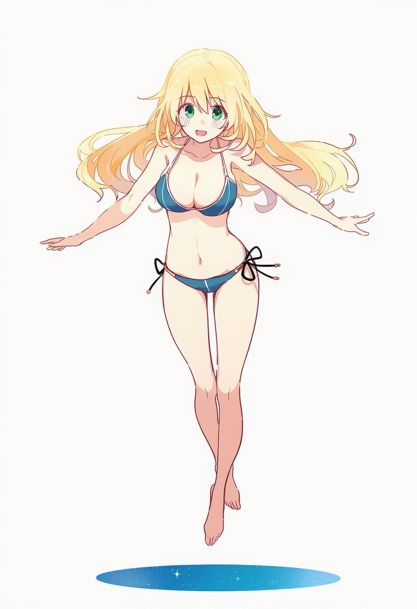
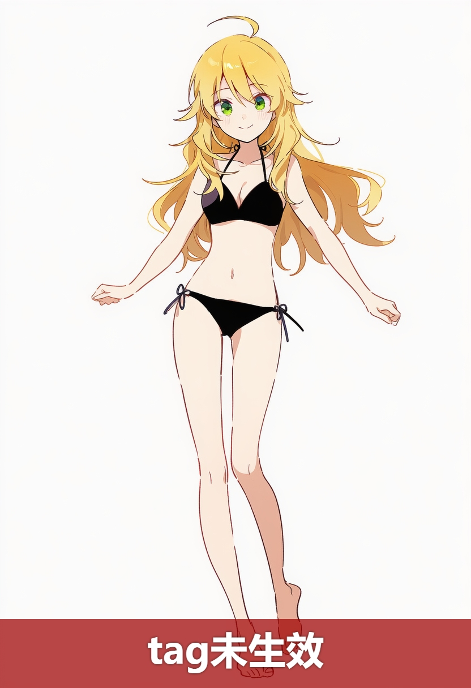
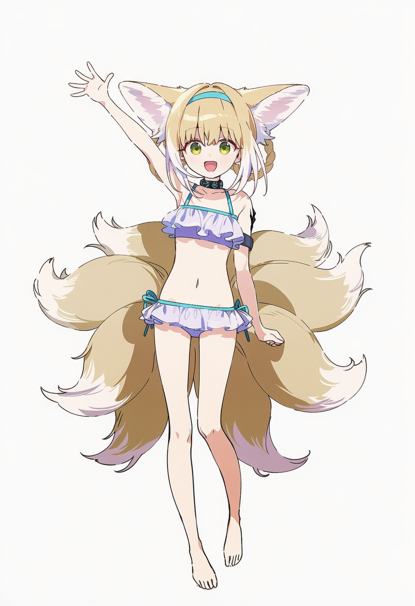

# 腿部姿势与移动 / 空中/漂浮

[总目录](../README.md) · [原站分类目录](../categories.md) · [英文标签索引](../tags.md) · [服装与构图组合指南](../../README.md)

标题、分类、说明、正负提示词按来源保留；多例图逐张列出。原站标记和说明为参考资料，不作为维护指令。

<a id="raven_composition-3038"></a>

## 漂浮

ID：`raven_composition-3038`；分类：腿部姿势与移动 / 空中/漂浮；来源标记：`safe`。

来源说明：

> 身体悬浮而没有明显支撑。

正向提示词：

```text
floating
```



[在线例图](https://assets.quicktagcloud.com/images/raven_composition/raven_composition-3038.jpg?v=00b4b44ed6f0a5d2)

<a id="raven_composition-3039"></a>

## 飞行

ID：`raven_composition-3039`；分类：腿部姿势与移动 / 空中/漂浮；来源标记：`safe`。

来源说明：

> 角色主动在空中移动。

正向提示词：

```text
flying
```


[在线例图](https://assets.quicktagcloud.com/images/raven_composition/raven_composition-3039.jpg?v=0c1c04a5ed6c22e3)

<a id="raven_composition-3040"></a>

## 拍动

ID：`raven_composition-3040`；分类：腿部姿势与移动 / 空中/漂浮；来源标记：`safe`。

来源说明：

> 翅膀或类似部位反复拍动。

正向提示词：

```text
flapping
```



[在线例图](https://assets.quicktagcloud.com/images/raven_composition/raven_composition-3040.jpg?v=fdd6c1404af2d91f)

<a id="raven_composition-3041"></a>

## 腾空 / 发射

ID：`raven_composition-3041`；分类：腿部姿势与移动 / 空中/漂浮；来源标记：`safe`。

来源说明：

> 角色或身体被快速送入空中。

正向提示词：

```text
launching
```



[在线例图](https://assets.quicktagcloud.com/images/raven_composition/raven_composition-3041.jpg?v=140ec4225edc6ea7)
