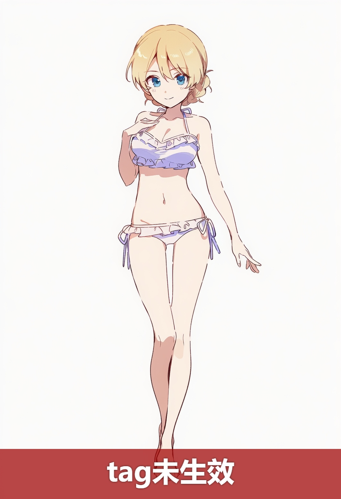
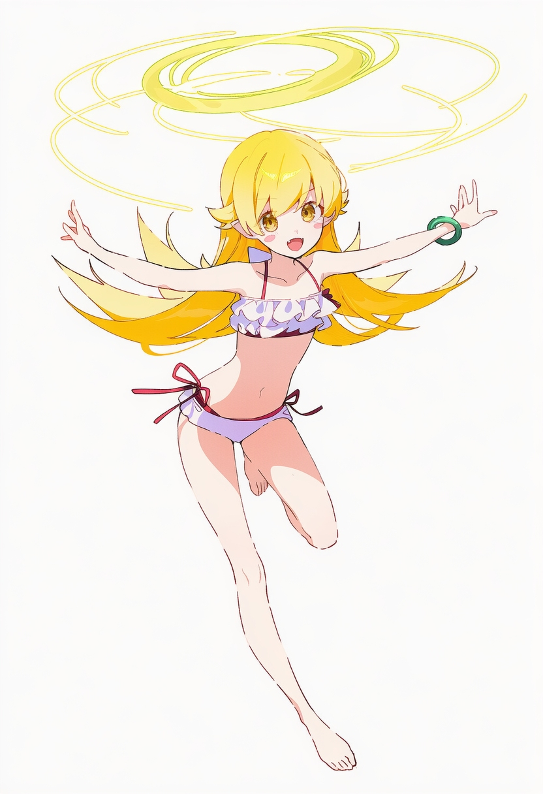
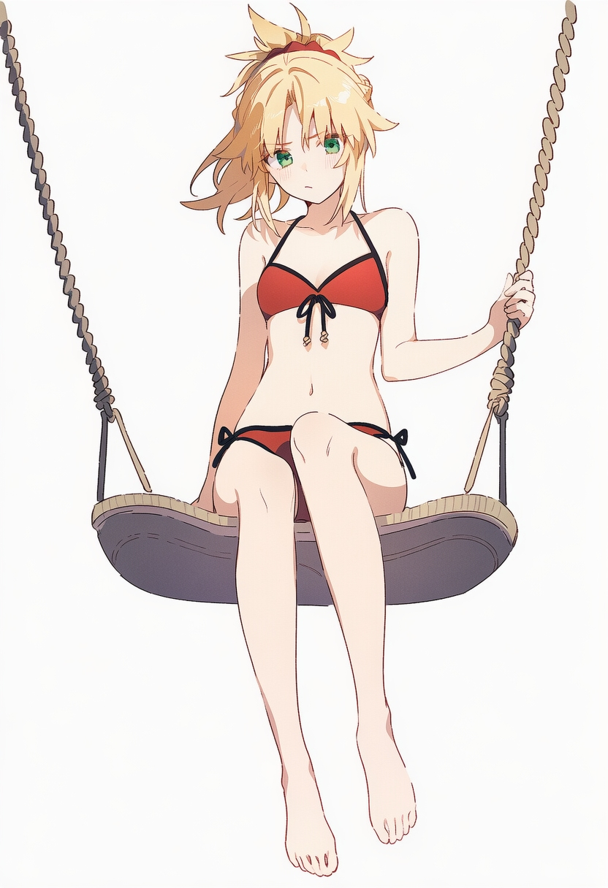
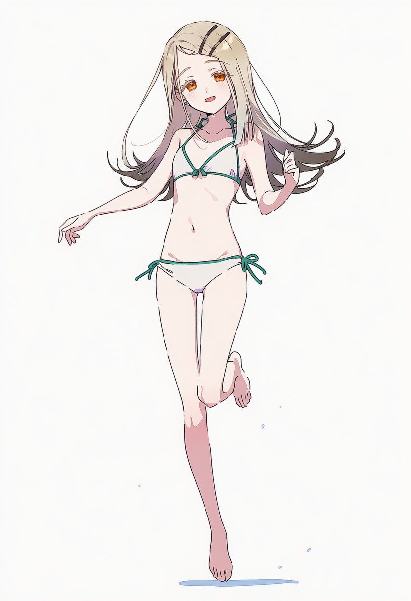
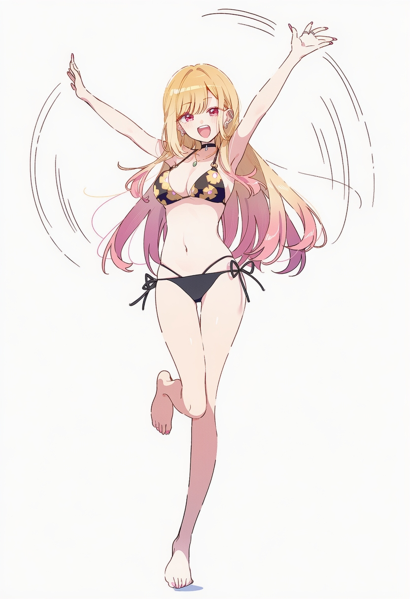
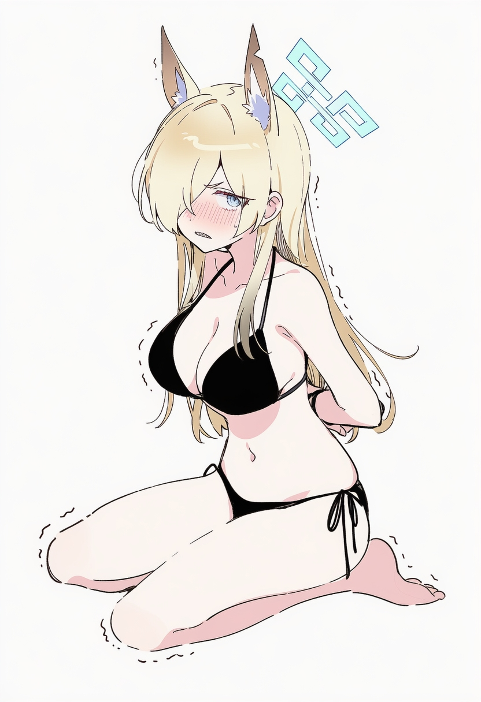
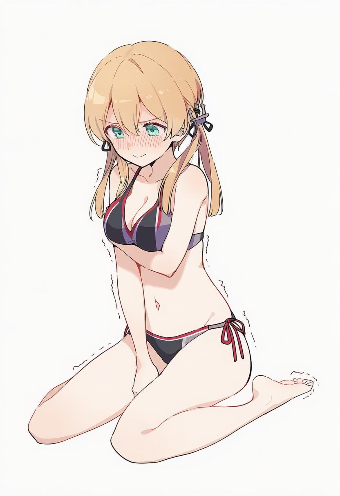
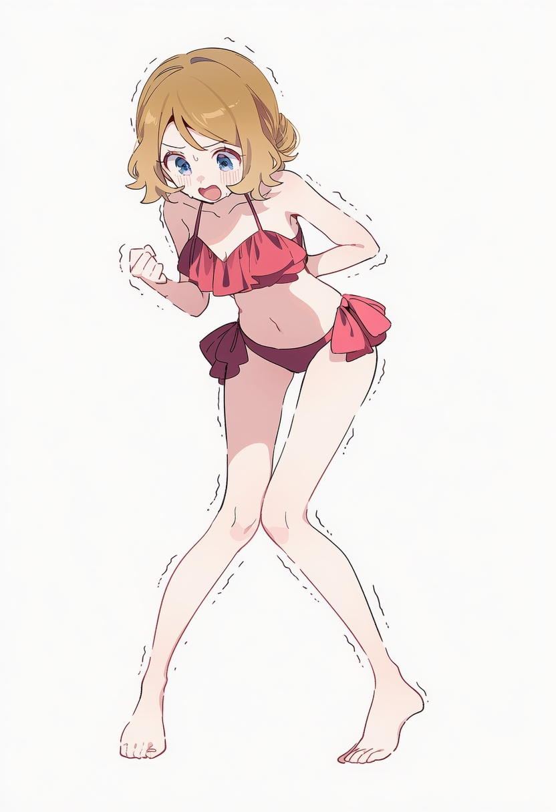
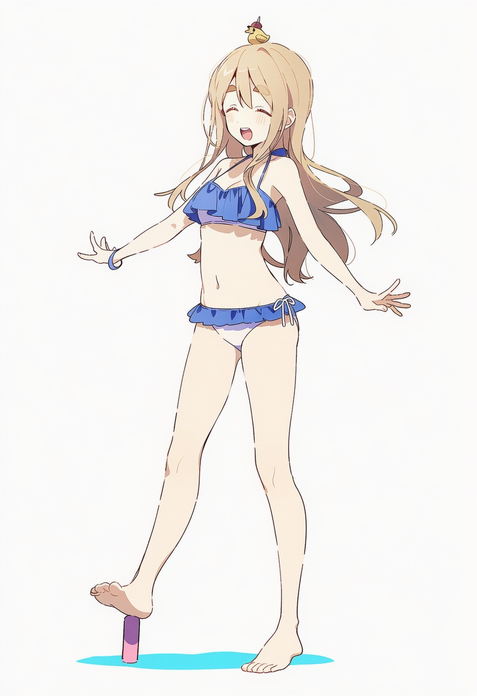

# 腿部姿势与移动 / 旋转/摆动/失衡

[总目录](../README.md) · [原站分类目录](../categories.md) · [英文标签索引](../tags.md) · [服装与构图组合指南](../../README.md)

标题、分类、说明、正负提示词按来源保留；多例图逐张列出。原站标记和说明为参考资料，不作为维护指令。

<a id="raven_composition-3042"></a>

## 翻滚

ID：`raven_composition-3042`；分类：腿部姿势与移动 / 旋转/摆动/失衡；来源标记：`safe`。

来源说明：

> 身体沿地面或自身轴线滚动。

正向提示词：

```text
rolling
```



[在线例图](https://assets.quicktagcloud.com/images/raven_composition/raven_composition-3042.jpg?v=32eaa6bccee2f3c6)

<a id="raven_composition-3043"></a>

## 旋转

ID：`raven_composition-3043`；分类：腿部姿势与移动 / 旋转/摆动/失衡；来源标记：`safe`。

来源说明：

> 身体快速围绕自身轴线转动。

正向提示词：

```text
spinning
```



[在线例图](https://assets.quicktagcloud.com/images/raven_composition/raven_composition-3043.jpg?v=d539eee37be85d10)

<a id="raven_composition-3044"></a>

## 摆荡

ID：`raven_composition-3044`；分类：腿部姿势与移动 / 旋转/摆动/失衡；来源标记：`safe`。

来源说明：

> 身体或肢体来回摆动。

正向提示词：

```text
swinging
```



[在线例图](https://assets.quicktagcloud.com/images/raven_composition/raven_composition-3044.jpg?v=160b815c94871d4a)

<a id="raven_composition-3045"></a>

## 摇摆

ID：`raven_composition-3045`；分类：腿部姿势与移动 / 旋转/摆动/失衡；来源标记：`safe`。

来源说明：

> 身体缓慢左右或前后摆动。

正向提示词：

```text
swaying
```


[在线例图](https://assets.quicktagcloud.com/images/raven_composition/raven_composition-3045.jpg?v=27dcbd52f1e18fb6)

<a id="raven_composition-3046"></a>

## 弹跳

ID：`raven_composition-3046`；分类：腿部姿势与移动 / 旋转/摆动/失衡；来源标记：`safe`。

来源说明：

> 身体上下反复弹起。

正向提示词：

```text
bouncing
```



[在线例图](https://assets.quicktagcloud.com/images/raven_composition/raven_composition-3046.jpg?v=c8a0d7344e9d2572)

<a id="raven_composition-3047"></a>

## 乱挥挣动

ID：`raven_composition-3047`；分类：腿部姿势与移动 / 旋转/摆动/失衡；来源标记：`safe`。

来源说明：

> 四肢失控般大幅挥动。

正向提示词：

```text
flailing
```



[在线例图](https://assets.quicktagcloud.com/images/raven_composition/raven_composition-3047.jpg?v=8eb28ab5fd682891)

<a id="raven_composition-3048"></a>

## 摇晃

ID：`raven_composition-3048`；分类：腿部姿势与移动 / 旋转/摆动/失衡；来源标记：`safe`。

来源说明：

> 身体明显快速来回晃动。

正向提示词：

```text
shaking
```



[在线例图](https://assets.quicktagcloud.com/images/raven_composition/raven_composition-3048.jpg?v=f10d663dda6260f5)

<a id="raven_composition-3049"></a>

## 发抖

ID：`raven_composition-3049`；分类：腿部姿势与移动 / 旋转/摆动/失衡；来源标记：`safe`。

来源说明：

> 身体因紧张、寒冷等轻微持续颤抖。

正向提示词：

```text
trembling
```


[在线例图](https://assets.quicktagcloud.com/images/raven_composition/raven_composition-3049.jpg?v=cb250f8471e6e0ff)

<a id="raven_composition-3050"></a>

## 抽动

ID：`raven_composition-3050`；分类：腿部姿势与移动 / 旋转/摆动/失衡；来源标记：`safe`。

来源说明：

> 身体或肢体出现短促抽动。

正向提示词：

```text
twitching
```



[在线例图](https://assets.quicktagcloud.com/images/raven_composition/raven_composition-3050.jpg?v=97298a4f6110df55)

<a id="raven_composition-3051"></a>

## 挣扎

ID：`raven_composition-3051`；分类：腿部姿势与移动 / 旋转/摆动/失衡；来源标记：`safe`。

来源说明：

> 身体持续用力扭动或反抗。

正向提示词：

```text
struggling
```



[在线例图](https://assets.quicktagcloud.com/images/raven_composition/raven_composition-3051.jpg?v=a73cafb919b3788b)

<a id="raven_composition-3052"></a>

## 保持平衡

ID：`raven_composition-3052`；分类：腿部姿势与移动 / 旋转/摆动/失衡；来源标记：`safe`。

来源说明：

> 身体正在主动维持平衡。

正向提示词：

```text
balancing
```



[在线例图](https://assets.quicktagcloud.com/images/raven_composition/raven_composition-3052.jpg?v=32dcb918ea6d80ed)
