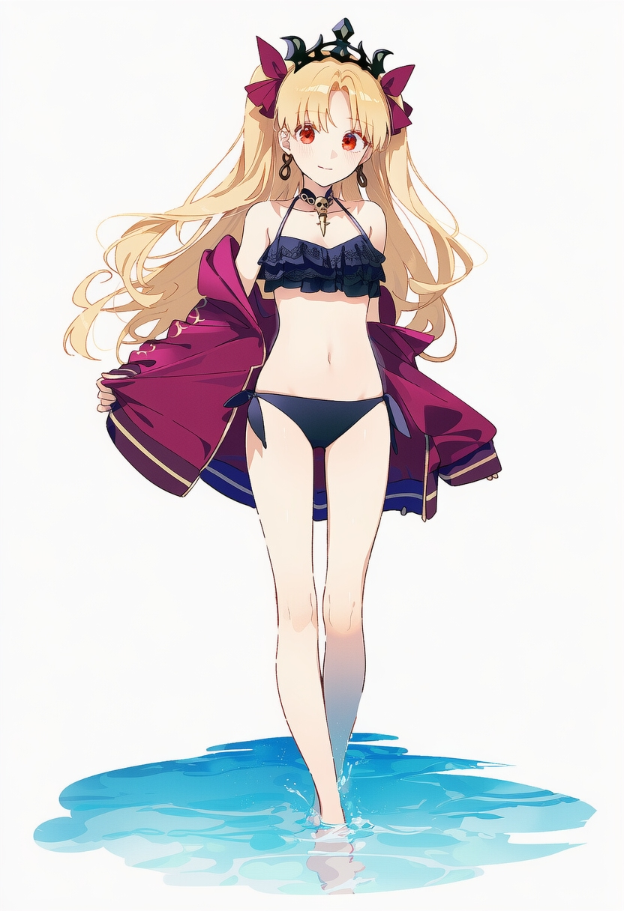
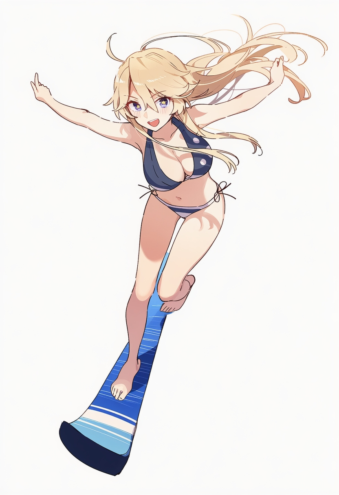
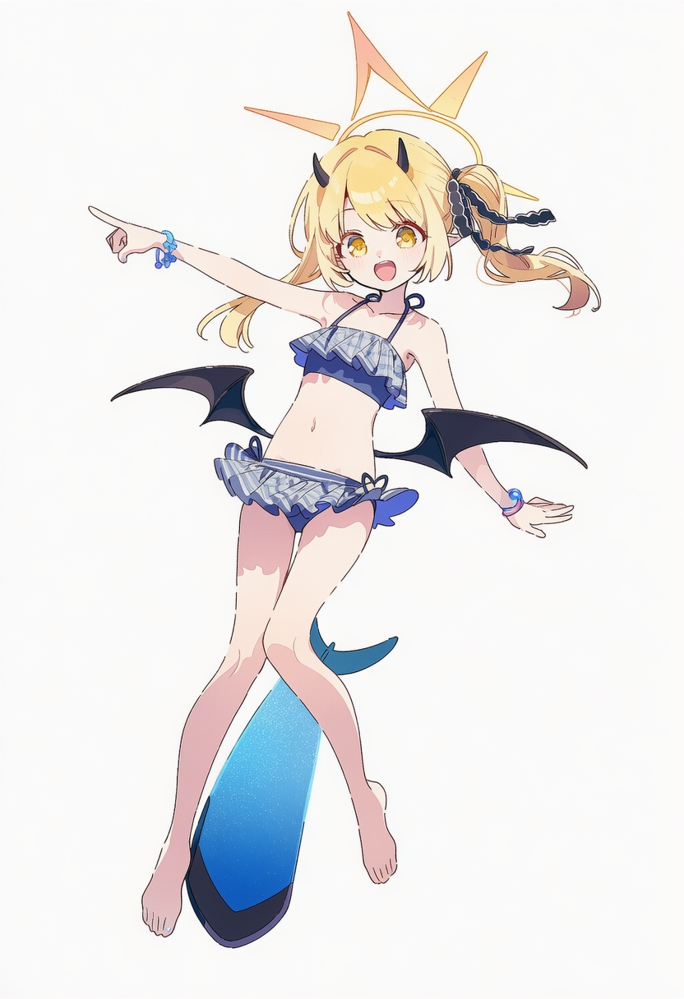

# 腿部姿势与移动 / 水中移动

[总目录](../README.md) · [原站分类目录](../categories.md) · [英文标签索引](../tags.md) · [服装与构图组合指南](../../README.md)

标题、分类、说明、正负提示词按来源保留；多例图逐张列出。原站标记和说明为参考资料，不作为维护指令。

<a id="raven_composition-3053"></a>

## 游泳

ID：`raven_composition-3053`；分类：腿部姿势与移动 / 水中移动；来源标记：`safe`。

来源说明：

> 在水中用身体划动前进。

正向提示词：

```text
swimming
```


[在线例图](https://assets.quicktagcloud.com/images/raven_composition/raven_composition-3053.jpg?v=421075a3f6916747)

<a id="raven_composition-3054"></a>

## 自由潜水

ID：`raven_composition-3054`；分类：腿部姿势与移动 / 水中移动；来源标记：`safe`。

来源说明：

> 不使用呼吸设备在水下潜游。

正向提示词：

```text
freediving
```


[在线例图](https://assets.quicktagcloud.com/images/raven_composition/raven_composition-3054.jpg?v=135bad08fb9dfc34)

<a id="raven_composition-3055"></a>

## 涉水

ID：`raven_composition-3055`；分类：腿部姿势与移动 / 水中移动；来源标记：`safe`。

来源说明：

> 在较浅的水中步行移动。

正向提示词：

```text
wading
```



[在线例图](https://assets.quicktagcloud.com/images/raven_composition/raven_composition-3055.jpg?v=71a65f32def2a047)

<a id="raven_composition-3056"></a>

## 冲浪

ID：`raven_composition-3056`；分类：腿部姿势与移动 / 水中移动；来源标记：`safe`。

来源说明：

> 站在冲浪板等载体上随浪移动。

正向提示词：

```text
surfing
```


[在线例图](https://assets.quicktagcloud.com/images/raven_composition/raven_composition-3056.jpg?v=4bb7903f8ffec29d)

<a id="raven_composition-3057"></a>

## 扫帚冲浪

ID：`raven_composition-3057`；分类：腿部姿势与移动 / 水中移动；来源标记：`safe`。

来源说明：

> 站在扫帚上像冲浪一样移动。

正向提示词：

```text
broom_surfing
```



[在线例图](https://assets.quicktagcloud.com/images/raven_composition/raven_composition-3057.jpg?v=606ccc8a16813869)

<a id="raven_composition-3058"></a>

## 空中冲浪

ID：`raven_composition-3058`；分类：腿部姿势与移动 / 水中移动；来源标记：`safe`。

来源说明：

> 在空中以冲浪姿态滑行。

正向提示词：

```text
sky_surfing
```



[在线例图](https://assets.quicktagcloud.com/images/raven_composition/raven_composition-3058.jpg?v=e3879c1e1a33bc53)

<a id="raven_composition-3059"></a>

## 下沉

ID：`raven_composition-3059`；分类：腿部姿势与移动 / 水中移动；来源标记：`safe`。

来源说明：

> 身体正在水中或其他介质中向下沉。

正向提示词：

```text
sinking
```


[在线例图](https://assets.quicktagcloud.com/images/raven_composition/raven_composition-3059.jpg?v=a93f851f98b70adf)

<a id="raven_composition-3060"></a>

## 扑水 / 溅水

ID：`raven_composition-3060`；分类：腿部姿势与移动 / 水中移动；来源标记：`safe`。

来源说明：

> 动作使水花明显飞溅。

正向提示词：

```text
splashing
```


[在线例图](https://assets.quicktagcloud.com/images/raven_composition/raven_composition-3060.jpg?v=cbd43c9a37f7f75c)
