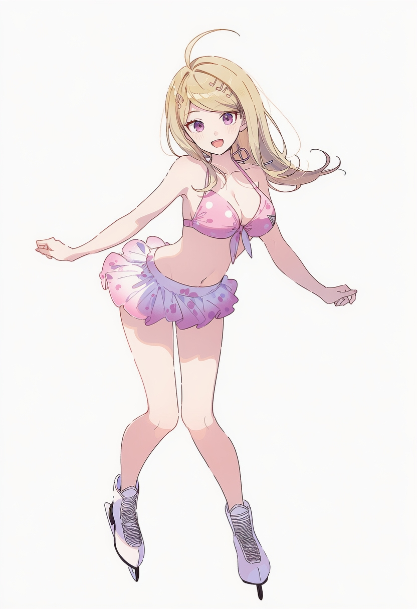
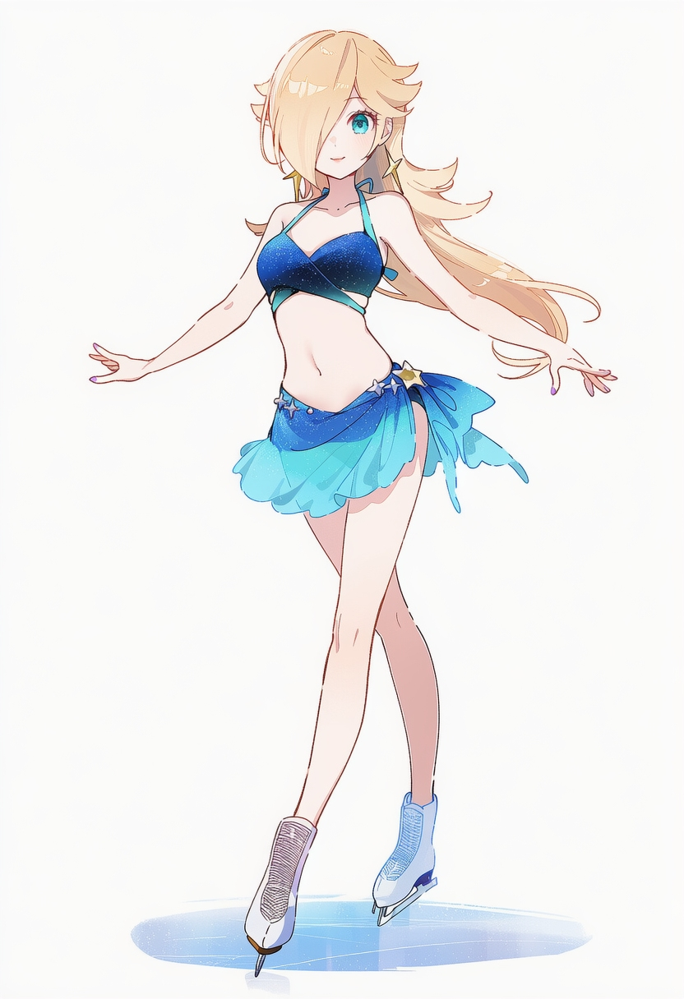
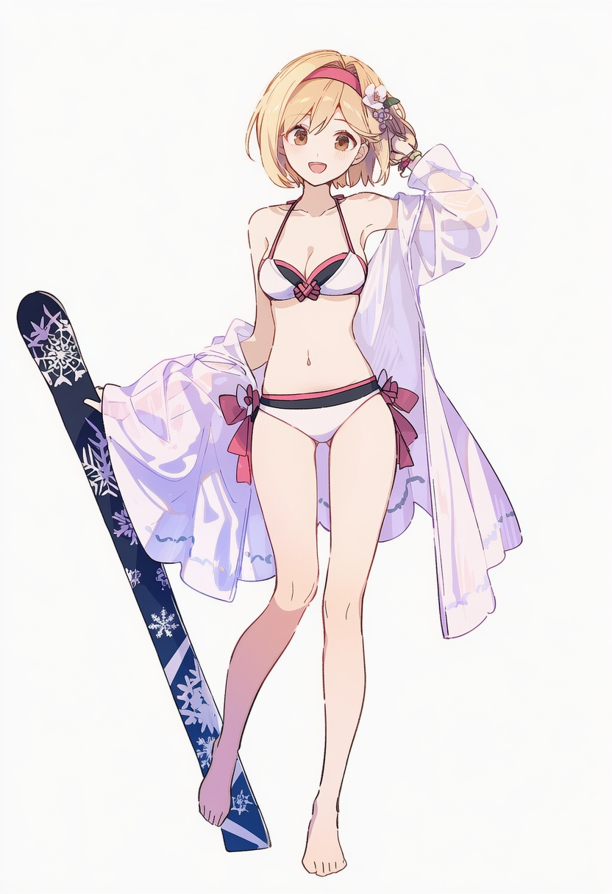
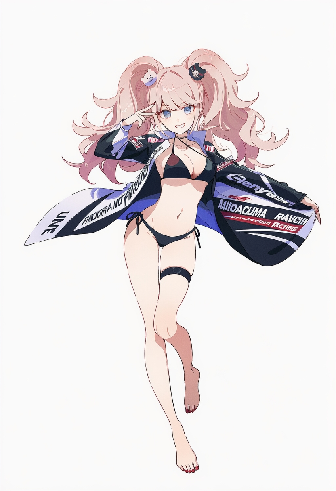
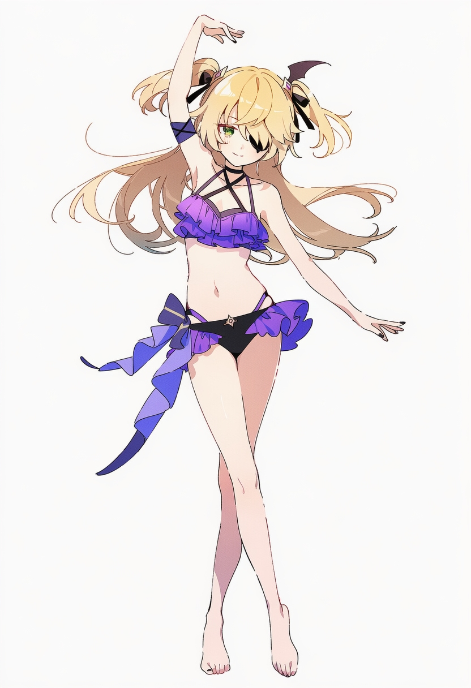
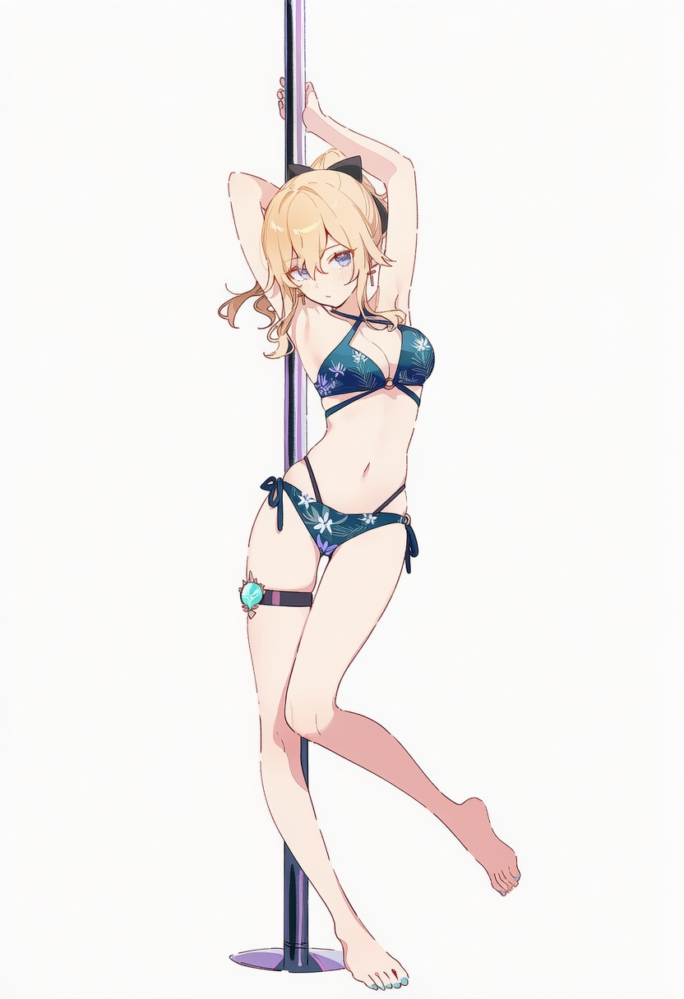

# 腿部姿势与移动 / 运动型移动

[总目录](../README.md) · [原站分类目录](../categories.md) · [英文标签索引](../tags.md) · [服装与构图组合指南](../../README.md)

标题、分类、说明、正负提示词按来源保留；多例图逐张列出。原站标记和说明为参考资料，不作为维护指令。

<a id="raven_composition-3061"></a>

## 滑行运动

ID：`raven_composition-3061`；分类：腿部姿势与移动 / 运动型移动；来源标记：`safe`。

来源说明：

> 穿滑冰鞋或轮滑装备滑行。

正向提示词：

```text
skating
```



[在线例图](https://assets.quicktagcloud.com/images/raven_composition/raven_composition-3061.jpg?v=f31fc3cba03b12da)

<a id="raven_composition-3062"></a>

## 花样滑冰

ID：`raven_composition-3062`；分类：腿部姿势与移动 / 运动型移动；来源标记：`safe`。

来源说明：

> 进行花样滑冰动作。

正向提示词：

```text
figure_skating
```


[在线例图](https://assets.quicktagcloud.com/images/raven_composition/raven_composition-3062.jpg?v=045d49b32f059985)

<a id="raven_composition-3063"></a>

## 滑冰

ID：`raven_composition-3063`；分类：腿部姿势与移动 / 运动型移动；来源标记：`safe`。

来源说明：

> 在冰面上用冰刀鞋滑行。

正向提示词：

```text
ice_skating
```



[在线例图](https://assets.quicktagcloud.com/images/raven_composition/raven_composition-3063.jpg?v=1bdba1838ddc42db)

<a id="raven_composition-3064"></a>

## 滑雪

ID：`raven_composition-3064`；分类：腿部姿势与移动 / 运动型移动；来源标记：`safe`。

来源说明：

> 使用滑雪板在雪地移动。

正向提示词：

```text
skiing
```



[在线例图](https://assets.quicktagcloud.com/images/raven_composition/raven_composition-3064.jpg?v=6ab63c1694bdd35a)

<a id="raven_composition-3065"></a>

## 划船

ID：`raven_composition-3065`；分类：腿部姿势与移动 / 运动型移动；来源标记：`safe`。

来源说明：

> 用桨驱动船只移动。

正向提示词：

```text
rowing
```


[在线例图](https://assets.quicktagcloud.com/images/raven_composition/raven_composition-3065.jpg?v=a6678bb92c7afe58)

<a id="raven_composition-3066"></a>

## 竞速

ID：`raven_composition-3066`；分类：腿部姿势与移动 / 运动型移动；来源标记：`safe`。

来源说明：

> 角色正在进行速度竞赛。

正向提示词：

```text
racing
```



[在线例图](https://assets.quicktagcloud.com/images/raven_composition/raven_composition-3066.jpg?v=6000bf67f452f85f)

<a id="raven_composition-3067"></a>

## 跳舞

ID：`raven_composition-3067`；分类：腿部姿势与移动 / 运动型移动；来源标记：`safe`。

来源说明：

> 身体随节奏做连续舞蹈动作。

正向提示词：

```text
dancing
```



[在线例图](https://assets.quicktagcloud.com/images/raven_composition/raven_composition-3067.jpg?v=853339cbc64368ab)

<a id="raven_composition-3068"></a>

## 钢管舞

ID：`raven_composition-3068`；分类：腿部姿势与移动 / 运动型移动；来源标记：`safe`。

来源说明：

> 围绕钢管进行舞蹈和身体动作。

正向提示词：

```text
pole_dancing
```



[在线例图](https://assets.quicktagcloud.com/images/raven_composition/raven_composition-3068.jpg?v=b2307a1232e0e2d8)
