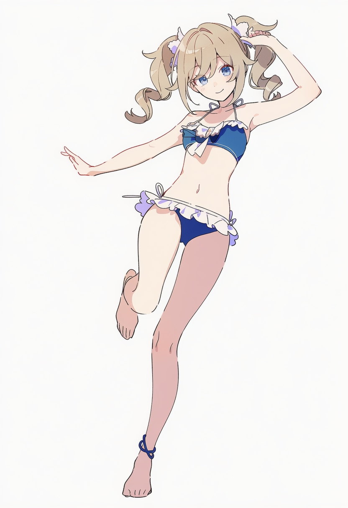
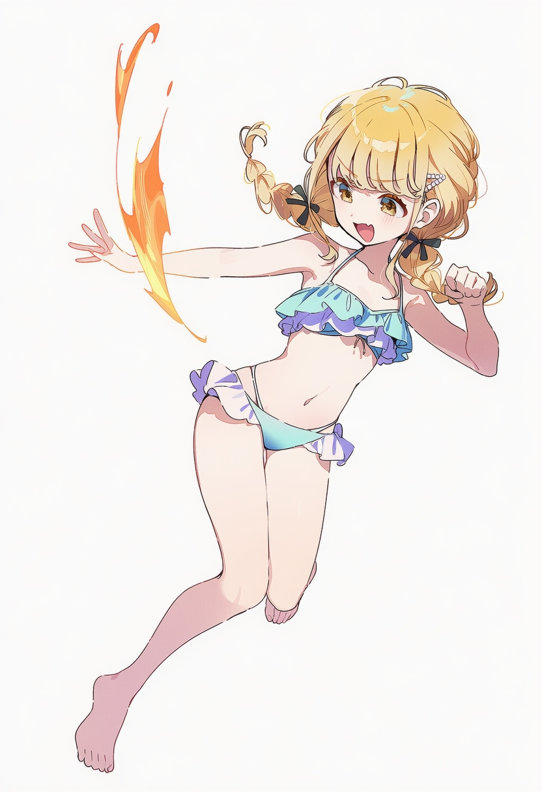
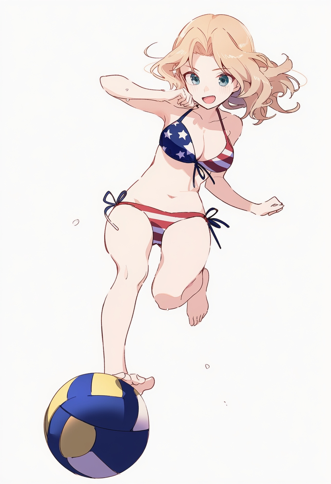
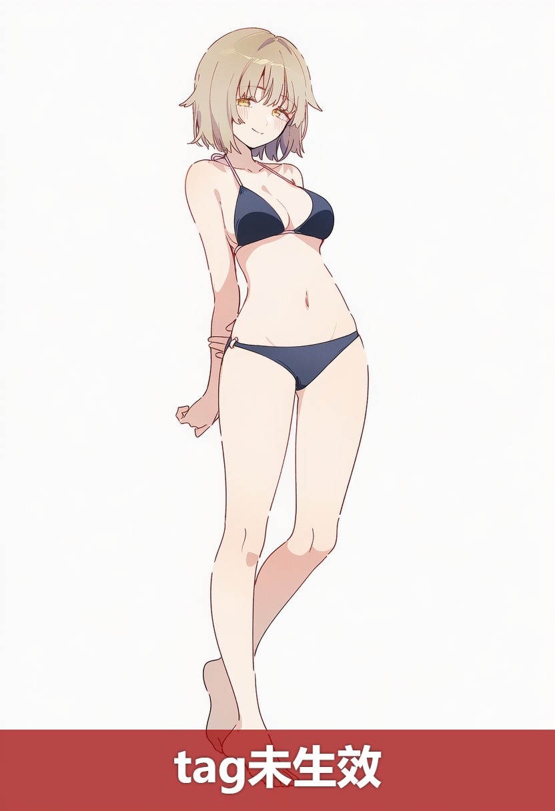
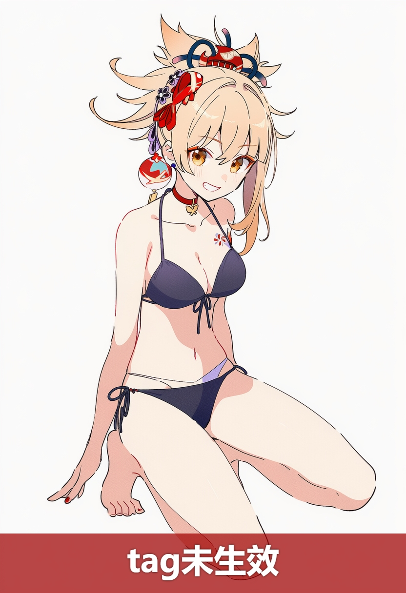
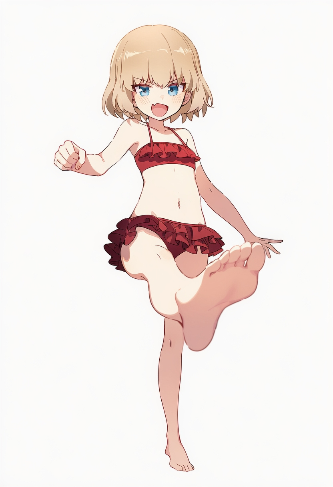
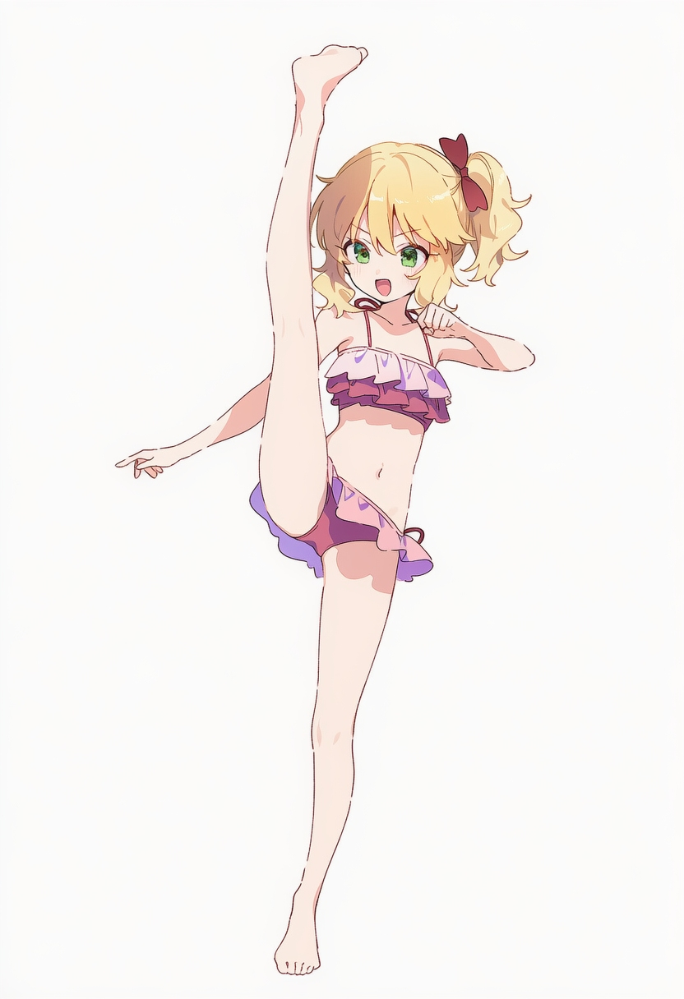
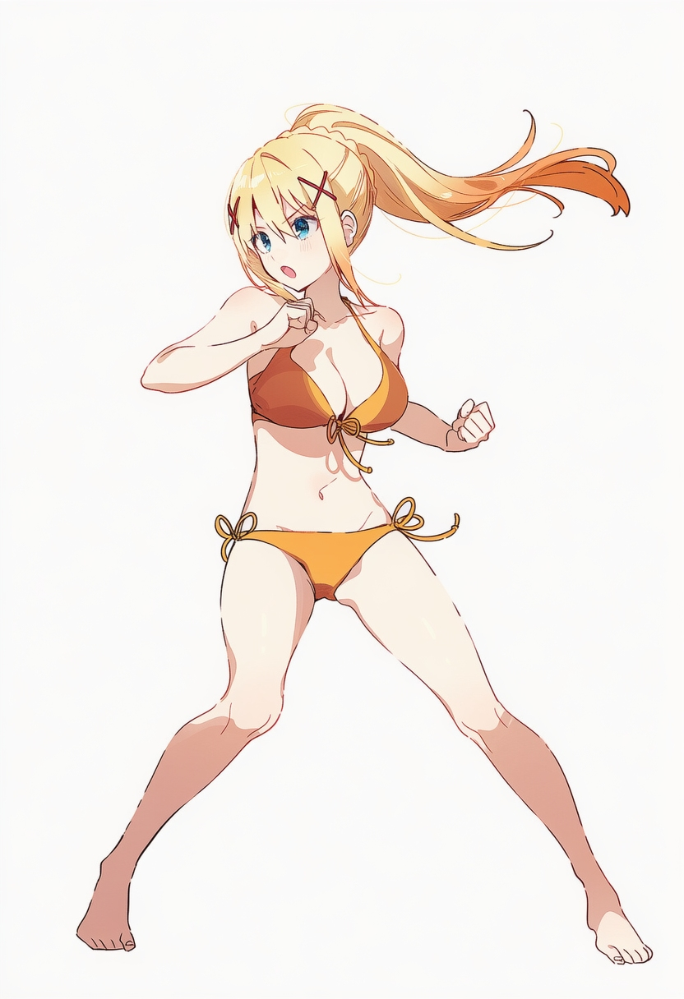

# 腿部姿势与移动 / 踢击/战斗步法

[总目录](../README.md) · [原站分类目录](../categories.md) · [英文标签索引](../tags.md) · [服装与构图组合指南](../../README.md)

标题、分类、说明、正负提示词按来源保留；多例图逐张列出。原站标记和说明为参考资料，不作为维护指令。

<a id="raven_composition-3069"></a>

## 踢击

ID：`raven_composition-3069`；分类：腿部姿势与移动 / 踢击/战斗步法；来源标记：`safe`。

来源说明：

> 用腿或脚击打人物或物体的动作。

正向提示词：

```text
kicking
```



[在线例图](https://assets.quicktagcloud.com/images/raven_composition/raven_composition-3069.jpg?v=30a5dbc4c60c7f06)

<a id="raven_composition-3070"></a>

## 飞踢

ID：`raven_composition-3070`；分类：腿部姿势与移动 / 踢击/战斗步法；来源标记：`safe`。

来源说明：

> 腾空或跃起后用腿脚进行踢击。

正向提示词：

```text
flying_kick
```



[在线例图](https://assets.quicktagcloud.com/images/raven_composition/raven_composition-3070.jpg?v=20e36994adbe7980)

<a id="raven_composition-3071"></a>

## 飞身双脚踢 / Dropkick

ID：`raven_composition-3071`；分类：腿部姿势与移动 / 踢击/战斗步法；来源标记：`safe`。

来源说明：

> 跳起后以双脚同时朝目标踢出，身体常呈后仰或近水平状态。

正向提示词：

```text
drop_kick
```



[在线例图](https://assets.quicktagcloud.com/images/raven_composition/raven_composition-3071.jpg?v=8ea34038e5bd361c)

<a id="raven_composition-3072"></a>

## 裆部踢击

ID：`raven_composition-3072`；分类：腿部姿势与移动 / 踢击/战斗步法；来源标记：`safe`。

来源说明：

> 踢向对方裆部的攻击动作。

正向提示词：

```text
crotch_kick
```



[在线例图](https://assets.quicktagcloud.com/images/raven_composition/raven_composition-3072.jpg?v=7959955f1c71d5e1)

<a id="raven_composition-3073"></a>

## 膝击

ID：`raven_composition-3073`；分类：腿部姿势与移动 / 踢击/战斗步法；来源标记：`safe`。

来源说明：

> 用膝部向目标进行撞击或攻击。

正向提示词：

```text
kneeing
```



[在线例图](https://assets.quicktagcloud.com/images/raven_composition/raven_composition-3073.jpg?v=ec699d3781c11095)

<a id="raven_composition-3074"></a>

## 踢向观众

ID：`raven_composition-3074`；分类：腿部姿势与移动 / 踢击/战斗步法；来源标记：`safe`。

来源说明：

> 角色准备朝画面观看者方向踢击；Danbooru 将从下方重踩的视角区分为 stomping_viewer。

正向提示词：

```text
kicking_viewer
```



[在线例图](https://assets.quicktagcloud.com/images/raven_composition/raven_composition-3074.jpg?v=d618a07983cf4269)

<a id="raven_composition-3075"></a>

## 高踢

ID：`raven_composition-3075`；分类：腿部姿势与移动 / 踢击/战斗步法；来源标记：`safe`。

来源说明：

> 将腿抬到较高位置进行踢击。

正向提示词：

```text
high_kick
```



[在线例图](https://assets.quicktagcloud.com/images/raven_composition/raven_composition-3075.jpg?v=ae10a47a44c2d408)

<a id="raven_composition-3076"></a>

## 战斗架势

ID：`raven_composition-3076`；分类：腿部姿势与移动 / 踢击/战斗步法；来源标记：`safe`。

来源说明：

> 双腿分配重心，呈准备交战或防守的架势。

正向提示词：

```text
fighting_stance
```



[在线例图](https://assets.quicktagcloud.com/images/raven_composition/raven_composition-3076.jpg?v=de9a24d4dae6fa61)
