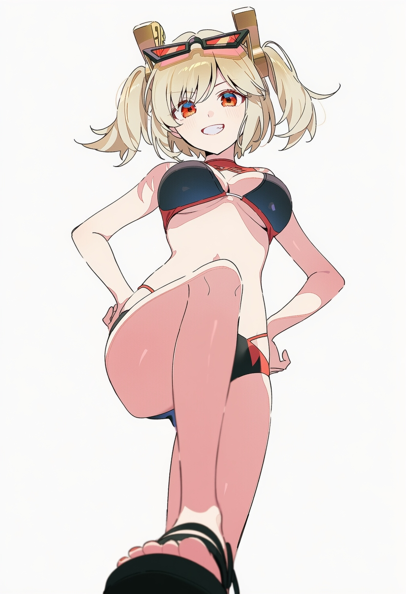
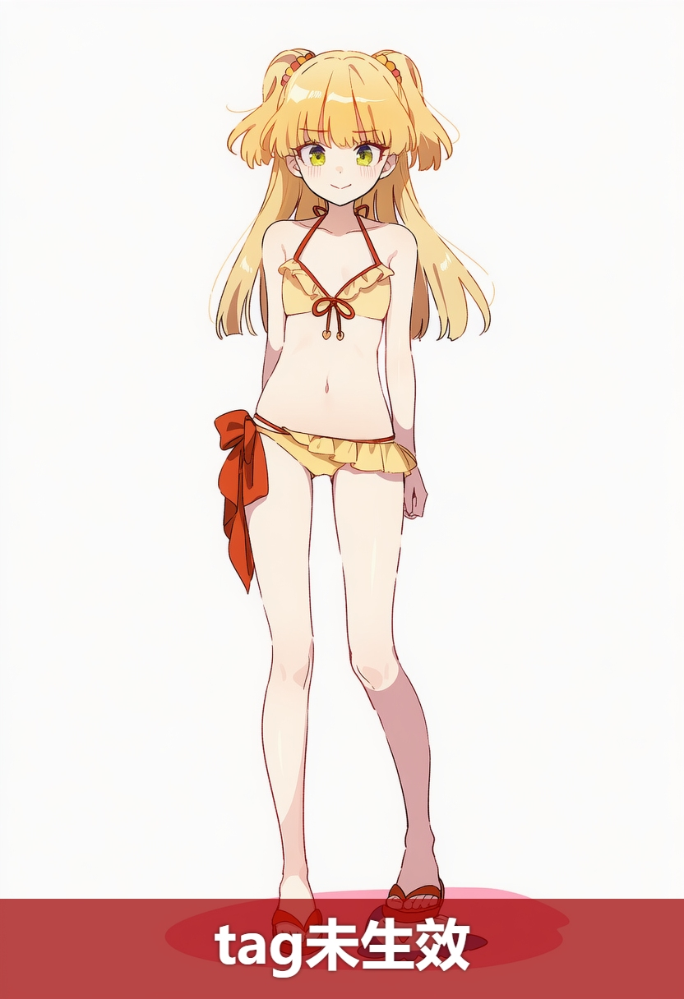
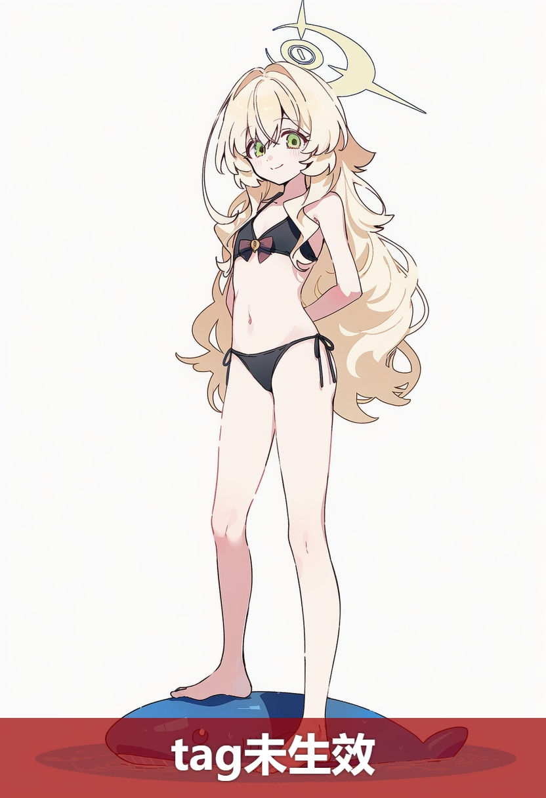
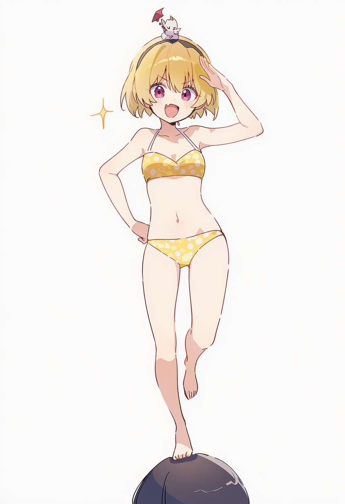

# 腿部姿势与移动 / 踩踏/脚部互动

[总目录](../README.md) · [原站分类目录](../categories.md) · [英文标签索引](../tags.md) · [服装与构图组合指南](../../README.md)

标题、分类、说明、正负提示词按来源保留；多例图逐张列出。原站标记和说明为参考资料，不作为维护指令。

<a id="raven_composition-3077"></a>

## 踩向观众

ID：`raven_composition-3077`；分类：腿部姿势与移动 / 踩踏/脚部互动；来源标记：`safe`。

来源说明：

> 从观看者视角，角色抬脚准备或正在向镜头方向重踩，常伴随单脚站立。

正向提示词：

```text
stomping_viewer
```


[在线例图](https://assets.quicktagcloud.com/images/raven_composition/raven_composition-3077.jpg?v=cfc3155be20f6006)

<a id="raven_composition-3078"></a>

## 踩到观众

ID：`raven_composition-3078`；分类：腿部姿势与移动 / 踩踏/脚部互动；来源标记：`safe`。

来源说明：

> 从观看者视角，角色的脚已经踩到画面边缘/观看者方向，强调“踩上去”而非空中重踩。

正向提示词：

```text
stepping_on_viewer
```



[在线例图](https://assets.quicktagcloud.com/images/raven_composition/raven_composition-3078.jpg?v=1c068be266268244)

<a id="raven_composition-3079"></a>

## 被踩 / 踩踏互动

ID：`raven_composition-3079`；分类：腿部姿势与移动 / 踩踏/脚部互动；来源标记：`safe`。

来源说明：

> 画面中一名角色正被另一名角色踩在身上，表示踩踏发生在角色之间。

正向提示词：

```text
stepped_on
```



[在线例图](https://assets.quicktagcloud.com/images/raven_composition/raven_composition-3079.jpg?v=3df11b43b90be21f)

<a id="raven_composition-3080"></a>

## 站在他人身上

ID：`raven_composition-3080`；分类：腿部姿势与移动 / 踩踏/脚部互动；来源标记：`safe`。

来源说明：

> 角色以双脚站在另一角色身体上。

正向提示词：

```text
standing_on_person
```



[在线例图](https://assets.quicktagcloud.com/images/raven_composition/raven_composition-3080.jpg?v=36027b9b53e2ca52)

<a id="raven_composition-3081"></a>

## 站在他人头上

ID：`raven_composition-3081`；分类：腿部姿势与移动 / 踩踏/脚部互动；来源标记：`safe`。

来源说明：

> 角色以脚站在另一角色头部上方或头上。

正向提示词：

```text
standing_on_another's_head
```



[在线例图](https://assets.quicktagcloud.com/images/raven_composition/raven_composition-3081.jpg?v=6911273c3a785b6b)
