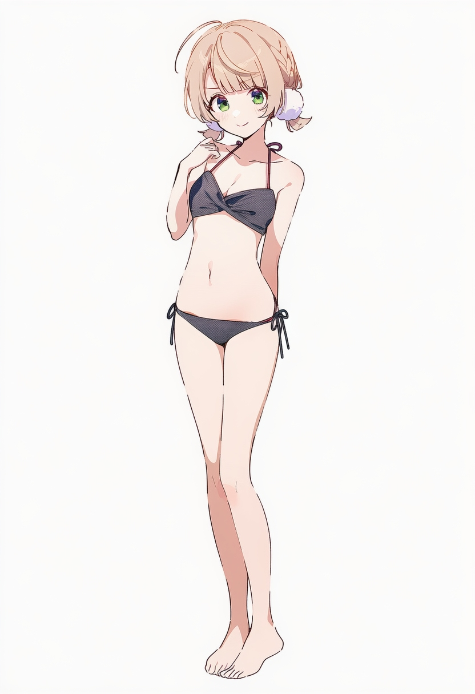
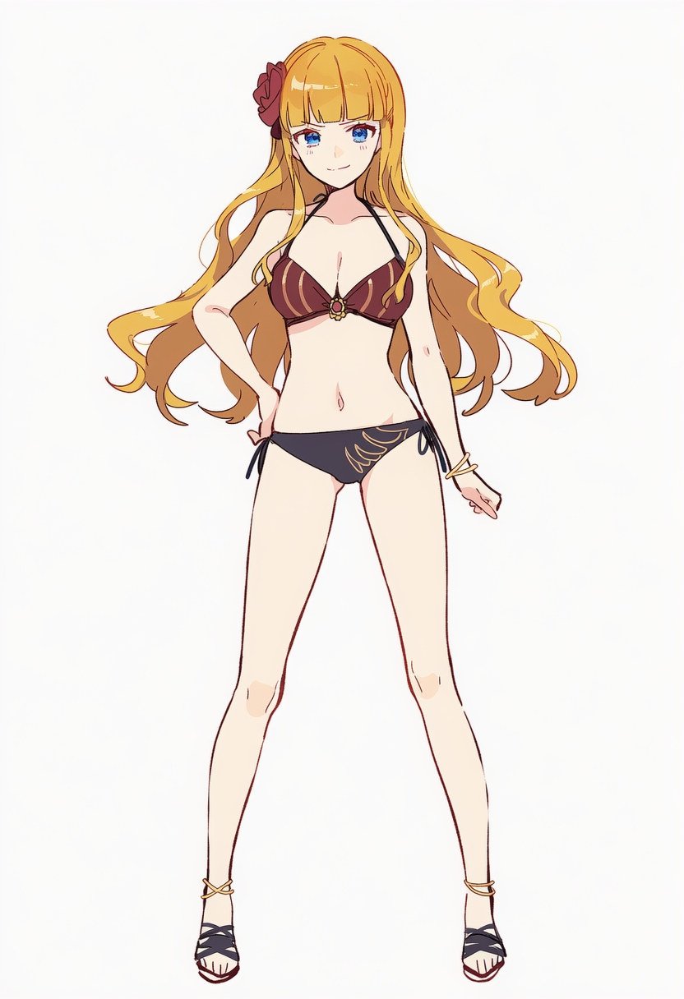
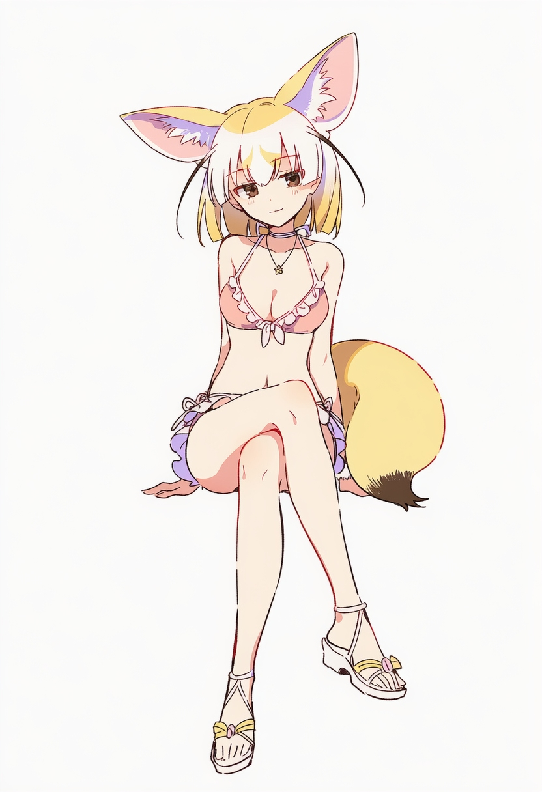
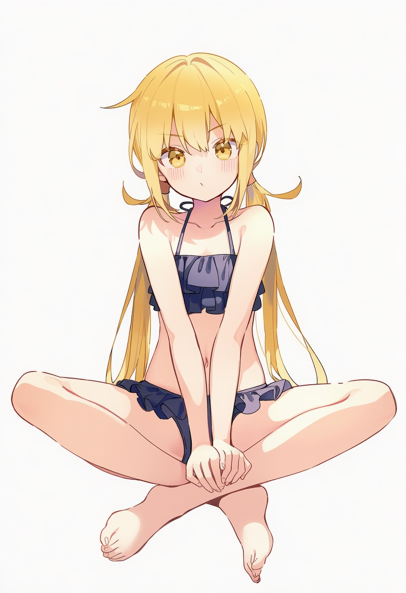
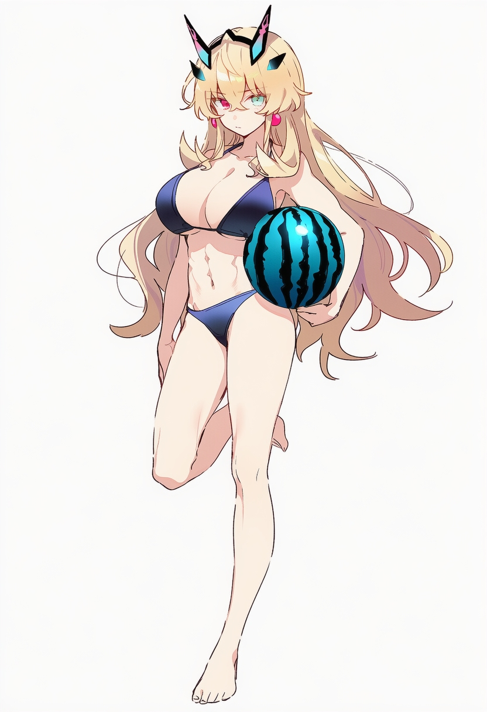
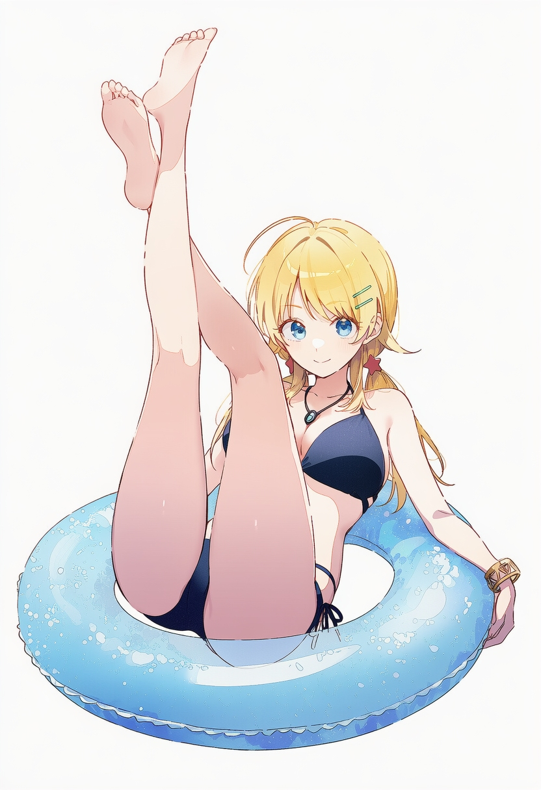
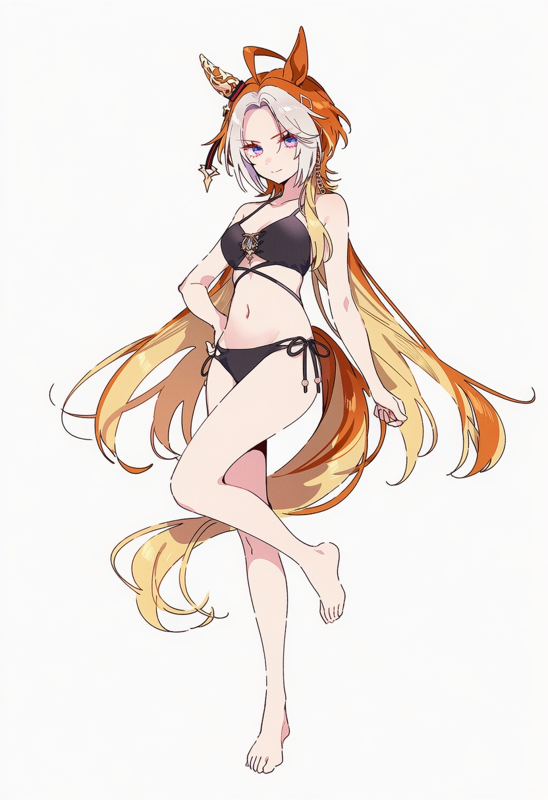
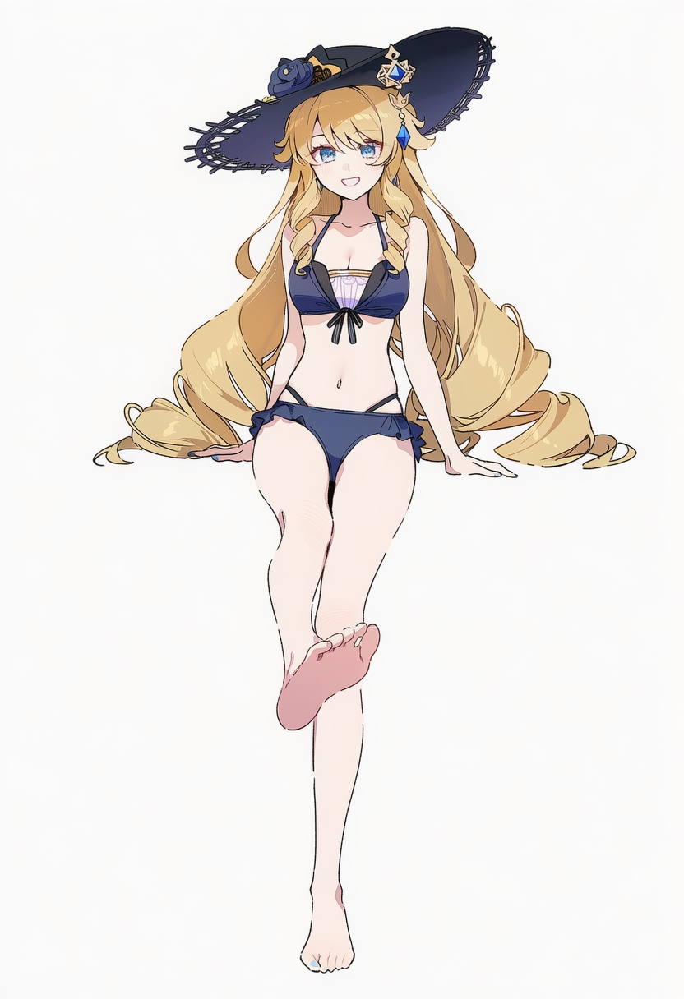
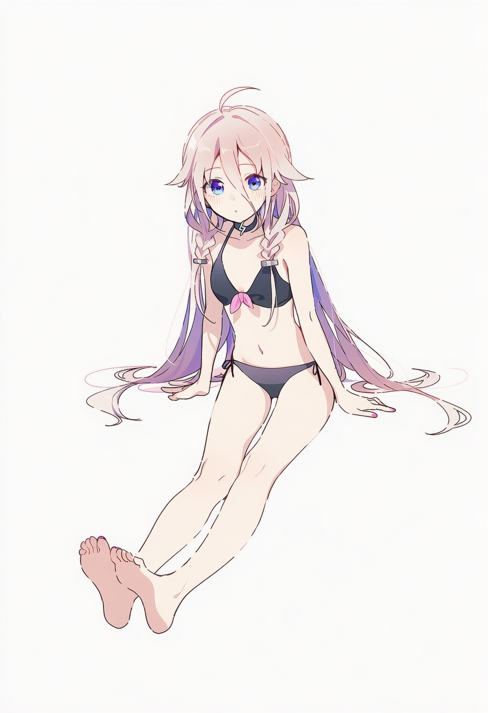
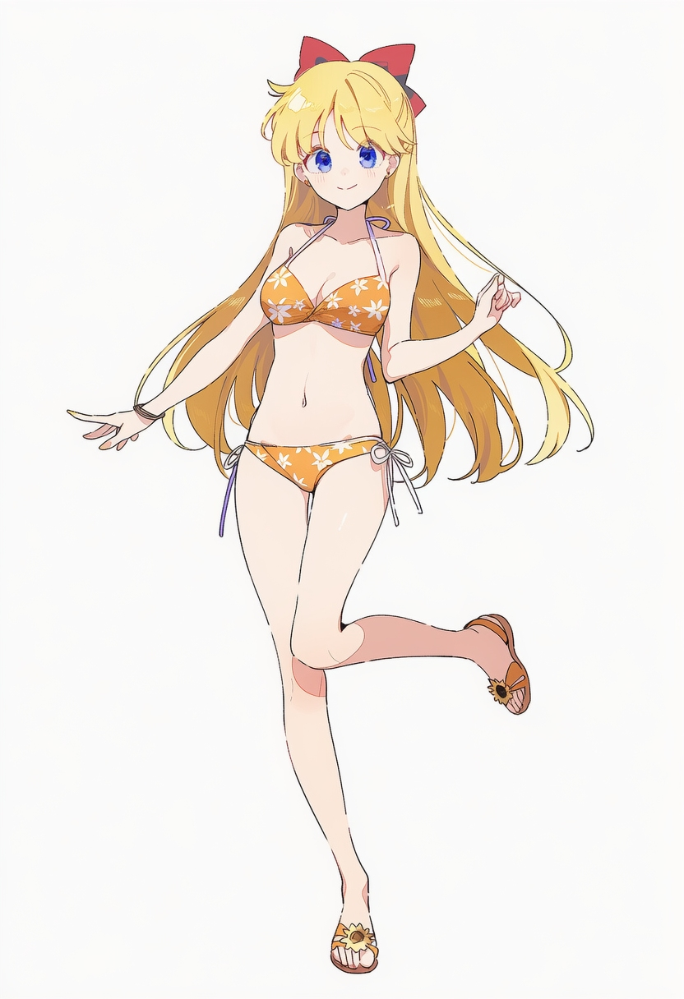

# 腿部姿势与移动 / 腿部整体位置

[总目录](../README.md) · [原站分类目录](../categories.md) · [英文标签索引](../tags.md) · [服装与构图组合指南](../../README.md)

标题、分类、说明、正负提示词按来源保留；多例图逐张列出。原站标记和说明为参考资料，不作为维护指令。

<a id="raven_composition-3082"></a>

## 双腿并拢

ID：`raven_composition-3082`；分类：腿部姿势与移动 / 腿部整体位置；来源标记：`safe`。

来源说明：

> 双腿整体靠拢在一起。

正向提示词：

```text
legs_together
```



[在线例图](https://assets.quicktagcloud.com/images/raven_composition/raven_composition-3082.jpg?v=edd0f8285f5533f5)

<a id="raven_composition-3083"></a>

## 双腿分开

ID：`raven_composition-3083`；分类：腿部姿势与移动 / 腿部整体位置；来源标记：`safe`。

来源说明：

> 双腿明显向两侧分开。

正向提示词：

```text
legs_apart
```



[在线例图](https://assets.quicktagcloud.com/images/raven_composition/raven_composition-3083.jpg?v=67be4263c6a82c4d)

<a id="raven_composition-3084"></a>

## 交叉双腿

ID：`raven_composition-3084`；分类：腿部姿势与移动 / 腿部整体位置；来源标记：`safe`。

来源说明：

> 双腿在膝、大腿或小腿处交叉。

正向提示词：

```text
crossed_legs
```



[在线例图](https://assets.quicktagcloud.com/images/raven_composition/raven_composition-3084.jpg?v=5cea73cb61272aee)

<a id="raven_composition-3085"></a>

## 脚踝交叉

ID：`raven_composition-3085`；分类：腿部姿势与移动 / 腿部整体位置；来源标记：`safe`。

来源说明：

> 双腿主要在脚踝处交叉。

正向提示词：

```text
crossed_ankles
```



[在线例图](https://assets.quicktagcloud.com/images/raven_composition/raven_composition-3085.jpg?v=9f4f1a5209499a1a)

<a id="raven_composition-3086"></a>

## 双腿折叠

ID：`raven_composition-3086`；分类：腿部姿势与移动 / 腿部整体位置；来源标记：`safe`。

来源说明：

> 膝盖完全弯曲，小腿贴近大腿。

正向提示词：

```text
legs_folded
```


[在线例图](https://assets.quicktagcloud.com/images/raven_composition/raven_composition-3086.jpg?v=e1659095a9dd030b)

<a id="raven_composition-3087"></a>

## 单腿抬起

ID：`raven_composition-3087`；分类：腿部姿势与移动 / 腿部整体位置；来源标记：`safe`。

来源说明：

> 一条腿明显抬高。

正向提示词：

```text
leg_up
```



[在线例图](https://assets.quicktagcloud.com/images/raven_composition/raven_composition-3087.jpg?v=943adce2853ed22e)

<a id="raven_composition-3088"></a>

## 双腿抬起

ID：`raven_composition-3088`；分类：腿部姿势与移动 / 腿部整体位置；来源标记：`safe`。

来源说明：

> 两条腿同时抬高。

正向提示词：

```text
legs_up
```



[在线例图](https://assets.quicktagcloud.com/images/raven_composition/raven_composition-3088.jpg?v=a8ed4fe11adfc845)

<a id="raven_composition-3089"></a>

## 抬腿动作

ID：`raven_composition-3089`；分类：腿部姿势与移动 / 腿部整体位置；来源标记：`safe`。

来源说明：

> 一条腿主动向上抬起形成明显姿态。

正向提示词：

```text
leg_lift
```



[在线例图](https://assets.quicktagcloud.com/images/raven_composition/raven_composition-3089.jpg?v=0da167a28721fb92)

<a id="raven_composition-3090"></a>

## 单腿伸直

ID：`raven_composition-3090`；分类：腿部姿势与移动 / 腿部整体位置；来源标记：`safe`。

来源说明：

> 一条腿完全向外伸直。

正向提示词：

```text
outstretched_leg
```



[在线例图](https://assets.quicktagcloud.com/images/raven_composition/raven_composition-3090.jpg?v=53262bbb4ca0c449)

<a id="raven_composition-3091"></a>

## 双腿伸直

ID：`raven_composition-3091`；分类：腿部姿势与移动 / 腿部整体位置；来源标记：`safe`。

来源说明：

> 两条腿同时向外伸直。

正向提示词：

```text
outstretched_legs
```



[在线例图](https://assets.quicktagcloud.com/images/raven_composition/raven_composition-3091.jpg?v=1d4a7dc06bb75247)

<a id="raven_composition-3092"></a>

## 单腿站立

ID：`raven_composition-3092`；分类：腿部姿势与移动 / 腿部整体位置；来源标记：`safe`。

来源说明：

> 只用一条腿支撑身体站立。

正向提示词：

```text
standing_on_one_leg
```



[在线例图](https://assets.quicktagcloud.com/images/raven_composition/raven_composition-3092.jpg?v=af4f781921d090f3)
