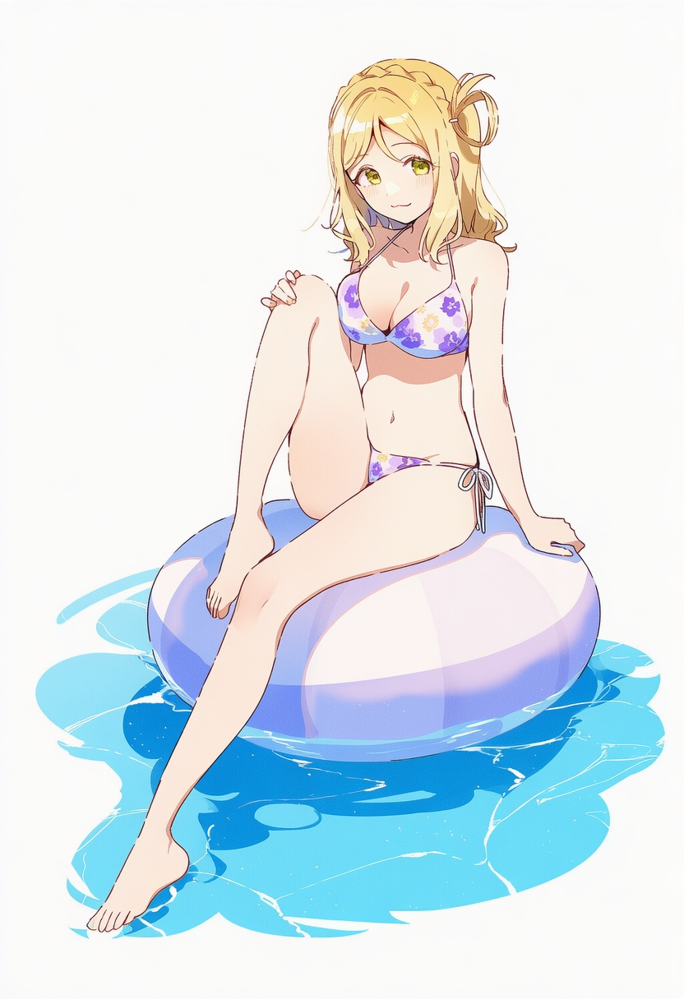
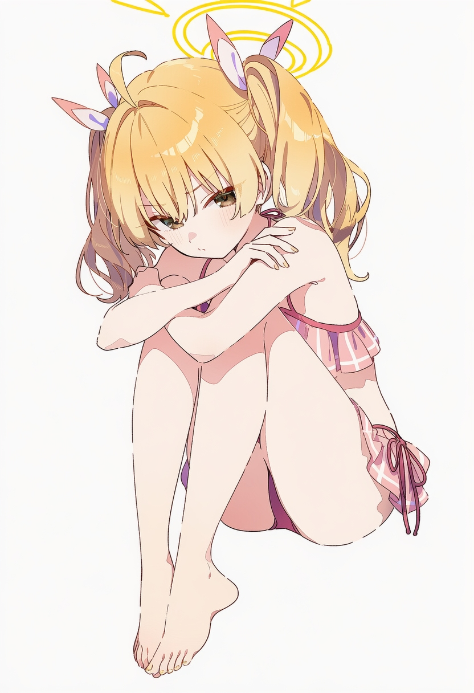
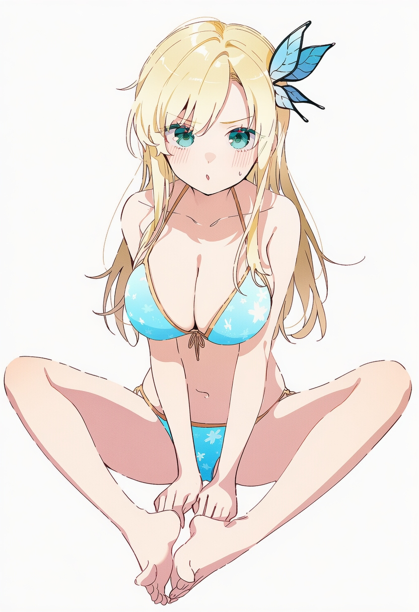

# 腿部姿势与移动 / 膝盖位置/屈腿

[总目录](../README.md) · [原站分类目录](../categories.md) · [英文标签索引](../tags.md) · [服装与构图组合指南](../../README.md)

标题、分类、说明、正负提示词按来源保留；多例图逐张列出。原站标记和说明为参考资料，不作为维护指令。

<a id="raven_composition-3093"></a>

## 单膝抬起

ID：`raven_composition-3093`；分类：腿部姿势与移动 / 膝盖位置/屈腿；来源标记：`safe`。

来源说明：

> 一侧膝盖明显抬高。

正向提示词：

```text
knee_up
```



[在线例图](https://assets.quicktagcloud.com/images/raven_composition/raven_composition-3093.jpg?v=dab3d24a8fd97e0e)

<a id="raven_composition-3094"></a>

## 双膝抬起

ID：`raven_composition-3094`；分类：腿部姿势与移动 / 膝盖位置/屈腿；来源标记：`safe`。

来源说明：

> 坐、躺或悬空时双膝弯曲抬起。

正向提示词：

```text
knees_up
```


[在线例图](https://assets.quicktagcloud.com/images/raven_composition/raven_composition-3094.jpg?v=4a6753b80b54f29b)

<a id="raven_composition-3095"></a>

## 屈膝靠胸

ID：`raven_composition-3095`；分类：腿部姿势与移动 / 膝盖位置/屈腿；来源标记：`safe`。

来源说明：

> 双膝收向胸口形成蜷缩姿态。

正向提示词：

```text
knees_to_chest
```



[在线例图](https://assets.quicktagcloud.com/images/raven_composition/raven_composition-3095.jpg?v=577567d4336a2b17)

<a id="raven_composition-3096"></a>

## 膝分脚并

ID：`raven_composition-3096`；分类：腿部姿势与移动 / 膝盖位置/屈腿；来源标记：`safe`。

来源说明：

> 双膝向外分开，但双脚靠在一起。

正向提示词：

```text
knees_apart_feet_together
```



[在线例图](https://assets.quicktagcloud.com/images/raven_composition/raven_composition-3096.jpg?v=1f4db35d44f655f7)

<a id="raven_composition-3097"></a>

## 膝并脚分

ID：`raven_composition-3097`；分类：腿部姿势与移动 / 膝盖位置/屈腿；来源标记：`safe`。

来源说明：

> 双膝靠在一起，双脚向两侧分开。

正向提示词：

```text
knees_together_feet_apart
```


[在线例图](https://assets.quicktagcloud.com/images/raven_composition/raven_composition-3097.jpg?v=33a7effcfe8c3ea0)
