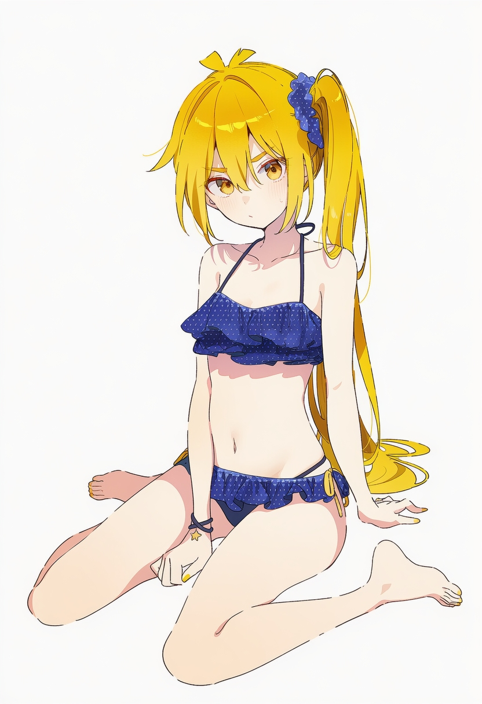

# 腿部姿势与移动 / 坐姿/盘腿

[总目录](../README.md) · [原站分类目录](../categories.md) · [英文标签索引](../tags.md) · [服装与构图组合指南](../../README.md)

标题、分类、说明、正负提示词按来源保留；多例图逐张列出。原站标记和说明为参考资料，不作为维护指令。

<a id="raven_composition-3102"></a>

## 正坐

ID：`raven_composition-3102`；分类：腿部姿势与移动 / 坐姿/盘腿；来源标记：`safe`。

来源说明：

> 日式正坐，双膝跪地并坐在脚跟附近。

正向提示词：

```text
seiza
```


[在线例图](https://assets.quicktagcloud.com/images/raven_composition/raven_composition-3102.jpg?v=e2135e0677122562)

<a id="raven_composition-3103"></a>

## 女子坐 / W坐

ID：`raven_composition-3103`；分类：腿部姿势与移动 / 坐姿/盘腿；来源标记：`safe`。

来源说明：

> 双膝朝前、双脚分向两侧，臀部落在地面。

正向提示词：

```text
wariza
```



[在线例图](https://assets.quicktagcloud.com/images/raven_composition/raven_composition-3103.jpg?v=1c4da8020dcd7757)

<a id="raven_composition-3104"></a>

## 横坐 / 侧坐

ID：`raven_composition-3104`；分类：腿部姿势与移动 / 坐姿/盘腿；来源标记：`safe`。

来源说明：

> 坐地时双腿折向身体同一侧。

正向提示词：

```text
yokozuwari
```


[在线例图](https://assets.quicktagcloud.com/images/raven_composition/raven_composition-3104.jpg?v=d643c5e011a2e5be)

<a id="raven_composition-3105"></a>

## 盘腿坐

ID：`raven_composition-3105`；分类：腿部姿势与移动 / 坐姿/盘腿；来源标记：`safe`。

来源说明：

> 双腿交叉盘坐在地面。

正向提示词：

```text
indian_style
```


[在线例图](https://assets.quicktagcloud.com/images/raven_composition/raven_composition-3105.jpg?v=c3e77e8ef35f1e00)

<a id="raven_composition-3106"></a>

## 蝴蝶坐

ID：`raven_composition-3106`；分类：腿部姿势与移动 / 坐姿/盘腿；来源标记：`safe`。

来源说明：

> 双脚脚掌相对、双膝向左右打开的坐姿。

正向提示词：

```text
butterfly_sitting
```


[在线例图](https://assets.quicktagcloud.com/images/raven_composition/raven_composition-3106.jpg?v=302772777c975ddd)

<a id="raven_composition-3107"></a>

## 抱腿 / 抱膝

ID：`raven_composition-3107`；分类：腿部姿势与移动 / 坐姿/盘腿；来源标记：`safe`。

来源说明：

> 用双臂环抱自己的腿部。

正向提示词：

```text
hugging_own_legs
```


[在线例图](https://assets.quicktagcloud.com/images/raven_composition/raven_composition-3107.jpg?v=c8a3e53ceeecb015)
