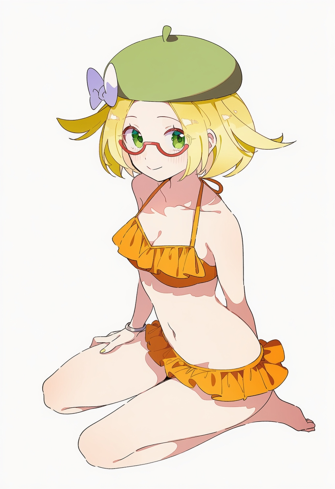
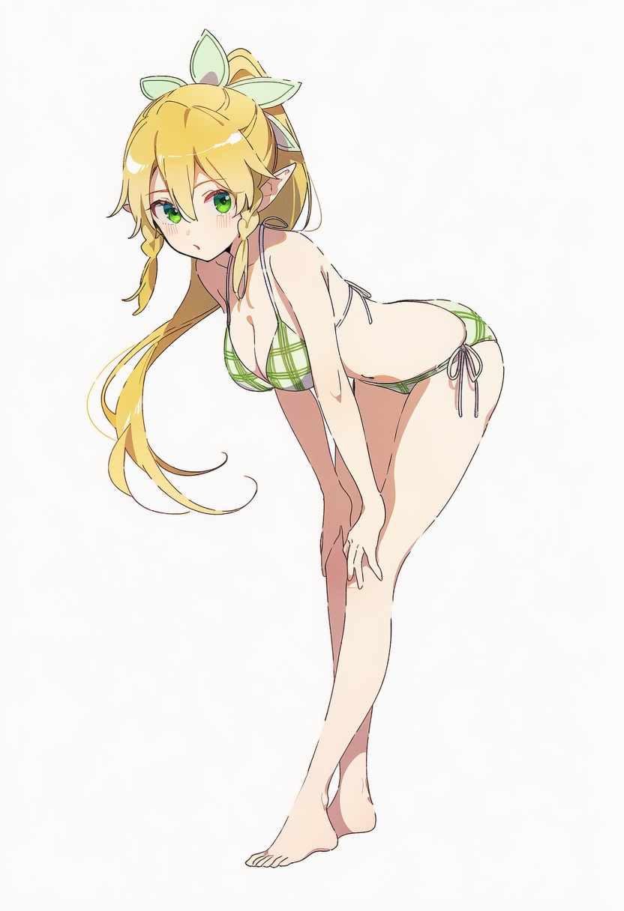

# 腿部姿势与移动 / 腿部手扶/抓握

[总目录](../README.md) · [原站分类目录](../categories.md) · [英文标签索引](../tags.md) · [服装与构图组合指南](../../README.md)

标题、分类、说明、正负提示词按来源保留；多例图逐张列出。原站标记和说明为参考资料，不作为维护指令。

<a id="raven_composition-3108"></a>

## 抓住自己的腿

ID：`raven_composition-3108`；分类：腿部姿势与移动 / 腿部手扶/抓握；来源标记：`safe`。

来源说明：

> 用手握住、托住或拉住自己的腿。

正向提示词：

```text
holding_own_leg
```


[在线例图](https://assets.quicktagcloud.com/images/raven_composition/raven_composition-3108.jpg?v=033043a70d868592)

<a id="raven_composition-3109"></a>

## 手放在自己腿上

ID：`raven_composition-3109`；分类：腿部姿势与移动 / 腿部手扶/抓握；来源标记：`safe`。

来源说明：

> 一只手放在自己的腿部。

正向提示词：

```text
hand_on_own_leg
```



[在线例图](https://assets.quicktagcloud.com/images/raven_composition/raven_composition-3109.jpg?v=9c9955859a2f798a)

<a id="raven_composition-3110"></a>

## 手放在自己膝盖上

ID：`raven_composition-3110`；分类：腿部姿势与移动 / 腿部手扶/抓握；来源标记：`safe`。

来源说明：

> 一只手搭在自己的膝盖上。

正向提示词：

```text
hand_on_own_knee
```


[在线例图](https://assets.quicktagcloud.com/images/raven_composition/raven_composition-3110.jpg?v=f09c00aba31b2973)

<a id="raven_composition-3111"></a>

## 双手扶膝

ID：`raven_composition-3111`；分类：腿部姿势与移动 / 腿部手扶/抓握；来源标记：`safe`。

来源说明：

> 双手分别搭在自己的膝盖上。

正向提示词：

```text
hands_on_own_knees
```



[在线例图](https://assets.quicktagcloud.com/images/raven_composition/raven_composition-3111.jpg?v=7a8aa3cba843fa02)

<a id="raven_composition-3112"></a>

## 双手扶脚 / 抓脚

ID：`raven_composition-3112`；分类：腿部姿势与移动 / 腿部手扶/抓握；来源标记：`safe`。

来源说明：

> 双手接触、扶住或抓住自己的脚部。

正向提示词：

```text
hands_on_feet
```


[在线例图](https://assets.quicktagcloud.com/images/raven_composition/raven_composition-3112.jpg?v=2eb1d7c478e5867f)
