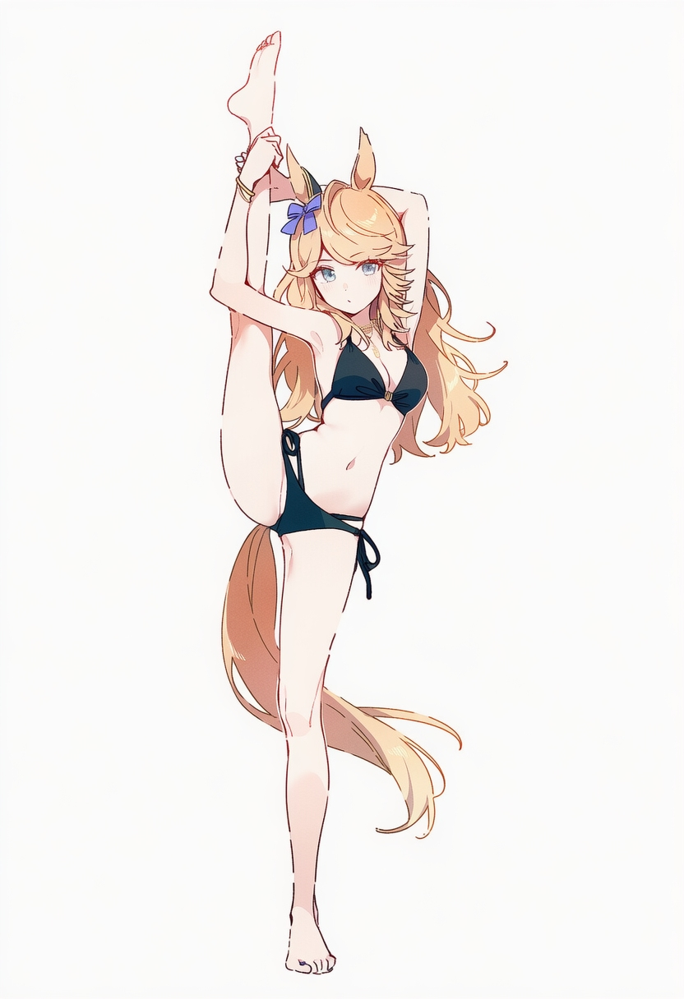
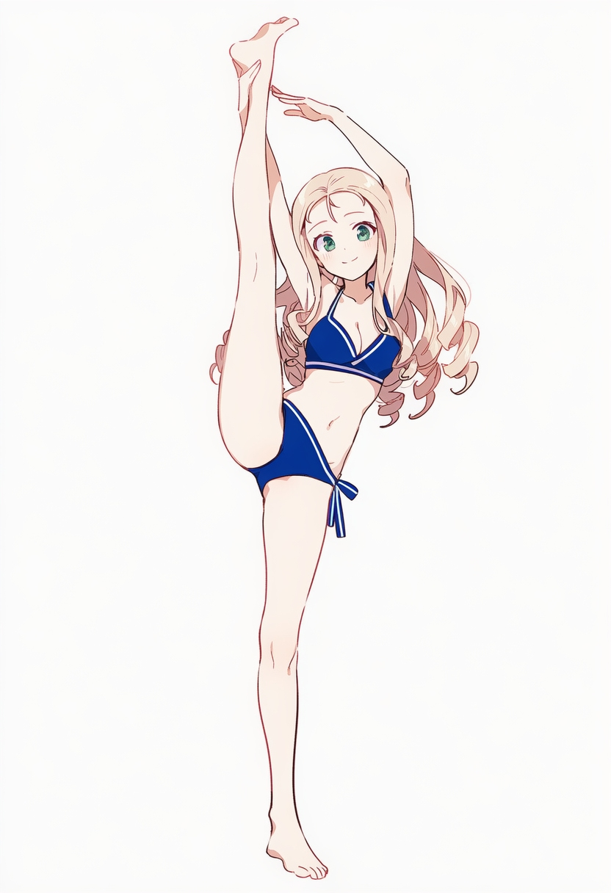
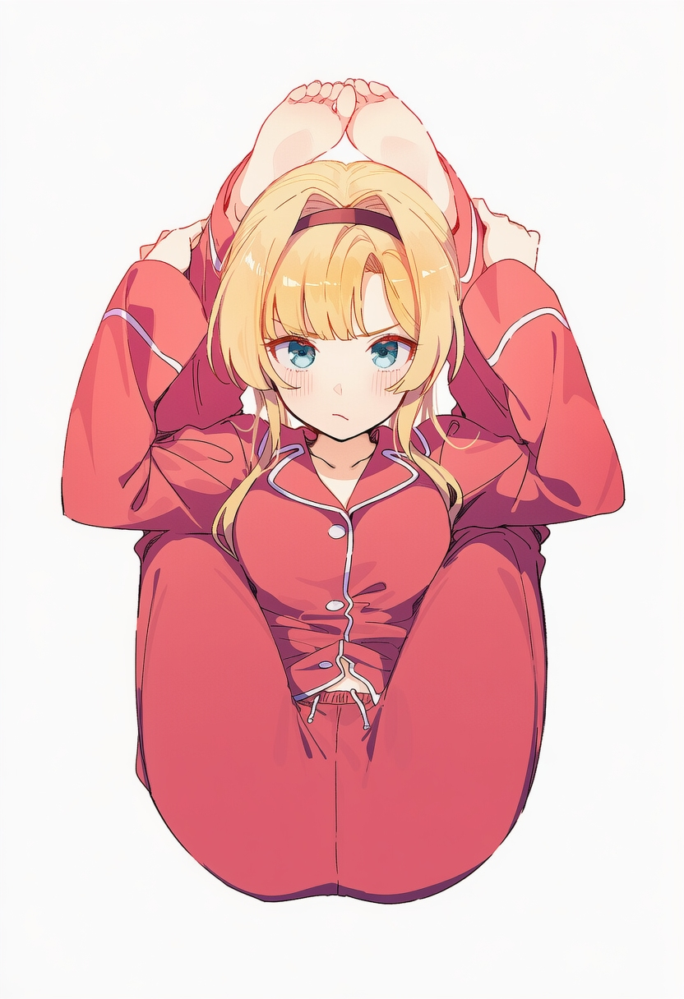
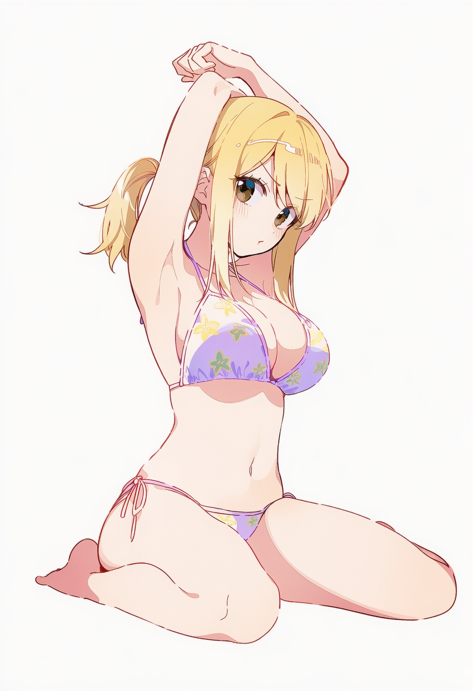
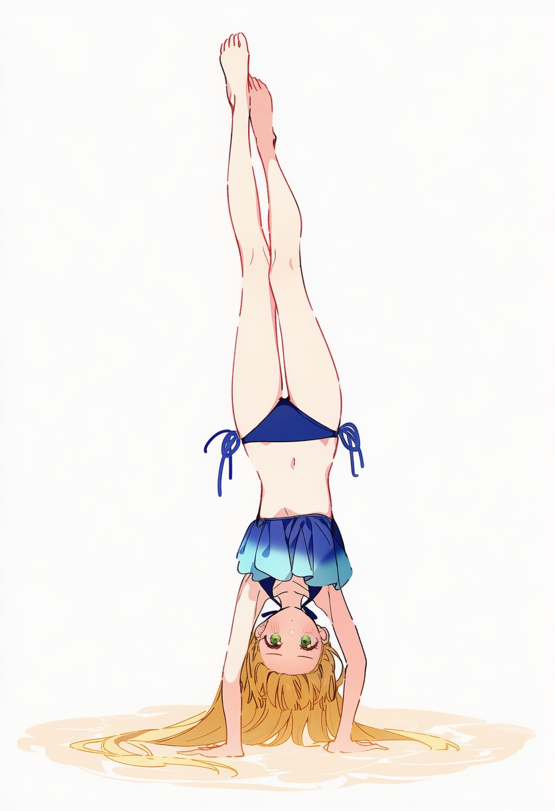

# 腿部姿势与移动 / 分腿/柔韧姿势

[总目录](../README.md) · [原站分类目录](../categories.md) · [英文标签索引](../tags.md) · [服装与构图组合指南](../../README.md)

标题、分类、说明、正负提示词按来源保留；多例图逐张列出。原站标记和说明为参考资料，不作为维护指令。

<a id="raven_composition-3113"></a>

## 大幅分腿

ID：`raven_composition-3113`；分类：腿部姿势与移动 / 分腿/柔韧姿势；来源标记：`safe`。

来源说明：

> 双腿明显向两侧张开。

正向提示词：

```text
spread_legs
```


[在线例图](https://assets.quicktagcloud.com/images/raven_composition/raven_composition-3113.jpg?v=e2682d5f594a6e8a)

<a id="raven_composition-3114"></a>

## 劈叉

ID：`raven_composition-3114`；分类：腿部姿势与移动 / 分腿/柔韧姿势；来源标记：`safe`。

来源说明：

> 双腿向相反方向展开形成劈叉。

正向提示词：

```text
split
```



[在线例图](https://assets.quicktagcloud.com/images/raven_composition/raven_composition-3114.jpg?v=99e46a00d3e40426)

<a id="raven_composition-3115"></a>

## 坐姿劈叉

ID：`raven_composition-3115`；分类：腿部姿势与移动 / 分腿/柔韧姿势；来源标记：`safe`。

来源说明：

> 坐在地面或平面上完成劈叉。

正向提示词：

```text
sitting_split
```


[在线例图](https://assets.quicktagcloud.com/images/raven_composition/raven_composition-3115.jpg?v=e3bf34c4700cd96f)

<a id="raven_composition-3116"></a>

## 站立劈叉

ID：`raven_composition-3116`；分类：腿部姿势与移动 / 分腿/柔韧姿势；来源标记：`safe`。

来源说明：

> 站立时将一条腿大幅抬高形成劈叉。

正向提示词：

```text
standing_split
```



[在线例图](https://assets.quicktagcloud.com/images/raven_composition/raven_composition-3116.jpg?v=68ad8a0a7073ac59)

<a id="raven_composition-3117"></a>

## 双腿越过头部

ID：`raven_composition-3117`；分类：腿部姿势与移动 / 分腿/柔韧姿势；来源标记：`safe`。

来源说明：

> 双腿向上或向后翻过头部。

正向提示词：

```text
legs_over_head
```



[在线例图](https://assets.quicktagcloud.com/images/raven_composition/raven_composition-3117.jpg?v=aa4214caf3d1daae)

<a id="raven_composition-3118"></a>

## 高柔韧姿势

ID：`raven_composition-3118`；分类：腿部姿势与移动 / 分腿/柔韧姿势；来源标记：`safe`。

来源说明：

> 身体呈现明显的大幅度柔韧或拉伸能力。

正向提示词：

```text
flexible
```


[在线例图](https://assets.quicktagcloud.com/images/raven_composition/raven_composition-3118.jpg?v=db9776e6997146ae)

<a id="raven_composition-3119"></a>

## 直身分腿

ID：`raven_composition-3119`；分类：腿部姿势与移动 / 分腿/柔韧姿势；来源标记：`safe`。

来源说明：

> 上身较直立，双腿向左右大幅分开。

正向提示词：

```text
upright_straddle
```


[在线例图](https://assets.quicktagcloud.com/images/raven_composition/raven_composition-3119.jpg?v=704c9b09f7f88972)

<a id="raven_composition-3120"></a>

## 拉伸

ID：`raven_composition-3120`；分类：腿部姿势与移动 / 分腿/柔韧姿势；来源标记：`safe`。

来源说明：

> 正在进行腿部或全身拉伸动作。

正向提示词：

```text
stretching
```



[在线例图](https://assets.quicktagcloud.com/images/raven_composition/raven_composition-3120.jpg?v=1184d3091e92763d)

<a id="raven_composition-3121"></a>

## 手倒立

ID：`raven_composition-3121`；分类：腿部姿势与移动 / 分腿/柔韧姿势；来源标记：`safe`。

来源说明：

> 以双手支撑身体倒立，双腿位于身体上方。

正向提示词：

```text
handstand
```



[在线例图](https://assets.quicktagcloud.com/images/raven_composition/raven_composition-3121.jpg?v=cf5f96f8952f3720)
