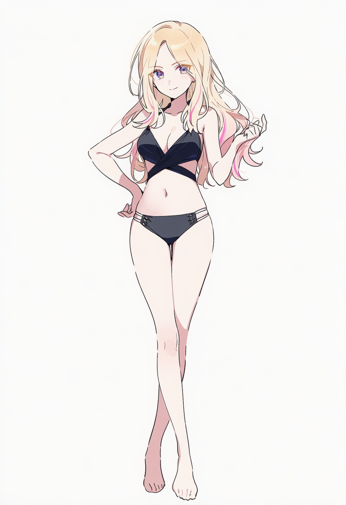
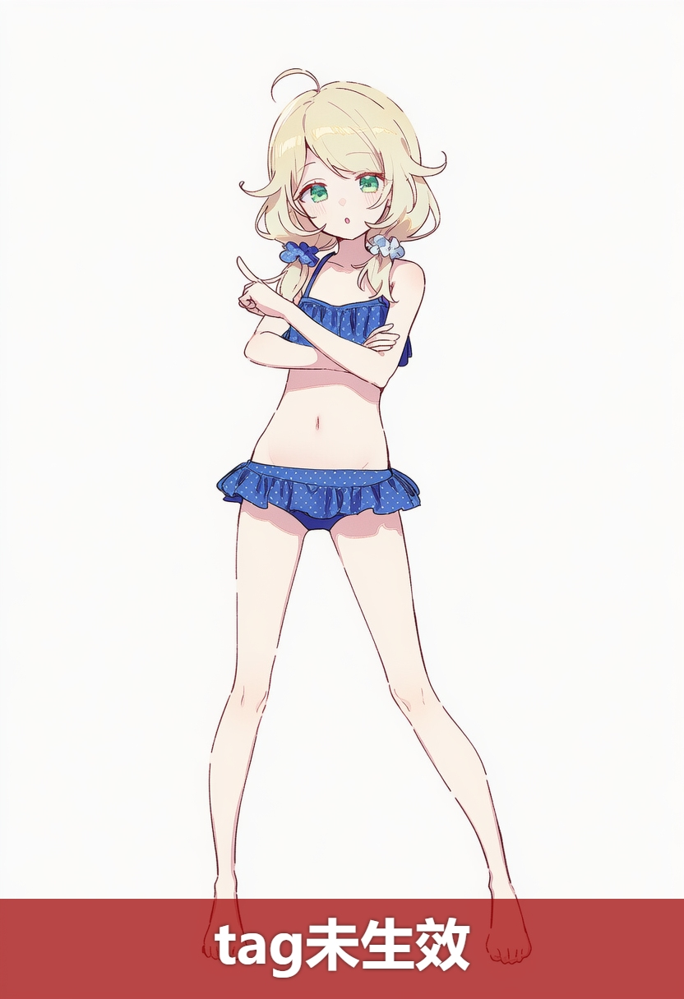
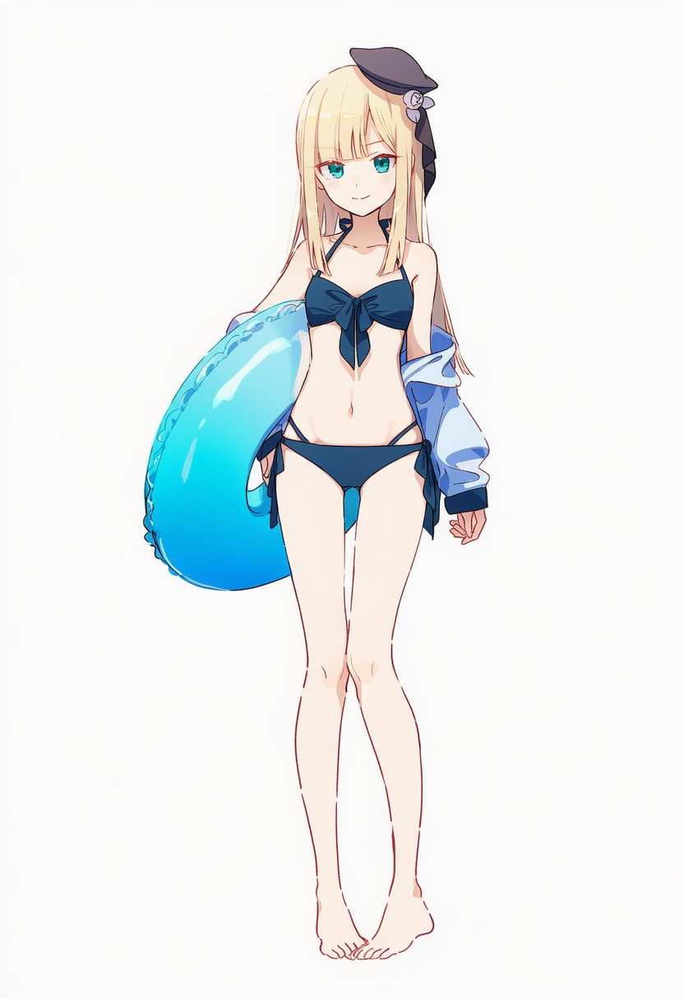

# 腿部姿势与移动 / 站姿/特殊腿姿

[总目录](../README.md) · [原站分类目录](../categories.md) · [英文标签索引](../tags.md) · [服装与构图组合指南](../../README.md)

标题、分类、说明、正负提示词按来源保留；多例图逐张列出。原站标记和说明为参考资料，不作为维护指令。

<a id="raven_composition-3122"></a>

## Watson交叉腿

ID：`raven_composition-3122`；分类：腿部姿势与移动 / 站姿/特殊腿姿；来源标记：`safe`。

来源说明：

> 站立时双腿在小腿、膝或大腿处交叉。

正向提示词：

```text
watson_cross
```



[在线例图](https://assets.quicktagcloud.com/images/raven_composition/raven_composition-3122.jpg?v=ce01f8939e0685e5)

<a id="raven_composition-3123"></a>

## 摩根船长姿势

ID：`raven_composition-3123`；分类：腿部姿势与移动 / 站姿/特殊腿姿；来源标记：`safe`。

来源说明：

> 一脚站地，另一只脚踩在较高物体或平面上。

正向提示词：

```text
captain_morgan_pose
```



[在线例图](https://assets.quicktagcloud.com/images/raven_composition/raven_composition-3123.jpg?v=9ae18565e829de90)

<a id="raven_composition-3124"></a>

## 内八字

ID：`raven_composition-3124`；分类：腿部姿势与移动 / 站姿/特殊腿姿；来源标记：`safe`。

来源说明：

> 脚尖向内靠拢形成内八站姿。

正向提示词：

```text
pigeon-toed
```



[在线例图](https://assets.quicktagcloud.com/images/raven_composition/raven_composition-3124.jpg?v=5529e6bad8ab0644)
