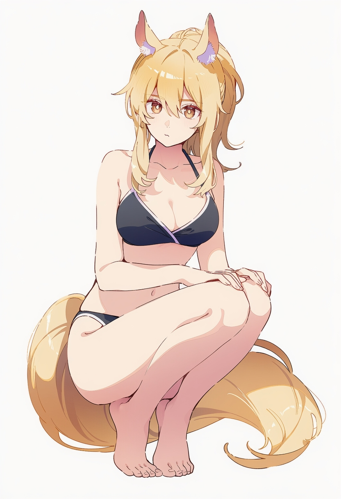
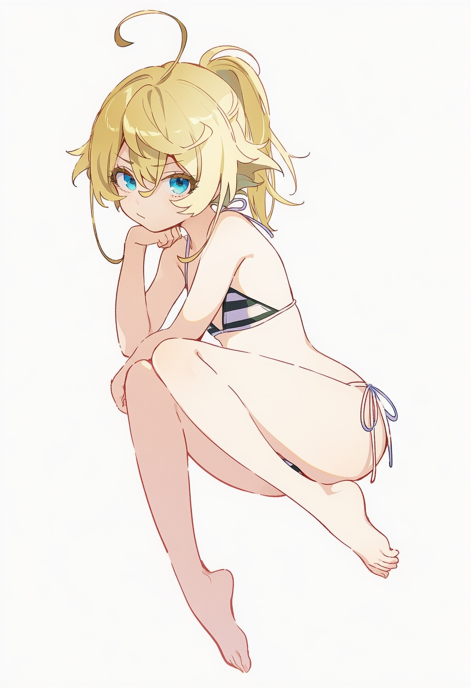
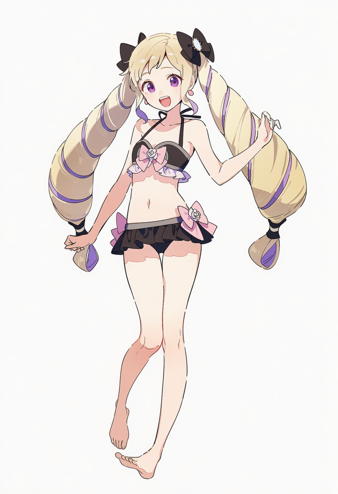
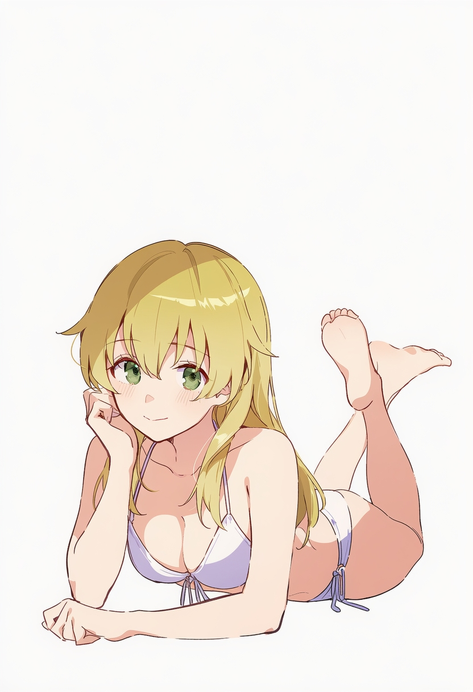
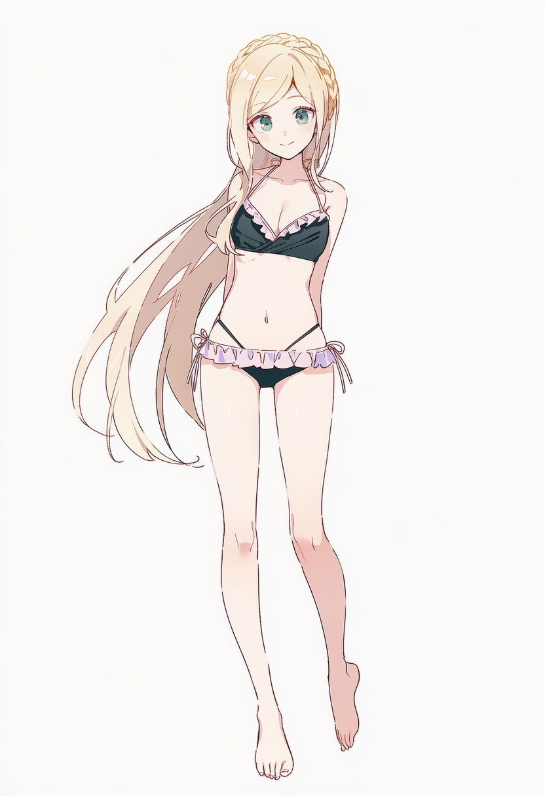

# 腿部姿势与移动 / 脚部/脚踝姿态

[总目录](../README.md) · [原站分类目录](../categories.md) · [英文标签索引](../tags.md) · [服装与构图组合指南](../../README.md)

标题、分类、说明、正负提示词按来源保留；多例图逐张列出。原站标记和说明为参考资料，不作为维护指令。

<a id="raven_composition-3125"></a>

## 踮脚

ID：`raven_composition-3125`；分类：腿部姿势与移动 / 脚部/脚踝姿态；来源标记：`safe`。

来源说明：

> 脚跟抬起，以前脚掌或脚趾支撑。

正向提示词：

```text
tiptoes
```



[在线例图](https://assets.quicktagcloud.com/images/raven_composition/raven_composition-3125.jpg?v=4838692f6cd7eeb7)

<a id="raven_composition-3126"></a>

## 绷脚背

ID：`raven_composition-3126`；分类：腿部姿势与移动 / 脚部/脚踝姿态；来源标记：`safe`。

来源说明：

> 脚尖向下延伸，脚背与小腿方向拉长。

正向提示词：

```text
plantar_flexion
```



[在线例图](https://assets.quicktagcloud.com/images/raven_composition/raven_composition-3126.jpg?v=5c986ed48de11146)

<a id="raven_composition-3127"></a>

## 勾脚

ID：`raven_composition-3127`；分类：腿部姿势与移动 / 脚部/脚踝姿态；来源标记：`safe`。

来源说明：

> 脚背向小腿方向抬起。

正向提示词：

```text
dorsiflexion
```



[在线例图](https://assets.quicktagcloud.com/images/raven_composition/raven_composition-3127.jpg?v=1a1dbcba66c8b6cf)

<a id="raven_composition-3128"></a>

## 双脚抬起

ID：`raven_composition-3128`；分类：腿部姿势与移动 / 脚部/脚踝姿态；来源标记：`safe`。

来源说明：

> 两只脚离开原本支撑面并抬高。

正向提示词：

```text
feet_up
```


[在线例图](https://assets.quicktagcloud.com/images/raven_composition/raven_composition-3128.jpg?v=03bde70f2bb637bb)

<a id="raven_composition-3129"></a>

## 脚跟抬起

ID：`raven_composition-3129`；分类：腿部姿势与移动 / 脚部/脚踝姿态；来源标记：`safe`。

来源说明：

> 脚跟明显离开地面或支撑面。

正向提示词：

```text
heels_up
```


[在线例图](https://assets.quicktagcloud.com/images/raven_composition/raven_composition-3129.jpg?v=6128d57ed169c4be)

<a id="raven_composition-3130"></a>

## 双脚后翘

ID：`raven_composition-3130`；分类：腿部姿势与移动 / 脚部/脚踝姿态；来源标记：`safe`。

来源说明：

> 屈膝后双脚和脚跟向后上方翘起。

正向提示词：

```text
feet_up_heels_up
```



[在线例图](https://assets.quicktagcloud.com/images/raven_composition/raven_composition-3130.jpg?v=964ac1c74750df38)

<a id="raven_composition-3131"></a>

## 绷脚尖

ID：`raven_composition-3131`；分类：腿部姿势与移动 / 脚部/脚踝姿态；来源标记：`safe`。

来源说明：

> 脚背下压、脚尖向外延伸，形成明显绷脚形态。

正向提示词：

```text
toe-point
```



[在线例图](https://assets.quicktagcloud.com/images/raven_composition/raven_composition-3131.jpg?v=b1a7fe9c0c7d15f9)
