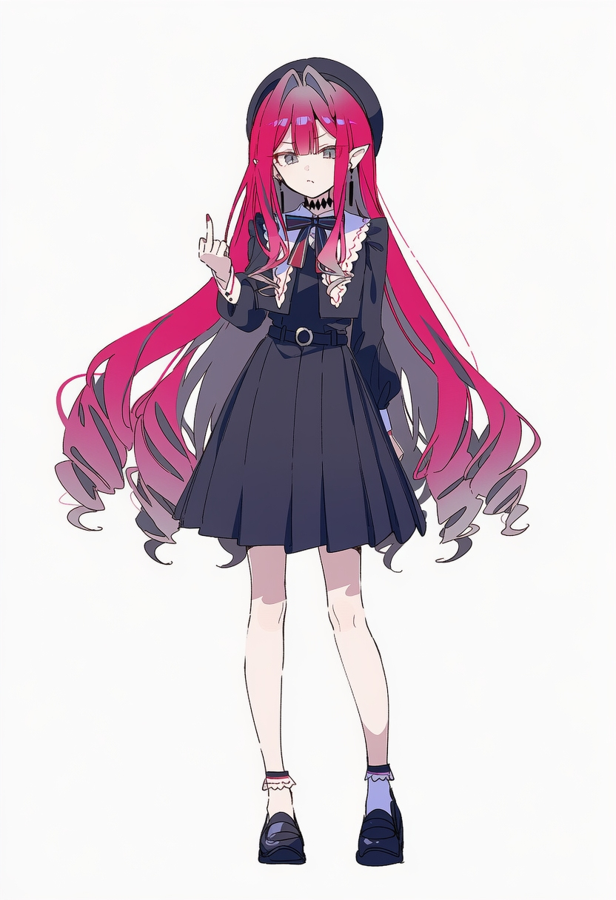
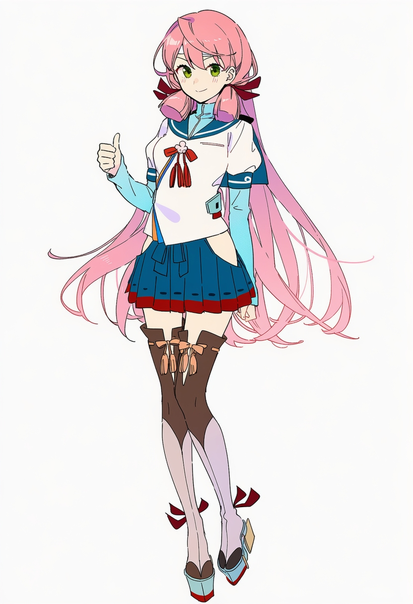
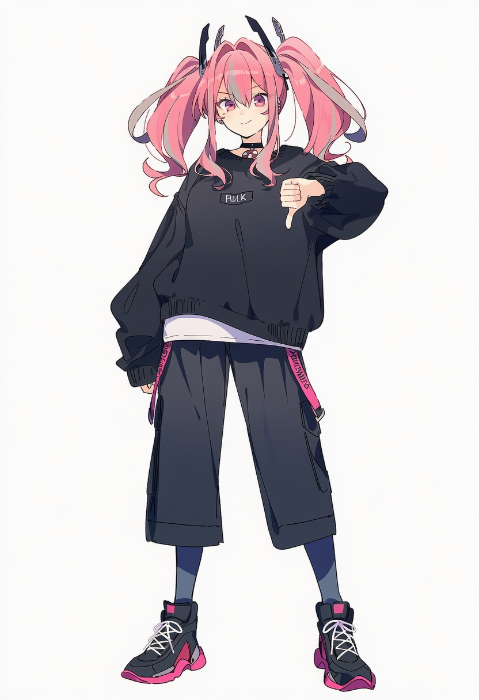
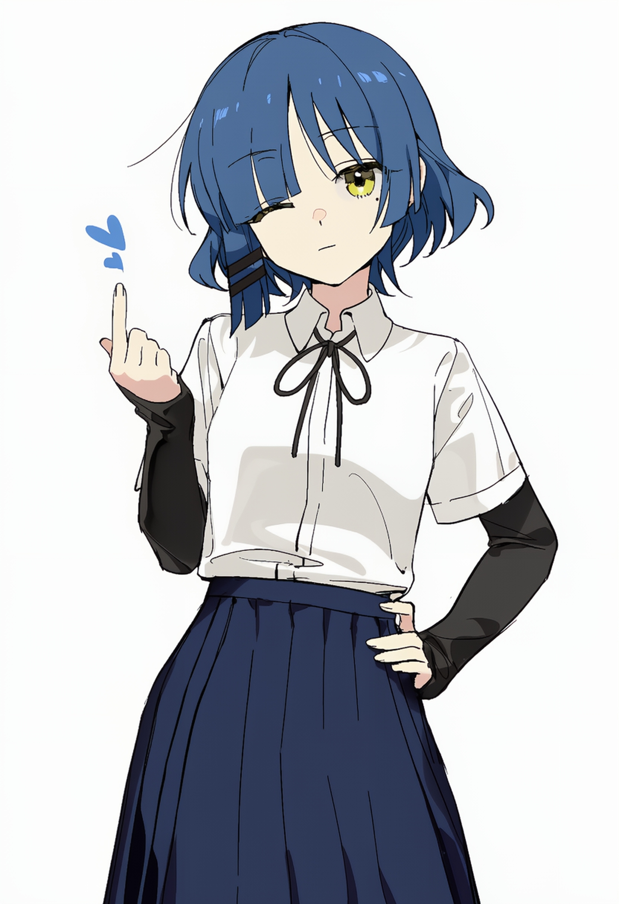
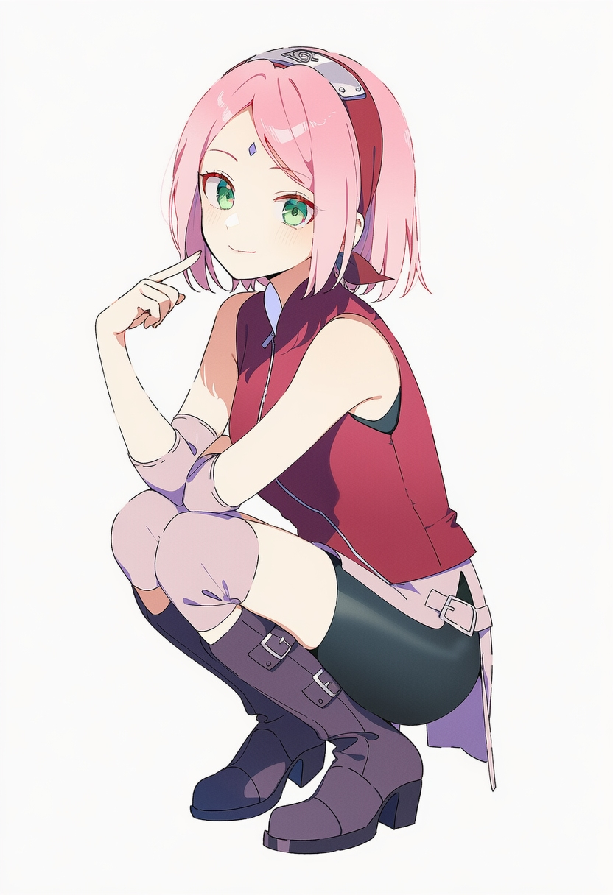
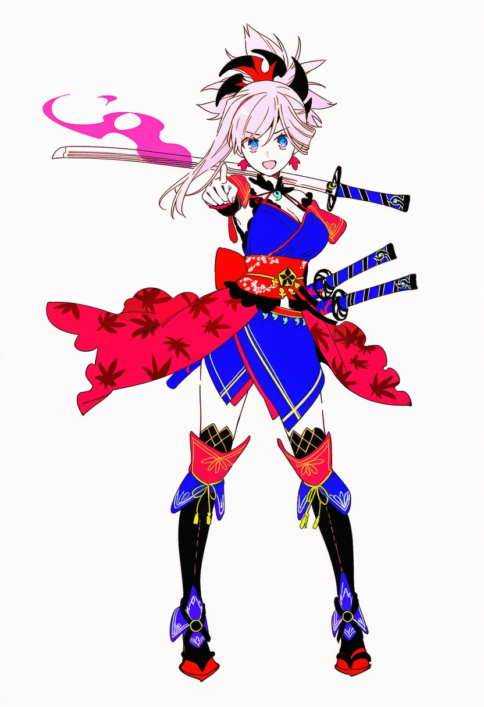
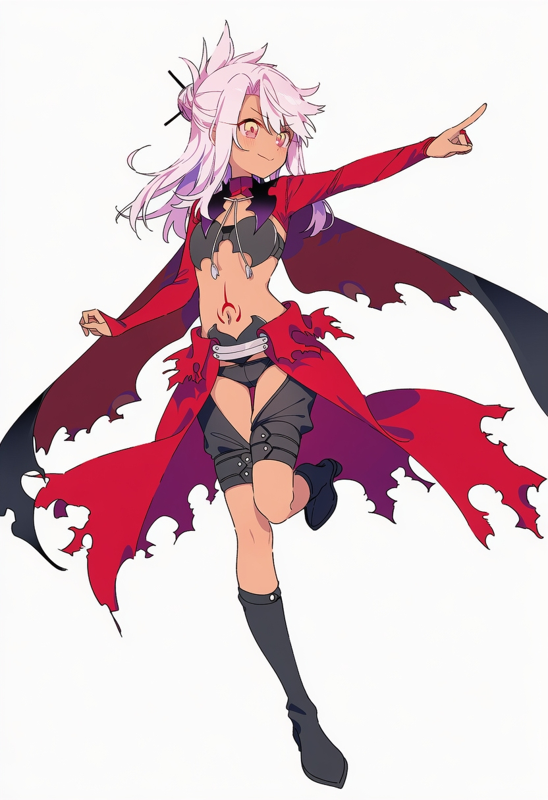
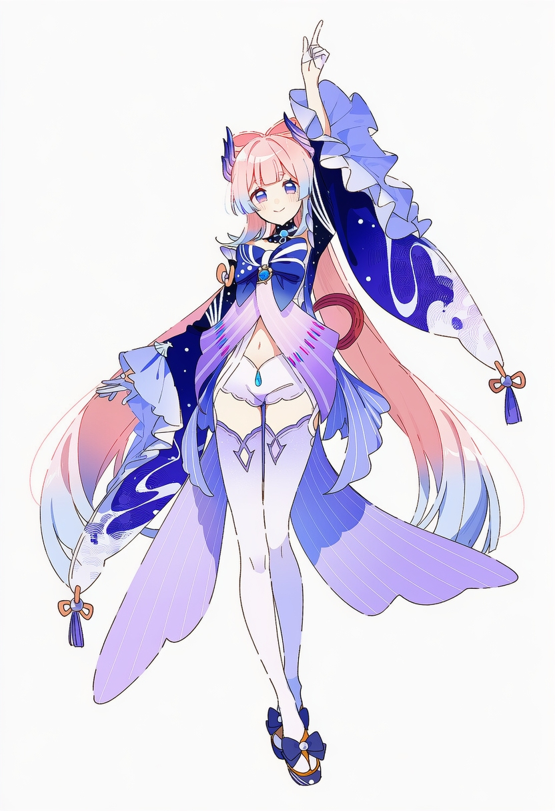

# 手势 / 单指/指向

[总目录](../README.md) · [原站分类目录](../categories.md) · [英文标签索引](../tags.md) · [服装与构图组合指南](../../README.md)

标题、分类、说明、正负提示词按来源保留；多例图逐张列出。原站标记和说明为参考资料，不作为维护指令。

<a id="raven_composition-3144"></a>

## 竖食指

ID：`raven_composition-3144`；分类：手势 / 单指/指向；来源标记：`safe`。

来源说明：

> 单独竖起食指。

正向提示词：

```text
index_finger_raised
```


[在线例图](https://assets.quicktagcloud.com/images/raven_composition/raven_composition-3144.jpg?v=fef41de5f9383473)

<a id="raven_composition-3145"></a>

## 竖中指

ID：`raven_composition-3145`；分类：手势 / 单指/指向；来源标记：`safe`。

来源说明：

> 单独竖起中指。

正向提示词：

```text
middle_finger
```



[在线例图](https://assets.quicktagcloud.com/images/raven_composition/raven_composition-3145.jpg?v=046279f364134f58)

<a id="raven_composition-3146"></a>

## 翘小指

ID：`raven_composition-3146`；分类：手势 / 单指/指向；来源标记：`safe`。

来源说明：

> 小拇指单独向外伸出。

正向提示词：

```text
pinky_out
```


[在线例图](https://assets.quicktagcloud.com/images/raven_composition/raven_composition-3146.jpg?v=ef308f445f547870)

<a id="raven_composition-3147"></a>

## 点赞

ID：`raven_composition-3147`；分类：手势 / 单指/指向；来源标记：`safe`。

来源说明：

> 竖起大拇指表示赞同或很好。

正向提示词：

```text
thumbs_up
```



[在线例图](https://assets.quicktagcloud.com/images/raven_composition/raven_composition-3147.jpg?v=a0c5b00bf5986294)

<a id="raven_composition-3148"></a>

## 倒赞

ID：`raven_composition-3148`；分类：手势 / 单指/指向；来源标记：`safe`。

来源说明：

> 大拇指朝下表示否定或不满。

正向提示词：

```text
thumbs_down
```



[在线例图](https://assets.quicktagcloud.com/images/raven_composition/raven_composition-3148.jpg?v=d77a7195e08438b6)

<a id="raven_composition-3149"></a>

## 指向

ID：`raven_composition-3149`；分类：手势 / 单指/指向；来源标记：`safe`。

来源说明：

> 用手指指向某个方向或对象。

正向提示词：

```text
pointing
```



[在线例图](https://assets.quicktagcloud.com/images/raven_composition/raven_composition-3149.jpg?v=bdb0b85354ce38f0)

<a id="raven_composition-3150"></a>

## 指自己

ID：`raven_composition-3150`；分类：手势 / 单指/指向；来源标记：`safe`。

来源说明：

> 用手指指向自己。

正向提示词：

```text
pointing_at_self
```



[在线例图](https://assets.quicktagcloud.com/images/raven_composition/raven_composition-3150.jpg?v=fe7030a32b46e14a)

<a id="raven_composition-3151"></a>

## 指向观众

ID：`raven_composition-3151`；分类：手势 / 单指/指向；来源标记：`safe`。

来源说明：

> 手指直接指向画面观看者。

正向提示词：

```text
pointing_at_viewer
```



[在线例图](https://assets.quicktagcloud.com/images/raven_composition/raven_composition-3151.jpg?v=ed4dcf1af9784cd4)

<a id="raven_composition-3152"></a>

## 向下指

ID：`raven_composition-3152`；分类：手势 / 单指/指向；来源标记：`safe`。

来源说明：

> 手指朝下方指。

正向提示词：

```text
pointing_down
```


[在线例图](https://assets.quicktagcloud.com/images/raven_composition/raven_composition-3152.jpg?v=a98b3857a3006a41)

<a id="raven_composition-3153"></a>

## 向前指

ID：`raven_composition-3153`；分类：手势 / 单指/指向；来源标记：`safe`。

来源说明：

> 手指朝角色前方指。

正向提示词：

```text
pointing_forward
```



[在线例图](https://assets.quicktagcloud.com/images/raven_composition/raven_composition-3153.jpg?v=31219e7e98c13681)

<a id="raven_composition-3154"></a>

## 向上指

ID：`raven_composition-3154`；分类：手势 / 单指/指向；来源标记：`safe`。

来源说明：

> 手指朝上方指。

正向提示词：

```text
pointing_up
```



[在线例图](https://assets.quicktagcloud.com/images/raven_composition/raven_composition-3154.jpg?v=50bd5e43a13ecfbd)
