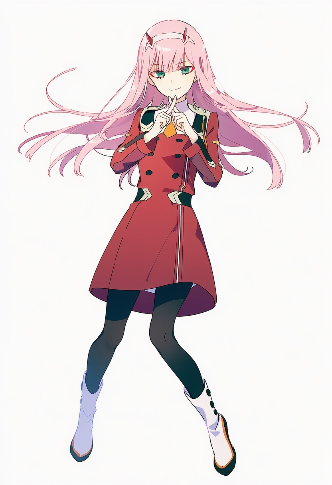
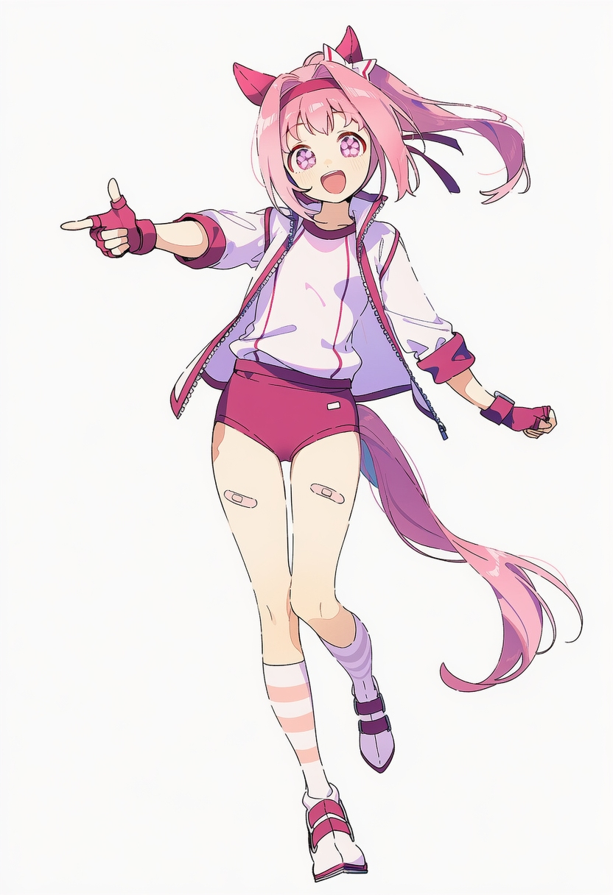
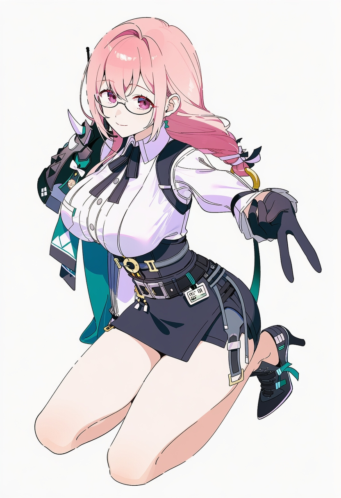
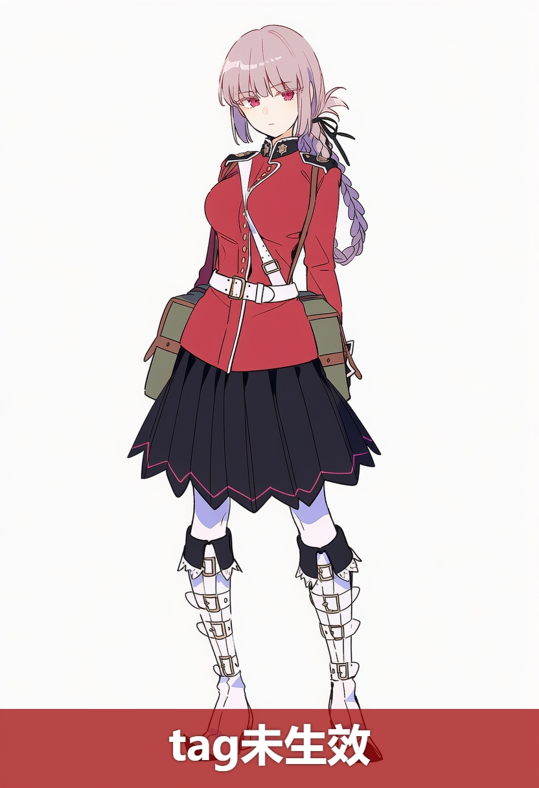
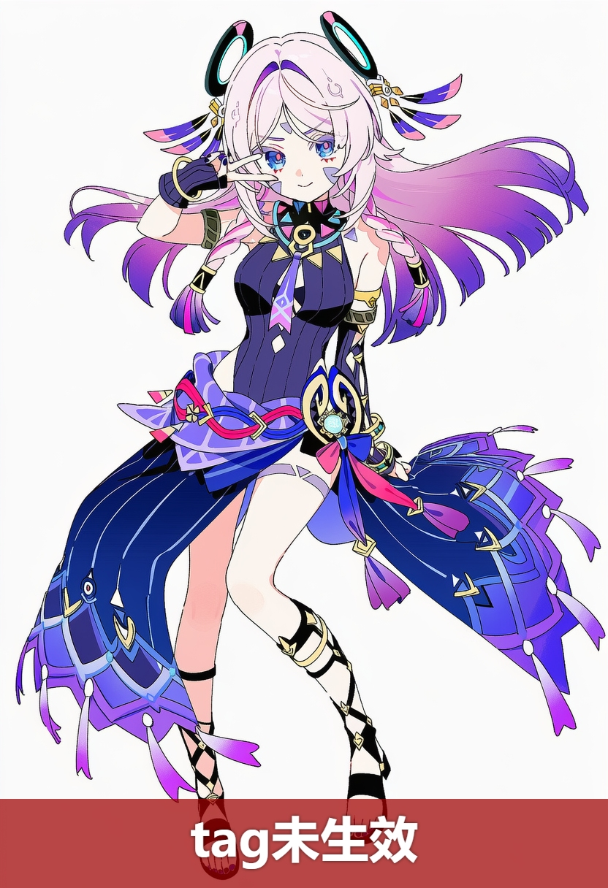

# 手势 / 双指/三指手势

[总目录](../README.md) · [原站分类目录](../categories.md) · [英文标签索引](../tags.md) · [服装与构图组合指南](../../README.md)

标题、分类、说明、正负提示词按来源保留；多例图逐张列出。原站标记和说明为参考资料，不作为维护指令。

<a id="raven_composition-3155"></a>

## 交叉手指

ID：`raven_composition-3155`；分类：手势 / 双指/三指手势；来源标记：`safe`。

来源说明：

> 两根手指交叉，常表示祈愿或好运。

正向提示词：

```text
crossed_fingers
```



[在线例图](https://assets.quicktagcloud.com/images/raven_composition/raven_composition-3155.jpg?v=9dbbb6f001b927b2)

<a id="raven_composition-3156"></a>

## 手枪手势

ID：`raven_composition-3156`；分类：手势 / 双指/三指手势；来源标记：`safe`。

来源说明：

> 用手指模仿手枪形状。

正向提示词：

```text
finger_gun
```



[在线例图](https://assets.quicktagcloud.com/images/raven_composition/raven_composition-3156.jpg?v=bd5becb50cff5219)

<a id="raven_composition-3157"></a>

## 指心

ID：`raven_composition-3157`；分类：手势 / 双指/三指手势；来源标记：`safe`。

来源说明：

> 拇指和食指交叉形成小爱心。

正向提示词：

```text
finger_heart
```


[在线例图](https://assets.quicktagcloud.com/images/raven_composition/raven_composition-3157.jpg?v=f62b48ea9310239c)

<a id="raven_composition-3158"></a>

## Shaka手势

ID：`raven_composition-3158`；分类：手势 / 双指/三指手势；来源标记：`safe`。

来源说明：

> 伸出拇指和小指的手势。

正向提示词：

```text
shaka_sign
```


[在线例图](https://assets.quicktagcloud.com/images/raven_composition/raven_composition-3158.jpg?v=c449facdba2d9732)

<a id="raven_composition-3159"></a>

## 双指敬礼

ID：`raven_composition-3159`；分类：手势 / 双指/三指手势；来源标记：`safe`。

来源说明：

> 用两根手指做敬礼动作。

正向提示词：

```text
two-finger_salute
```


[在线例图](https://assets.quicktagcloud.com/images/raven_composition/raven_composition-3159.jpg?v=db02573cd81ff3fe)

<a id="raven_composition-3160"></a>

## V字手势

ID：`raven_composition-3160`；分类：手势 / 双指/三指手势；来源标记：`safe`。

来源说明：

> 食指和中指张开形成 V 字。

正向提示词：

```text
v
```


[在线例图](https://assets.quicktagcloud.com/images/raven_composition/raven_composition-3160.jpg?v=28bd4140df5384d6)

<a id="raven_composition-3161"></a>

## 辣妹V手势

ID：`raven_composition-3161`；分类：手势 / 双指/三指手势；来源标记：`safe`。

来源说明：

> 带明显辣妹风格的 V 字手势。

正向提示词：

```text
gyaru_v
```



[在线例图](https://assets.quicktagcloud.com/images/raven_composition/raven_composition-3161.jpg?v=b41f8fb96fc1a954)

<a id="raven_composition-3162"></a>

## 反向V手势

ID：`raven_composition-3162`；分类：手势 / 双指/三指手势；来源标记：`safe`。

来源说明：

> 手背朝外或 V 字朝向脸部的手势。

正向提示词：

```text
inward_v
```



[在线例图](https://assets.quicktagcloud.com/images/raven_composition/raven_composition-3162.jpg?v=584ca6df0dd872c2)

<a id="raven_composition-3163"></a>

## V遮眼

ID：`raven_composition-3163`；分类：手势 / 双指/三指手势；来源标记：`safe`。

来源说明：

> 用 V 字手势框住或遮住一只眼睛。

正向提示词：

```text
v_over_eye
```



[在线例图](https://assets.quicktagcloud.com/images/raven_composition/raven_composition-3163.jpg?v=3675dc3b920c21ac)

<a id="raven_composition-3164"></a>

## V遮嘴

ID：`raven_composition-3164`；分类：手势 / 双指/三指手势；来源标记：`safe`。

来源说明：

> 用 V 字手势放在嘴边或嘴前。

正向提示词：

```text
v_over_mouth
```


[在线例图](https://assets.quicktagcloud.com/images/raven_composition/raven_composition-3164.jpg?v=94844ecbe81852c4)

<a id="raven_composition-3165"></a>

## 祝福手势

ID：`raven_composition-3165`；分类：手势 / 双指/三指手势；来源标记：`safe`。

来源说明：

> 类似宗教祝福姿态的三指手势。

正向提示词：

```text
hand_of_benediction
```


[在线例图](https://assets.quicktagcloud.com/images/raven_composition/raven_composition-3165.jpg?v=cee0e525bfb6793e)

<a id="raven_composition-3166"></a>

## 搓钱手势

ID：`raven_composition-3166`；分类：手势 / 双指/三指手势；来源标记：`safe`。

来源说明：

> 手指做出表示钱或索要钱的动作。

正向提示词：

```text
money_gesture
```


[在线例图](https://assets.quicktagcloud.com/images/raven_composition/raven_composition-3166.jpg?v=922601b09fdd8fdf)

<a id="raven_composition-3167"></a>

## OK手势

ID：`raven_composition-3167`；分类：手势 / 双指/三指手势；来源标记：`safe`。

来源说明：

> 拇指和食指围成圆圈的 OK 手势。

正向提示词：

```text
ok_sign
```


[在线例图](https://assets.quicktagcloud.com/images/raven_composition/raven_composition-3167.jpg?v=a9515ff08298907b)

<a id="raven_composition-3168"></a>

## 捏取手势

ID：`raven_composition-3168`；分类：手势 / 双指/三指手势；来源标记：`safe`。

来源说明：

> 拇指与手指靠近形成捏取动作。

正向提示词：

```text
pinching_gesture
```


[在线例图](https://assets.quicktagcloud.com/images/raven_composition/raven_composition-3168.jpg?v=f0d6250cadd528e3)

<a id="raven_composition-3169"></a>

## W手势

ID：`raven_composition-3169`；分类：手势 / 双指/三指手势；来源标记：`safe`。

来源说明：

> 手指排列形成 W 形。

正向提示词：

```text
w
```


[在线例图](https://assets.quicktagcloud.com/images/raven_composition/raven_composition-3169.jpg?v=956e07ac261fba24)
