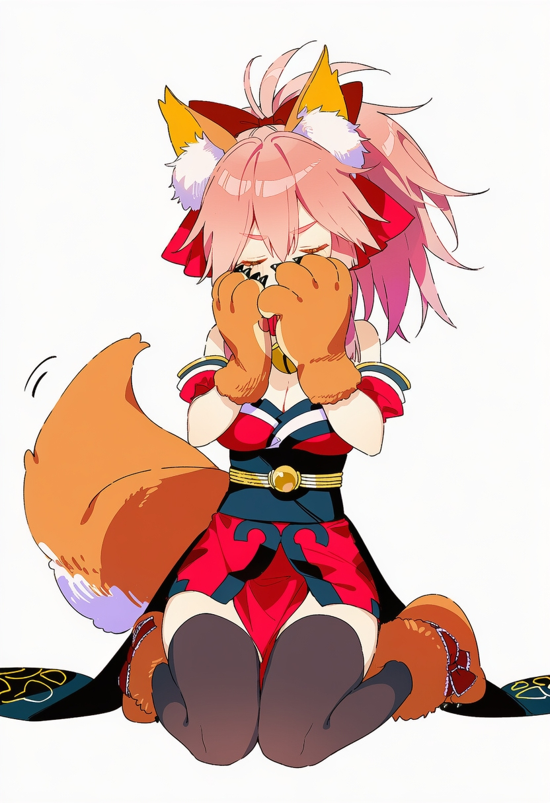
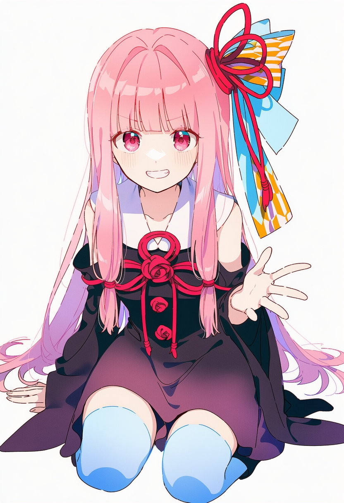
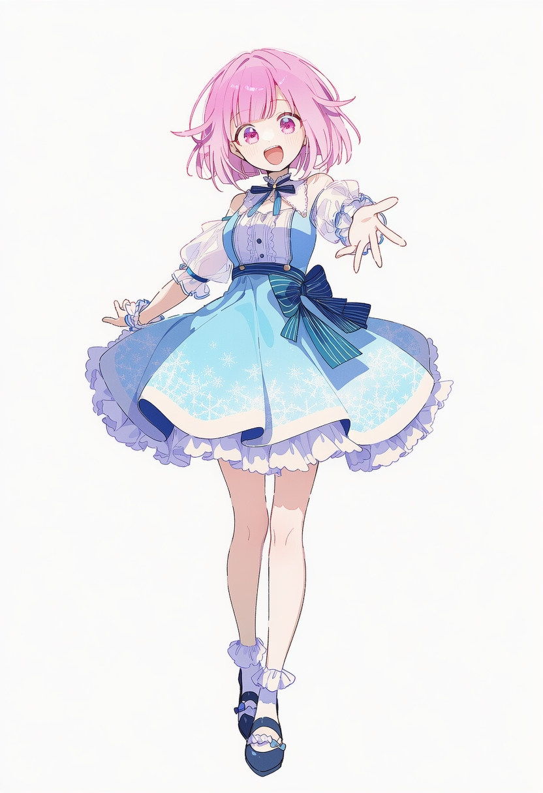
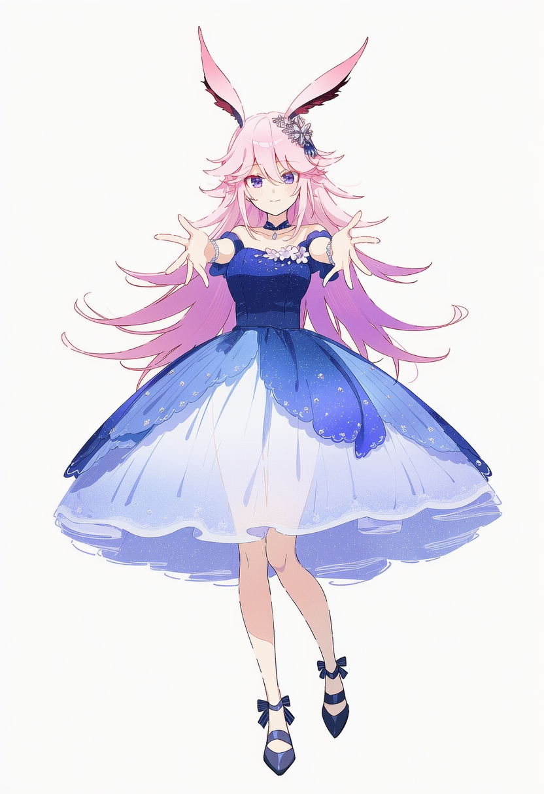
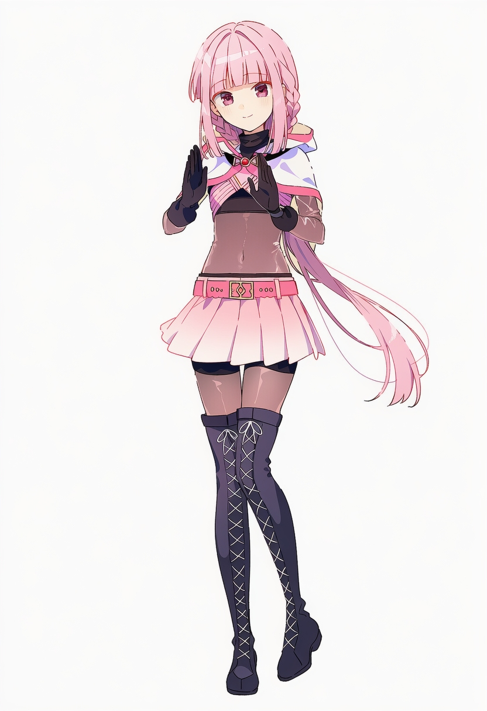
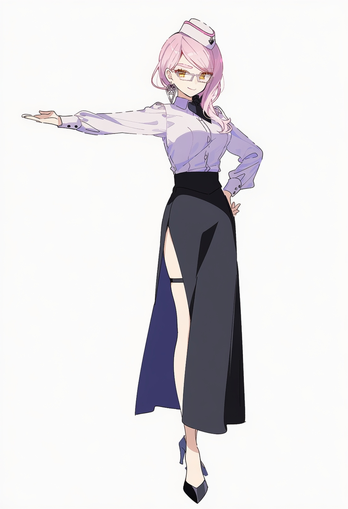
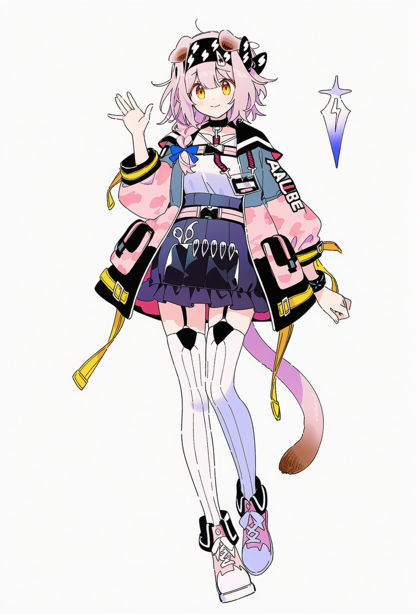
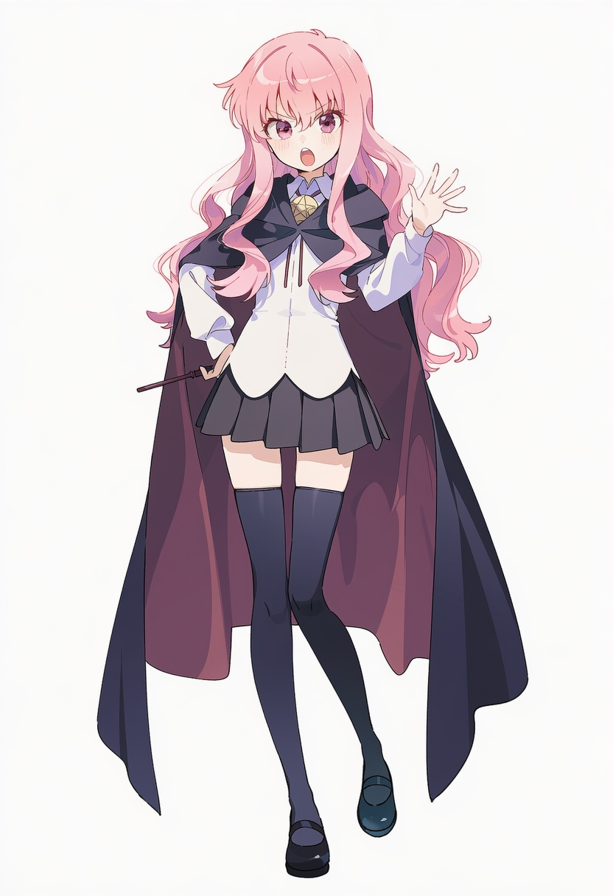
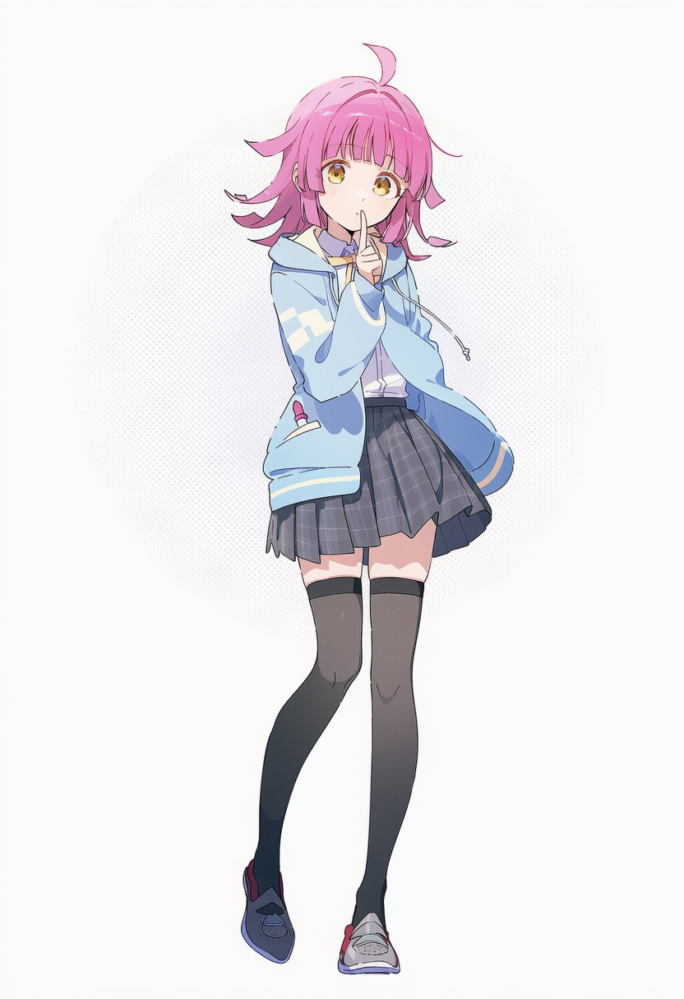

# 手势 / 张手/掌部手势

[总目录](../README.md) · [原站分类目录](../categories.md) · [英文标签索引](../tags.md) · [服装与构图组合指南](../../README.md)

标题、分类、说明、正负提示词按来源保留；多例图逐张列出。原站标记和说明为参考资料，不作为维护指令。

<a id="raven_composition-3170"></a>

## 爪子手

ID：`raven_composition-3170`；分类：手势 / 张手/掌部手势；来源标记：`safe`。

来源说明：

> 张开并弯曲手指，像爪子一样。

正向提示词：

```text
claw_pose
```


[在线例图](https://assets.quicktagcloud.com/images/raven_composition/raven_composition-3170.jpg?v=f05a9882331b46ad)

<a id="raven_composition-3171"></a>

## 扶额

ID：`raven_composition-3171`；分类：手势 / 张手/掌部手势；来源标记：`safe`。

来源说明：

> 用手掌或手指捂住自己的脸或额头。

正向提示词：

```text
facepalm
```



[在线例图](https://assets.quicktagcloud.com/images/raven_composition/raven_composition-3171.jpg?v=eaf6a649aa361b27)

<a id="raven_composition-3172"></a>

## 张开手掌

ID：`raven_composition-3172`；分类：手势 / 张手/掌部手势；来源标记：`safe`。

来源说明：

> 整只手完全张开。

正向提示词：

```text
open_hand
```



[在线例图](https://assets.quicktagcloud.com/images/raven_composition/raven_composition-3172.jpg?v=2365a226bf94fff5)

<a id="raven_composition-3173"></a>

## 伸手

ID：`raven_composition-3173`；分类：手势 / 张手/掌部手势；来源标记：`safe`。

来源说明：

> 张手向某个方向或对象伸过去。

正向提示词：

```text
reaching
```



[在线例图](https://assets.quicktagcloud.com/images/raven_composition/raven_composition-3173.jpg?v=90012c4f5ae157fb)

<a id="raven_composition-3174"></a>

## 敬礼

ID：`raven_composition-3174`；分类：手势 / 张手/掌部手势；来源标记：`safe`。

来源说明：

> 手抬到额头附近做敬礼动作。

正向提示词：

```text
salute
```


[在线例图](https://assets.quicktagcloud.com/images/raven_composition/raven_composition-3174.jpg?v=d9392d8ff970162e)

<a id="raven_composition-3175"></a>

## 五指张开

ID：`raven_composition-3175`；分类：手势 / 张手/掌部手势；来源标记：`safe`。

来源说明：

> 手掌张开并明显分开手指。

正向提示词：

```text
spread_fingers
```



[在线例图](https://assets.quicktagcloud.com/images/raven_composition/raven_composition-3175.jpg?v=c74e0ed4f5d28bfc)

<a id="raven_composition-3176"></a>

## 停止手势

ID：`raven_composition-3176`；分类：手势 / 张手/掌部手势；来源标记：`safe`。

来源说明：

> 手掌朝外做“停”的动作。

正向提示词：

```text
stop_(gesture)
```



[在线例图](https://assets.quicktagcloud.com/images/raven_composition/raven_composition-3176.jpg?v=3ca19e2aae3bfae8)

<a id="raven_composition-3177"></a>

## 直臂礼

ID：`raven_composition-3177`；分类：手势 / 张手/掌部手势；来源标记：`safe`。

来源说明：

> 手臂伸直向前上方做礼式动作。

正向提示词：

```text
straight-arm_salute
```



[在线例图](https://assets.quicktagcloud.com/images/raven_composition/raven_composition-3177.jpg?v=c3aa1d189439bd68)

<a id="raven_composition-3178"></a>

## 瓦肯举手礼

ID：`raven_composition-3178`；分类：手势 / 张手/掌部手势；来源标记：`safe`。

来源说明：

> 中间两指分开形成经典瓦肯手势。

正向提示词：

```text
vulcan_salute
```



[在线例图](https://assets.quicktagcloud.com/images/raven_composition/raven_composition-3178.jpg?v=1a8f87e11312b171)

<a id="raven_composition-3179"></a>

## 挥手

ID：`raven_composition-3179`；分类：手势 / 张手/掌部手势；来源标记：`safe`。

来源说明：

> 张手挥动，常用于打招呼或告别。

正向提示词：

```text
waving
```



[在线例图](https://assets.quicktagcloud.com/images/raven_composition/raven_composition-3179.jpg?v=18f04a8323941c5a)

<a id="raven_composition-3180"></a>

## 噤声手势

ID：`raven_composition-3180`；分类：手势 / 张手/掌部手势；来源标记：`safe`。

来源说明：

> 食指放在嘴唇前示意安静。

正向提示词：

```text
shushing
```



[在线例图](https://assets.quicktagcloud.com/images/raven_composition/raven_composition-3180.jpg?v=3674775206ad72f9)
