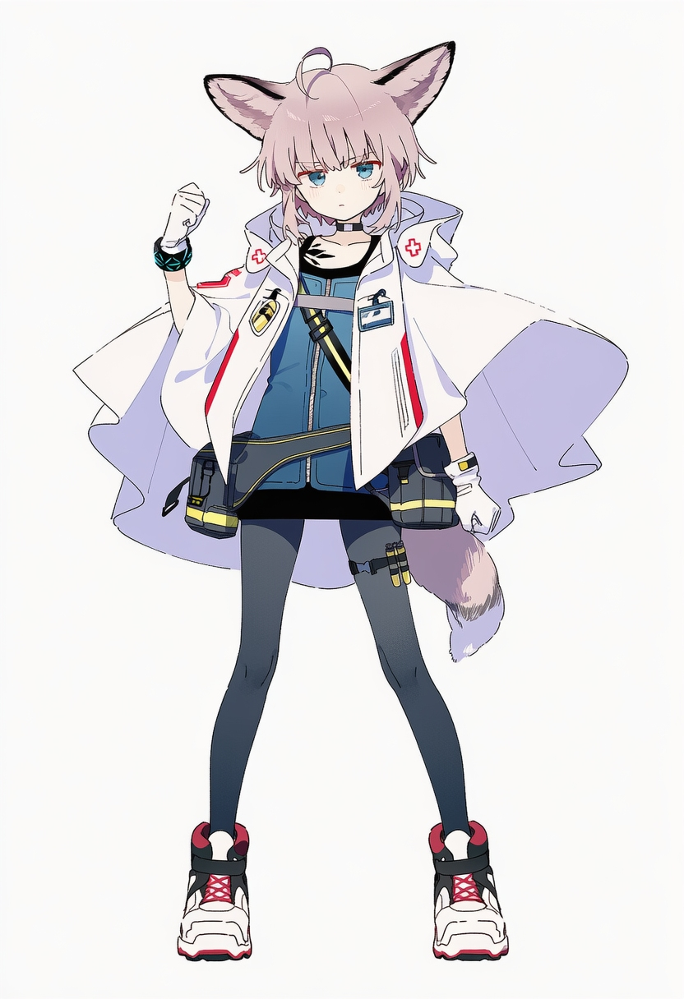
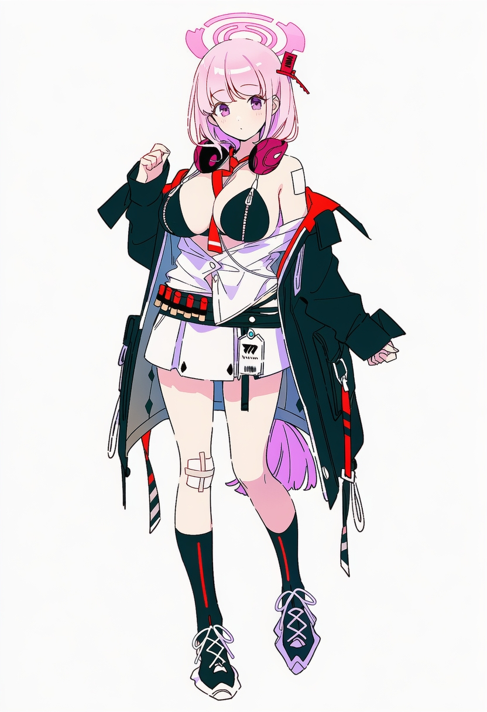
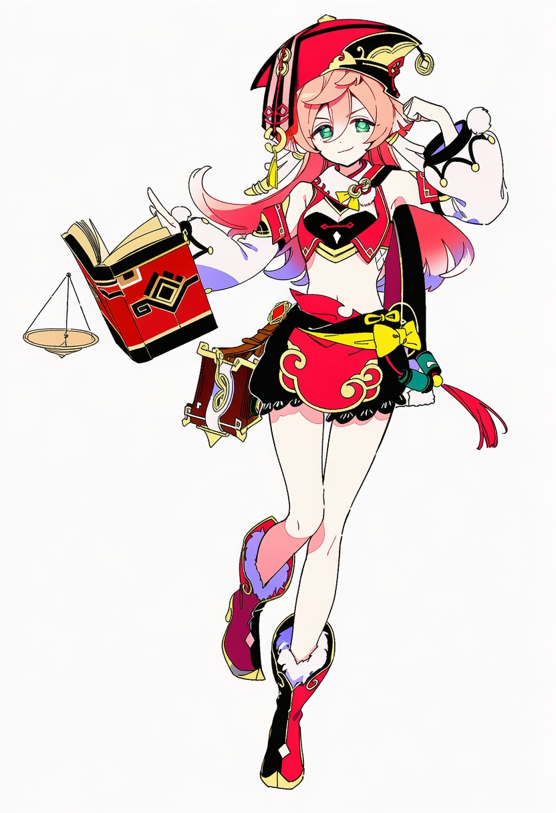
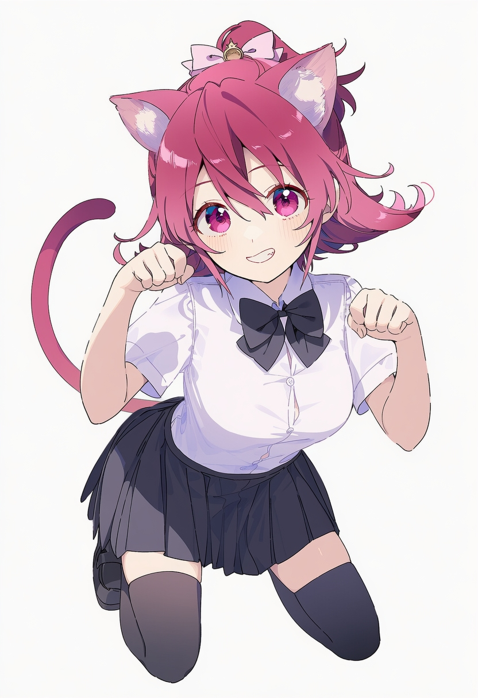

# 手势 / 握拳/弯指手势

[总目录](../README.md) · [原站分类目录](../categories.md) · [英文标签索引](../tags.md) · [服装与构图组合指南](../../README.md)

标题、分类、说明、正负提示词按来源保留；多例图逐张列出。原站标记和说明为参考资料，不作为维护指令。

<a id="raven_composition-3181"></a>

## 握拳

ID：`raven_composition-3181`；分类：手势 / 握拳/弯指手势；来源标记：`safe`。

来源说明：

> 手掌完全握成拳头。

正向提示词：

```text
clenched_hand
```



[在线例图](https://assets.quicktagcloud.com/images/raven_composition/raven_composition-3181.jpg?v=fc6f7ca9655ab7ad)

<a id="raven_composition-3182"></a>

## 蜷曲手指

ID：`raven_composition-3182`；分类：手势 / 握拳/弯指手势；来源标记：`safe`。

来源说明：

> 手指明显弯曲收拢。

正向提示词：

```text
curled_fingers
```



[在线例图](https://assets.quicktagcloud.com/images/raven_composition/raven_composition-3182.jpg?v=3191d1ba7180dacf)

<a id="raven_composition-3183"></a>

## 冒失娘手势

ID：`raven_composition-3183`；分类：手势 / 握拳/弯指手势；来源标记：`safe`。

来源说明：

> 握拳靠近头部的经典冒失娘姿势。

正向提示词：

```text
dojikko_pose
```



[在线例图](https://assets.quicktagcloud.com/images/raven_composition/raven_composition-3183.jpg?v=dafb986dc9b29d30)

<a id="raven_composition-3184"></a>

## 拇指夹拳手势

ID：`raven_composition-3184`；分类：手势 / 握拳/弯指手势；来源标记：`safe`。

来源说明：

> 拇指夹在手指之间的拳形手势。

正向提示词：

```text
fig_sign
```


[在线例图](https://assets.quicktagcloud.com/images/raven_composition/raven_composition-3184.jpg?v=5ea536aca2a9e6bc)

<a id="raven_composition-3185"></a>

## 振臂握拳

ID：`raven_composition-3185`；分类：手势 / 握拳/弯指手势；来源标记：`safe`。

来源说明：

> 握拳向上或向前挥动表示兴奋。

正向提示词：

```text
fist_pump
```


[在线例图](https://assets.quicktagcloud.com/images/raven_composition/raven_composition-3185.jpg?v=20ba94728e89d715)

<a id="raven_composition-3186"></a>

## 猫爪手

ID：`raven_composition-3186`；分类：手势 / 握拳/弯指手势；来源标记：`safe`。

来源说明：

> 双手或单手弯曲成可爱的动物爪姿。

正向提示词：

```text
paw_pose
```



[在线例图](https://assets.quicktagcloud.com/images/raven_composition/raven_composition-3186.jpg?v=ef8d2c98a3bbfa4c)

<a id="raven_composition-3187"></a>

## 力量拳

ID：`raven_composition-3187`；分类：手势 / 握拳/弯指手势；来源标记：`safe`。

来源说明：

> 高举紧握的拳头，常表现团结或力量。

正向提示词：

```text
power_fist
```


[在线例图](https://assets.quicktagcloud.com/images/raven_composition/raven_composition-3187.jpg?v=fd82b43e9186bc10)

<a id="raven_composition-3188"></a>

## 举拳

ID：`raven_composition-3188`；分类：手势 / 握拳/弯指手势；来源标记：`safe`。

来源说明：

> 将握紧的拳头举起。

正向提示词：

```text
raised_fist
```


[在线例图](https://assets.quicktagcloud.com/images/raven_composition/raven_composition-3188.jpg?v=1b4165794a2708b9)

<a id="raven_composition-3189"></a>

## 招手示意过来

ID：`raven_composition-3189`；分类：手势 / 握拳/弯指手势；来源标记：`safe`。

来源说明：

> 用手指或手掌做“过来”的招呼动作。

正向提示词：

```text
beckoning
```


[在线例图](https://assets.quicktagcloud.com/images/raven_composition/raven_composition-3189.jpg?v=5730ca53e48847b1)
