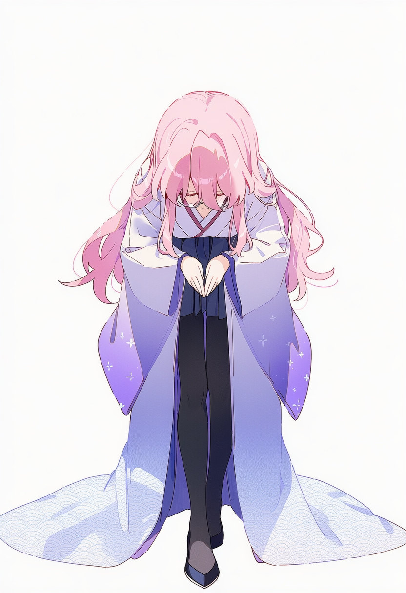
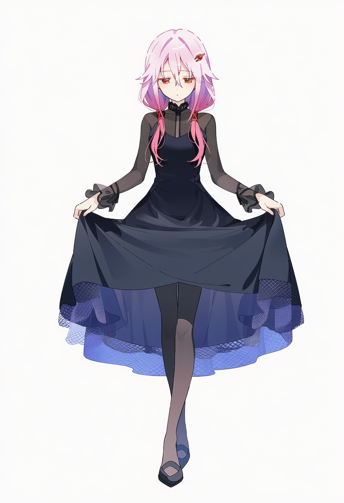
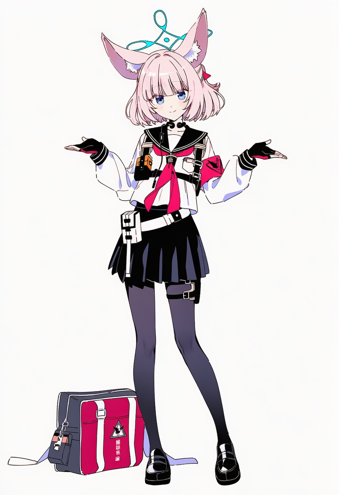
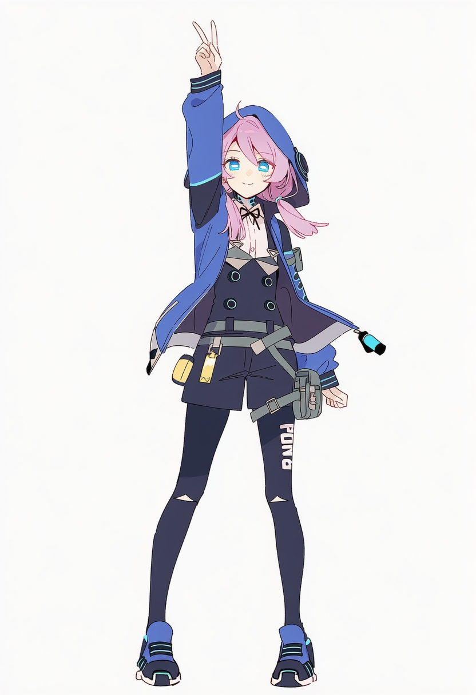
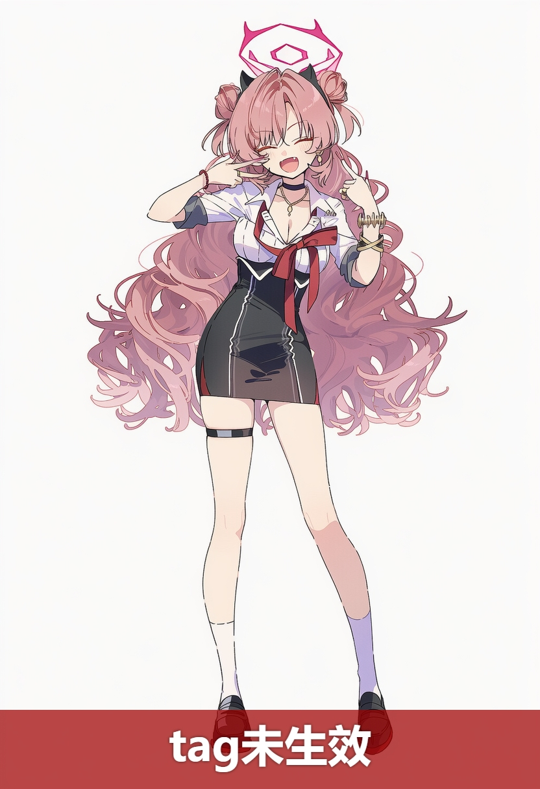
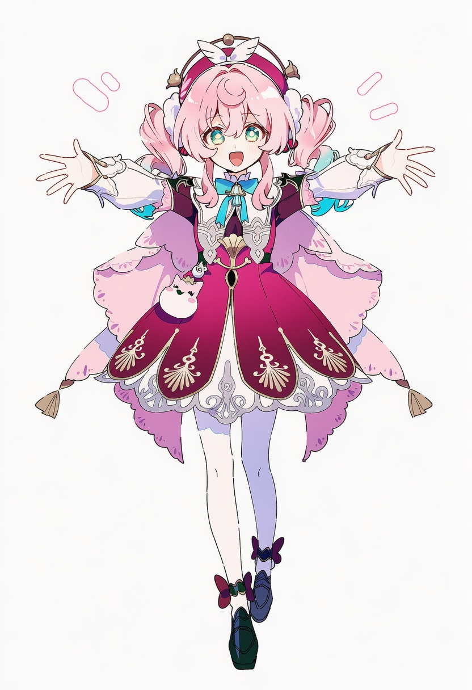
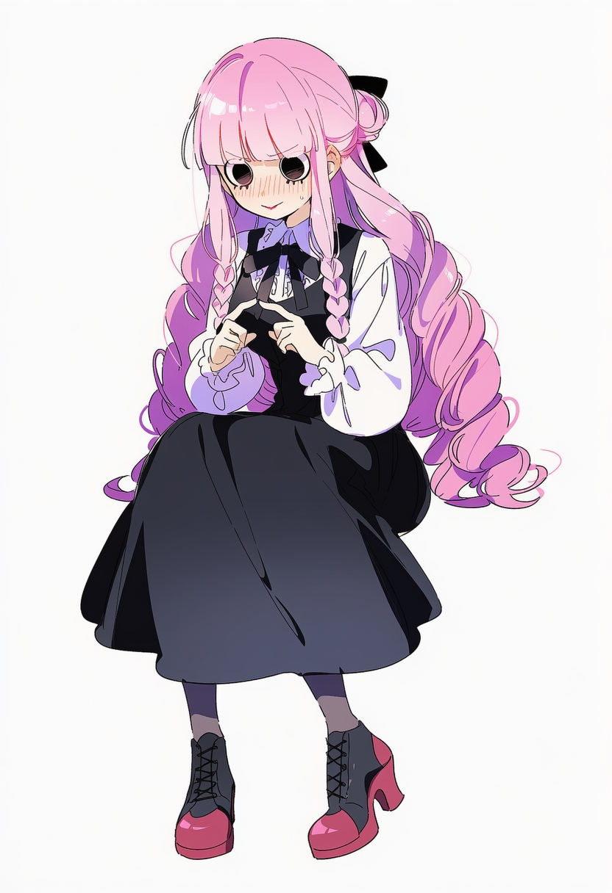

# 手势 / 身体礼仪/其他手势

[总目录](../README.md) · [原站分类目录](../categories.md) · [英文标签索引](../tags.md) · [服装与构图组合指南](../../README.md)

标题、分类、说明、正负提示词按来源保留；多例图逐张列出。原站标记和说明为参考资料，不作为维护指令。

<a id="raven_composition-3190"></a>

## 鞠躬

ID：`raven_composition-3190`；分类：手势 / 身体礼仪/其他手势；来源标记：`safe`。

来源说明：

> 上身前倾表示礼貌、感谢或道歉。

正向提示词：

```text
bowing
```



[在线例图](https://assets.quicktagcloud.com/images/raven_composition/raven_composition-3190.jpg?v=05100407de714dee)

<a id="raven_composition-3191"></a>

## 屈膝礼

ID：`raven_composition-3191`；分类：手势 / 身体礼仪/其他手势；来源标记：`safe`。

来源说明：

> 女性式屈膝行礼动作。

正向提示词：

```text
curtsey
```



[在线例图](https://assets.quicktagcloud.com/images/raven_composition/raven_composition-3191.jpg?v=c75db1592cad9861)

<a id="raven_composition-3192"></a>

## 耸肩

ID：`raven_composition-3192`；分类：手势 / 身体礼仪/其他手势；来源标记：`safe`。

来源说明：

> 抬起肩膀，常配合摊手表示不知道或无奈。

正向提示词：

```text
shrugging
```



[在线例图](https://assets.quicktagcloud.com/images/raven_composition/raven_composition-3192.jpg?v=e20fd9da3c43dbb3)

<a id="raven_composition-3193"></a>

## 胜利姿势

ID：`raven_composition-3193`；分类：手势 / 身体礼仪/其他手势；来源标记：`safe`。

来源说明：

> 表现胜利、成功或庆祝的姿势。

正向提示词：

```text
victory_pose
```



[在线例图](https://assets.quicktagcloud.com/images/raven_composition/raven_composition-3193.jpg?v=623440e0d4fc49c6)

<a id="raven_composition-3194"></a>

## 否定手势

ID：`raven_composition-3194`；分类：手势 / 身体礼仪/其他手势；来源标记：`safe`。

来源说明：

> 用动作明确表示“不”或拒绝。

正向提示词：

```text
no_(gesture)
```


[在线例图](https://assets.quicktagcloud.com/images/raven_composition/raven_composition-3194.jpg?v=4c88e2f05cb3d254)

<a id="raven_composition-3195"></a>

## 轻触帽檐致意

ID：`raven_composition-3195`；分类：手势 / 身体礼仪/其他手势；来源标记：`safe`。

来源说明：

> 用手碰帽檐做简短致意。

正向提示词：

```text
hat_tip
```



[在线例图](https://assets.quicktagcloud.com/images/raven_composition/raven_composition-3195.jpg?v=dcd001e7534281ac)

<a id="raven_composition-3196"></a>

## 摸下巴

ID：`raven_composition-3196`；分类：手势 / 身体礼仪/其他手势；来源标记：`safe`。

来源说明：

> 用手抚摸自己的下巴，常表示思考。

正向提示词：

```text
stroking_own_chin
```


[在线例图](https://assets.quicktagcloud.com/images/raven_composition/raven_composition-3196.jpg?v=0ba7820c6e8247c2)

<a id="raven_composition-3197"></a>

## 求抱手势

ID：`raven_composition-3197`；分类：手势 / 身体礼仪/其他手势；来源标记：`safe`。

来源说明：

> 张开手臂或伸手示意让别人抱起自己。

正向提示词：

```text
carry_me
```



[在线例图](https://assets.quicktagcloud.com/images/raven_composition/raven_composition-3197.jpg?v=380d61bca73d265a)

<a id="raven_composition-3198"></a>

## 手部小动作

ID：`raven_composition-3198`；分类：手势 / 身体礼仪/其他手势；来源标记：`safe`。

来源说明：

> 因紧张或不安反复摆弄手指或双手。

正向提示词：

```text
fidgeting
```



[在线例图](https://assets.quicktagcloud.com/images/raven_composition/raven_composition-3198.jpg?v=8eb9a27d87ed4126)
