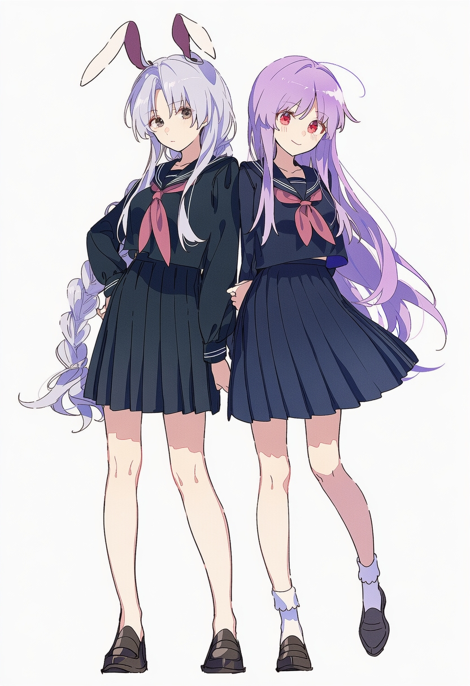

# 多人互动 / 站位/靠近/依靠

[总目录](../README.md) · [原站分类目录](../categories.md) · [英文标签索引](../tags.md) · [服装与构图组合指南](../../README.md)

标题、分类、说明、正负提示词按来源保留；多例图逐张列出。原站标记和说明为参考资料，不作为维护指令。

<a id="raven_composition-3199"></a>

## 并肩

ID：`raven_composition-3199`；分类：多人互动 / 站位/靠近/依靠；来源标记：`safe`。

来源说明：

> 两个或更多角色紧挨着并排。

正向提示词：

```text
side-by-side
```


[在线例图](https://assets.quicktagcloud.com/images/raven_composition/raven_composition-3199.jpg?v=e679551c972b39e4)

<a id="raven_composition-3200"></a>

## 背靠背

ID：`raven_composition-3200`；分类：多人互动 / 站位/靠近/依靠；来源标记：`safe`。

来源说明：

> 两个角色背部相对或贴靠。

正向提示词：

```text
back-to-back
```


[在线例图](https://assets.quicktagcloud.com/images/raven_composition/raven_composition-3200.jpg?v=73b4bb67461451f6)

<a id="raven_composition-3201"></a>

## 面对面

ID：`raven_composition-3201`；分类：多人互动 / 站位/靠近/依靠；来源标记：`safe`。

来源说明：

> 两个角色正面朝向彼此。

正向提示词：

```text
face-to-face
```


[在线例图](https://assets.quicktagcloud.com/images/raven_composition/raven_composition-3201.jpg?v=cecabee63cffe335)

<a id="raven_composition-3202"></a>

## 前后贴靠

ID：`raven_composition-3202`；分类：多人互动 / 站位/靠近/依靠；来源标记：`safe`。

来源说明：

> 一个角色的正面靠着另一个角色的背面。

正向提示词：

```text
front-to-back
```


[在线例图](https://assets.quicktagcloud.com/images/raven_composition/raven_composition-3202.jpg?v=6e2750221e6cbada)

<a id="raven_composition-3203"></a>

## 站在他人身后

ID：`raven_composition-3203`；分类：多人互动 / 站位/靠近/依靠；来源标记：`safe`。

来源说明：

> 一个角色位于另一个角色后方。

正向提示词：

```text
behind_another
```


[在线例图](https://assets.quicktagcloud.com/images/raven_composition/raven_composition-3203.jpg?v=3c57eee49f8eebce)

<a id="raven_composition-3204"></a>

## 靠在别人身上

ID：`raven_composition-3204`；分类：多人互动 / 站位/靠近/依靠；来源标记：`safe`。

来源说明：

> 把身体重量或身体一部分倚靠在另一角色身上。

正向提示词：

```text
leaning_on_person
```


[在线例图](https://assets.quicktagcloud.com/images/raven_composition/raven_composition-3204.jpg?v=a0b5235d9e902c22)

<a id="raven_composition-3205"></a>

## 头靠肩

ID：`raven_composition-3205`；分类：多人互动 / 站位/靠近/依靠；来源标记：`safe`。

来源说明：

> 把头靠在另一角色肩膀上。

正向提示词：

```text
head_on_another's_shoulder
```


[在线例图](https://assets.quicktagcloud.com/images/raven_composition/raven_composition-3205.jpg?v=524a959c98003478)

<a id="raven_composition-3206"></a>

## 头靠头顶

ID：`raven_composition-3206`；分类：多人互动 / 站位/靠近/依靠；来源标记：`safe`。

来源说明：

> 把头放在另一角色头部上。

正向提示词：

```text
head_on_another's_head
```


[在线例图](https://assets.quicktagcloud.com/images/raven_composition/raven_composition-3206.jpg?v=21d6c09cc92f47e3)

<a id="raven_composition-3207"></a>

## 肩并肩

ID：`raven_composition-3207`；分类：多人互动 / 站位/靠近/依靠；来源标记：`safe`。

来源说明：

> 两人的肩部彼此紧靠。

正向提示词：

```text
shoulder-to-shoulder
```



[在线例图](https://assets.quicktagcloud.com/images/raven_composition/raven_composition-3207.jpg?v=21bf96dfcb067551)

<a id="raven_composition-3208"></a>

## 额头贴额头

ID：`raven_composition-3208`；分类：多人互动 / 站位/靠近/依靠；来源标记：`safe`。

来源说明：

> 两人的额头彼此贴近或接触。

正向提示词：

```text
forehead-to-forehead
```


[在线例图](https://assets.quicktagcloud.com/images/raven_composition/raven_composition-3208.jpg?v=ba5ed8f9a2ee9f98)

<a id="raven_composition-3209"></a>

## 鼻尖贴鼻尖

ID：`raven_composition-3209`；分类：多人互动 / 站位/靠近/依靠；来源标记：`safe`。

来源说明：

> 两人的鼻子彼此靠近或接触。

正向提示词：

```text
nose-to-nose
```


[在线例图](https://assets.quicktagcloud.com/images/raven_composition/raven_composition-3209.jpg?v=a90d0404662be9c6)

<a id="raven_composition-3210"></a>

## 脸颊贴脸颊

ID：`raven_composition-3210`；分类：多人互动 / 站位/靠近/依靠；来源标记：`safe`。

来源说明：

> 两人的脸颊彼此贴近。

正向提示词：

```text
cheek-to-cheek
```


[在线例图](https://assets.quicktagcloud.com/images/raven_composition/raven_composition-3210.jpg?v=73d61feab7df1336)
