# 多人互动 / 牵手/手臂互动

[总目录](../README.md) · [原站分类目录](../categories.md) · [英文标签索引](../tags.md) · [服装与构图组合指南](../../README.md)

标题、分类、说明、正负提示词按来源保留；多例图逐张列出。原站标记和说明为参考资料，不作为维护指令。

<a id="raven_composition-3211"></a>

## 牵手

ID：`raven_composition-3211`；分类：多人互动 / 牵手/手臂互动；来源标记：`safe`。

来源说明：

> 角色彼此握住对方的手。

正向提示词：

```text
holding_hands
```

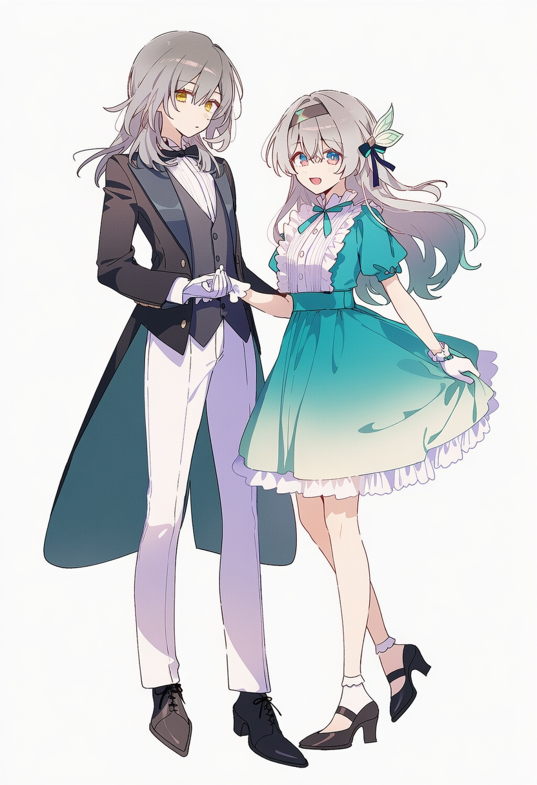

[在线例图](https://assets.quicktagcloud.com/images/raven_composition/raven_composition-3211.jpg?v=f7c6e742f17e98b9)

<a id="raven_composition-3212"></a>

## 十指相扣

ID：`raven_composition-3212`；分类：多人互动 / 牵手/手臂互动；来源标记：`safe`。

来源说明：

> 两人的手指彼此交错扣住。

正向提示词：

```text
interlocked_fingers
```

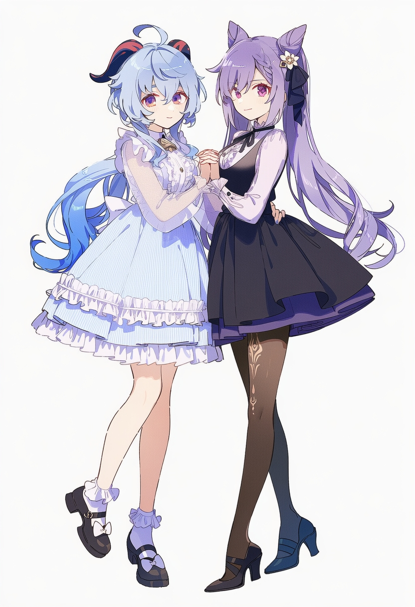

[在线例图](https://assets.quicktagcloud.com/images/raven_composition/raven_composition-3212.jpg?v=89525c48ae8ca4c1)

<a id="raven_composition-3213"></a>

## 握手

ID：`raven_composition-3213`；分类：多人互动 / 牵手/手臂互动；来源标记：`safe`。

来源说明：

> 两人以握手方式互动。

正向提示词：

```text
handshake
```

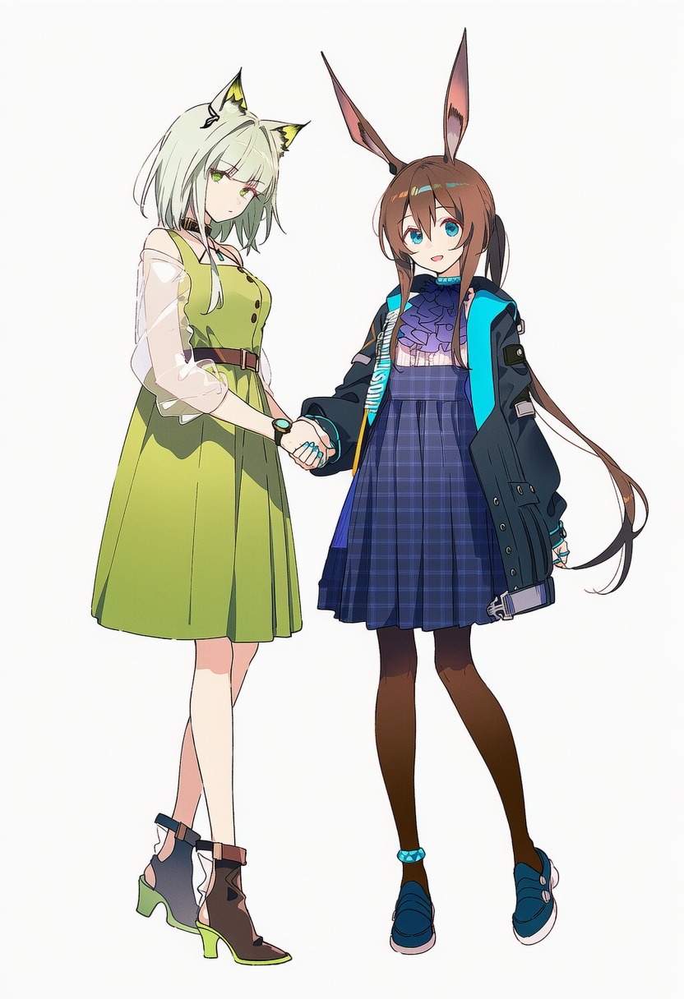

[在线例图](https://assets.quicktagcloud.com/images/raven_composition/raven_composition-3213.jpg?v=303426a853d0e292)

<a id="raven_composition-3214"></a>

## 击掌

ID：`raven_composition-3214`；分类：多人互动 / 牵手/手臂互动；来源标记：`safe`。

来源说明：

> 两人抬手互相击掌。

正向提示词：

```text
high_five
```

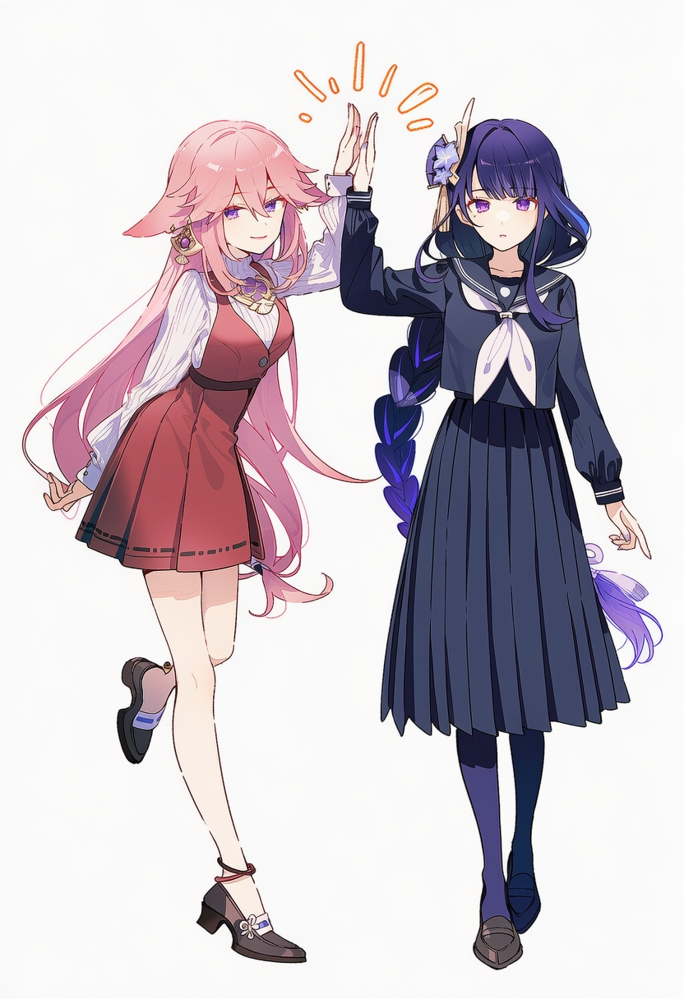

[在线例图](https://assets.quicktagcloud.com/images/raven_composition/raven_composition-3214.jpg?v=5fe9a1b5794bd8c4)

<a id="raven_composition-3215"></a>

## 碰拳

ID：`raven_composition-3215`；分类：多人互动 / 牵手/手臂互动；来源标记：`safe`。

来源说明：

> 两人用拳头互相轻碰。

正向提示词：

```text
fist_bump
```

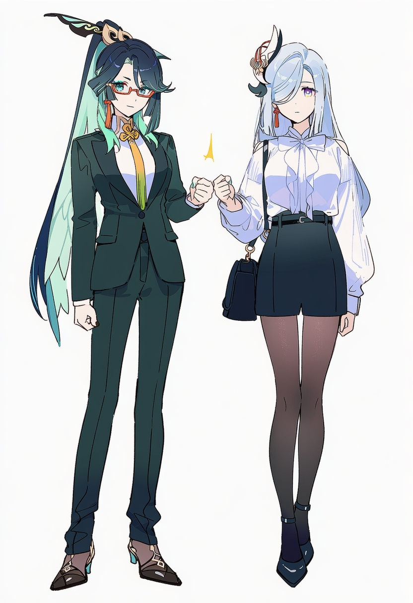

[在线例图](https://assets.quicktagcloud.com/images/raven_composition/raven_composition-3215.jpg?v=7e810e8c68d7ff8b)

<a id="raven_composition-3216"></a>

## 拉钩

ID：`raven_composition-3216`；分类：多人互动 / 牵手/手臂互动；来源标记：`safe`。

来源说明：

> 两人用小拇指勾在一起。

正向提示词：

```text
pinky_swear
```

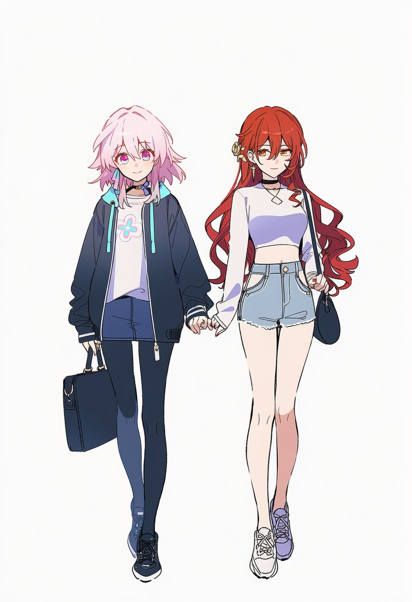

[在线例图](https://assets.quicktagcloud.com/images/raven_composition/raven_composition-3216.jpg?v=6ed1741015dc7abb)

<a id="raven_composition-3217"></a>

## 手放他人手臂

ID：`raven_composition-3217`；分类：多人互动 / 牵手/手臂互动；来源标记：`safe`。

来源说明：

> 一只手放在另一角色的手臂上。

正向提示词：

```text
hand_on_another's_arm
```

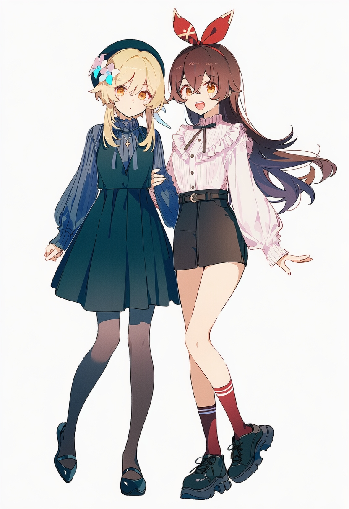

[在线例图](https://assets.quicktagcloud.com/images/raven_composition/raven_composition-3217.jpg?v=ea33234a0e3351fa)

<a id="raven_composition-3218"></a>

## 双手放他人单臂

ID：`raven_composition-3218`；分类：多人互动 / 牵手/手臂互动；来源标记：`safe`。

来源说明：

> 双手都放在另一角色的一只手臂上。

正向提示词：

```text
hands_on_another's_arm
```

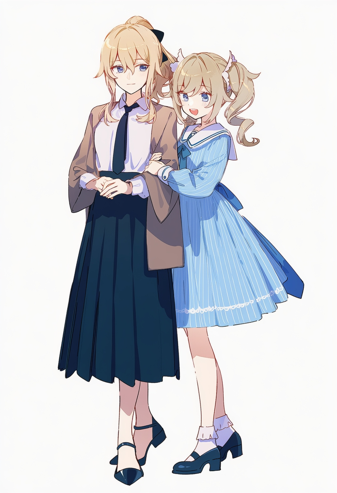

[在线例图](https://assets.quicktagcloud.com/images/raven_composition/raven_composition-3218.jpg?v=e55a180add662c95)

<a id="raven_composition-3219"></a>

## 双手放他人双臂

ID：`raven_composition-3219`；分类：多人互动 / 牵手/手臂互动；来源标记：`safe`。

来源说明：

> 双手分别接触另一角色的手臂。

正向提示词：

```text
hands_on_another's_arms
```

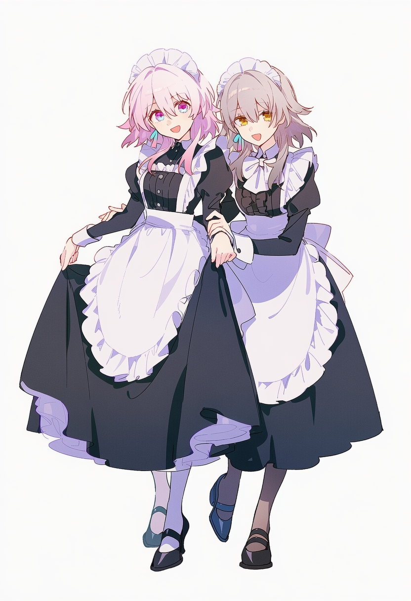

[在线例图](https://assets.quicktagcloud.com/images/raven_composition/raven_composition-3219.jpg?v=2b2e86c6cad598e0)

<a id="raven_composition-3220"></a>

## 手搭他人肩

ID：`raven_composition-3220`；分类：多人互动 / 牵手/手臂互动；来源标记：`safe`。

来源说明：

> 一只手放在另一角色肩膀上。

正向提示词：

```text
hand_on_another's_shoulder
```

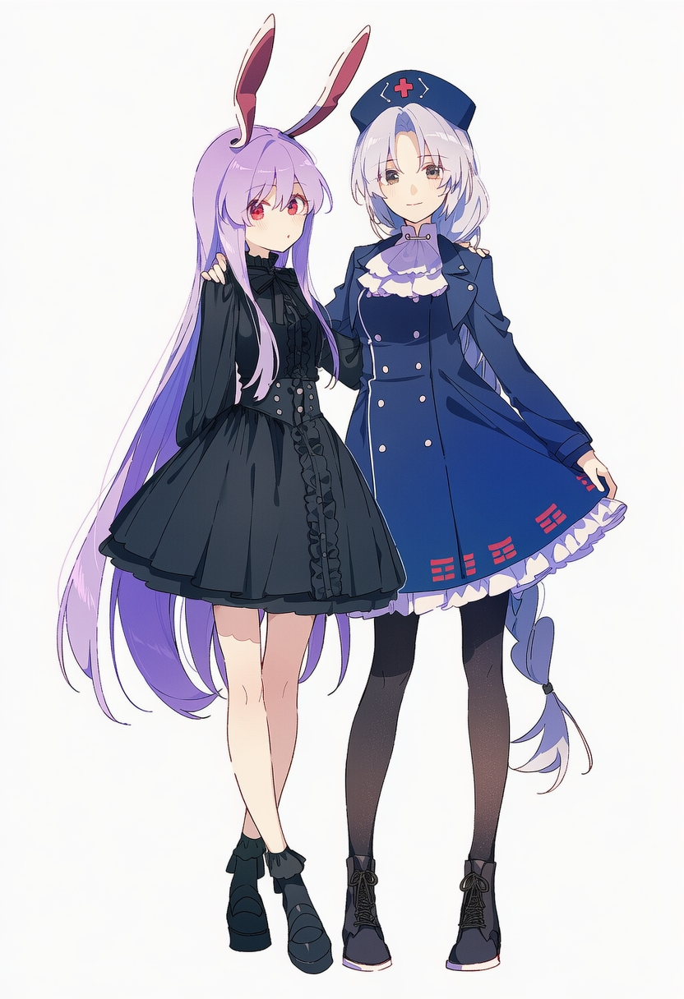

[在线例图](https://assets.quicktagcloud.com/images/raven_composition/raven_composition-3220.jpg?v=8bcc060977757328)

<a id="raven_composition-3221"></a>

## 双手搭肩

ID：`raven_composition-3221`；分类：多人互动 / 牵手/手臂互动；来源标记：`safe`。

来源说明：

> 双手放在另一角色双肩上。

正向提示词：

```text
hands_on_another's_shoulders
```

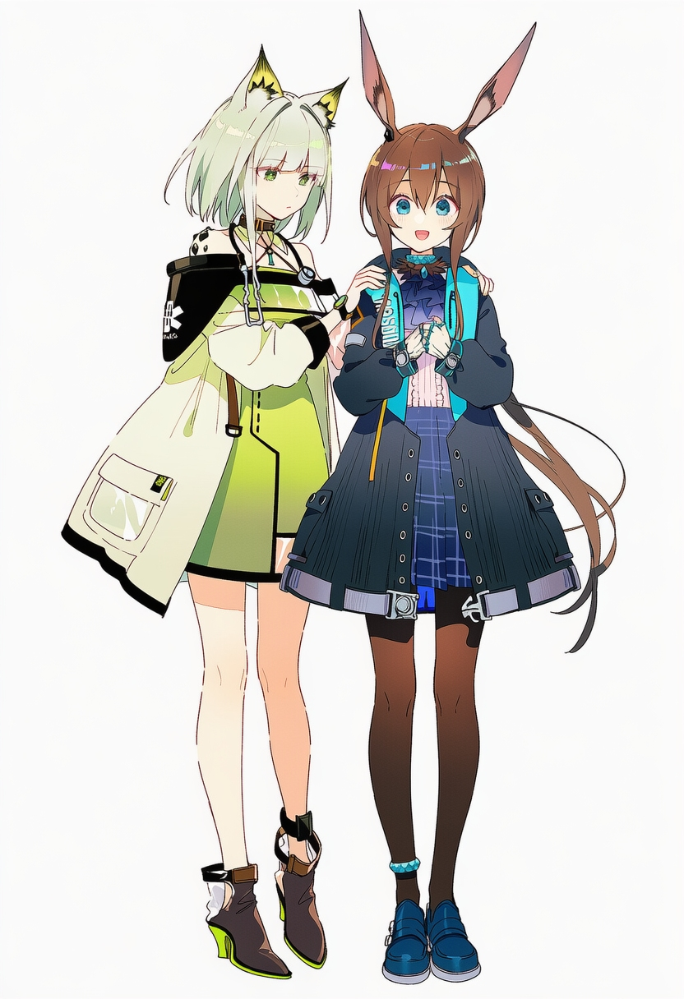

[在线例图](https://assets.quicktagcloud.com/images/raven_composition/raven_composition-3221.jpg?v=cb8a86a1014b7a8c)

<a id="raven_composition-3222"></a>

## 抓/握他人手臂

ID：`raven_composition-3222`；分类：多人互动 / 牵手/手臂互动；来源标记：`safe`。

来源说明：

> 用手握住另一角色的手臂。

正向提示词：

```text
holding_another's_arm
```

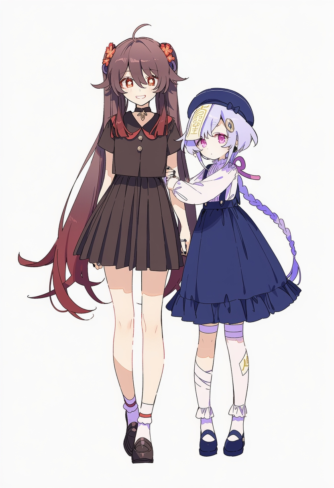

[在线例图](https://assets.quicktagcloud.com/images/raven_composition/raven_composition-3222.jpg?v=99b72eb036b528bb)

<a id="raven_composition-3223"></a>

## 握住他人手腕

ID：`raven_composition-3223`；分类：多人互动 / 牵手/手臂互动；来源标记：`safe`。

来源说明：

> 用手握住另一角色的手腕。

正向提示词：

```text
holding_another's_wrist
```

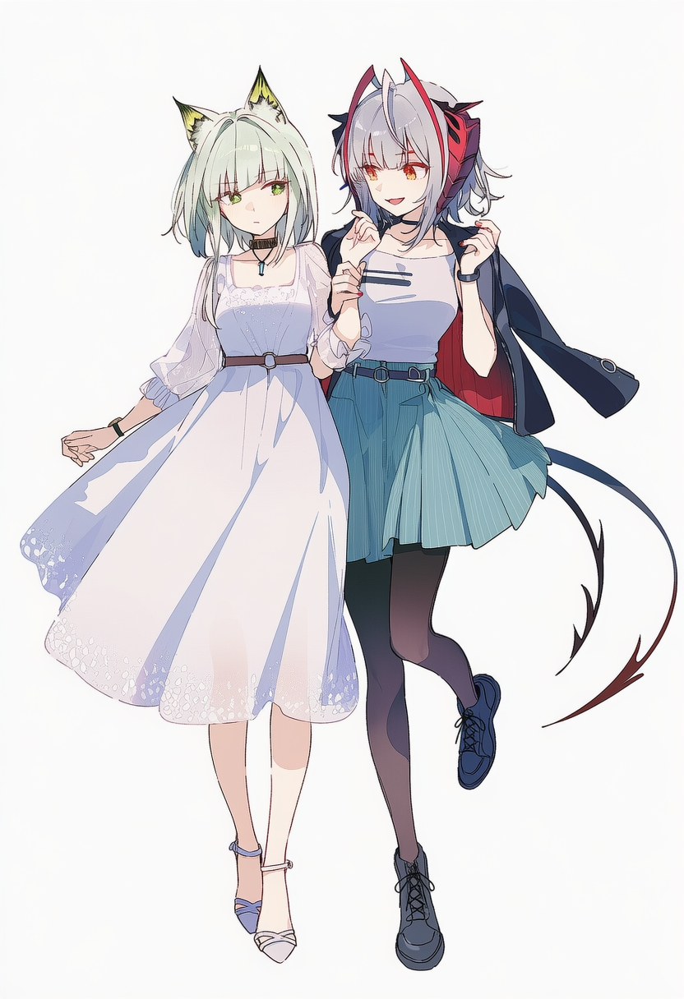

[在线例图](https://assets.quicktagcloud.com/images/raven_composition/raven_composition-3223.jpg?v=541331abcf3ba4bc)

<a id="raven_composition-3224"></a>

## 握住他人的手

ID：`raven_composition-3224`；分类：多人互动 / 牵手/手臂互动；来源标记：`safe`。

来源说明：

> 用手握住另一角色的一只手。

正向提示词：

```text
holding_another's_hand
```

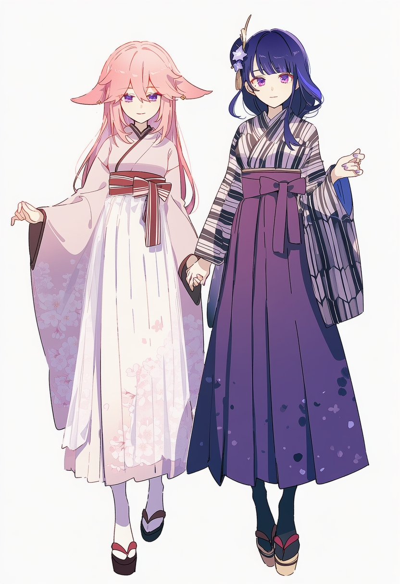

[在线例图](https://assets.quicktagcloud.com/images/raven_composition/raven_composition-3224.jpg?v=aa52ddadcdd45d99)

<a id="raven_composition-3225"></a>

## 搂肩

ID：`raven_composition-3225`；分类：多人互动 / 牵手/手臂互动；来源标记：`safe`。

来源说明：

> 用一只手臂环在另一角色肩膀周围。

正向提示词：

```text
arm_around_shoulder
```

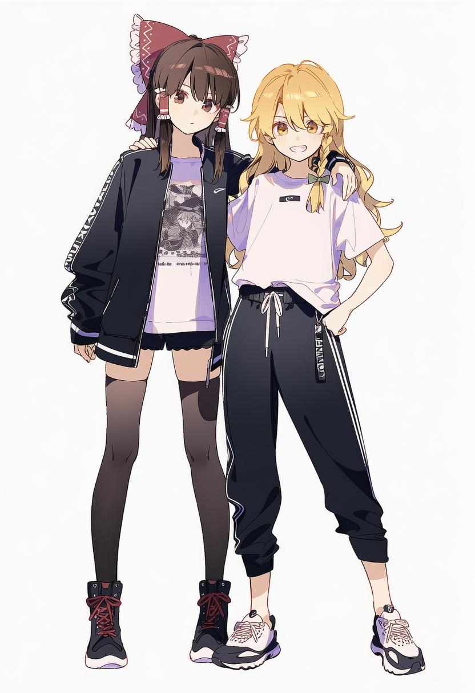

[在线例图](https://assets.quicktagcloud.com/images/raven_composition/raven_composition-3225.jpg?v=71c0fd2865613655)

<a id="raven_composition-3226"></a>

## 搂住脖子

ID：`raven_composition-3226`；分类：多人互动 / 牵手/手臂互动；来源标记：`safe`。

来源说明：

> 用手臂环在另一角色颈部周围。

正向提示词：

```text
arm_around_neck
```

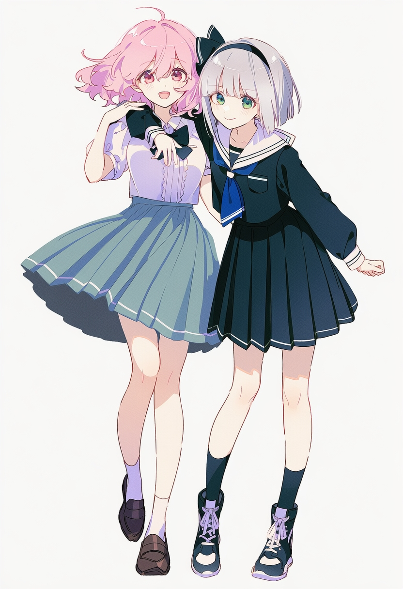

[在线例图](https://assets.quicktagcloud.com/images/raven_composition/raven_composition-3226.jpg?v=0f10ac2b4bfa2ee8)

<a id="raven_composition-3227"></a>

## 单臂搂腰

ID：`raven_composition-3227`；分类：多人互动 / 牵手/手臂互动；来源标记：`safe`。

来源说明：

> 用一只手臂环住另一角色腰部。

正向提示词：

```text
arm_around_another's_waist
```

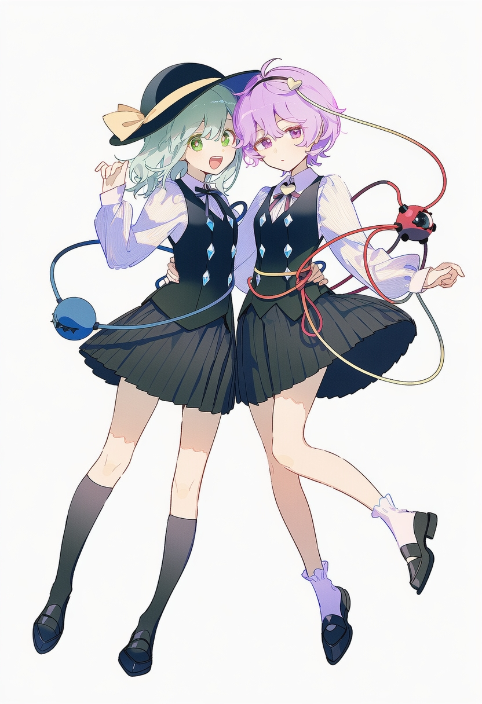

[在线例图](https://assets.quicktagcloud.com/images/raven_composition/raven_composition-3227.jpg?v=fbe4b3b381e5b078)

<a id="raven_composition-3228"></a>

## 双臂搂腰

ID：`raven_composition-3228`；分类：多人互动 / 牵手/手臂互动；来源标记：`safe`。

来源说明：

> 用双臂环住另一角色腰部。

正向提示词：

```text
arms_around_another's_waist
```

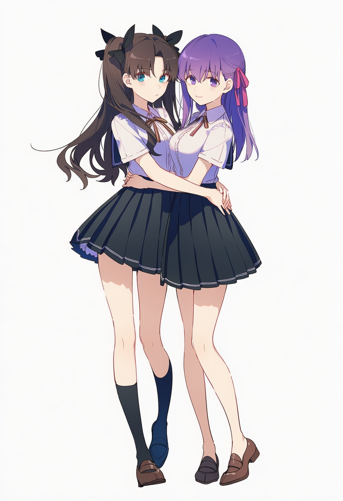

[在线例图](https://assets.quicktagcloud.com/images/raven_composition/raven_composition-3228.jpg?v=0b61320aea936d03)

<a id="raven_composition-3229"></a>

## 挽手臂

ID：`raven_composition-3229`；分类：多人互动 / 牵手/手臂互动；来源标记：`safe`。

来源说明：

> 两人把手臂互相挽在一起。

正向提示词：

```text
linking_arms
```

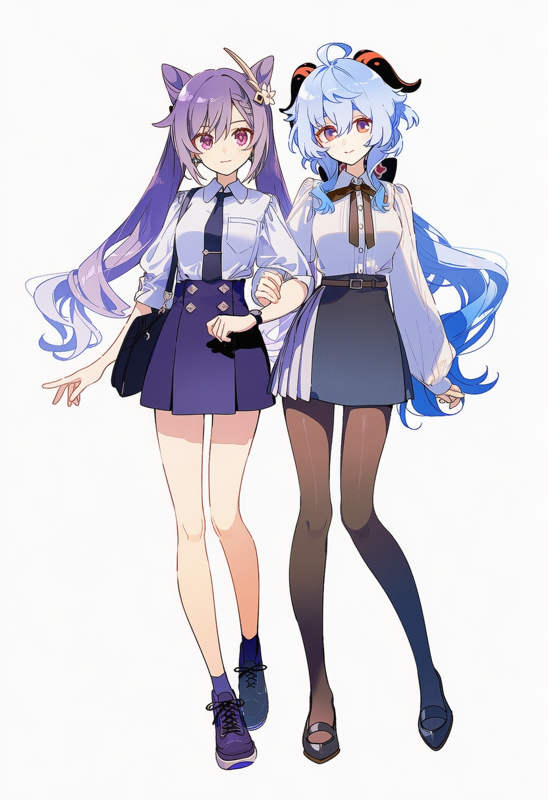

[在线例图](https://assets.quicktagcloud.com/images/raven_composition/raven_composition-3229.jpg?v=c0ed1a352ee8ff08)

<a id="raven_composition-3230"></a>

## 伸手邀请

ID：`raven_composition-3230`；分类：多人互动 / 牵手/手臂互动；来源标记：`safe`。

来源说明：

> 向对方或观众伸出手，常用于牵手或扶起。

正向提示词：

```text
offering_hand
```

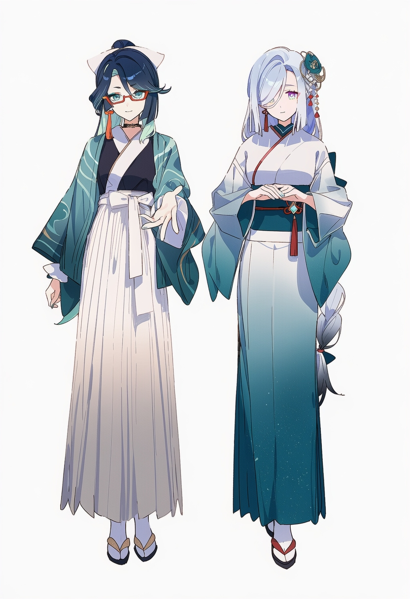

[在线例图](https://assets.quicktagcloud.com/images/raven_composition/raven_composition-3230.jpg?v=3d7cff2f9d2ff976)

<a id="raven_composition-3231"></a>

## 向他人伸手

ID：`raven_composition-3231`；分类：多人互动 / 牵手/手臂互动；来源标记：`safe`。

来源说明：

> 明确向另一个角色伸出手邀请互动。

正向提示词：

```text
offering_hand_to_another
```

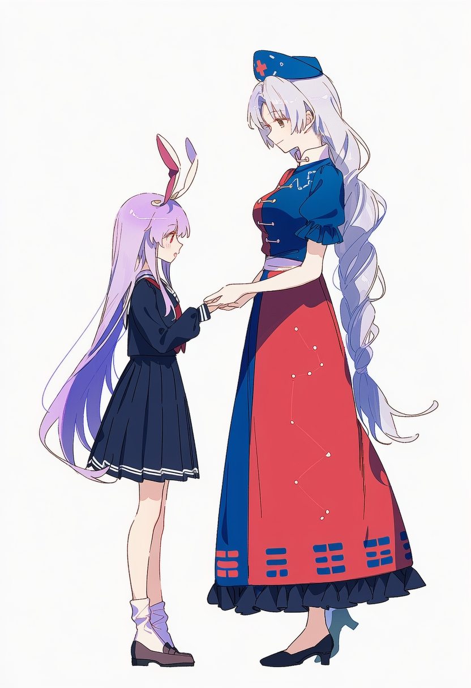

[在线例图](https://assets.quicktagcloud.com/images/raven_composition/raven_composition-3231.jpg?v=d015c9a33e702b5a)
