# 多人互动 / 拥抱/贴靠

[总目录](../README.md) · [原站分类目录](../categories.md) · [英文标签索引](../tags.md) · [服装与构图组合指南](../../README.md)

标题、分类、说明、正负提示词按来源保留；多例图逐张列出。原站标记和说明为参考资料，不作为维护指令。

<a id="raven_composition-3232"></a>

## 拥抱

ID：`raven_composition-3232`；分类：多人互动 / 拥抱/贴靠；来源标记：`safe`。

来源说明：

> 一个角色用手臂抱住另一个角色。

正向提示词：

```text
hug
```

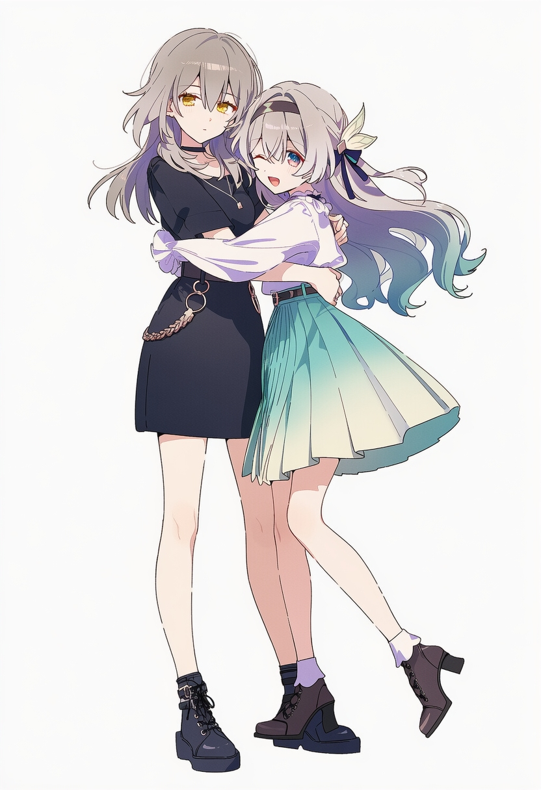

[在线例图](https://assets.quicktagcloud.com/images/raven_composition/raven_composition-3232.jpg?v=b41d2e1a8c9b14cd)

<a id="raven_composition-3233"></a>

## 相互拥抱

ID：`raven_composition-3233`；分类：多人互动 / 拥抱/贴靠；来源标记：`safe`。

来源说明：

> 双方都用手臂抱住彼此。

正向提示词：

```text
mutual_hug
```

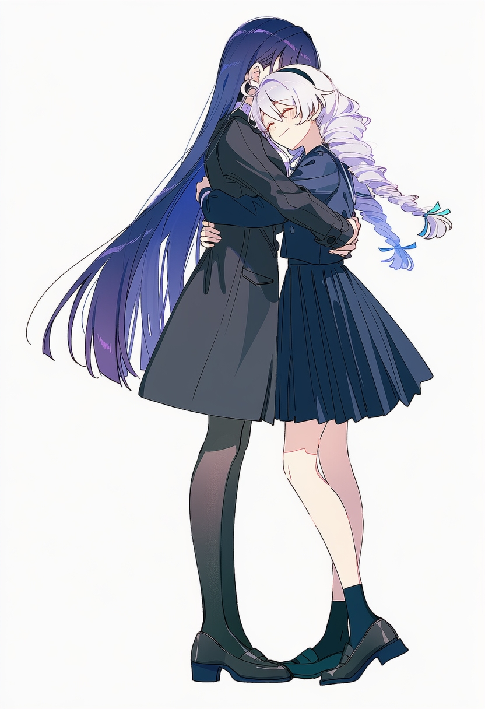

[在线例图](https://assets.quicktagcloud.com/images/raven_composition/raven_composition-3233.jpg?v=7c85d27d3e55fb1b)

<a id="raven_composition-3234"></a>

## 背后拥抱

ID：`raven_composition-3234`；分类：多人互动 / 拥抱/贴靠；来源标记：`safe`。

来源说明：

> 从另一角色身后抱住对方。

正向提示词：

```text
hug_from_behind
```

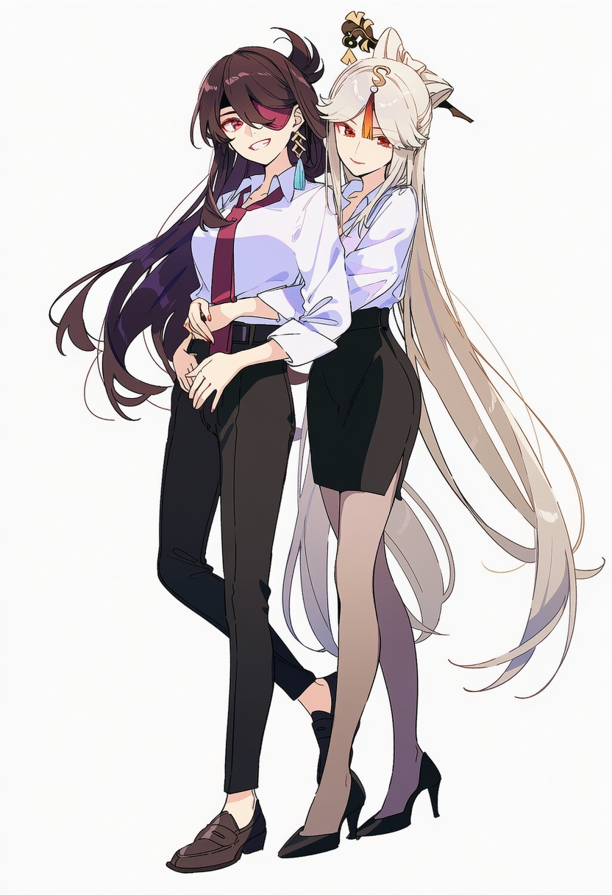

[在线例图](https://assets.quicktagcloud.com/images/raven_composition/raven_composition-3234.jpg?v=ec620ac0385797df)

<a id="raven_composition-3235"></a>

## 侧面拥抱

ID：`raven_composition-3235`；分类：多人互动 / 拥抱/贴靠；来源标记：`safe`。

来源说明：

> 从另一角色侧面抱住对方。

正向提示词：

```text
hug_from_side
```

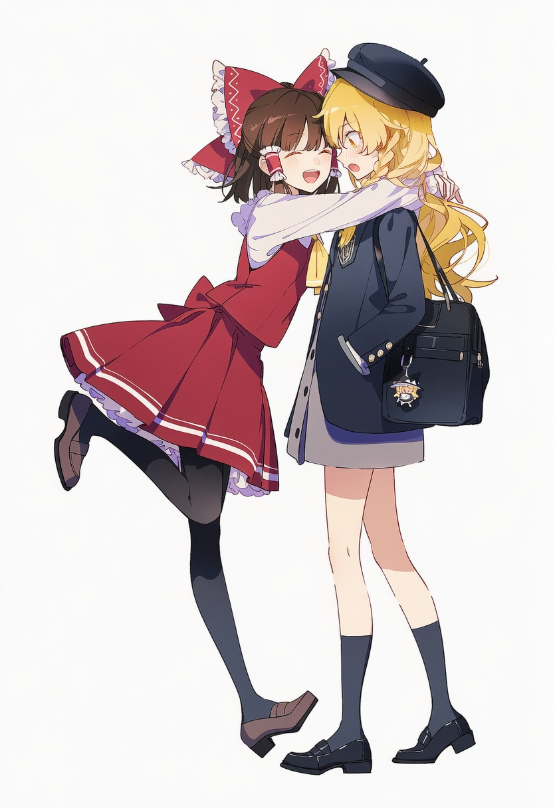

[在线例图](https://assets.quicktagcloud.com/images/raven_composition/raven_composition-3235.jpg?v=36e77ec0151ff97a)

<a id="raven_composition-3236"></a>

## 突然拥抱

ID：`raven_composition-3236`；分类：多人互动 / 拥抱/贴靠；来源标记：`safe`。

来源说明：

> 在对方没有预料时突然抱住。

正向提示词：

```text
surprise_hug
```

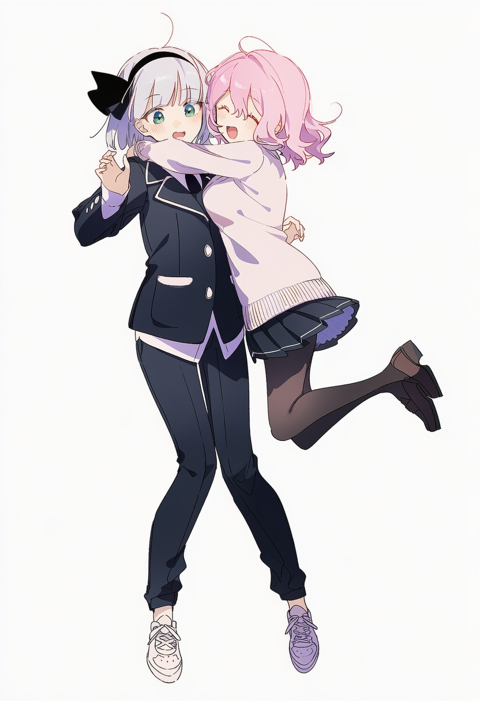

[在线例图](https://assets.quicktagcloud.com/images/raven_composition/raven_composition-3236.jpg?v=4f6f3ec54e6983cf)

<a id="raven_composition-3237"></a>

## 强行拥抱

ID：`raven_composition-3237`；分类：多人互动 / 拥抱/贴靠；来源标记：`safe`。

来源说明：

> 一方在另一方不情愿时抱住对方。

正向提示词：

```text
forced_hug
```

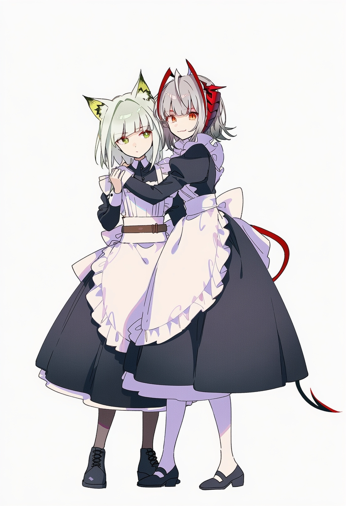

[在线例图](https://assets.quicktagcloud.com/images/raven_composition/raven_composition-3237.jpg?v=4b46ed069b6b0c45)

<a id="raven_composition-3238"></a>

## 拒绝拥抱

ID：`raven_composition-3238`；分类：多人互动 / 拥抱/贴靠；来源标记：`safe`。

来源说明：

> 一方试图拥抱但被另一方拒绝。

正向提示词：

```text
rejected_hug
```

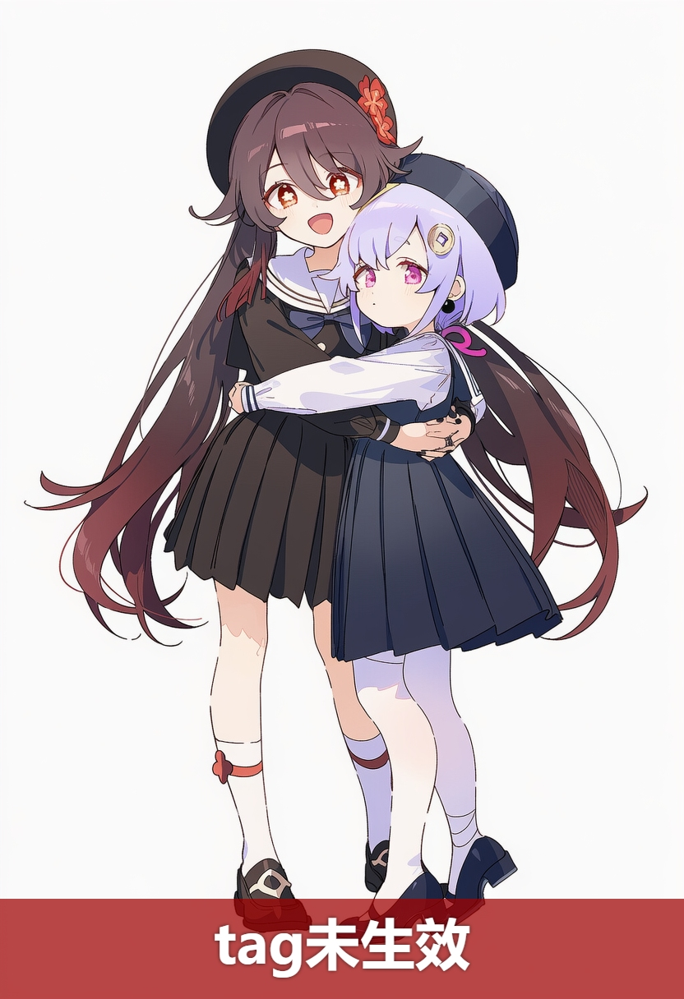

[在线例图](https://assets.quicktagcloud.com/images/raven_composition/raven_composition-3238.jpg?v=3bff4e0601b0592c)

<a id="raven_composition-3239"></a>

## 即将拥抱

ID：`raven_composition-3239`；分类：多人互动 / 拥抱/贴靠；来源标记：`safe`。

来源说明：

> 两人正处于马上要抱在一起的状态。

正向提示词：

```text
imminent_hug
```

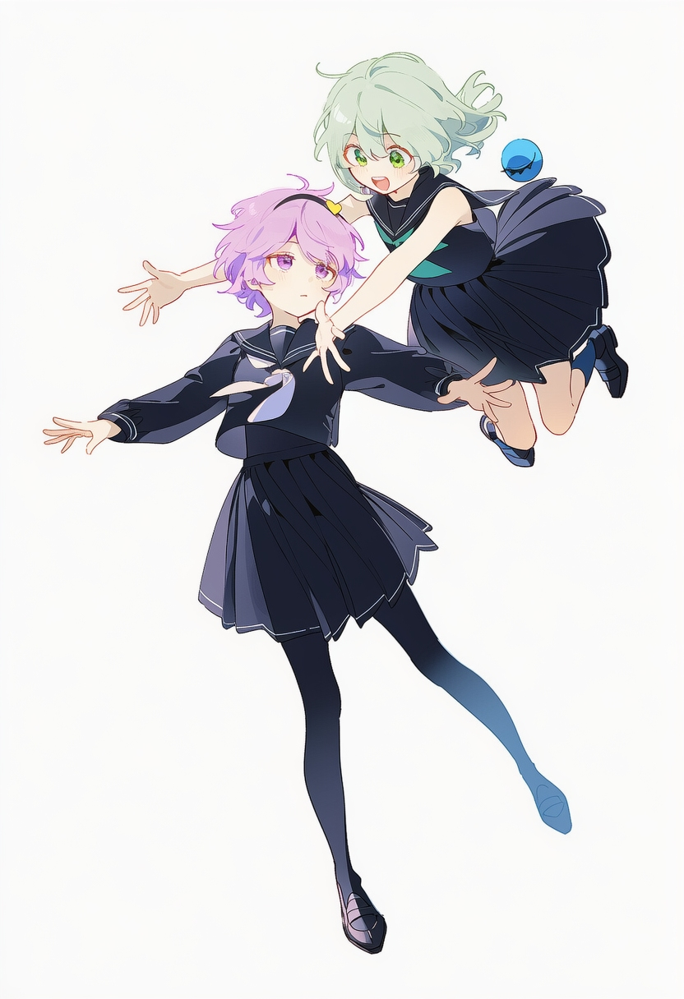

[在线例图](https://assets.quicktagcloud.com/images/raven_composition/raven_composition-3239.jpg?v=3e7c34a657ccd3ed)

<a id="raven_composition-3240"></a>

## 飞扑拥抱

ID：`raven_composition-3240`；分类：多人互动 / 拥抱/贴靠；来源标记：`safe`。

来源说明：

> 带扑跃感的猛烈拥抱。

正向提示词：

```text
glomp
```

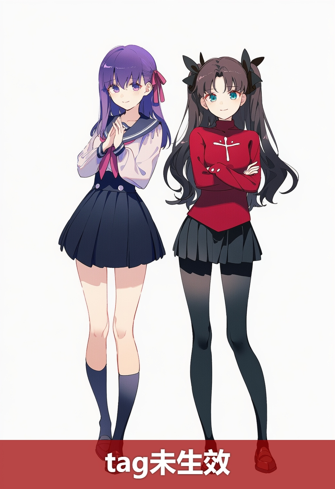

[在线例图](https://assets.quicktagcloud.com/images/raven_composition/raven_composition-3240.jpg?v=99a37e79ecb3c815)

<a id="raven_composition-3241"></a>

## 依偎

ID：`raven_composition-3241`；分类：多人互动 / 拥抱/贴靠；来源标记：`safe`。

来源说明：

> 角色亲密地抱在一起或贴靠取暖。

正向提示词：

```text
cuddling
```

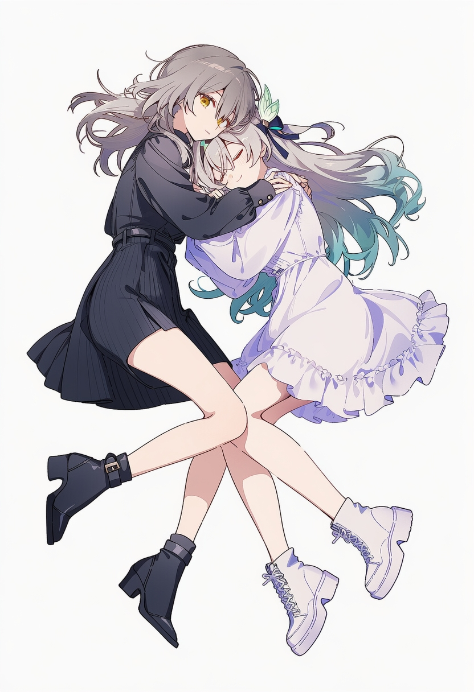

[在线例图](https://assets.quicktagcloud.com/images/raven_composition/raven_composition-3241.jpg?v=867da57688d4f2ae)

<a id="raven_composition-3242"></a>

## 抱住手臂

ID：`raven_composition-3242`；分类：多人互动 / 拥抱/贴靠；来源标记：`safe`。

来源说明：

> 抱住另一角色的一只手臂。

正向提示词：

```text
arm_hug
```

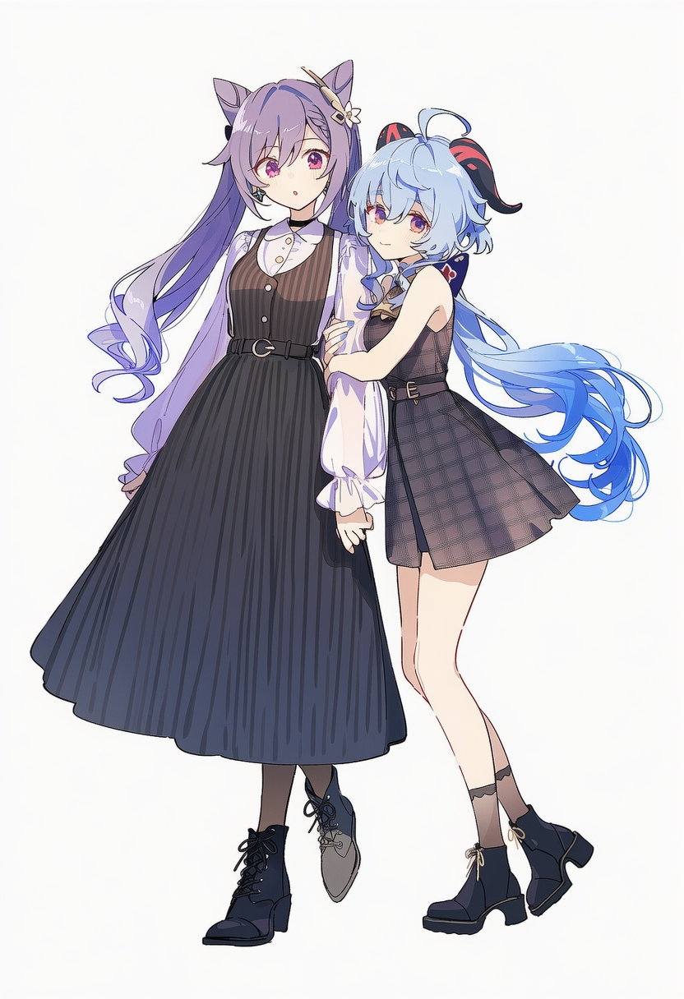

[在线例图](https://assets.quicktagcloud.com/images/raven_composition/raven_composition-3242.jpg?v=b0233194ce28527e)

<a id="raven_composition-3243"></a>

## 抱他人手臂

ID：`raven_composition-3243`；分类：多人互动 / 拥抱/贴靠；来源标记：`safe`。

来源说明：

> 双手或手臂抱住另一角色的手臂。

正向提示词：

```text
hugging_another's_arm
```

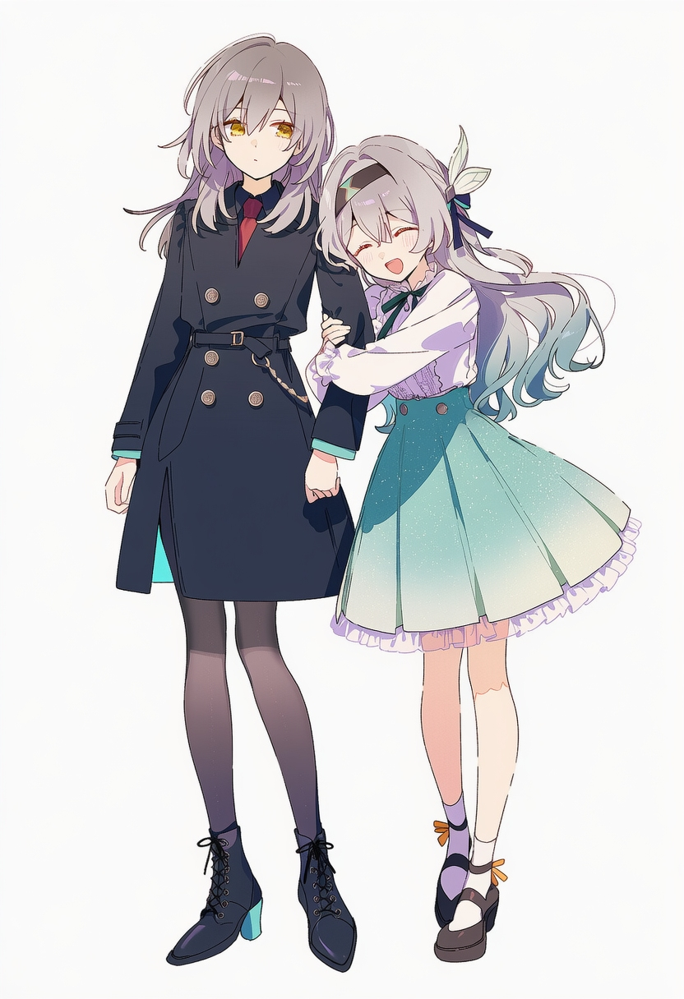

[在线例图](https://assets.quicktagcloud.com/images/raven_composition/raven_composition-3243.jpg?v=a6f629a780d20e99)

<a id="raven_composition-3244"></a>

## 抱他人单腿

ID：`raven_composition-3244`；分类：多人互动 / 拥抱/贴靠；来源标记：`safe`。

来源说明：

> 抱住另一角色的一条腿。

正向提示词：

```text
hugging_another's_leg
```

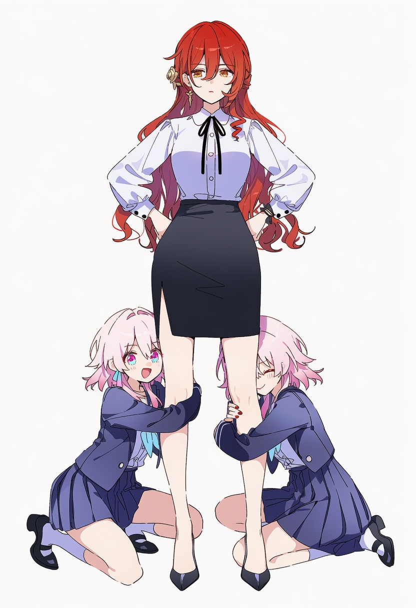

[在线例图](https://assets.quicktagcloud.com/images/raven_composition/raven_composition-3244.jpg?v=e151a024e59ea853)
