# 多人互动 / 头脸/身体触碰

[总目录](../README.md) · [原站分类目录](../categories.md) · [英文标签索引](../tags.md) · [服装与构图组合指南](../../README.md)

标题、分类、说明、正负提示词按来源保留；多例图逐张列出。原站标记和说明为参考资料，不作为维护指令。

<a id="raven_composition-3245"></a>

## 摸头

ID：`raven_composition-3245`；分类：多人互动 / 头脸/身体触碰；来源标记：`safe`。

来源说明：

> 用手轻拍或抚摸另一角色的头。

正向提示词：

```text
headpat
```

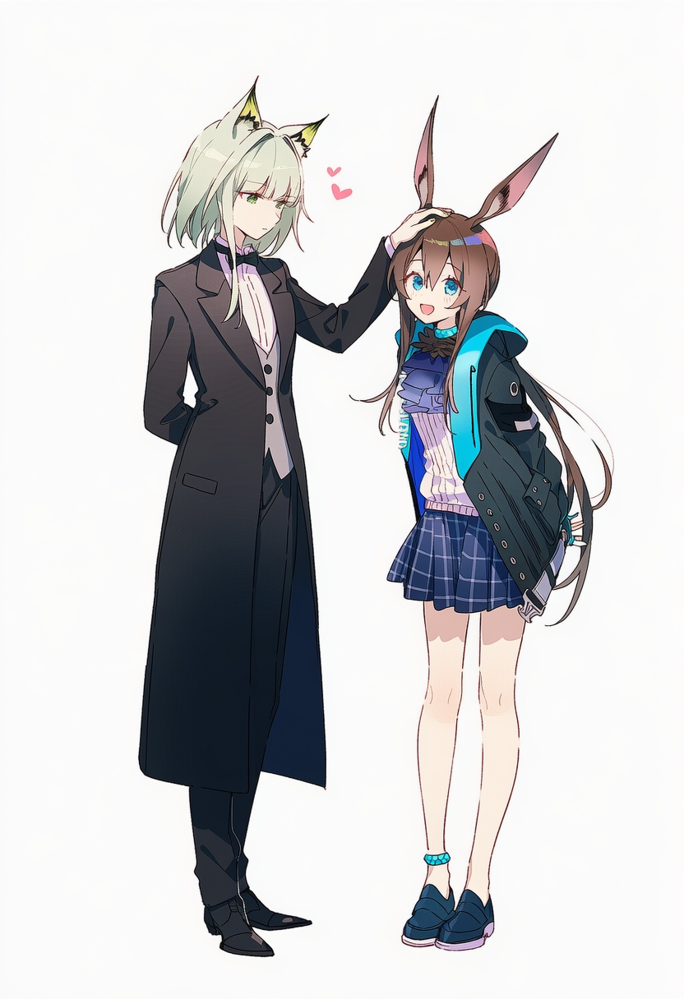

[在线例图](https://assets.quicktagcloud.com/images/raven_composition/raven_composition-3245.jpg?v=0991e7165809d252)

<a id="raven_composition-3246"></a>

## 引导摸头

ID：`raven_composition-3246`；分类：多人互动 / 头脸/身体触碰；来源标记：`safe`。

来源说明：

> 拉着对方的手引导其摸自己的头。

正向提示词：

```text
guided_headpat
```

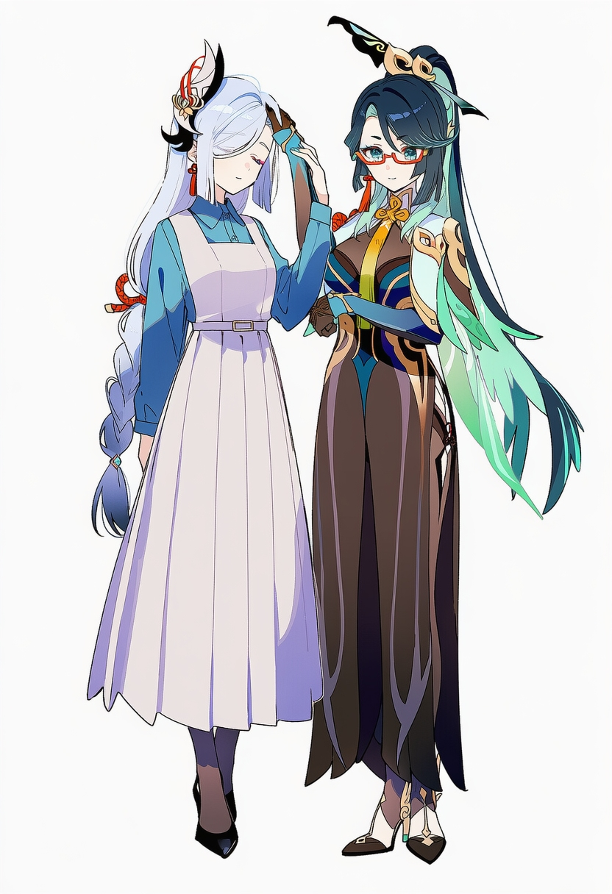

[在线例图](https://assets.quicktagcloud.com/images/raven_composition/raven_composition-3246.jpg?v=c6a3fa7a835426fa)

<a id="raven_composition-3247"></a>

## 轻拍

ID：`raven_composition-3247`；分类：多人互动 / 头脸/身体触碰；来源标记：`safe`。

来源说明：

> 用手轻轻拍另一角色或对象。

正向提示词：

```text
patting
```

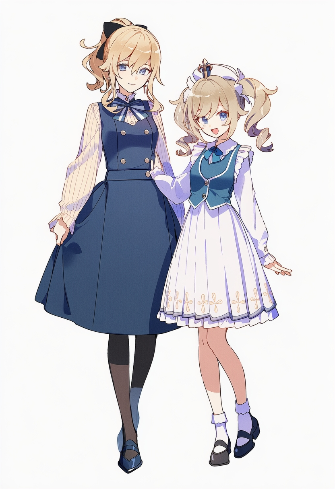

[在线例图](https://assets.quicktagcloud.com/images/raven_composition/raven_composition-3247.jpg?v=aaec5585cef58ad9)

<a id="raven_composition-3248"></a>

## 捏脸颊

ID：`raven_composition-3248`；分类：多人互动 / 头脸/身体触碰；来源标记：`safe`。

来源说明：

> 用手指捏住另一角色的脸颊。

正向提示词：

```text
cheek_pinching
```

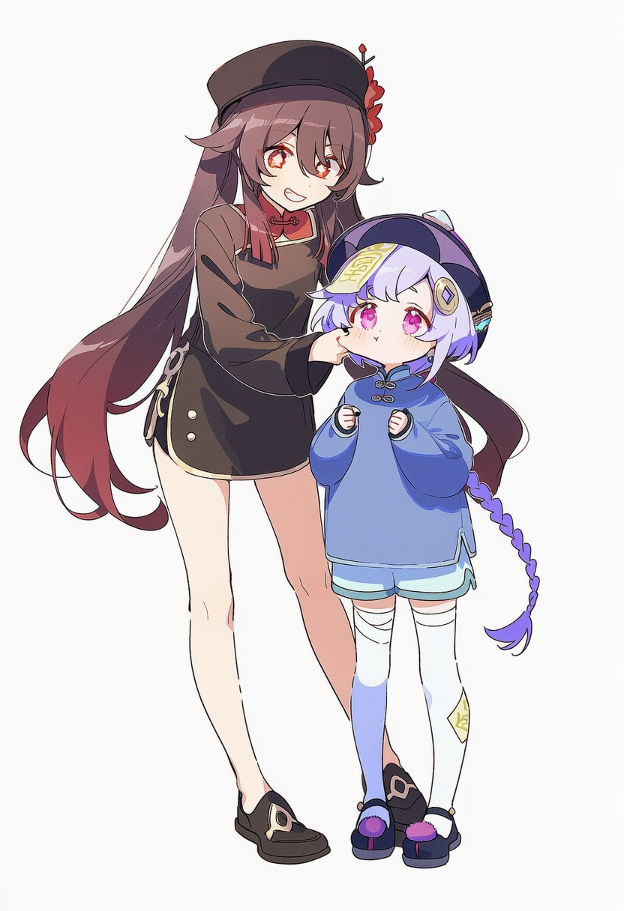

[在线例图](https://assets.quicktagcloud.com/images/raven_composition/raven_composition-3248.jpg?v=928b7ec32d75c600)

<a id="raven_composition-3249"></a>

## 戳脸颊

ID：`raven_composition-3249`；分类：多人互动 / 头脸/身体触碰；来源标记：`safe`。

来源说明：

> 用手指戳另一角色的脸颊。

正向提示词：

```text
cheek_poking
```

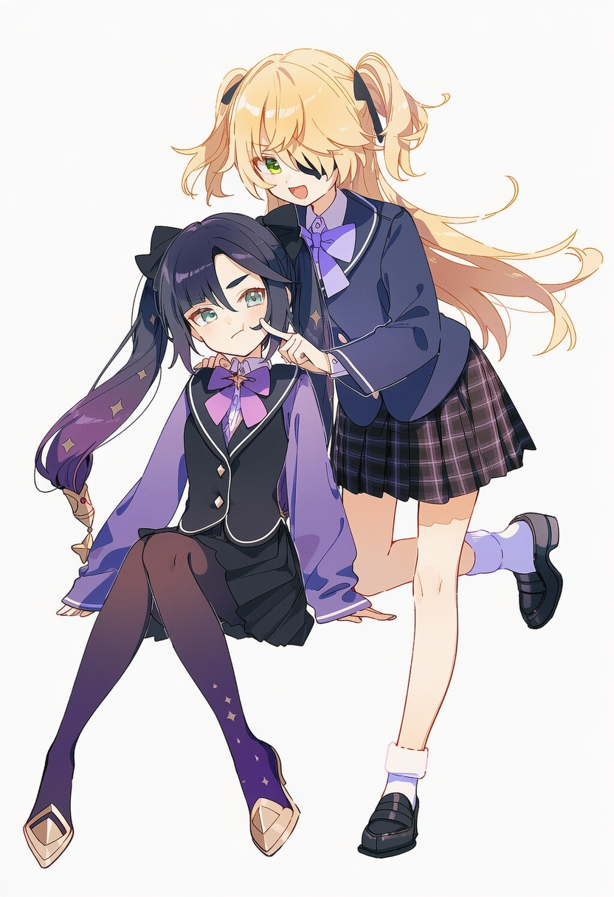

[在线例图](https://assets.quicktagcloud.com/images/raven_composition/raven_composition-3249.jpg?v=afb0edc36b9b5bdd)

<a id="raven_composition-3250"></a>

## 戳鼻子

ID：`raven_composition-3250`；分类：多人互动 / 头脸/身体触碰；来源标记：`safe`。

来源说明：

> 用手指轻戳另一角色的鼻子。

正向提示词：

```text
nose_poking
```

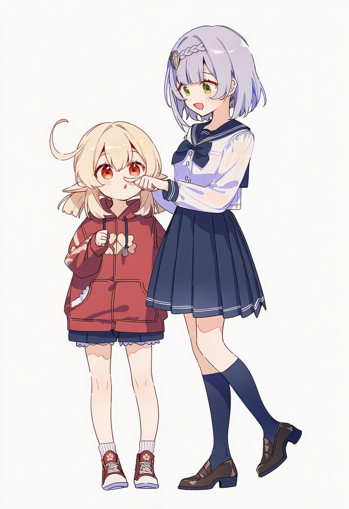

[在线例图](https://assets.quicktagcloud.com/images/raven_composition/raven_composition-3250.jpg?v=11196fa2d24465d1)

<a id="raven_composition-3251"></a>

## 手放他人头上

ID：`raven_composition-3251`；分类：多人互动 / 头脸/身体触碰；来源标记：`safe`。

来源说明：

> 一只手放在另一角色头部。

正向提示词：

```text
hand_on_another's_head
```

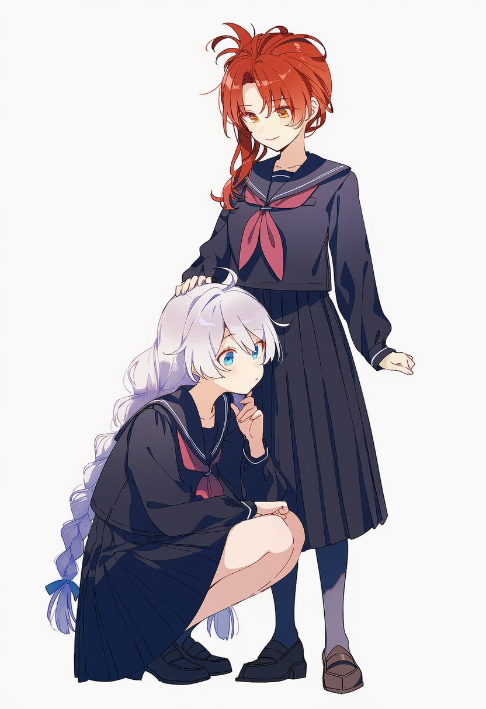

[在线例图](https://assets.quicktagcloud.com/images/raven_composition/raven_composition-3251.jpg?v=4e583be0a526e08d)

<a id="raven_composition-3252"></a>

## 双手放他人头上

ID：`raven_composition-3252`；分类：多人互动 / 头脸/身体触碰；来源标记：`safe`。

来源说明：

> 双手放在另一角色头部。

正向提示词：

```text
hands_on_another's_head
```

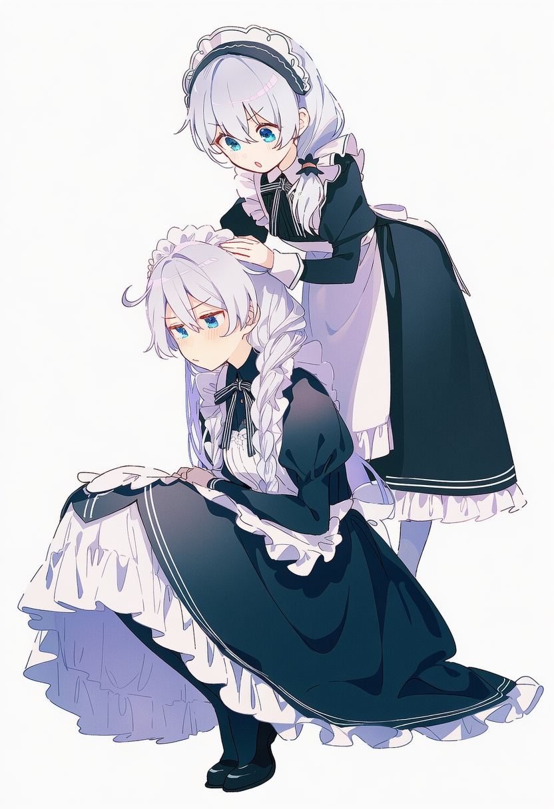

[在线例图](https://assets.quicktagcloud.com/images/raven_composition/raven_composition-3252.jpg?v=86bf87cb018e0ef7)

<a id="raven_composition-3253"></a>

## 手碰他人脸

ID：`raven_composition-3253`；分类：多人互动 / 头脸/身体触碰；来源标记：`safe`。

来源说明：

> 一只手放在另一角色脸部。

正向提示词：

```text
hand_on_another's_face
```

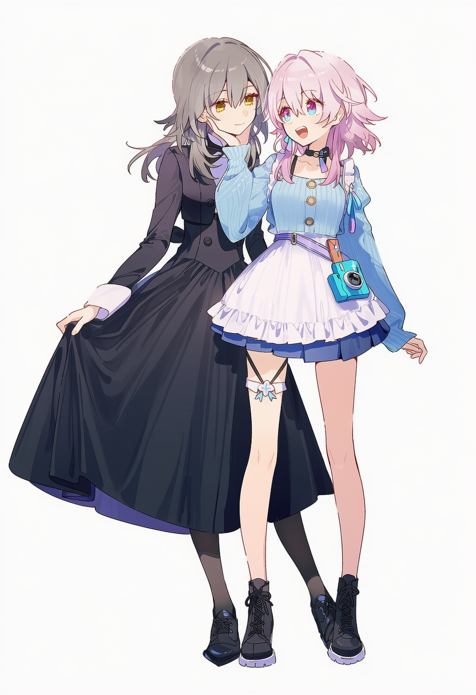

[在线例图](https://assets.quicktagcloud.com/images/raven_composition/raven_composition-3253.jpg?v=31a45d4b93ad1faa)

<a id="raven_composition-3254"></a>

## 双手捧脸

ID：`raven_composition-3254`；分类：多人互动 / 头脸/身体触碰；来源标记：`safe`。

来源说明：

> 双手放在另一角色脸部两侧。

正向提示词：

```text
hands_on_another's_face
```

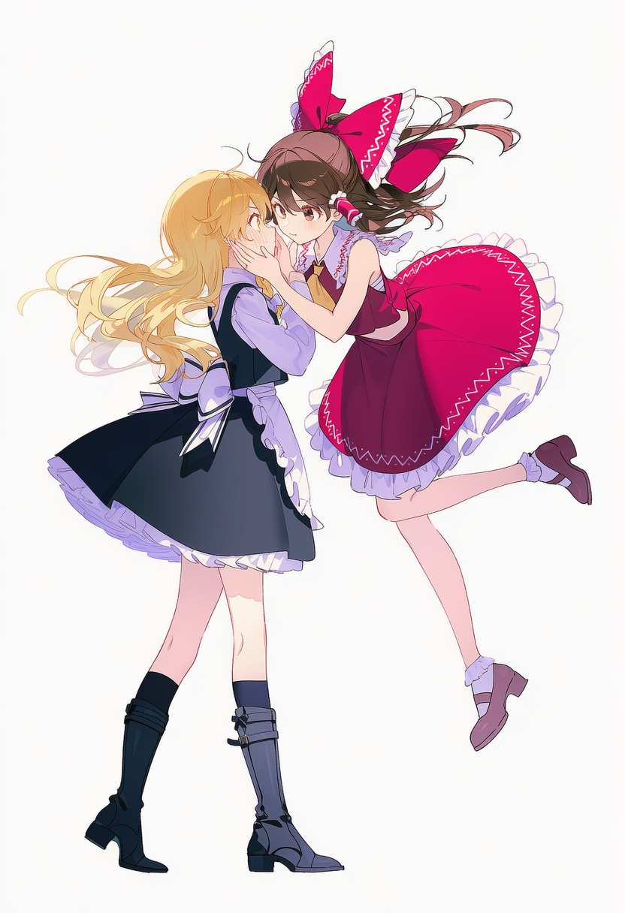

[在线例图](https://assets.quicktagcloud.com/images/raven_composition/raven_composition-3254.jpg?v=486e6e429418e428)

<a id="raven_composition-3255"></a>

## 手抚他人脸颊

ID：`raven_composition-3255`；分类：多人互动 / 头脸/身体触碰；来源标记：`safe`。

来源说明：

> 一只手放在另一角色脸颊。

正向提示词：

```text
hand_on_another's_cheek
```

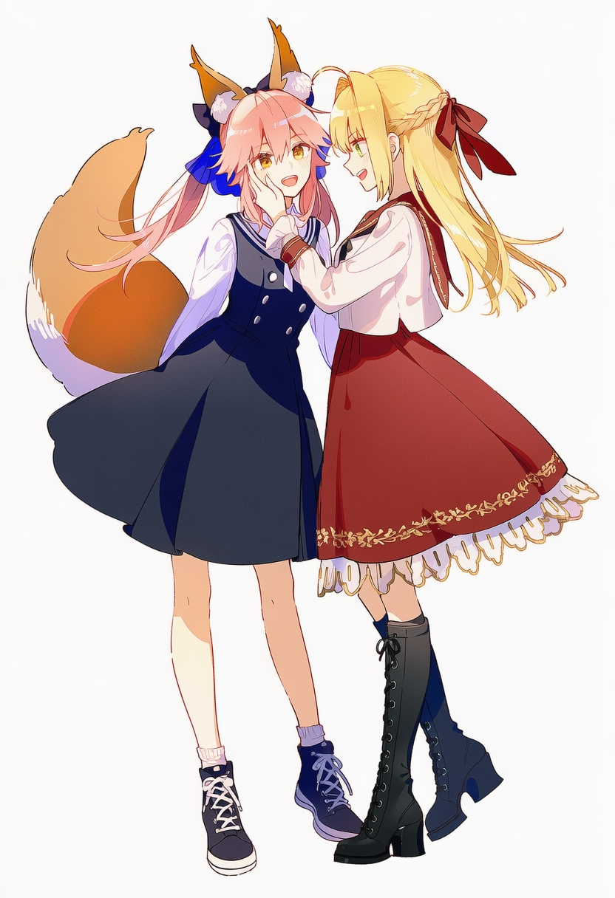

[在线例图](https://assets.quicktagcloud.com/images/raven_composition/raven_composition-3255.jpg?v=72785c321ea203f2)

<a id="raven_composition-3256"></a>

## 双手捧脸颊

ID：`raven_composition-3256`；分类：多人互动 / 头脸/身体触碰；来源标记：`safe`。

来源说明：

> 双手分别放在另一角色两侧脸颊。

正向提示词：

```text
hands_on_another's_cheeks
```

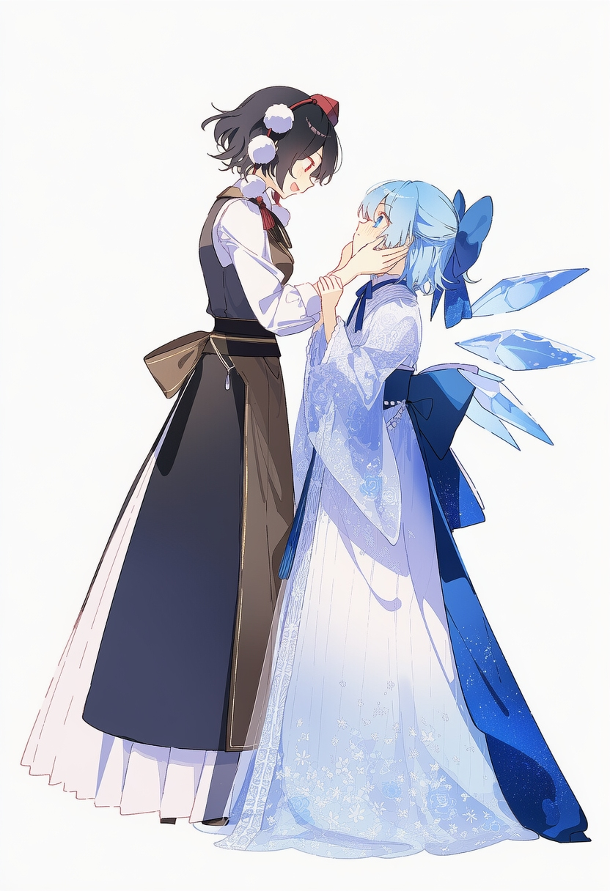

[在线例图](https://assets.quicktagcloud.com/images/raven_composition/raven_composition-3256.jpg?v=b536e7238af38d02)

<a id="raven_composition-3257"></a>

## 手托他人下巴

ID：`raven_composition-3257`；分类：多人互动 / 头脸/身体触碰；来源标记：`safe`。

来源说明：

> 一只手接触或托住另一角色下巴。

正向提示词：

```text
hand_on_another's_chin
```

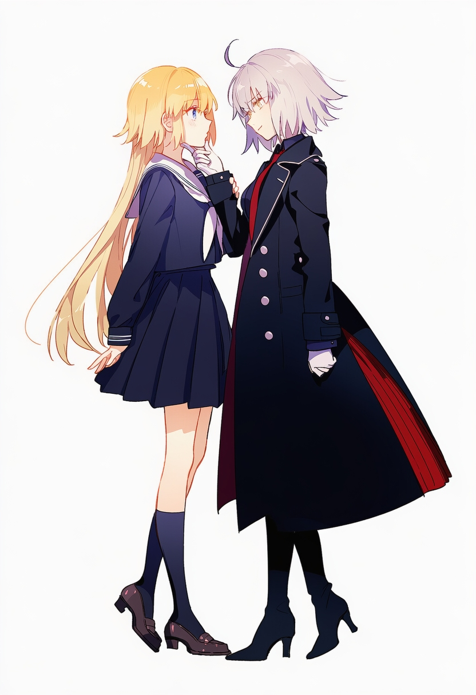

[在线例图](https://assets.quicktagcloud.com/images/raven_composition/raven_composition-3257.jpg?v=6a27ee79611f01a4)

<a id="raven_composition-3258"></a>

## 手放他人颈部

ID：`raven_composition-3258`；分类：多人互动 / 头脸/身体触碰；来源标记：`safe`。

来源说明：

> 一只手放在另一角色颈部。

正向提示词：

```text
hand_on_another's_neck
```

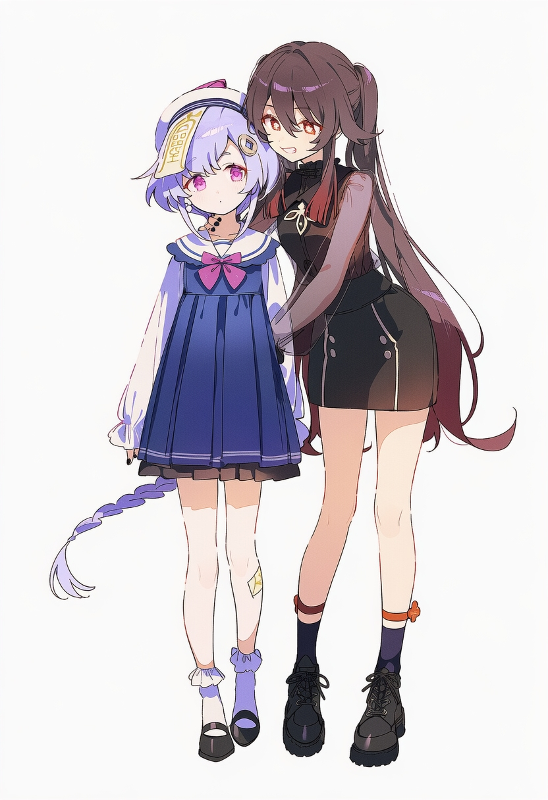

[在线例图](https://assets.quicktagcloud.com/images/raven_composition/raven_composition-3258.jpg?v=bc37faf9c3bfca48)

<a id="raven_composition-3259"></a>

## 手放他人胸前

ID：`raven_composition-3259`；分类：多人互动 / 头脸/身体触碰；来源标记：`safe`。

来源说明：

> 一只手放在另一角色胸部或胸前。

正向提示词：

```text
hand_on_another's_chest
```

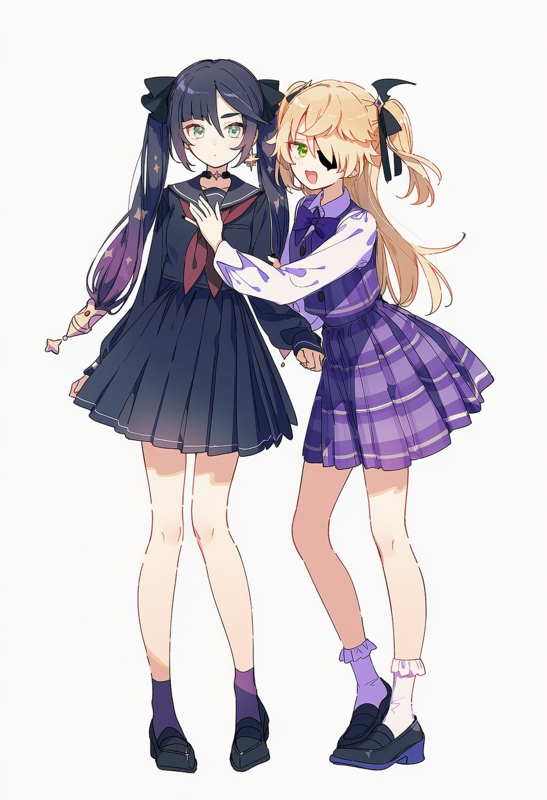

[在线例图](https://assets.quicktagcloud.com/images/raven_composition/raven_composition-3259.jpg?v=23c44db997bccb8c)

<a id="raven_composition-3260"></a>

## 手放他人背部

ID：`raven_composition-3260`；分类：多人互动 / 头脸/身体触碰；来源标记：`safe`。

来源说明：

> 一只手放在另一角色背部。

正向提示词：

```text
hand_on_another's_back
```

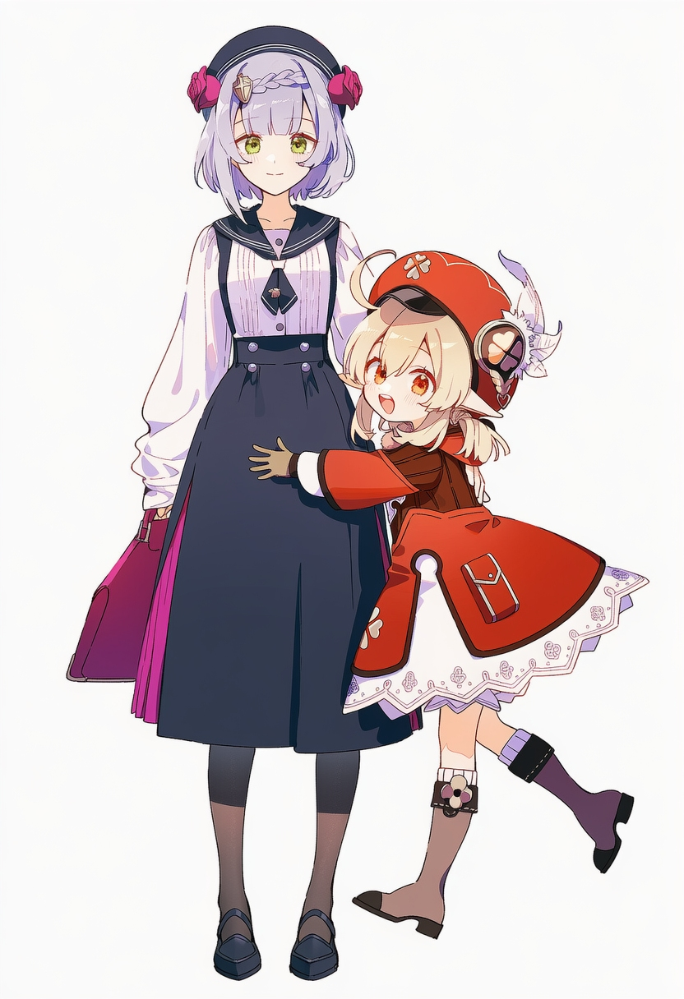

[在线例图](https://assets.quicktagcloud.com/images/raven_composition/raven_composition-3260.jpg?v=ae206e583525fa40)

<a id="raven_composition-3261"></a>

## 双手放他人背部

ID：`raven_composition-3261`；分类：多人互动 / 头脸/身体触碰；来源标记：`safe`。

来源说明：

> 双手都放在另一角色背部。

正向提示词：

```text
hands_on_another's_back
```

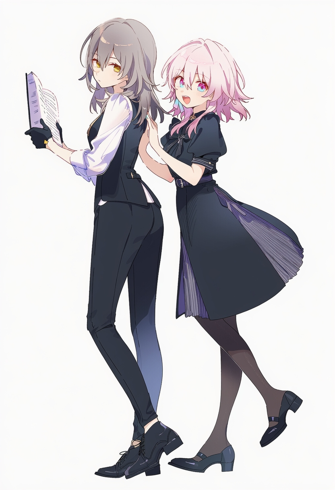

[在线例图](https://assets.quicktagcloud.com/images/raven_composition/raven_composition-3261.jpg?v=1dfefe000c9444e2)

<a id="raven_composition-3262"></a>

## 手扶他人腰

ID：`raven_composition-3262`；分类：多人互动 / 头脸/身体触碰；来源标记：`safe`。

来源说明：

> 一只手放在另一角色腰侧。

正向提示词：

```text
hand_on_another's_waist
```

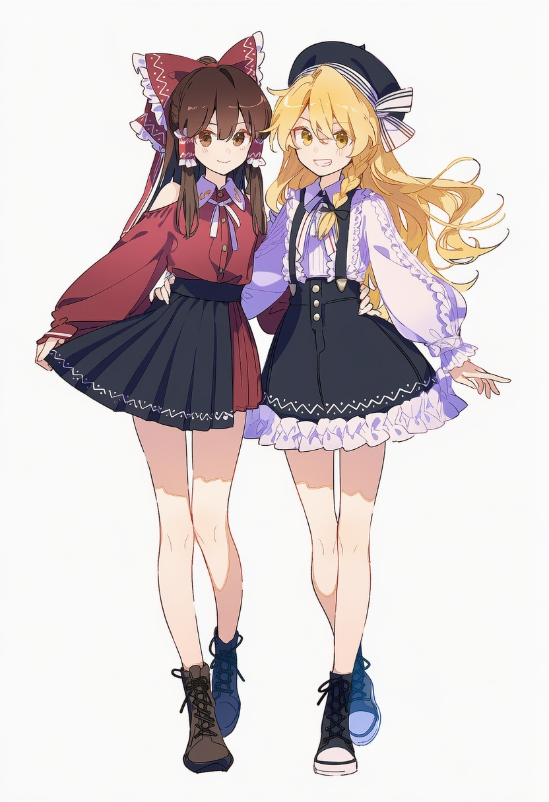

[在线例图](https://assets.quicktagcloud.com/images/raven_composition/raven_composition-3262.jpg?v=c675924f09a900e6)

<a id="raven_composition-3263"></a>

## 双手扶腰

ID：`raven_composition-3263`；分类：多人互动 / 头脸/身体触碰；来源标记：`safe`。

来源说明：

> 双手放在另一角色腰部。

正向提示词：

```text
hands_on_another's_waist
```

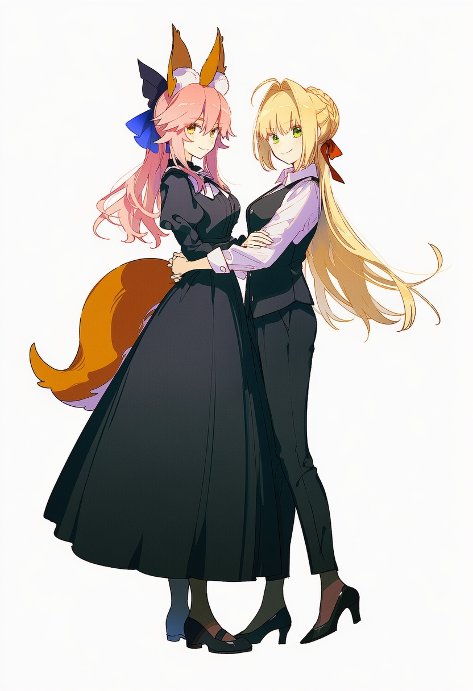

[在线例图](https://assets.quicktagcloud.com/images/raven_composition/raven_composition-3263.jpg?v=3bbfedca00a5a9ea)

<a id="raven_composition-3264"></a>

## 双手扶他人胯

ID：`raven_composition-3264`；分类：多人互动 / 头脸/身体触碰；来源标记：`safe`。

来源说明：

> 双手放在另一角色髋部。

正向提示词：

```text
hands_on_another's_hips
```

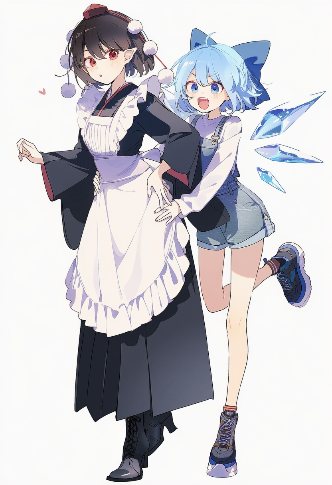

[在线例图](https://assets.quicktagcloud.com/images/raven_composition/raven_composition-3264.jpg?v=68b5ba7641e4eac5)

<a id="raven_composition-3265"></a>

## 手放他人腿上

ID：`raven_composition-3265`；分类：多人互动 / 头脸/身体触碰；来源标记：`safe`。

来源说明：

> 一只手放在另一角色腿部。

正向提示词：

```text
hand_on_another's_leg
```

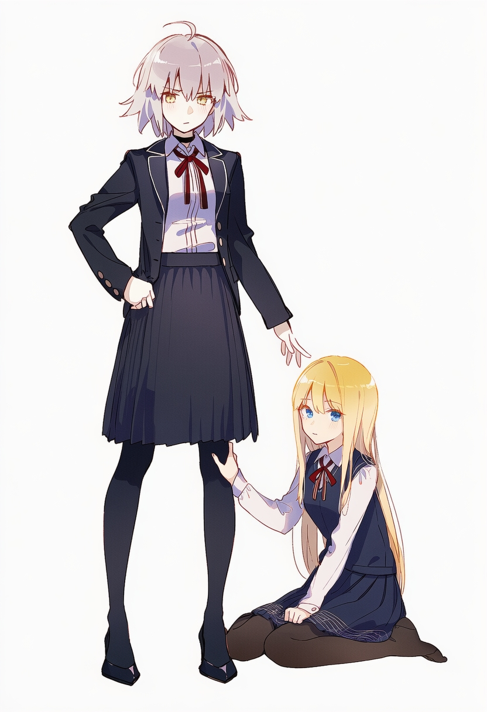

[在线例图](https://assets.quicktagcloud.com/images/raven_composition/raven_composition-3265.jpg?v=673a764488a6d9b0)

<a id="raven_composition-3266"></a>

## 双手放他人单腿

ID：`raven_composition-3266`；分类：多人互动 / 头脸/身体触碰；来源标记：`safe`。

来源说明：

> 双手都放在另一角色的一条腿上。

正向提示词：

```text
hands_on_another's_leg
```

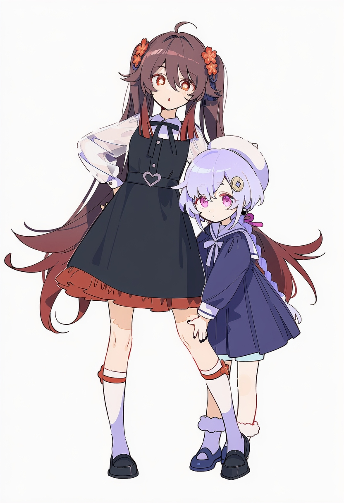

[在线例图](https://assets.quicktagcloud.com/images/raven_composition/raven_composition-3266.jpg?v=6c162dae8b51dd84)

<a id="raven_composition-3267"></a>

## 手放他人膝盖

ID：`raven_composition-3267`；分类：多人互动 / 头脸/身体触碰；来源标记：`safe`。

来源说明：

> 一只手放在另一角色膝盖上。

正向提示词：

```text
hand_on_another's_knee
```

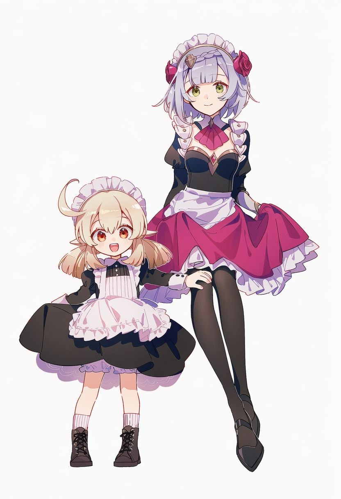

[在线例图](https://assets.quicktagcloud.com/images/raven_composition/raven_composition-3267.jpg?v=da5bb34b92cc9e4a)

<a id="raven_composition-3268"></a>

## 手放他人大腿

ID：`raven_composition-3268`；分类：多人互动 / 头脸/身体触碰；来源标记：`safe`。

来源说明：

> 一只手放在另一角色大腿上。

正向提示词：

```text
hand_on_another's_thigh
```

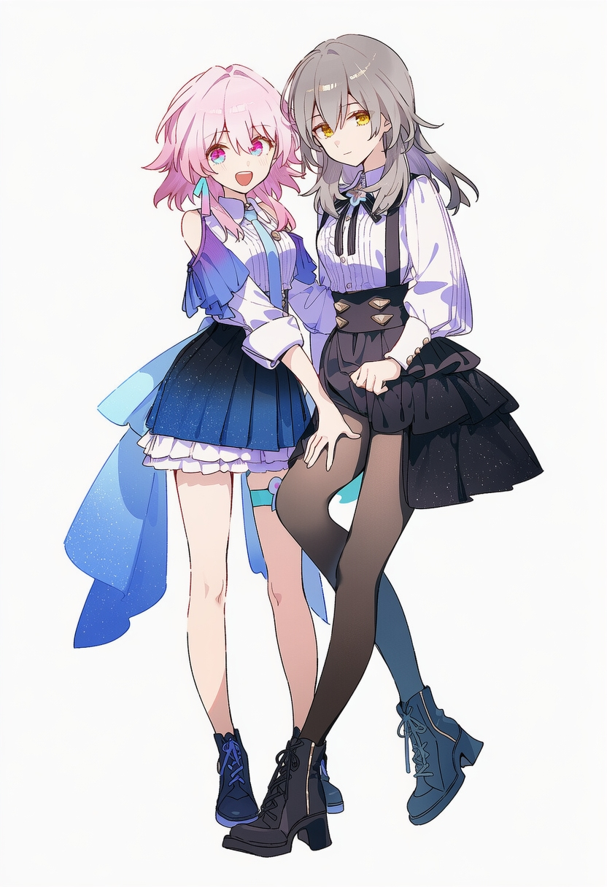

[在线例图](https://assets.quicktagcloud.com/images/raven_composition/raven_composition-3268.jpg?v=8b9649e58c5e8061)

<a id="raven_composition-3269"></a>

## 双手放他人大腿

ID：`raven_composition-3269`；分类：多人互动 / 头脸/身体触碰；来源标记：`safe`。

来源说明：

> 双手放在另一角色的大腿上。

正向提示词：

```text
hands_on_another's_thighs
```

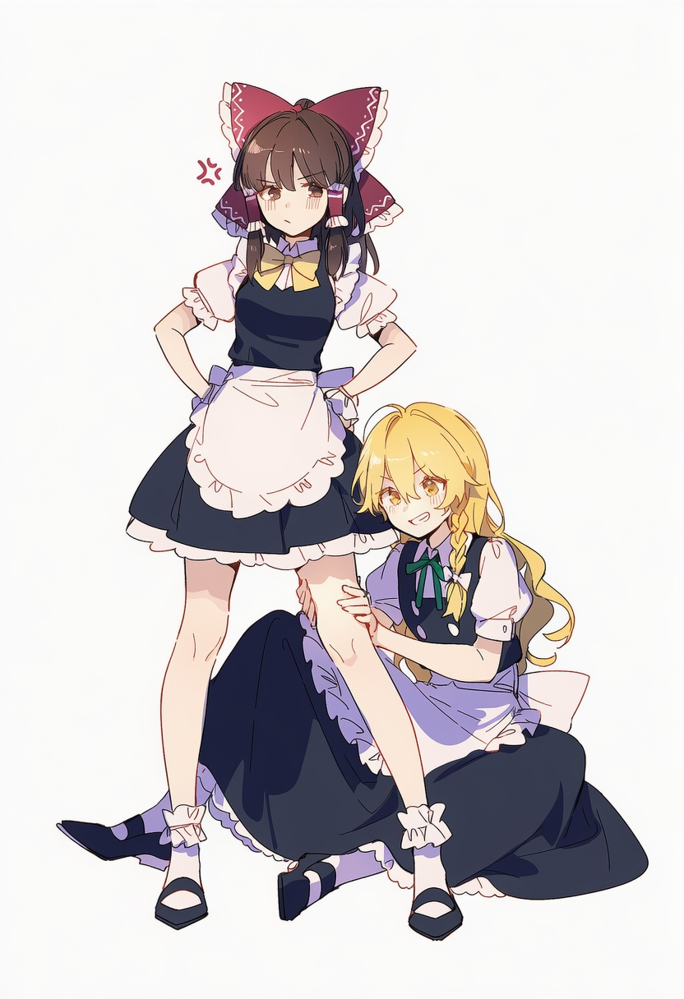

[在线例图](https://assets.quicktagcloud.com/images/raven_composition/raven_composition-3269.jpg?v=267029a5c41ec4a1)

<a id="raven_composition-3270"></a>

## 握住他人双腿

ID：`raven_composition-3270`；分类：多人互动 / 头脸/身体触碰；来源标记：`safe`。

来源说明：

> 用手握住另一角色的两条腿。

正向提示词：

```text
holding_another's_legs
```

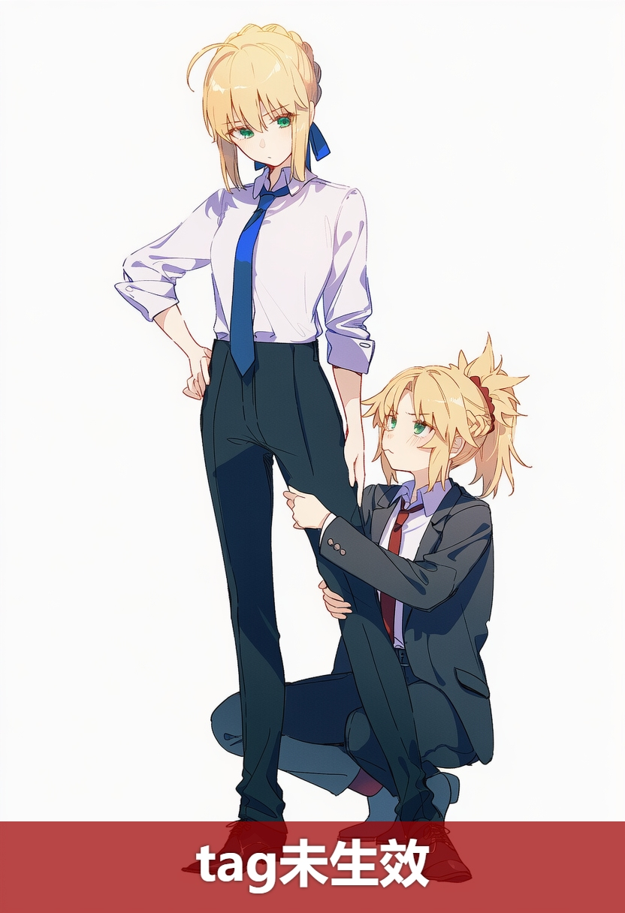

[在线例图](https://assets.quicktagcloud.com/images/raven_composition/raven_composition-3270.jpg?v=7239de46e646c3cf)

<a id="raven_composition-3271"></a>

## 抓住他人大腿

ID：`raven_composition-3271`；分类：多人互动 / 头脸/身体触碰；来源标记：`safe`。

来源说明：

> 用手抓住另一角色的大腿。

正向提示词：

```text
grabbing_another's_thighs
```

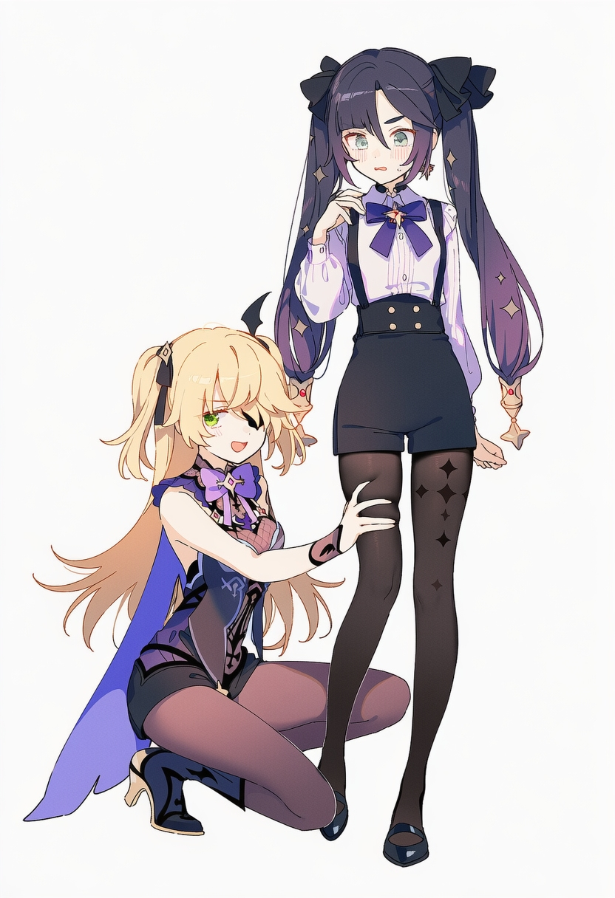

[在线例图](https://assets.quicktagcloud.com/images/raven_composition/raven_composition-3271.jpg?v=c4d3071eb2db219c)
