# 多人互动 / 背负/抱起/支撑

[总目录](../README.md) · [原站分类目录](../categories.md) · [英文标签索引](../tags.md) · [服装与构图组合指南](../../README.md)

标题、分类、说明、正负提示词按来源保留；多例图逐张列出。原站标记和说明为参考资料，不作为维护指令。

<a id="raven_composition-3272"></a>

## 抱/背着人

ID：`raven_composition-3272`；分类：多人互动 / 背负/抱起/支撑；来源标记：`safe`。

来源说明：

> 一个角色正在支撑并搬运另一个角色。

正向提示词：

```text
carrying_person
```

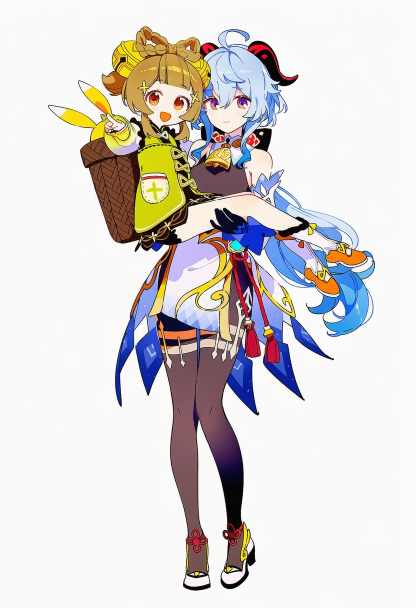

[在线例图](https://assets.quicktagcloud.com/images/raven_composition/raven_composition-3272.jpg?v=93b8334a660c5d1d)

<a id="raven_composition-3273"></a>

## 同时搬多人

ID：`raven_composition-3273`；分类：多人互动 / 背负/抱起/支撑；来源标记：`safe`。

来源说明：

> 一个角色同时背、抱或扛着多个人。

正向提示词：

```text
carrying_multiple_people
```

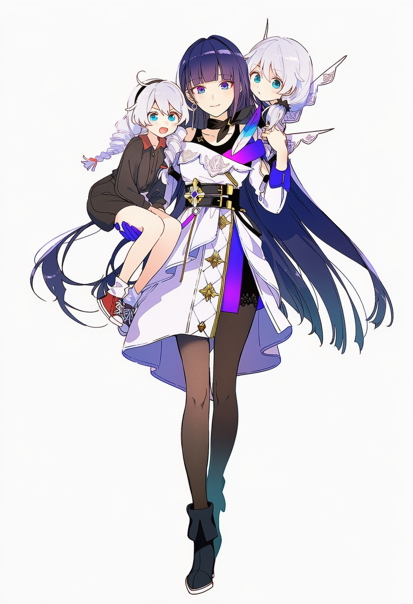

[在线例图](https://assets.quicktagcloud.com/images/raven_composition/raven_composition-3273.jpg?v=39dc5d36006fec68)

<a id="raven_composition-3274"></a>

## 公主抱

ID：`raven_composition-3274`；分类：多人互动 / 背负/抱起/支撑；来源标记：`safe`。

来源说明：

> 一只手托上身、一只手托腿横抱对方。

正向提示词：

```text
princess_carry
```

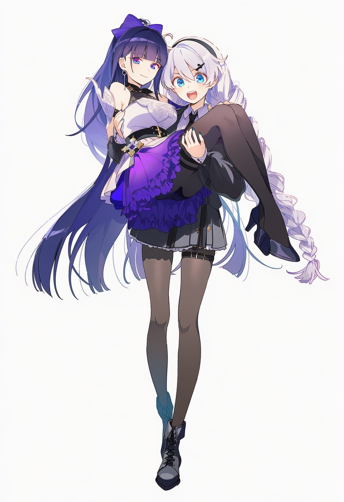

[在线例图](https://assets.quicktagcloud.com/images/raven_composition/raven_composition-3274.jpg?v=b74c0f2df50f457f)

<a id="raven_composition-3275"></a>

## 背人

ID：`raven_composition-3275`；分类：多人互动 / 背负/抱起/支撑；来源标记：`safe`。

来源说明：

> 一个角色趴在另一个角色背上被背着。

正向提示词：

```text
piggyback
```

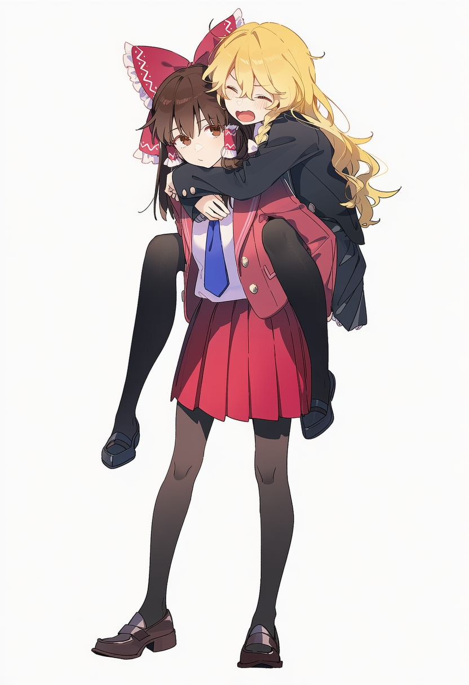

[在线例图](https://assets.quicktagcloud.com/images/raven_composition/raven_composition-3275.jpg?v=23ec6d7a01b35012)

<a id="raven_composition-3276"></a>

## 消防员扛法

ID：`raven_composition-3276`；分类：多人互动 / 背负/抱起/支撑；来源标记：`safe`。

来源说明：

> 把另一角色横扛在肩部。

正向提示词：

```text
fireman's_carry
```

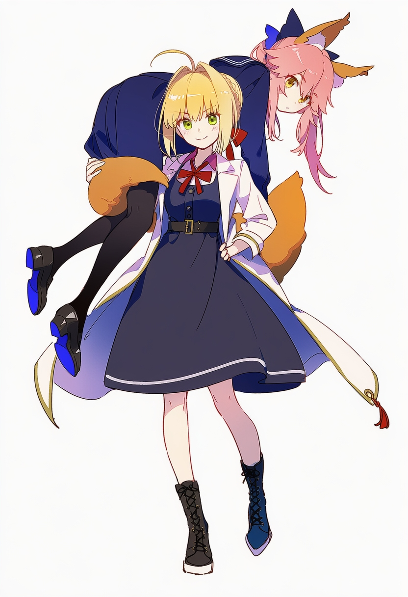

[在线例图](https://assets.quicktagcloud.com/images/raven_composition/raven_composition-3276.jpg?v=bfbbded9a17988cd)

<a id="raven_composition-3277"></a>

## 肩扛

ID：`raven_composition-3277`；分类：多人互动 / 背负/抱起/支撑；来源标记：`safe`。

来源说明：

> 把另一角色放在肩上搬运。

正向提示词：

```text
shoulder_carry
```

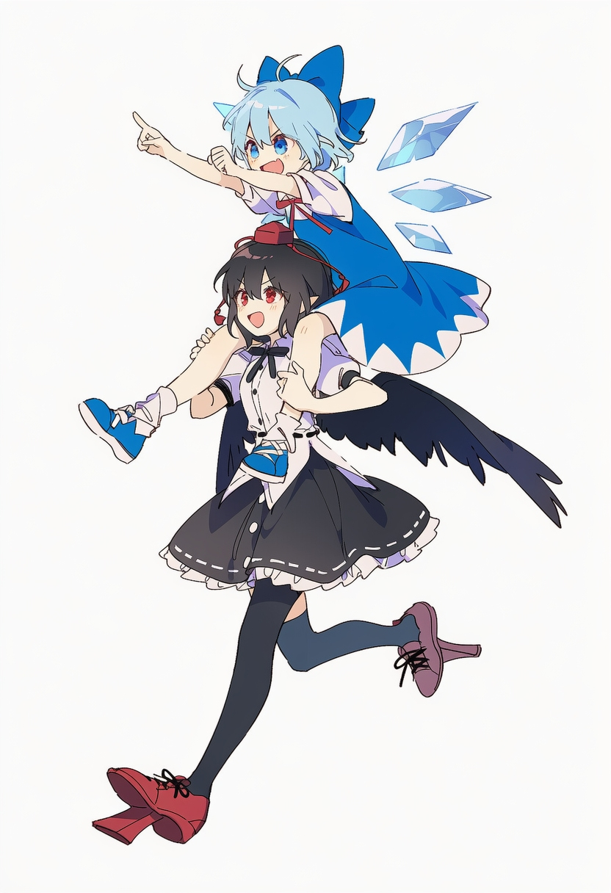

[在线例图](https://assets.quicktagcloud.com/images/raven_composition/raven_composition-3277.jpg?v=10d5f6a438f0a909)

<a id="raven_composition-3278"></a>

## 腋下提抱

ID：`raven_composition-3278`；分类：多人互动 / 背负/抱起/支撑；来源标记：`safe`。

来源说明：

> 从腋下托住或提起另一角色。

正向提示词：

```text
armpit_carry
```

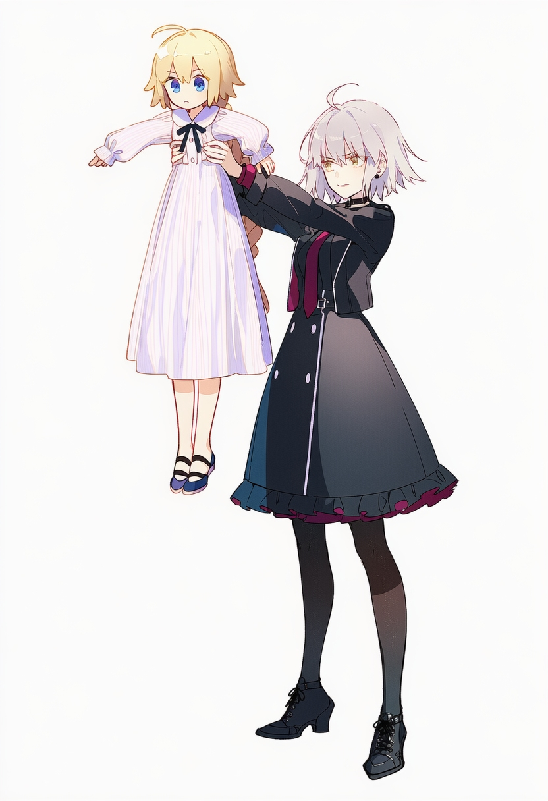

[在线例图](https://assets.quicktagcloud.com/images/raven_composition/raven_composition-3278.jpg?v=bb00877ea596248c)

<a id="raven_composition-3279"></a>

## 抱婴儿

ID：`raven_composition-3279`；分类：多人互动 / 背负/抱起/支撑；来源标记：`safe`。

来源说明：

> 以抱婴儿的方式抱住小孩或较小角色。

正向提示词：

```text
baby_carry
```

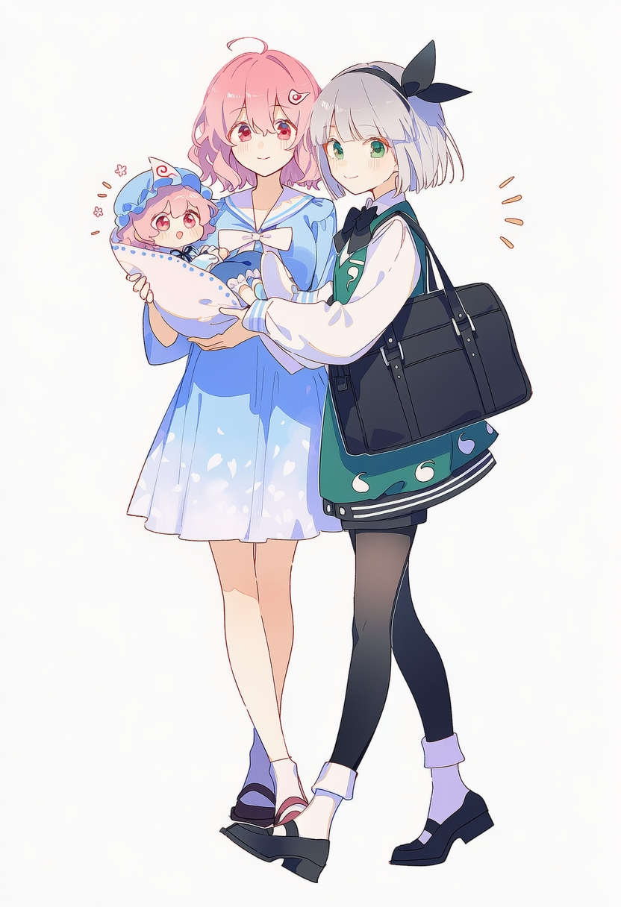

[在线例图](https://assets.quicktagcloud.com/images/raven_composition/raven_composition-3279.jpg?v=5b805f1edf9648d6)

<a id="raven_composition-3280"></a>

## 抱小孩

ID：`raven_composition-3280`；分类：多人互动 / 背负/抱起/支撑；来源标记：`safe`。

来源说明：

> 把儿童角色抱起或携带。

正向提示词：

```text
child_carry
```

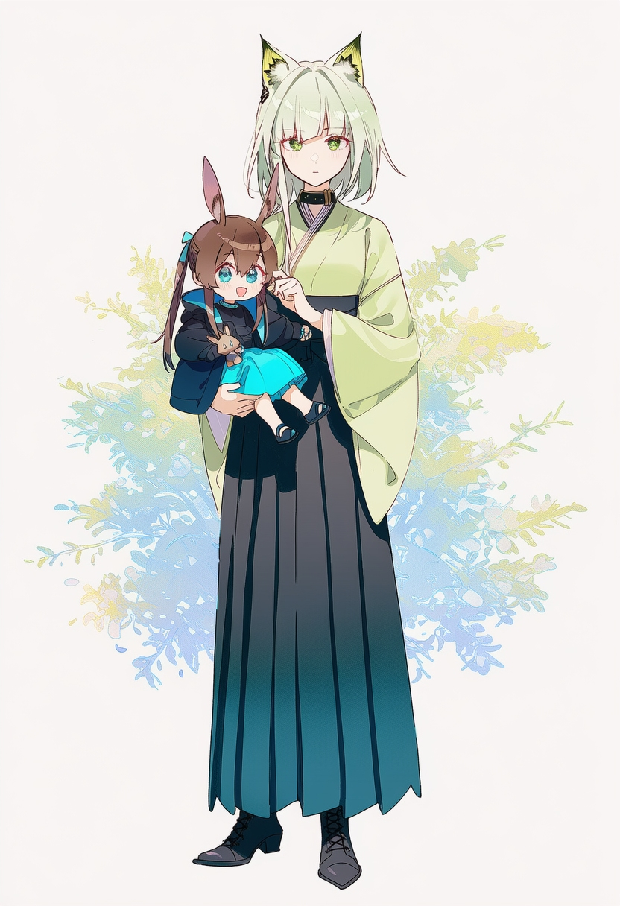

[在线例图](https://assets.quicktagcloud.com/images/raven_composition/raven_composition-3280.jpg?v=0b0109de9807b72b)

<a id="raven_composition-3281"></a>

## 拥抱式抱起

ID：`raven_composition-3281`；分类：多人互动 / 背负/抱起/支撑；来源标记：`safe`。

来源说明：

> 抱住对方身体并同时将其抱起。

正向提示词：

```text
hug_carry
```

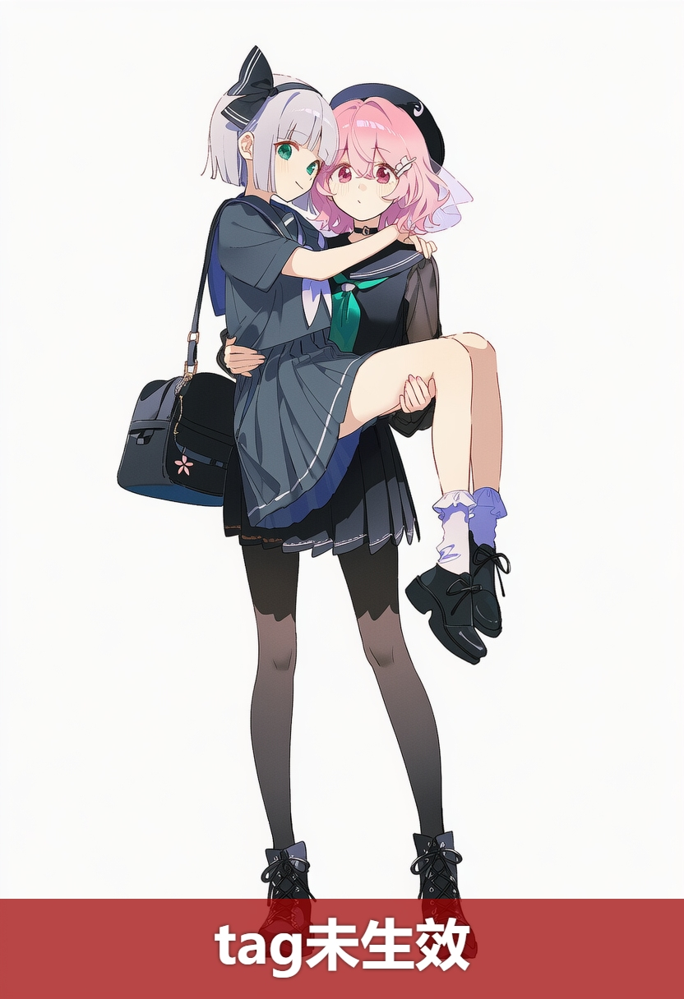

[在线例图](https://assets.quicktagcloud.com/images/raven_composition/raven_composition-3281.jpg?v=8b58d628ece65311)

<a id="raven_composition-3282"></a>

## 坐在肩上

ID：`raven_composition-3282`；分类：多人互动 / 背负/抱起/支撑；来源标记：`safe`。

来源说明：

> 一个角色坐在另一个角色肩膀上。

正向提示词：

```text
sitting_on_shoulder
```

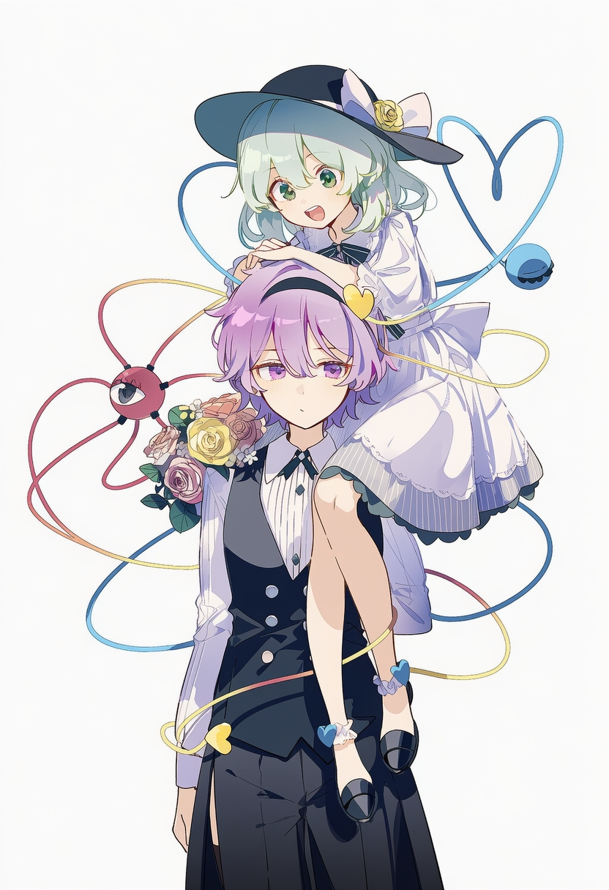

[在线例图](https://assets.quicktagcloud.com/images/raven_composition/raven_composition-3282.jpg?v=d52a42368580f0c0)

<a id="raven_composition-3283"></a>

## 支撑他人体重

ID：`raven_composition-3283`；分类：多人互动 / 背负/抱起/支撑；来源标记：`safe`。

来源说明：

> 托住或扶住另一角色以防其倒下。

正向提示词：

```text
supporting_another's_weight
```

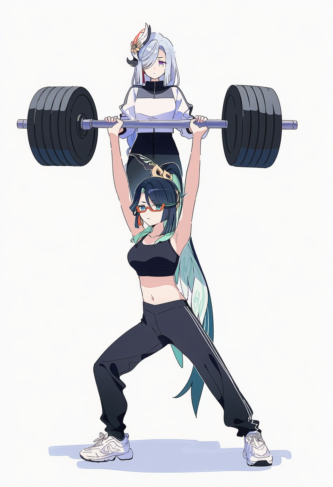

[在线例图](https://assets.quicktagcloud.com/images/raven_composition/raven_composition-3283.jpg?v=7652dff0051815ad)

<a id="raven_composition-3284"></a>

## 扶起

ID：`raven_composition-3284`；分类：多人互动 / 背负/抱起/支撑；来源标记：`safe`。

来源说明：

> 伸手或用身体帮助另一角色站起来。

正向提示词：

```text
helping_up
```

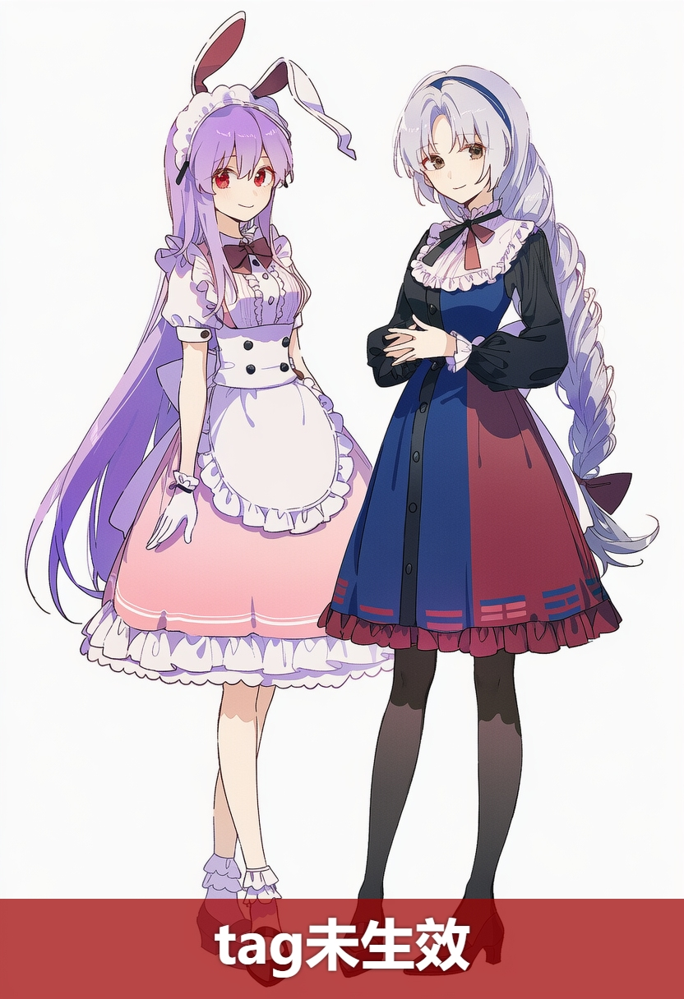

[在线例图](https://assets.quicktagcloud.com/images/raven_composition/raven_composition-3284.jpg?v=c5a24ad645057b01)
