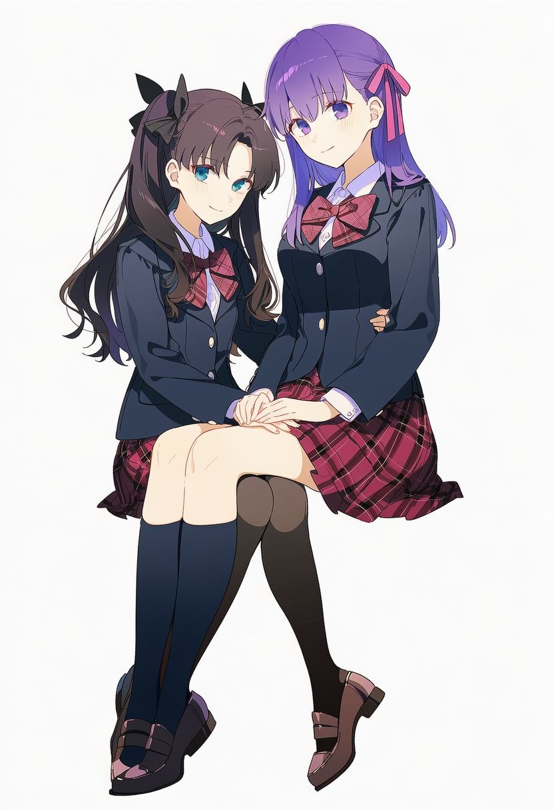
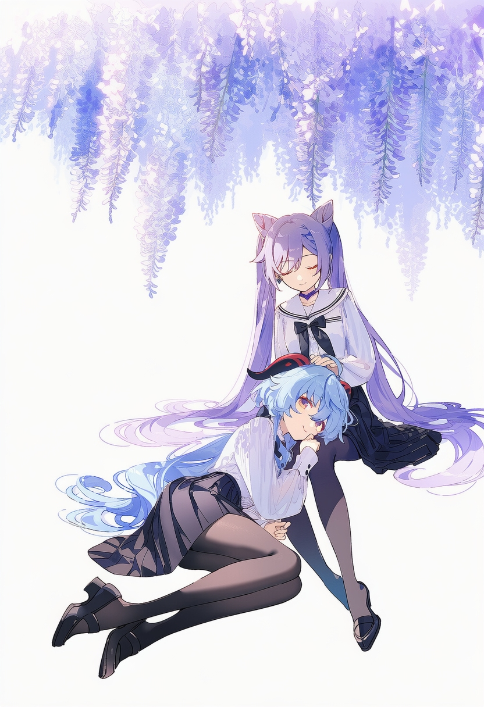
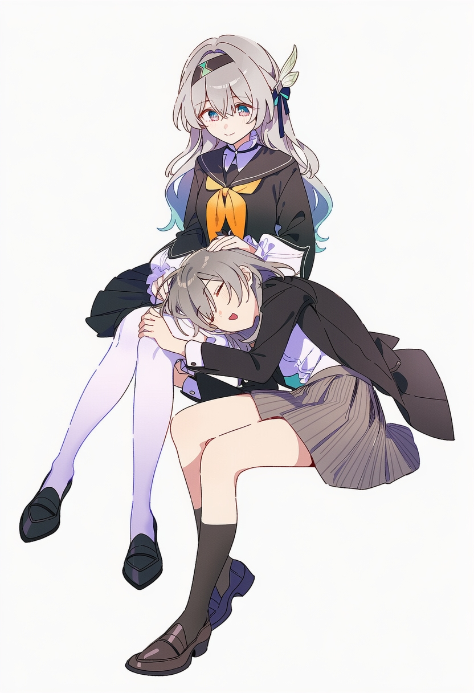
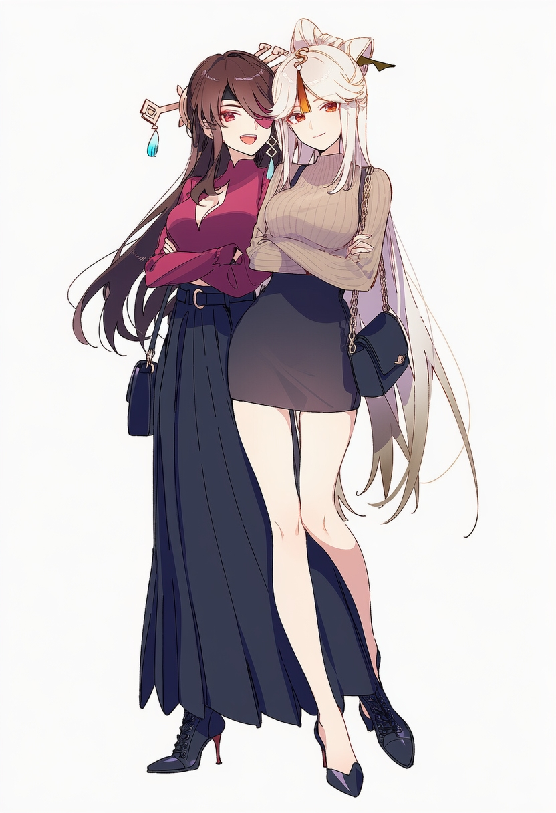
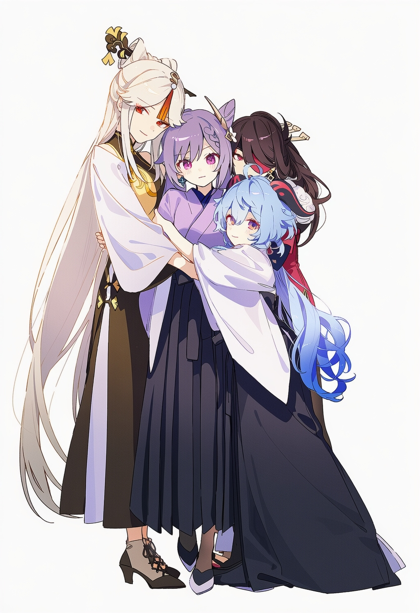
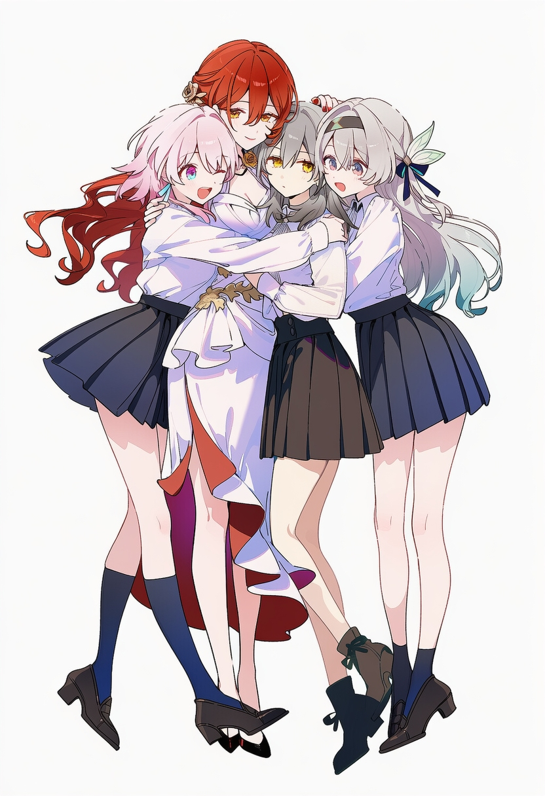
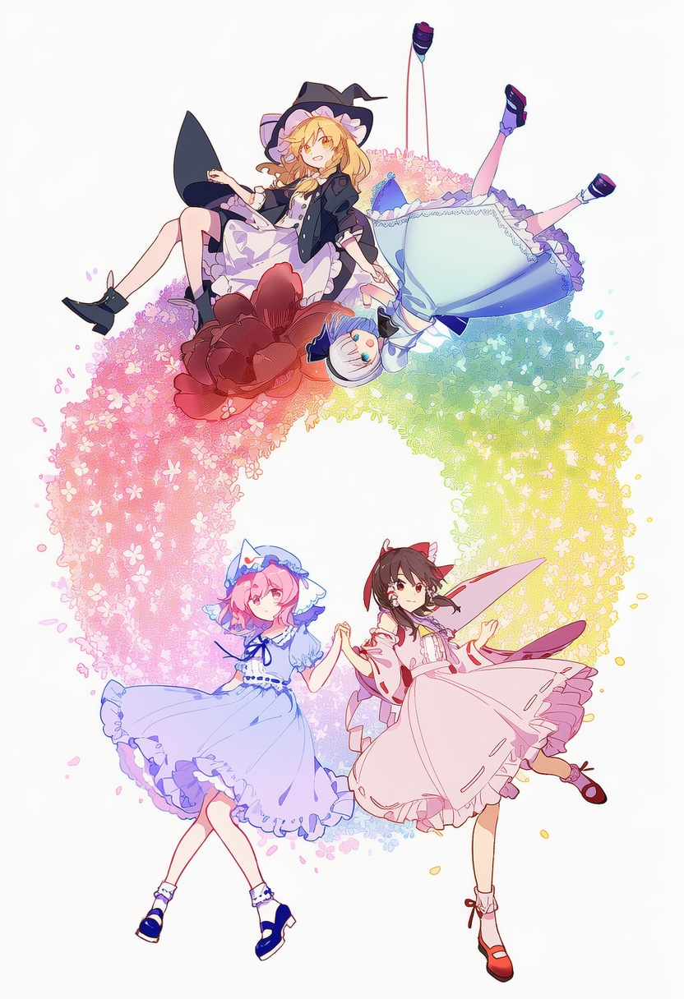
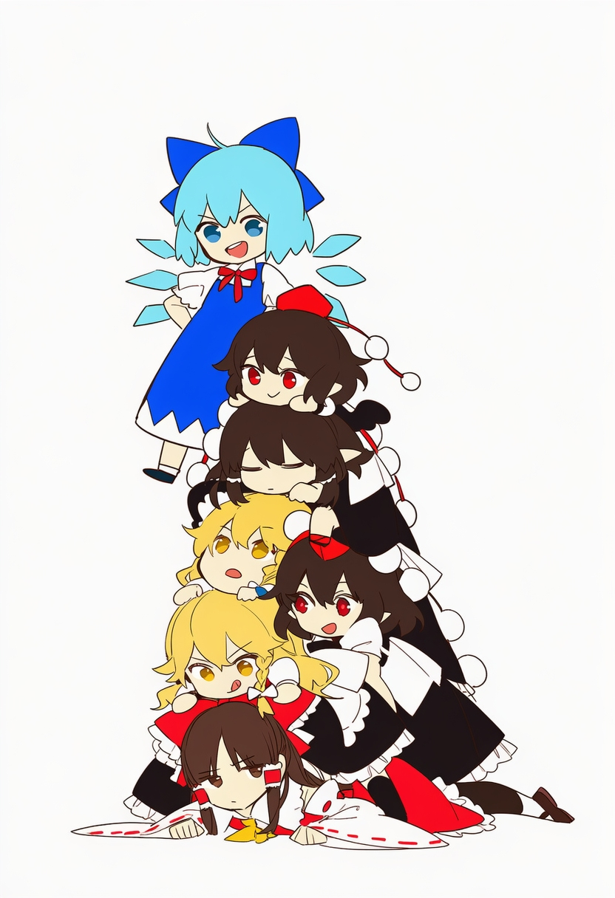
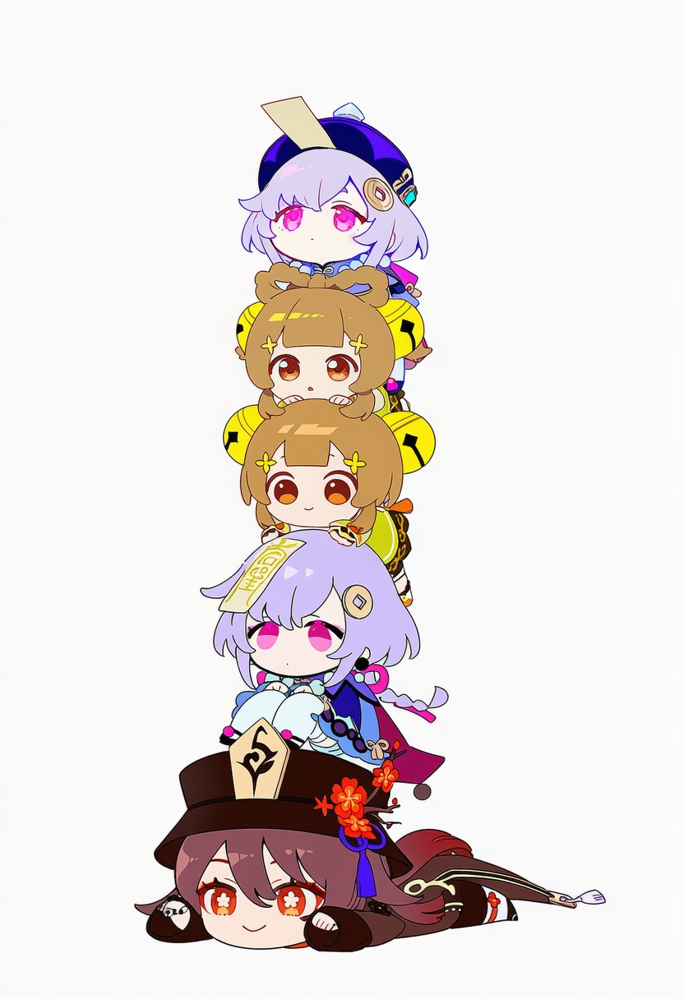
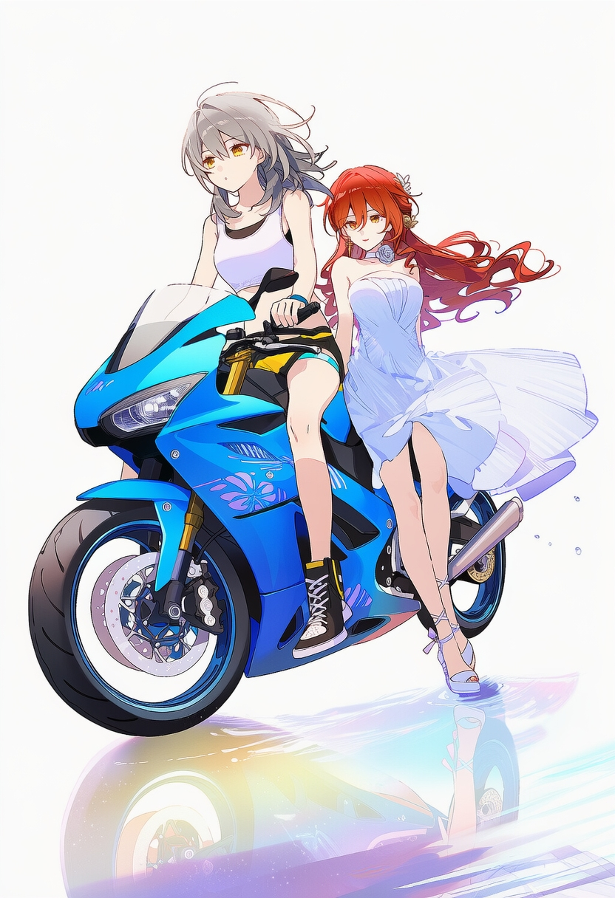

# 多人互动 / 坐卧/群体互动

[总目录](../README.md) · [原站分类目录](../categories.md) · [英文标签索引](../tags.md) · [服装与构图组合指南](../../README.md)

标题、分类、说明、正负提示词按来源保留；多例图逐张列出。原站标记和说明为参考资料，不作为维护指令。

<a id="raven_composition-3285"></a>

## 坐在腿上

ID：`raven_composition-3285`；分类：多人互动 / 坐卧/群体互动；来源标记：`safe`。

来源说明：

> 一个角色坐在另一个角色的大腿或膝上。

正向提示词：

```text
sitting_on_lap
```



[在线例图](https://assets.quicktagcloud.com/images/raven_composition/raven_composition-3285.jpg?v=d08e34e94a29dc78)

<a id="raven_composition-3286"></a>

## 膝枕

ID：`raven_composition-3286`；分类：多人互动 / 坐卧/群体互动；来源标记：`safe`。

来源说明：

> 一个角色把头枕在另一角色的大腿上。

正向提示词：

```text
lap_pillow
```



[在线例图](https://assets.quicktagcloud.com/images/raven_composition/raven_composition-3286.jpg?v=f8bada5f5e14e3f8)

<a id="raven_composition-3287"></a>

## 头枕腿上

ID：`raven_composition-3287`；分类：多人互动 / 坐卧/群体互动；来源标记：`safe`。

来源说明：

> 头部放在另一角色腿上休息。

正向提示词：

```text
head_in_lap
```



[在线例图](https://assets.quicktagcloud.com/images/raven_composition/raven_composition-3287.jpg?v=5caba4ab5b148de8)

<a id="raven_composition-3288"></a>

## 一起睡觉

ID：`raven_composition-3288`；分类：多人互动 / 坐卧/群体互动；来源标记：`safe`。

来源说明：

> 多个角色靠在一起睡觉。

正向提示词：

```text
sleeping_together
```


[在线例图](https://assets.quicktagcloud.com/images/raven_composition/raven_composition-3288.jpg?v=d552521599e42278)

<a id="raven_composition-3289"></a>

## 挤在一起

ID：`raven_composition-3289`；分类：多人互动 / 坐卧/群体互动；来源标记：`safe`。

来源说明：

> 多个角色紧密聚拢在一起。

正向提示词：

```text
huddling
```



[在线例图](https://assets.quicktagcloud.com/images/raven_composition/raven_composition-3289.jpg?v=8466e0042ac36d5c)

<a id="raven_composition-3290"></a>

## 多人拥抱

ID：`raven_composition-3290`；分类：多人互动 / 坐卧/群体互动；来源标记：`safe`。

来源说明：

> 三人或更多角色共同拥抱。

正向提示词：

```text
group_hug
```



[在线例图](https://assets.quicktagcloud.com/images/raven_composition/raven_composition-3290.jpg?v=a331e32bcf2f94ec)

<a id="raven_composition-3291"></a>

## 群体抱在一起

ID：`raven_composition-3291`；分类：多人互动 / 坐卧/群体互动；来源标记：`safe`。

来源说明：

> 多个角色形成集体拥抱状态。

正向提示词：

```text
group_hugging
```



[在线例图](https://assets.quicktagcloud.com/images/raven_composition/raven_composition-3291.jpg?v=1310c5acf6aa2642)

<a id="raven_composition-3292"></a>

## 围成一圈

ID：`raven_composition-3292`；分类：多人互动 / 坐卧/群体互动；来源标记：`safe`。

来源说明：

> 多个角色共同围成圆圈。

正向提示词：

```text
forming_a_circle
```



[在线例图](https://assets.quicktagcloud.com/images/raven_composition/raven_composition-3292.jpg?v=9068ad6637a2a441)

<a id="raven_composition-3293"></a>

## 叠罗汉

ID：`raven_composition-3293`；分类：多人互动 / 坐卧/群体互动；来源标记：`safe`。

来源说明：

> 多人用身体堆叠成人体金字塔。

正向提示词：

```text
human_pyramid
```



[在线例图](https://assets.quicktagcloud.com/images/raven_composition/raven_composition-3293.jpg?v=12d3e75788299c7e)

<a id="raven_composition-3294"></a>

## 叠在一起

ID：`raven_composition-3294`；分类：多人互动 / 坐卧/群体互动；来源标记：`safe`。

来源说明：

> 多个角色上下堆叠或压在一起。

正向提示词：

```text
stacked_on_top_of_each_other
```



[在线例图](https://assets.quicktagcloud.com/images/raven_composition/raven_composition-3294.jpg?v=52654620433455f3)

<a id="raven_composition-3295"></a>

## 多人同乘

ID：`raven_composition-3295`；分类：多人互动 / 坐卧/群体互动；来源标记：`safe`。

来源说明：

> 多个角色同时骑乘同一载具或动物。

正向提示词：

```text
multiple_riders
```



[在线例图](https://assets.quicktagcloud.com/images/raven_composition/raven_composition-3295.jpg?v=3dd484135e3aa717)
