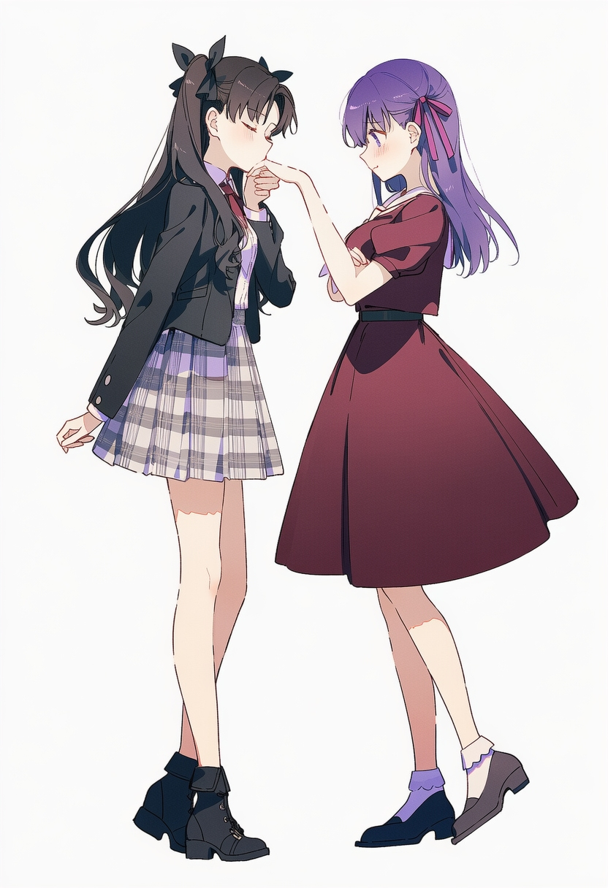
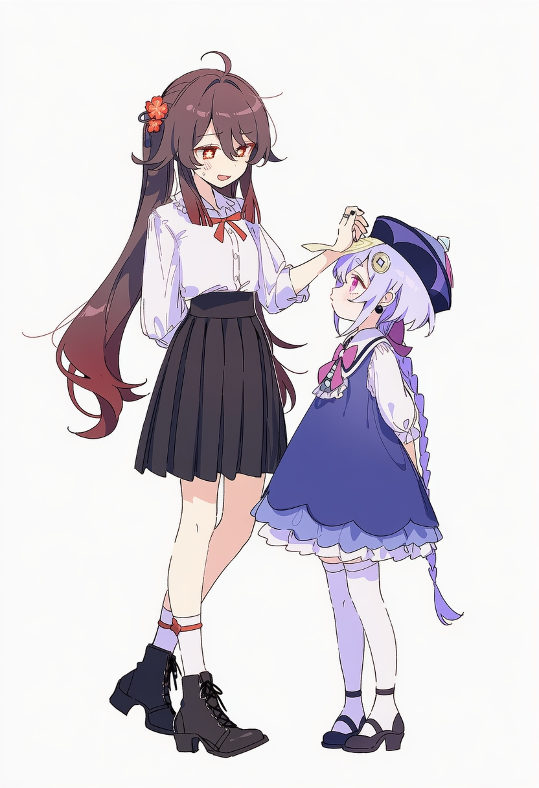
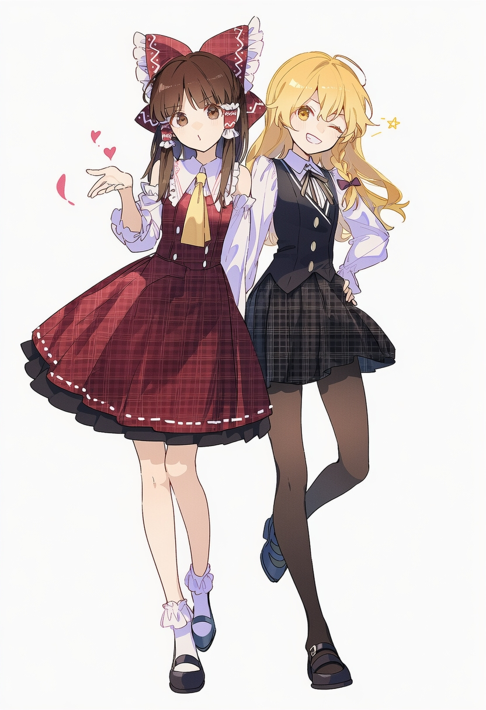
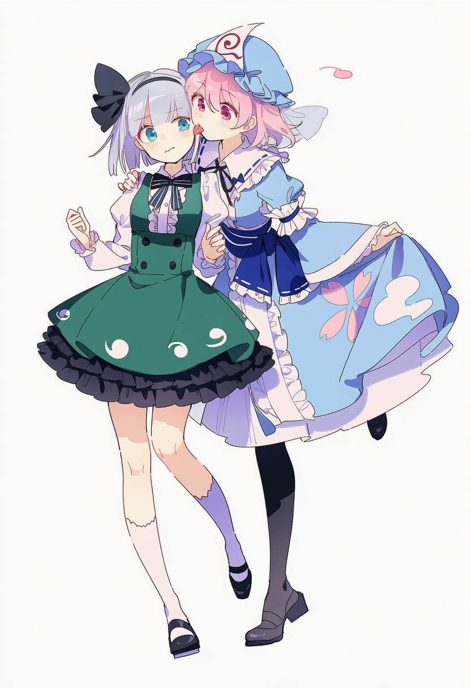
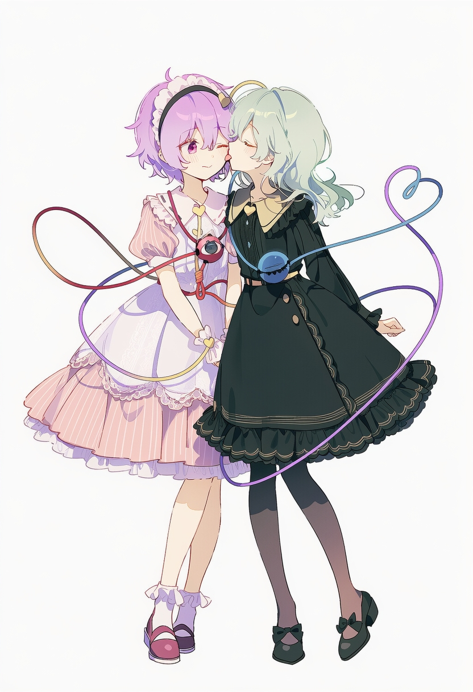
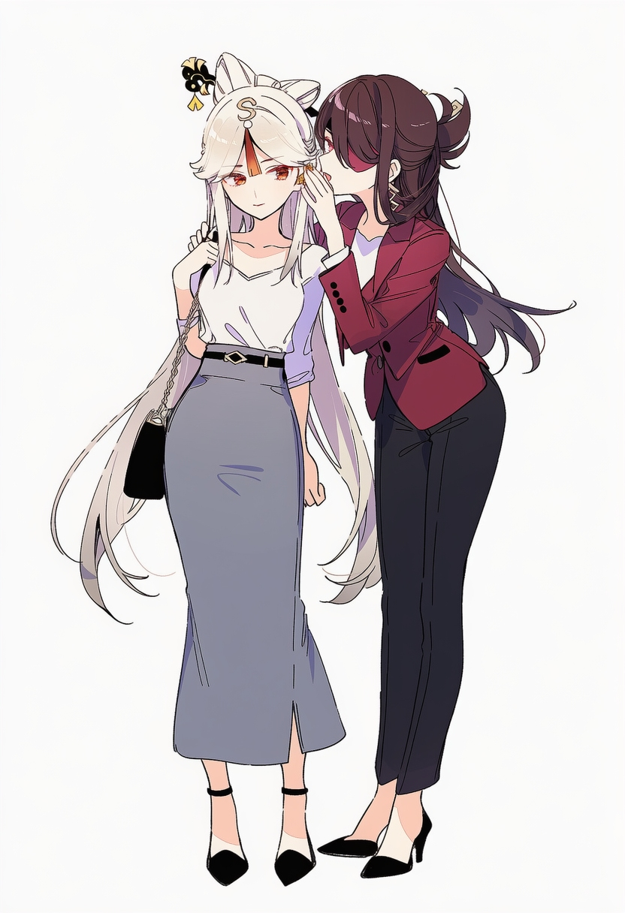

# 多人互动 / 亲昵/浪漫互动

[总目录](../README.md) · [原站分类目录](../categories.md) · [英文标签索引](../tags.md) · [服装与构图组合指南](../../README.md)

标题、分类、说明、正负提示词按来源保留；多例图逐张列出。原站标记和说明为参考资料，不作为维护指令。

<a id="raven_composition-3296"></a>

## 亲吻

ID：`raven_composition-3296`；分类：多人互动 / 亲昵/浪漫互动；来源标记：`safe`。

来源说明：

> 角色之间发生亲吻。

正向提示词：

```text
kiss
```


[在线例图](https://assets.quicktagcloud.com/images/raven_composition/raven_composition-3296.jpg?v=f66c1d930eb1db3b)

<a id="raven_composition-3297"></a>

## 接吻

ID：`raven_composition-3297`；分类：多人互动 / 亲昵/浪漫互动；来源标记：`safe`。

来源说明：

> 两个角色正在亲吻彼此。

正向提示词：

```text
kissing
```


[在线例图](https://assets.quicktagcloud.com/images/raven_composition/raven_composition-3297.jpg?v=d1099efc5cbfccff)

<a id="raven_composition-3298"></a>

## 亲脸颊

ID：`raven_composition-3298`；分类：多人互动 / 亲昵/浪漫互动；来源标记：`safe`。

来源说明：

> 亲吻另一角色的脸颊。

正向提示词：

```text
kiss_on_cheek
```


[在线例图](https://assets.quicktagcloud.com/images/raven_composition/raven_composition-3298.jpg?v=ab4887dad93f1654)

<a id="raven_composition-3299"></a>

## 脸颊吻

ID：`raven_composition-3299`；分类：多人互动 / 亲昵/浪漫互动；来源标记：`safe`。

来源说明：

> 以脸颊为目标的亲吻互动。

正向提示词：

```text
cheek_kiss
```


[在线例图](https://assets.quicktagcloud.com/images/raven_composition/raven_composition-3299.jpg?v=8b75bd137d3d1e6d)

<a id="raven_composition-3300"></a>

## 亲额头

ID：`raven_composition-3300`；分类：多人互动 / 亲昵/浪漫互动；来源标记：`safe`。

来源说明：

> 亲吻另一角色的额头。

正向提示词：

```text
forehead_kiss
```


[在线例图](https://assets.quicktagcloud.com/images/raven_composition/raven_composition-3300.jpg?v=01b0bf6f32bab0bc)

<a id="raven_composition-3301"></a>

## 吻手

ID：`raven_composition-3301`；分类：多人互动 / 亲昵/浪漫互动；来源标记：`safe`。

来源说明：

> 亲吻另一角色的手。

正向提示词：

```text
hand_kiss
```



[在线例图](https://assets.quicktagcloud.com/images/raven_composition/raven_composition-3301.jpg?v=fbf49ac294bdbb38)

<a id="raven_composition-3302"></a>

## 间接接吻

ID：`raven_composition-3302`；分类：多人互动 / 亲昵/浪漫互动；来源标记：`safe`。

来源说明：

> 通过共同接触物品等形成间接亲吻。

正向提示词：

```text
indirect_kiss
```


[在线例图](https://assets.quicktagcloud.com/images/raven_composition/raven_composition-3302.jpg?v=e2ddeb9009d878c1)

<a id="raven_composition-3303"></a>

## 即将接吻

ID：`raven_composition-3303`；分类：多人互动 / 亲昵/浪漫互动；来源标记：`safe`。

来源说明：

> 两人靠得很近，马上要亲吻。

正向提示词：

```text
imminent_kiss
```


[在线例图](https://assets.quicktagcloud.com/images/raven_composition/raven_composition-3303.jpg?v=c87869defb8a93c7)

<a id="raven_composition-3304"></a>

## 拒绝亲吻

ID：`raven_composition-3304`；分类：多人互动 / 亲昵/浪漫互动；来源标记：`safe`。

来源说明：

> 一方尝试亲吻但被另一方拒绝。

正向提示词：

```text
rejected_kiss
```



[在线例图](https://assets.quicktagcloud.com/images/raven_composition/raven_composition-3304.jpg?v=249852defa0ccd7b)

<a id="raven_composition-3305"></a>

## 飞吻

ID：`raven_composition-3305`；分类：多人互动 / 亲昵/浪漫互动；来源标记：`safe`。

来源说明：

> 用手和嘴做出把吻送出去的动作。

正向提示词：

```text
blowing_a_kiss
```



[在线例图](https://assets.quicktagcloud.com/images/raven_composition/raven_composition-3305.jpg?v=8aaa891c946fe532)

<a id="raven_composition-3306"></a>

## 蹭脸 / 依偎摩擦

ID：`raven_composition-3306`；分类：多人互动 / 亲昵/浪漫互动；来源标记：`safe`。

来源说明：

> 用脸或头部亲昵地蹭另一角色。

正向提示词：

```text
nuzzling
```


[在线例图](https://assets.quicktagcloud.com/images/raven_composition/raven_composition-3306.jpg?v=6857e2f221fabae2)

<a id="raven_composition-3307"></a>

## 舔脸颊

ID：`raven_composition-3307`；分类：多人互动 / 亲昵/浪漫互动；来源标记：`safe`。

来源说明：

> 舔另一角色的脸颊。

正向提示词：

```text
licking_another's_cheek
```



[在线例图](https://assets.quicktagcloud.com/images/raven_composition/raven_composition-3307.jpg?v=4e587302f86accb8)

<a id="raven_composition-3308"></a>

## 舔脸

ID：`raven_composition-3308`；分类：多人互动 / 亲昵/浪漫互动；来源标记：`safe`。

来源说明：

> 舔另一角色的脸部。

正向提示词：

```text
licking_another's_face
```



[在线例图](https://assets.quicktagcloud.com/images/raven_composition/raven_composition-3308.jpg?v=00c06abc51dc5743)

<a id="raven_composition-3309"></a>

## 耳边低语

ID：`raven_composition-3309`；分类：多人互动 / 亲昵/浪漫互动；来源标记：`safe`。

来源说明：

> 靠近另一角色耳边小声说话。

正向提示词：

```text
whispering_in_ear
```



[在线例图](https://assets.quicktagcloud.com/images/raven_composition/raven_composition-3309.jpg?v=68fe46b1526b409d)
