# 多人互动 / 嬉闹/对抗互动

[总目录](../README.md) · [原站分类目录](../categories.md) · [英文标签索引](../tags.md) · [服装与构图组合指南](../../README.md)

标题、分类、说明、正负提示词按来源保留；多例图逐张列出。原站标记和说明为参考资料，不作为维护指令。

<a id="raven_composition-3310"></a>

## 挠痒

ID：`raven_composition-3310`；分类：多人互动 / 嬉闹/对抗互动；来源标记：`safe`。

来源说明：

> 用手挠另一角色使其发痒。

正向提示词：

```text
tickling
```

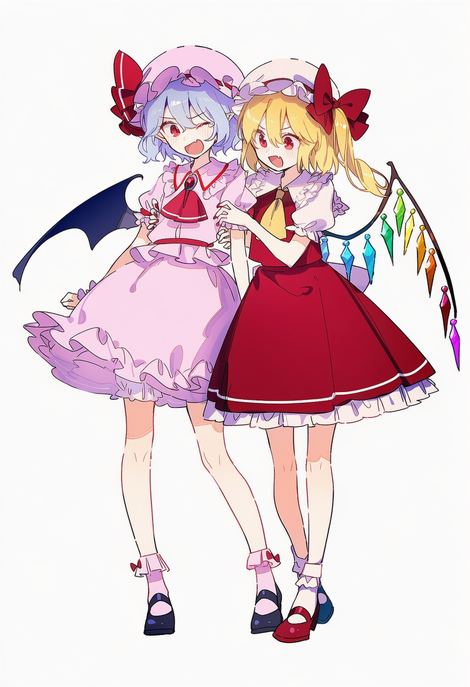

[在线例图](https://assets.quicktagcloud.com/images/raven_composition/raven_composition-3310.jpg?v=bc53c0e17c454747)

<a id="raven_composition-3311"></a>

## 拳揉头

ID：`raven_composition-3311`；分类：多人互动 / 嬉闹/对抗互动；来源标记：`safe`。

来源说明：

> 用拳头或手臂夹住对方头部嬉闹摩擦。

正向提示词：

```text
noogie
```

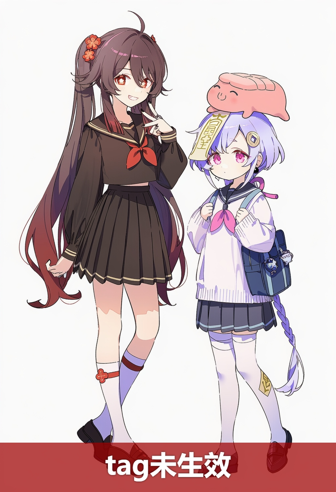

[在线例图](https://assets.quicktagcloud.com/images/raven_composition/raven_composition-3311.jpg?v=2ffa18e870ed335a)

<a id="raven_composition-3312"></a>

## 嬉闹打斗

ID：`raven_composition-3312`；分类：多人互动 / 嬉闹/对抗互动；来源标记：`safe`。

来源说明：

> 以玩闹性质进行打斗互动。

正向提示词：

```text
play_fighting
```

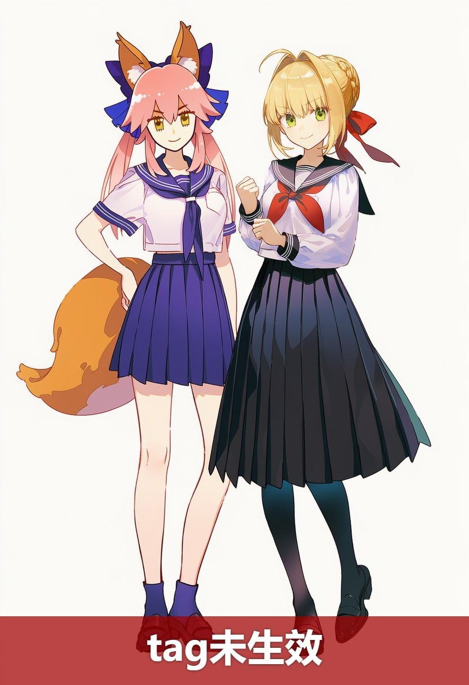

[在线例图](https://assets.quicktagcloud.com/images/raven_composition/raven_composition-3312.jpg?v=22807cc3f40a77fc)

<a id="raven_composition-3313"></a>

## 掰手腕

ID：`raven_composition-3313`；分类：多人互动 / 嬉闹/对抗互动；来源标记：`safe`。

来源说明：

> 两人进行手臂力量较量。

正向提示词：

```text
arm_wrestling
```

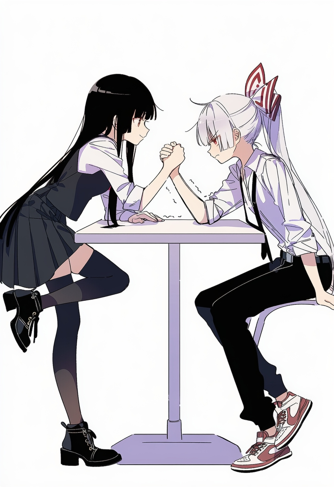

[在线例图](https://assets.quicktagcloud.com/images/raven_composition/raven_composition-3313.jpg?v=83897ea9b9139b59)

<a id="raven_composition-3314"></a>

## 摔跤

ID：`raven_composition-3314`；分类：多人互动 / 嬉闹/对抗互动；来源标记：`safe`。

来源说明：

> 角色彼此进行摔跤或扭打。

正向提示词：

```text
wrestling
```

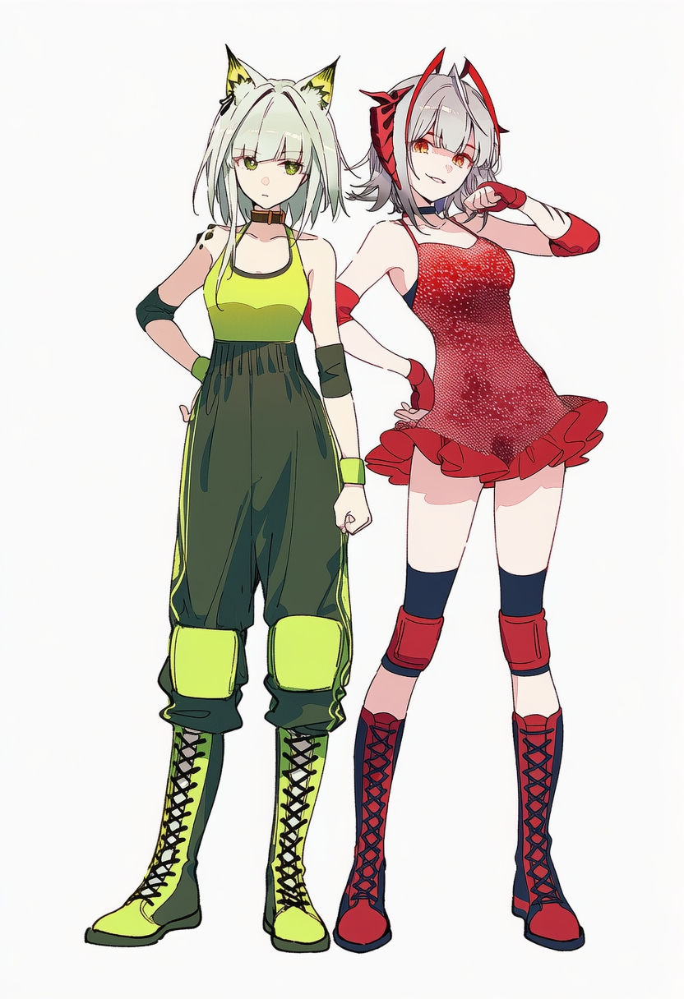

[在线例图](https://assets.quicktagcloud.com/images/raven_composition/raven_composition-3314.jpg?v=cfa7e56ec07b4bd2)

<a id="raven_composition-3315"></a>

## 枕头大战

ID：`raven_composition-3315`；分类：多人互动 / 嬉闹/对抗互动；来源标记：`safe`。

来源说明：

> 角色用枕头互相打闹。

正向提示词：

```text
pillow_fight
```

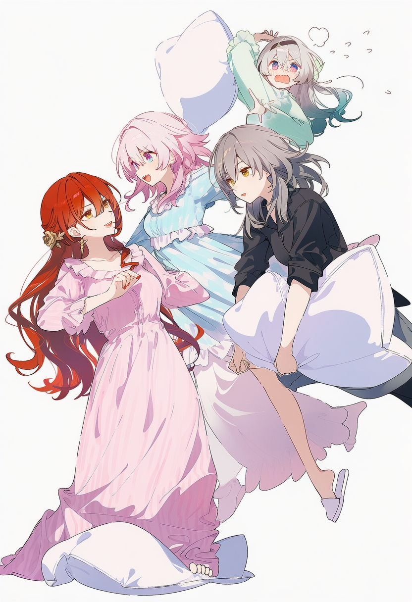

[在线例图](https://assets.quicktagcloud.com/images/raven_composition/raven_composition-3315.jpg?v=251e9dbfa7ca5c2e)

<a id="raven_composition-3316"></a>

## 追逐

ID：`raven_composition-3316`；分类：多人互动 / 嬉闹/对抗互动；来源标记：`safe`。

来源说明：

> 一个角色追赶另一个角色。

正向提示词：

```text
chasing
```

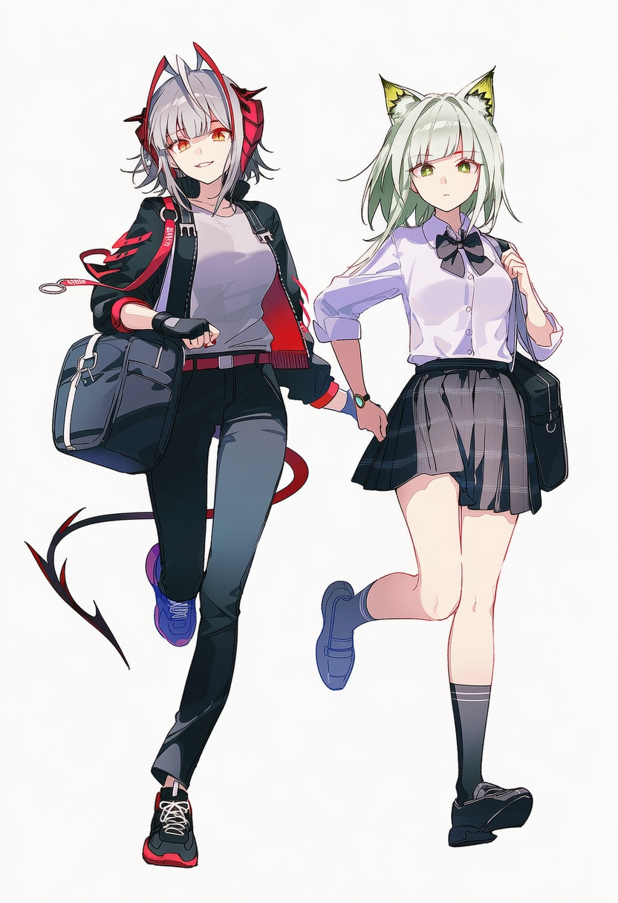

[在线例图](https://assets.quicktagcloud.com/images/raven_composition/raven_composition-3316.jpg?v=a45aa72f28aef470)

<a id="raven_composition-3317"></a>

## 推开

ID：`raven_composition-3317`；分类：多人互动 / 嬉闹/对抗互动；来源标记：`safe`。

来源说明：

> 用手把另一角色推离自己。

正向提示词：

```text
pushing_away
```

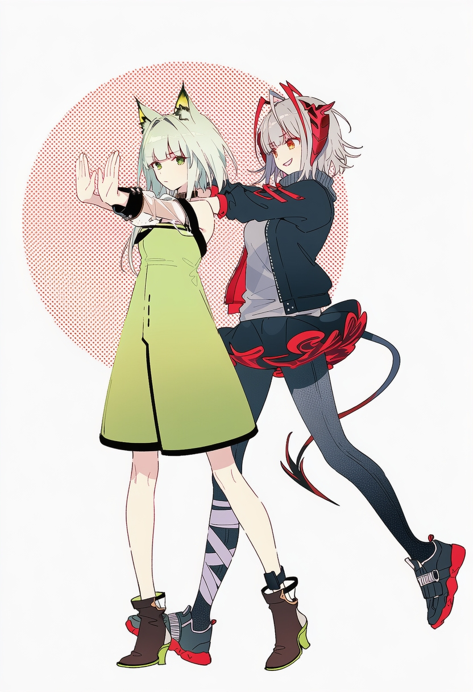

[在线例图](https://assets.quicktagcloud.com/images/raven_composition/raven_composition-3317.jpg?v=2d22f3f54076eb37)

<a id="raven_composition-3318"></a>

## 制止 / 控制

ID：`raven_composition-3318`；分类：多人互动 / 嬉闹/对抗互动；来源标记：`safe`。

来源说明：

> 用身体或手臂限制另一角色行动。

正向提示词：

```text
restraining
```

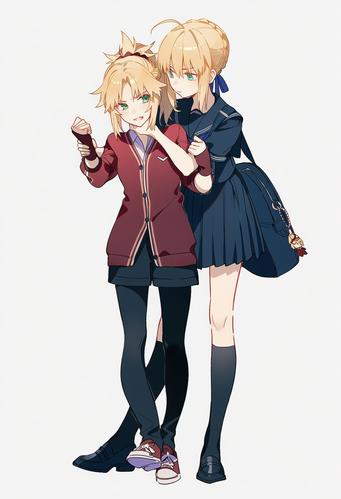

[在线例图](https://assets.quicktagcloud.com/images/raven_composition/raven_composition-3318.jpg?v=dd9f9ed92f6b5798)

<a id="raven_composition-3319"></a>

## 抓住他人

ID：`raven_composition-3319`；分类：多人互动 / 嬉闹/对抗互动；来源标记：`safe`。

来源说明：

> 用手抓住另一角色。

正向提示词：

```text
grabbing_another
```

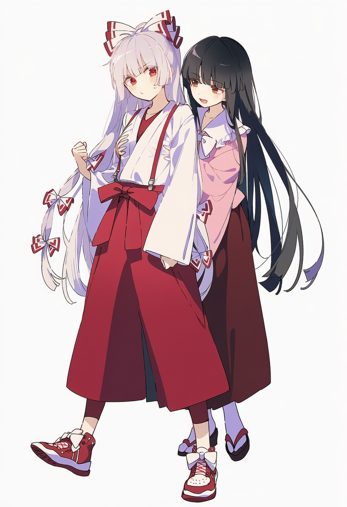

[在线例图](https://assets.quicktagcloud.com/images/raven_composition/raven_composition-3319.jpg?v=05f35ee6cd8cbed4)

<a id="raven_composition-3320"></a>

## 拉着他人

ID：`raven_composition-3320`；分类：多人互动 / 嬉闹/对抗互动；来源标记：`safe`。

来源说明：

> 拉动另一角色朝自己或某方向移动。

正向提示词：

```text
pulling_another
```

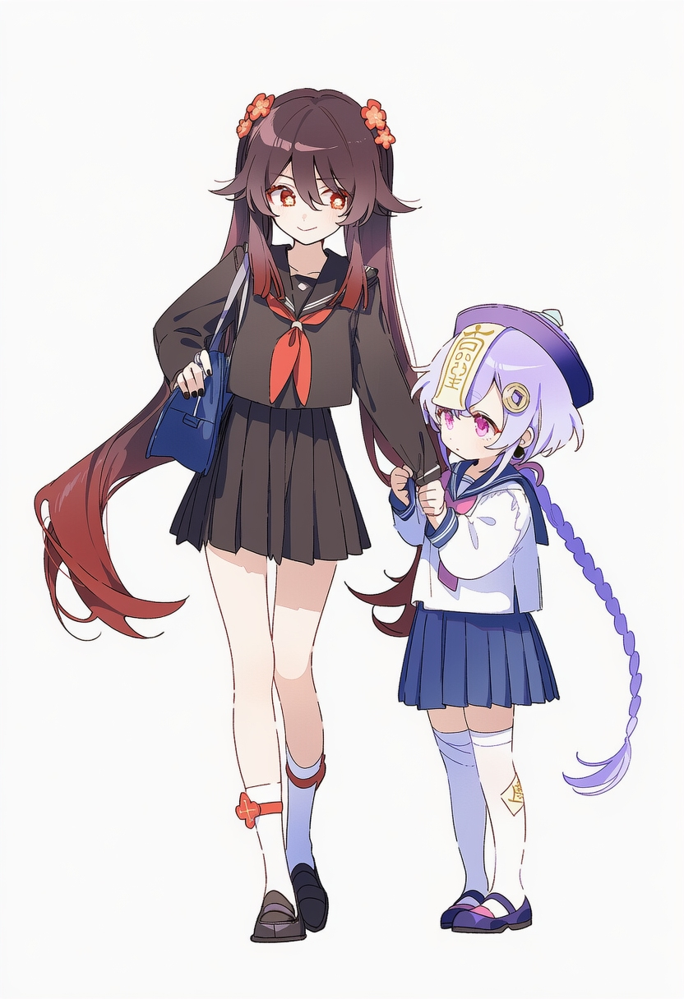

[在线例图](https://assets.quicktagcloud.com/images/raven_composition/raven_composition-3320.jpg?v=2c8299a8e08e4772)

<a id="raven_composition-3321"></a>

## 喂别人

ID：`raven_composition-3321`；分类：多人互动 / 嬉闹/对抗互动；来源标记：`safe`。

来源说明：

> 把食物送到另一角色嘴边。

正向提示词：

```text
feeding_another
```

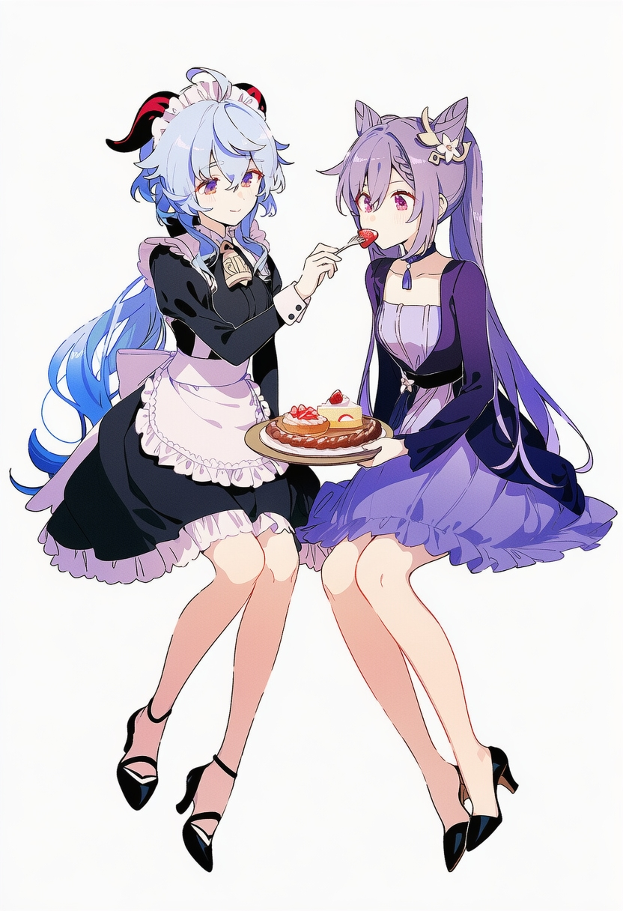

[在线例图](https://assets.quicktagcloud.com/images/raven_composition/raven_composition-3321.jpg?v=a3a300f802110e6b)

<a id="raven_composition-3322"></a>

## 分享食物

ID：`raven_composition-3322`；分类：多人互动 / 嬉闹/对抗互动；来源标记：`safe`。

来源说明：

> 多个角色共同分享同一份食物。

正向提示词：

```text
sharing_food
```

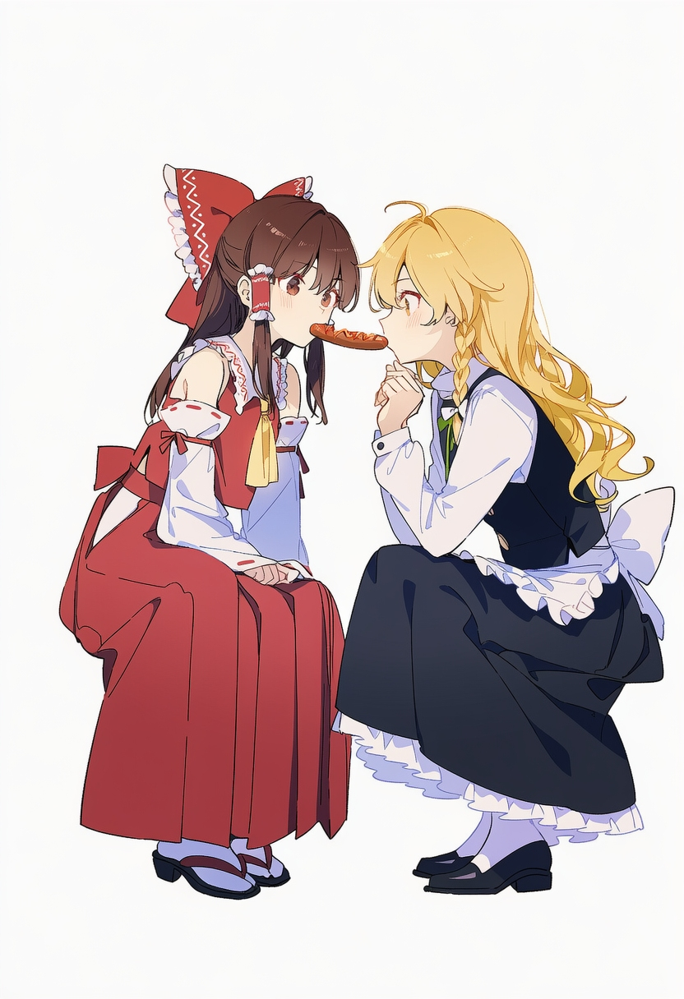

[在线例图](https://assets.quicktagcloud.com/images/raven_composition/raven_composition-3322.jpg?v=0c235c58867965d5)

<a id="raven_composition-3323"></a>

## 分享饮料

ID：`raven_composition-3323`；分类：多人互动 / 嬉闹/对抗互动；来源标记：`safe`。

来源说明：

> 多个角色共同分享饮料。

正向提示词：

```text
sharing_drink
```

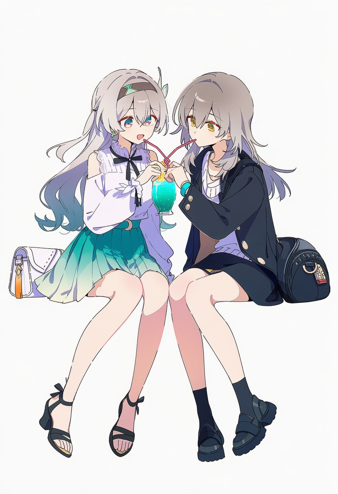

[在线例图](https://assets.quicktagcloud.com/images/raven_composition/raven_composition-3323.jpg?v=407f69a293dc89aa)
