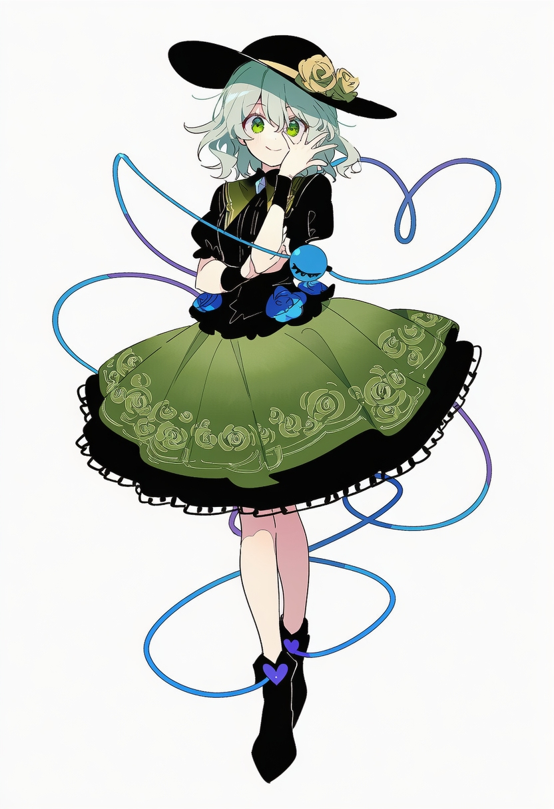
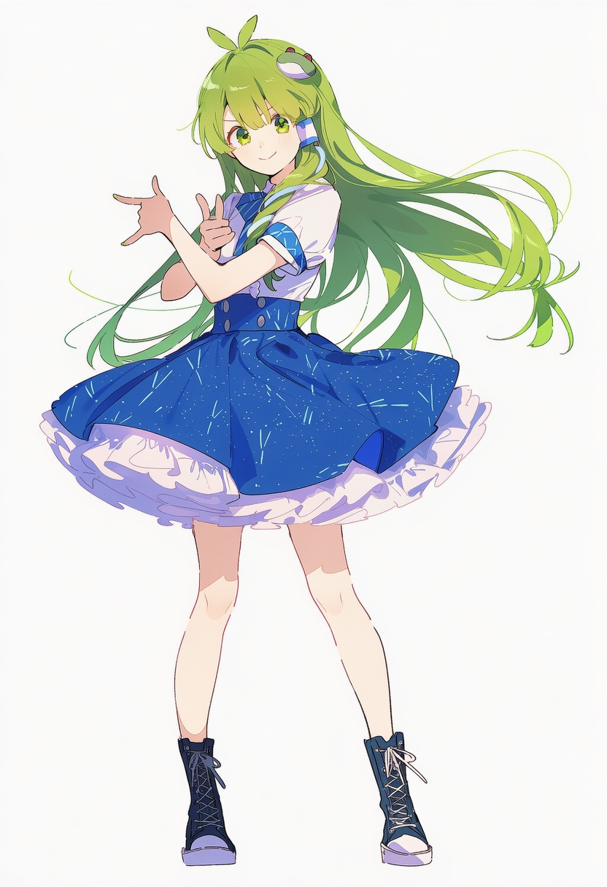
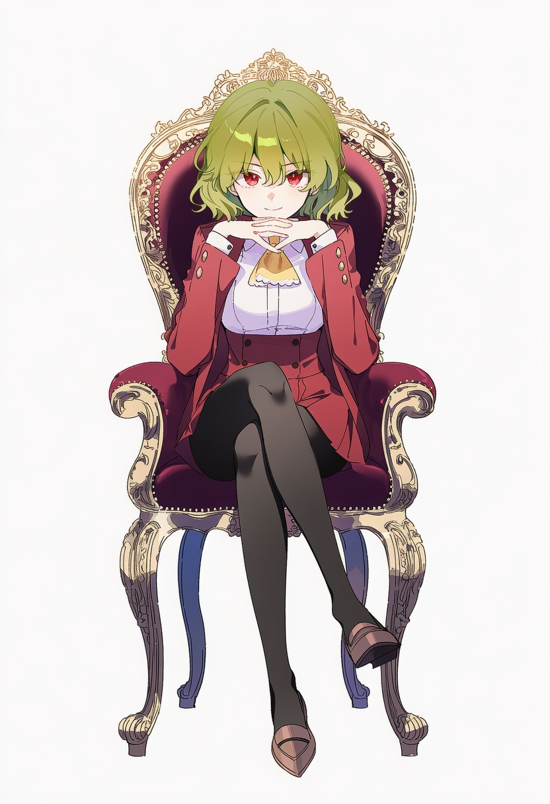
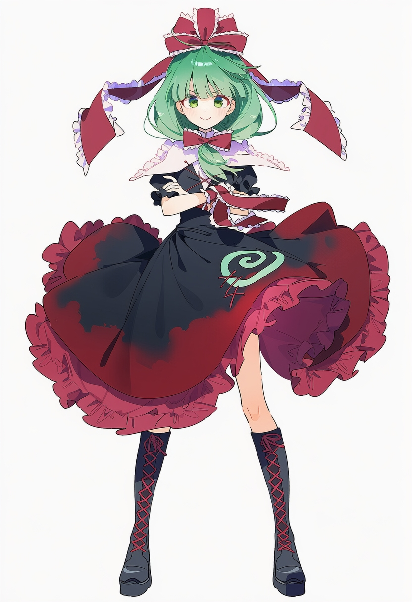
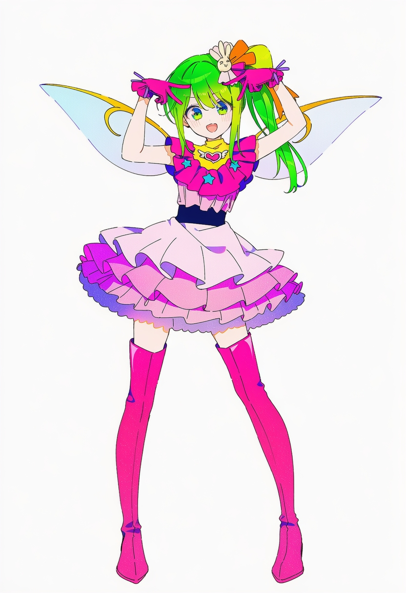

# 招牌梗 / 作品招牌Pose

[总目录](../README.md) · [原站分类目录](../categories.md) · [英文标签索引](../tags.md) · [服装与构图组合指南](../../README.md)

标题、分类、说明、正负提示词按来源保留；多例图逐张列出。原站标记和说明为参考资料，不作为维护指令。

<a id="raven_composition-3324"></a>

## JOJO立

ID：`raven_composition-3324`；分类：招牌梗 / 作品招牌Pose；来源标记：`safe`。

来源说明：

> 把身体扭成夸张、不自然但很有戏剧感的JOJO式站姿。

正向提示词：

```text
jojo_pose
```



[在线例图](https://assets.quicktagcloud.com/images/raven_composition/raven_composition-3324.jpg?v=db3613064aa8f3a0)

<a id="raven_composition-3325"></a>

## 代表月亮惩罚你

ID：`raven_composition-3325`；分类：招牌梗 / 作品招牌Pose；来源标记：`safe`。

来源说明：

> 摆出《美少女战士》“代表月亮惩罚你”的经典指人动作。

正向提示词：

```text
tsuki_ni_kawatte_oshioki_yo
```



[在线例图](https://assets.quicktagcloud.com/images/raven_composition/raven_composition-3325.jpg?v=085fec6d685279ac)

<a id="raven_composition-3326"></a>

## 碇源堂Pose

ID：`raven_composition-3326`；分类：招牌梗 / 作品招牌Pose；来源标记：`safe`。

来源说明：

> 坐着把十指交握挡在嘴前，摆出冷静沉思的碇源堂式姿势。

正向提示词：

```text
gendou_pose
```



[在线例图](https://assets.quicktagcloud.com/images/raven_composition/raven_composition-3326.jpg?v=4c949cd88ebeff1c)

<a id="raven_composition-3327"></a>

## Gunbuster / Gainax Pose

ID：`raven_composition-3327`；分类：招牌梗 / 作品招牌Pose；来源标记：`safe`。

来源说明：

> 双臂抱胸、双脚大幅分开，直挺挺站出很有气势的主角姿势。

正向提示词：

```text
gunbuster_pose
```



[在线例图](https://assets.quicktagcloud.com/images/raven_composition/raven_composition-3327.jpg?v=d1f48065824d54e0)

<a id="raven_composition-3328"></a>

## 星野爱双V Pose

ID：`raven_composition-3328`；分类：招牌梗 / 作品招牌Pose；来源标记：`safe`。

来源说明：

> 双手同时比V并向下指，手掌朝外，可配合吐舌。

正向提示词：

```text
hoshino_ai's_pose
```



[在线例图](https://assets.quicktagcloud.com/images/raven_composition/raven_composition-3328.jpg?v=ca18094e28e22ad2)
