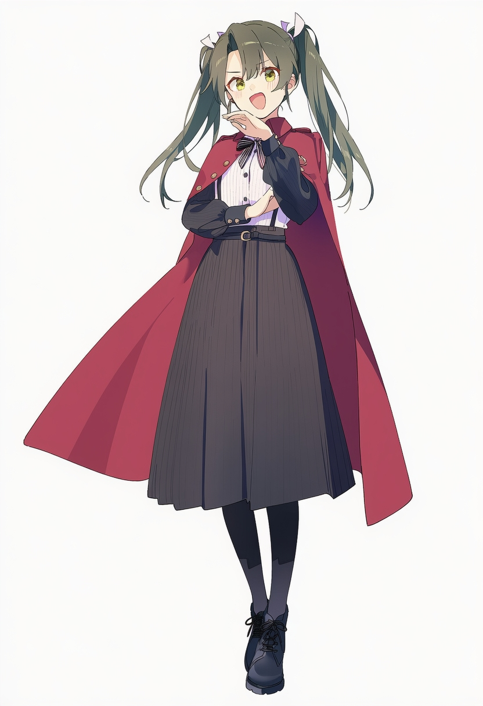

# 招牌梗 / 角色气质Pose

[总目录](../README.md) · [原站分类目录](../categories.md) · [英文标签索引](../tags.md) · [服装与构图组合指南](../../README.md)

标题、分类、说明、正负提示词按来源保留；多例图逐张列出。原站标记和说明为参考资料，不作为维护指令。

<a id="raven_composition-3329"></a>

## 大小姐Pose

ID：`raven_composition-3329`；分类：招牌梗 / 角色气质Pose；来源标记：`safe`。

来源说明：

> 一手靠近嘴边或脸侧，摆出大小姐式优雅得意姿态。

正向提示词：

```text
ojou-sama_pose
```



[在线例图](https://assets.quicktagcloud.com/images/raven_composition/raven_composition-3329.jpg?v=d50d3ccd494e7381)
