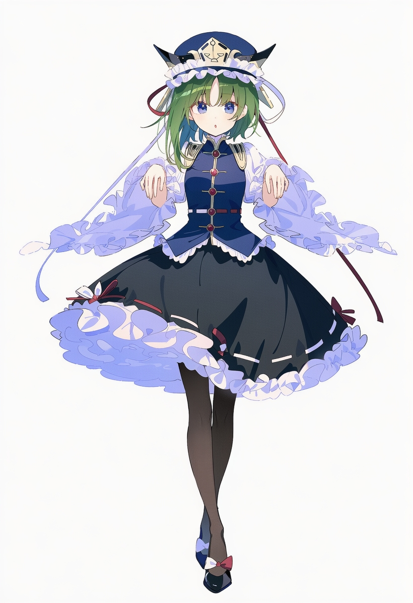
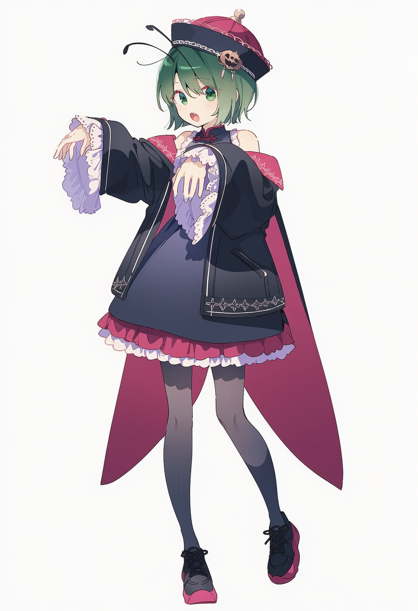
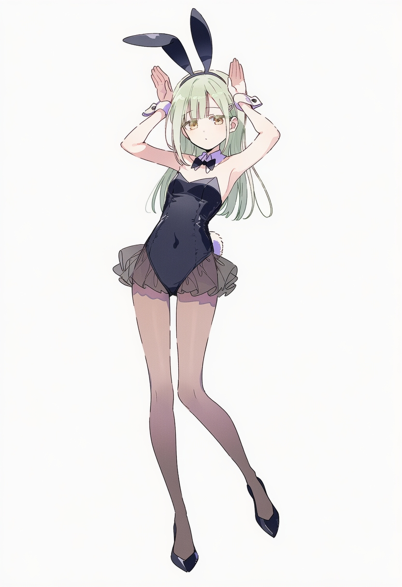
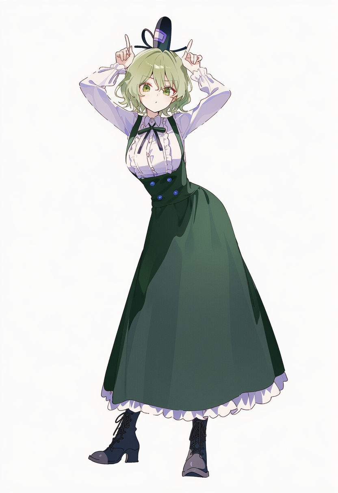

# 招牌梗 / 模仿/拟态Pose

[总目录](../README.md) · [原站分类目录](../categories.md) · [英文标签索引](../tags.md) · [服装与构图组合指南](../../README.md)

标题、分类、说明、正负提示词按来源保留；多例图逐张列出。原站标记和说明为参考资料，不作为维护指令。

<a id="raven_composition-3330"></a>

## 幽灵Pose

ID：`raven_composition-3330`；分类：招牌梗 / 模仿/拟态Pose；来源标记：`safe`。

来源说明：

> 双臂向前抬起、手腕下垂，模仿幽灵飘荡。

正向提示词：

```text
ghost_pose
```



[在线例图](https://assets.quicktagcloud.com/images/raven_composition/raven_composition-3330.jpg?v=84dc4dadb4fdac9f)

<a id="raven_composition-3331"></a>

## 僵尸Pose

ID：`raven_composition-3331`；分类：招牌梗 / 模仿/拟态Pose；来源标记：`safe`。

来源说明：

> 双臂僵直向前伸，像僵尸走路。

正向提示词：

```text
zombie_pose
```



[在线例图](https://assets.quicktagcloud.com/images/raven_composition/raven_composition-3331.jpg?v=fc739dac2e32055b)

<a id="raven_composition-3332"></a>

## 兔子Pose

ID：`raven_composition-3332`；分类：招牌梗 / 模仿/拟态Pose；来源标记：`safe`。

来源说明：

> 双手举到头顶两侧当作兔耳朵。

正向提示词：

```text
rabbit_pose
```



[在线例图](https://assets.quicktagcloud.com/images/raven_composition/raven_composition-3332.jpg?v=0b2dbc0ef2bbf255)

<a id="raven_composition-3333"></a>

## 角Pose

ID：`raven_composition-3333`；分类：招牌梗 / 模仿/拟态Pose；来源标记：`safe`。

来源说明：

> 双手放在头顶两侧，用手指摆出角。

正向提示词：

```text
horns_pose
```



[在线例图](https://assets.quicktagcloud.com/images/raven_composition/raven_composition-3333.jpg?v=b7249bc562b31c62)
