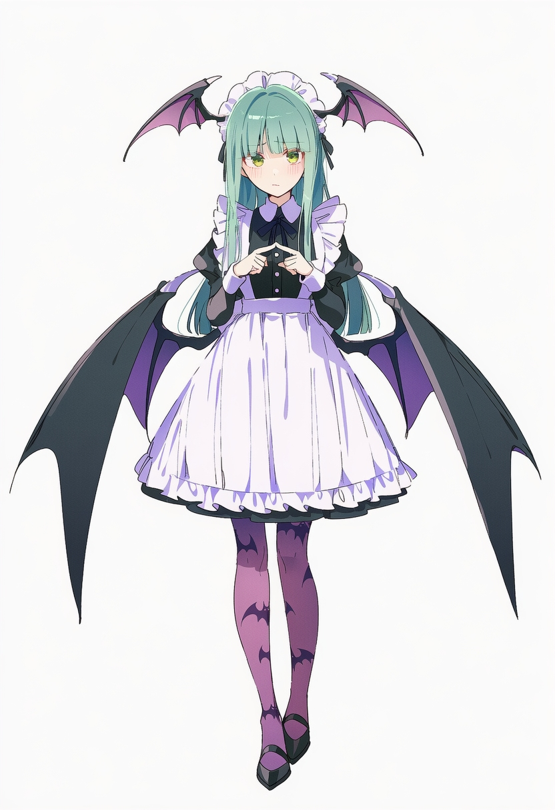
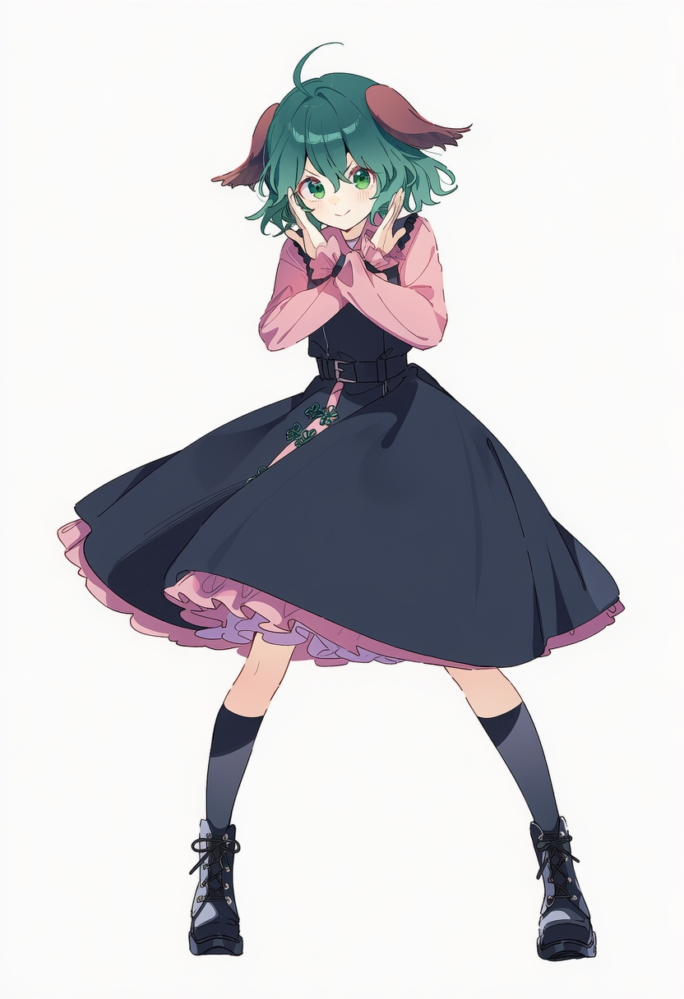
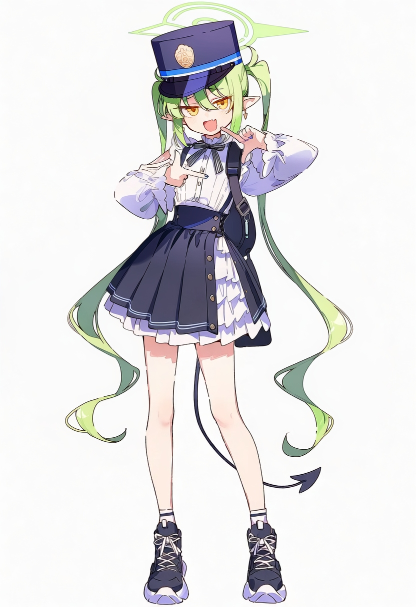
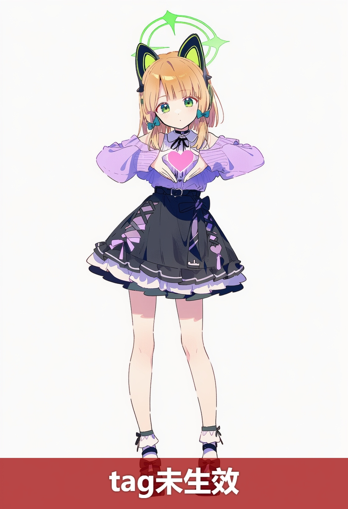

# 招牌梗 / 手势型招牌Pose

[总目录](../README.md) · [原站分类目录](../categories.md) · [英文标签索引](../tags.md) · [服装与构图组合指南](../../README.md)

标题、分类、说明、正负提示词按来源保留；多例图逐张列出。原站标记和说明为参考资料，不作为维护指令。

<a id="raven_composition-3334"></a>

## 食指对碰

ID：`raven_composition-3334`；分类：招牌梗 / 手势型招牌Pose；来源标记：`safe`。

来源说明：

> 两根食指在身前轻轻碰在一起，显得害羞或扭捏。

正向提示词：

```text
index_fingers_together
```



[在线例图](https://assets.quicktagcloud.com/images/raven_composition/raven_composition-3334.jpg?v=a03540bd61251253)

<a id="raven_composition-3335"></a>

## 双臂X

ID：`raven_composition-3335`；分类：招牌梗 / 手势型招牌Pose；来源标记：`safe`。

来源说明：

> 双臂在身前交叉成X，表示拒绝或“不行”。

正向提示词：

```text
x_arms
```



[在线例图](https://assets.quicktagcloud.com/images/raven_composition/raven_composition-3335.jpg?v=9e4a181754d2ad58)

<a id="raven_composition-3336"></a>

## 手指取景框

ID：`raven_composition-3336`；分类：招牌梗 / 手势型招牌Pose；来源标记：`safe`。

来源说明：

> 用手指在脸前或眼前比出一个取景框。

正向提示词：

```text
finger_frame
```



[在线例图](https://assets.quicktagcloud.com/images/raven_composition/raven_composition-3336.jpg?v=c9f9afaf0bdf1305)

<a id="raven_composition-3337"></a>

## 手臂大爱心

ID：`raven_composition-3337`；分类：招牌梗 / 手势型招牌Pose；来源标记：`safe`。

来源说明：

> 双臂举过头顶并弯成一个大爱心。

正向提示词：

```text
heart_arms
```



[在线例图](https://assets.quicktagcloud.com/images/raven_composition/raven_composition-3337.jpg?v=fcd43c679e2a9e42)
