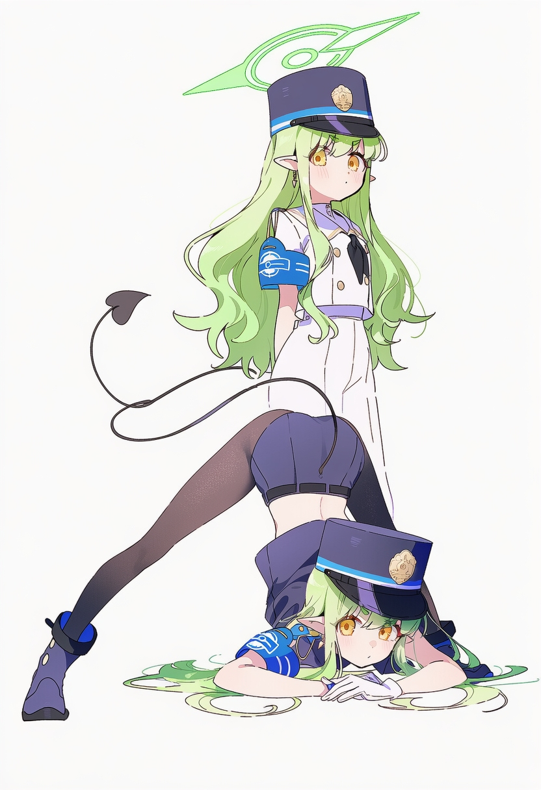
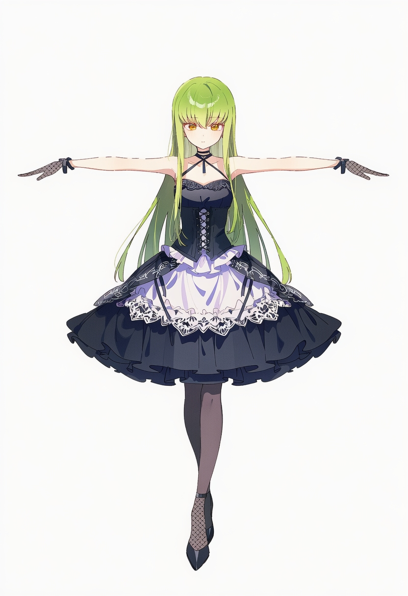
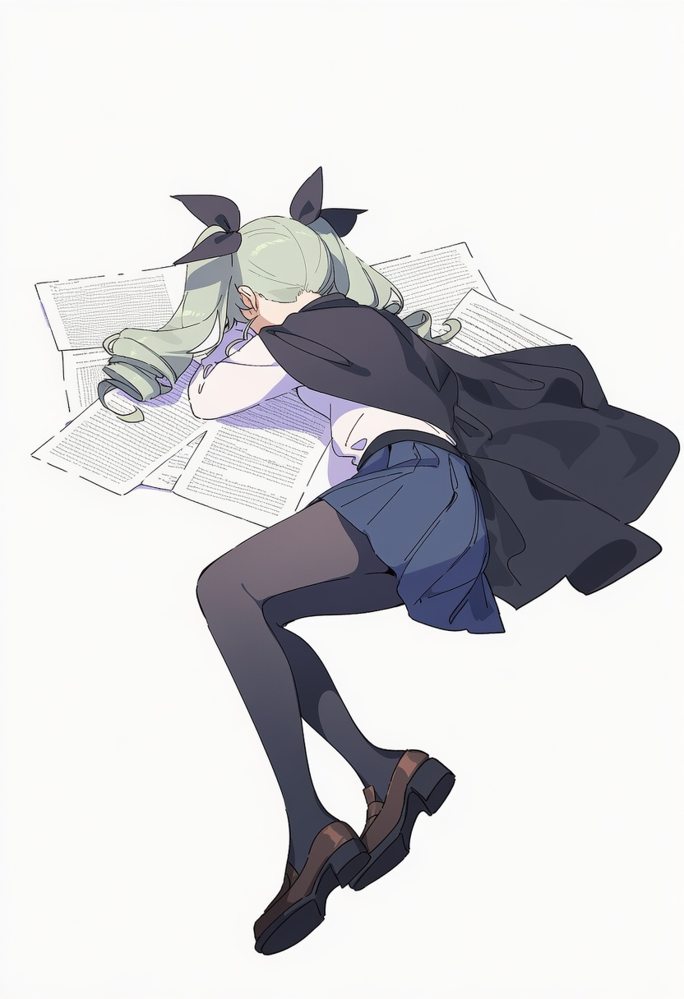
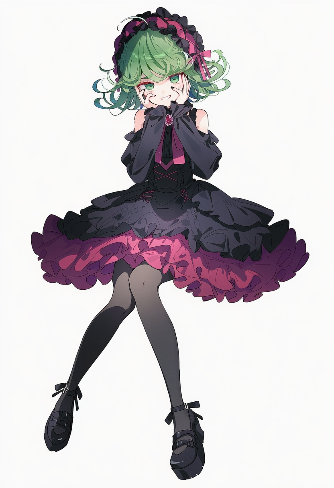
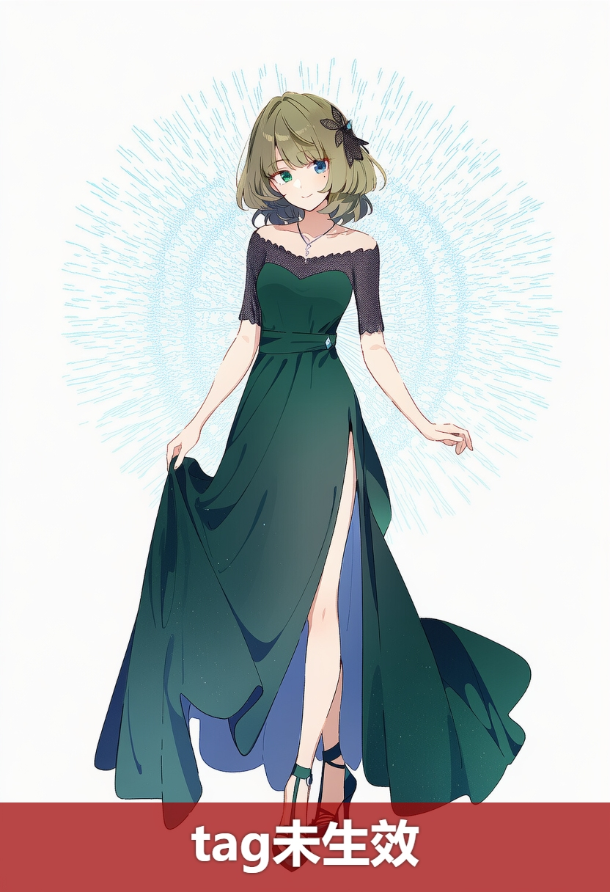

# 招牌梗 / 经典梗/挑战Pose

[总目录](../README.md) · [原站分类目录](../categories.md) · [英文标签索引](../tags.md) · [服装与构图组合指南](../../README.md)

标题、分类、说明、正负提示词按来源保留；多例图逐张列出。原站标记和说明为参考资料，不作为维护指令。

<a id="raven_composition-3338"></a>

## Jack-O挑战

ID：`raven_composition-3338`；分类：招牌梗 / 经典梗/挑战Pose；来源标记：`safe`。

来源说明：

> 身体压得很低，双腿大幅分开，臀部抬高的Jack-O挑战姿势。

正向提示词：

```text
jack-o'_challenge
```



[在线例图](https://assets.quicktagcloud.com/images/raven_composition/raven_composition-3338.jpg?v=54c7a6dfa17b2f31)

<a id="raven_composition-3339"></a>

## 周六夜狂热Pose

ID：`raven_composition-3339`；分类：招牌梗 / 经典梗/挑战Pose；来源标记：`safe`。

来源说明：

> 一只手斜向上指，摆出经典迪斯科海报式姿势。

正向提示词：

```text
saturday_night_fever
```


[在线例图](https://assets.quicktagcloud.com/images/raven_composition/raven_composition-3339.jpg?v=a250509d1f69e2cf)

<a id="raven_composition-3340"></a>

## T Pose

ID：`raven_composition-3340`；分类：招牌梗 / 经典梗/挑战Pose；来源标记：`safe`。

来源说明：

> 站直并把双臂水平伸开，身体像字母T。

正向提示词：

```text
t-pose
```



[在线例图](https://assets.quicktagcloud.com/images/raven_composition/raven_composition-3340.jpg?v=e9ef1ee3b95f10c4)

<a id="raven_composition-3341"></a>

## 雅木茶倒地梗

ID：`raven_composition-3341`；分类：招牌梗 / 经典梗/挑战Pose；来源标记：`safe`。

来源说明：

> 侧身蜷倒在地上，摆出“被一击放倒”的雅木茶经典阵亡姿势。

正向提示词：

```text
yamcha_pose_(meme)
```



[在线例图](https://assets.quicktagcloud.com/images/raven_composition/raven_composition-3341.jpg?v=d82d26f135e3261c)

<a id="raven_composition-3342"></a>

## 病娇恍惚Pose

ID：`raven_composition-3342`；分类：招牌梗 / 经典梗/挑战Pose；来源标记：`safe`。

来源说明：

> 双手捧住脸颊，直盯镜头，摆出病娇式恍惚表情。

正向提示词：

```text
yandere_trance
```



[在线例图](https://assets.quicktagcloud.com/images/raven_composition/raven_composition-3342.jpg?v=9bab52cb30b14eb9)

<a id="raven_composition-3343"></a>

## Speaki趴地崩溃梗

ID：`raven_composition-3343`；分类：招牌梗 / 经典梗/挑战Pose；来源标记：`safe`。

来源说明：

> 四肢着地趴着，眼泪汪汪地摆出委屈崩溃的梗图姿势。

正向提示词：

```text
speakiposting_(meme)
```



[在线例图](https://assets.quicktagcloud.com/images/raven_composition/raven_composition-3343.jpg?v=c26be2791f9bd491)
