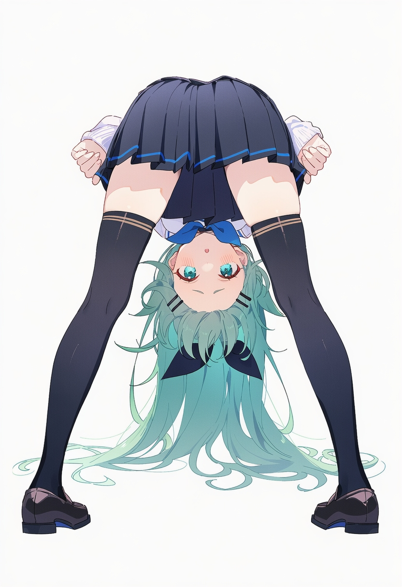
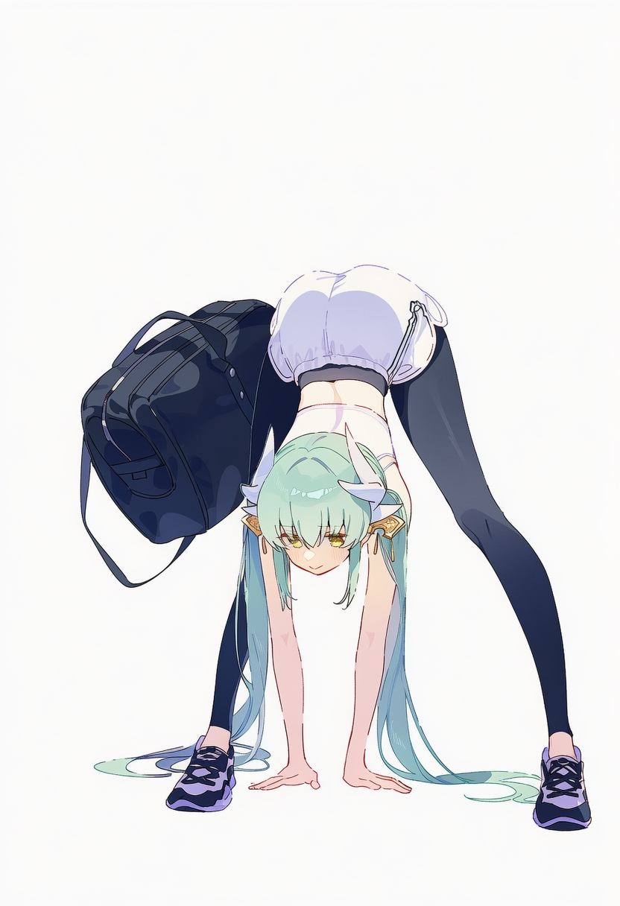

# 招牌梗 / 夸张身体Pose

[总目录](../README.md) · [原站分类目录](../categories.md) · [英文标签索引](../tags.md) · [服装与构图组合指南](../../README.md)

标题、分类、说明、正负提示词按来源保留；多例图逐张列出。原站标记和说明为参考资料，不作为维护指令。

<a id="raven_composition-3344"></a>

## 隐形椅子

ID：`raven_composition-3344`；分类：招牌梗 / 夸张身体Pose；来源标记：`safe`。

来源说明：

> 膝盖弯着半蹲，像坐在一把看不见的椅子上。

正向提示词：

```text
invisible_chair
```


[在线例图](https://assets.quicktagcloud.com/images/raven_composition/raven_composition-3344.jpg?v=2cf8247fda100328)

<a id="raven_composition-3345"></a>

## 胯下回看

ID：`raven_composition-3345`；分类：招牌梗 / 夸张身体Pose；来源标记：`safe`。

来源说明：

> 大幅向前弯腰，从自己两腿之间往后看。

正向提示词：

```text
looking_through_own_legs
```



[在线例图](https://assets.quicktagcloud.com/images/raven_composition/raven_composition-3345.jpg?v=ff6883119bc55fc8)

<a id="raven_composition-3346"></a>

## 前屈

ID：`raven_composition-3346`；分类：招牌梗 / 夸张身体Pose；来源标记：`safe`。

来源说明：

> 上半身尽量向前折，头靠近双腿。

正向提示词：

```text
frontbend
```


[在线例图](https://assets.quicktagcloud.com/images/raven_composition/raven_composition-3346.jpg?v=e28a600e9488440f)

<a id="raven_composition-3347"></a>

## 下犬式

ID：`raven_composition-3347`；分类：招牌梗 / 夸张身体Pose；来源标记：`safe`。

来源说明：

> 双手双脚撑地，臀部向上顶，身体形成倒V。

正向提示词：

```text
downward_dog
```



[在线例图](https://assets.quicktagcloud.com/images/raven_composition/raven_composition-3347.jpg?v=8594d2607bef6659)
