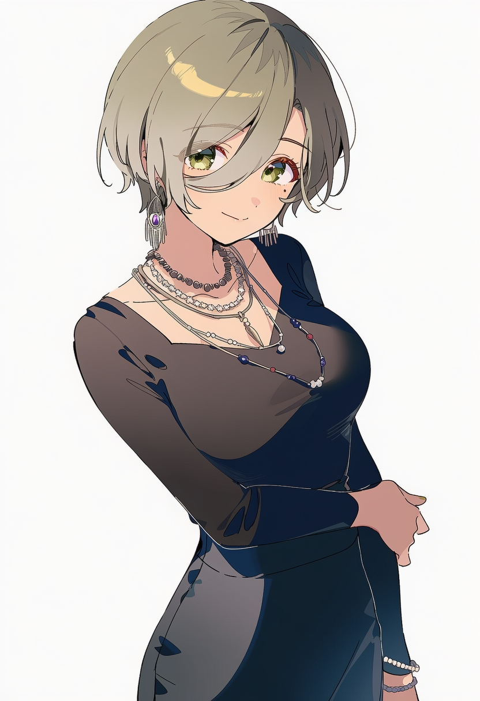
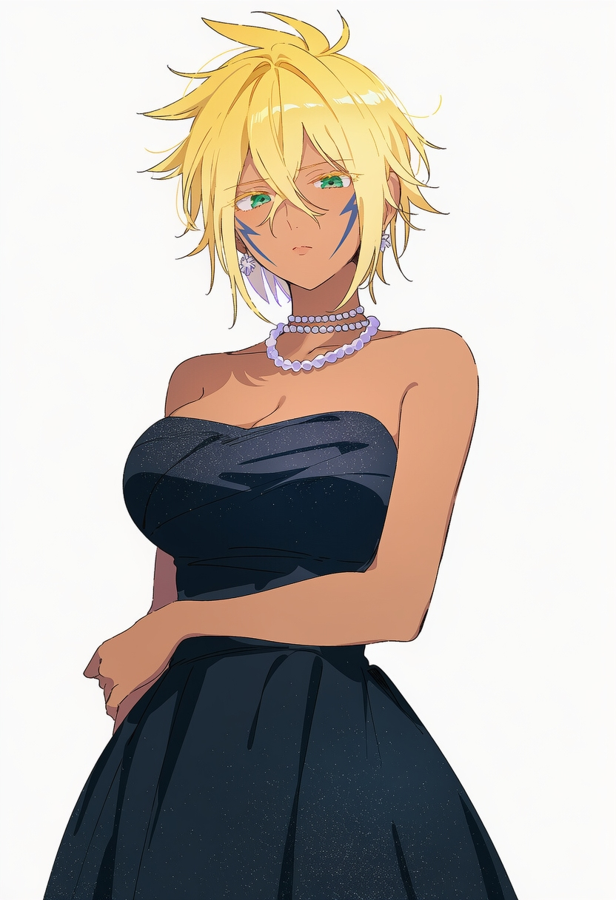
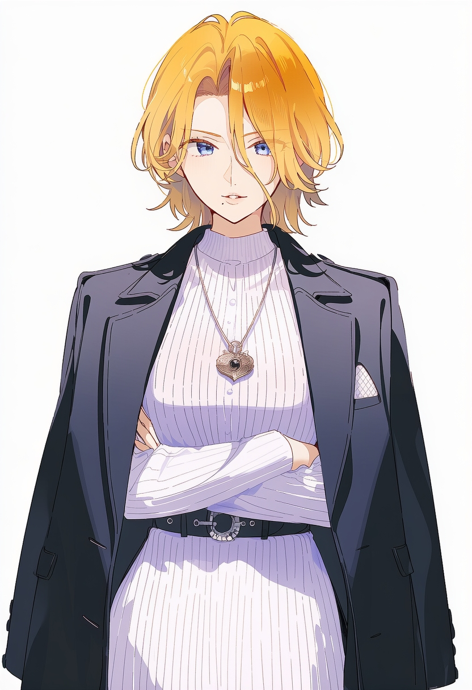
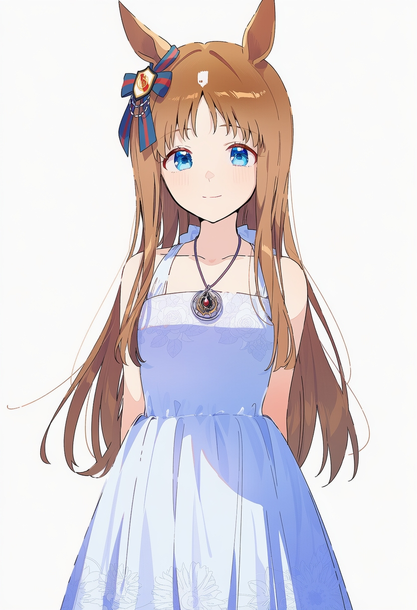
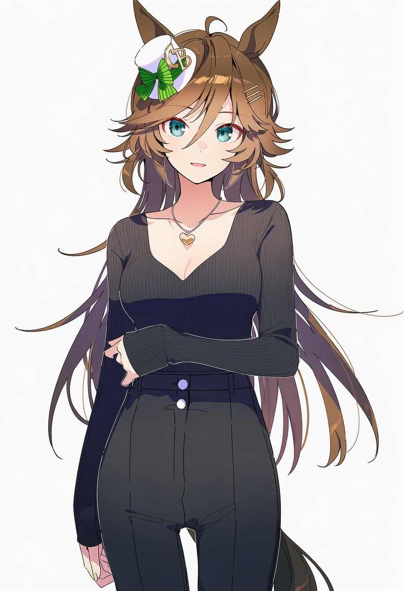
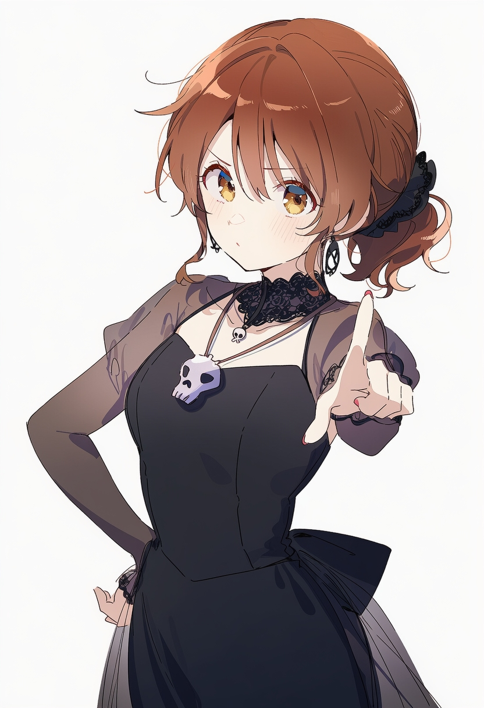

# 颈部配饰 / 项链/吊坠

[总目录](../README.md) · [原站分类目录](../categories.md) · [英文标签索引](../tags.md) · [服装与构图组合指南](../../README.md)

标题、分类、说明、正负提示词按来源保留；多例图逐张列出。原站标记和说明为参考资料，不作为维护指令。

<a id="raven_composition-3350"></a>

## 项链

ID：`raven_composition-3350`；分类：颈部配饰 / 项链/吊坠；来源标记：`safe`。

来源说明：

> 泛指戴在颈部的项链。

正向提示词：

```text
necklace
```


[在线例图](https://assets.quicktagcloud.com/images/raven_composition/raven_composition-3350.jpg?v=73613e9c8bb3fd4e)

<a id="raven_composition-3351"></a>

## 多层项链

ID：`raven_composition-3351`；分类：颈部配饰 / 项链/吊坠；来源标记：`safe`。

来源说明：

> 同时佩戴多条项链。

正向提示词：

```text
multiple_necklaces
```



[在线例图](https://assets.quicktagcloud.com/images/raven_composition/raven_composition-3351.jpg?v=43ce93804a9bf4f5)

<a id="raven_composition-3352"></a>

## 链条项链

ID：`raven_composition-3352`；分类：颈部配饰 / 项链/吊坠；来源标记：`safe`。

来源说明：

> 以金属链条为主体的项链。

正向提示词：

```text
chain_necklace
```


[在线例图](https://assets.quicktagcloud.com/images/raven_composition/raven_composition-3352.jpg?v=3cb33ed473785f02)

<a id="raven_composition-3353"></a>

## 珠串项链

ID：`raven_composition-3353`；分类：颈部配饰 / 项链/吊坠；来源标记：`safe`。

来源说明：

> 由珠子串成的项链。

正向提示词：

```text
bead_necklace
```


[在线例图](https://assets.quicktagcloud.com/images/raven_composition/raven_composition-3353.jpg?v=64201fea653cd283)

<a id="raven_composition-3354"></a>

## 珍珠项链

ID：`raven_composition-3354`；分类：颈部配饰 / 项链/吊坠；来源标记：`safe`。

来源说明：

> 由珍珠串成的项链。

正向提示词：

```text
pearl_necklace
```



[在线例图](https://assets.quicktagcloud.com/images/raven_composition/raven_composition-3354.jpg?v=1bc18f32a5ee2a00)

<a id="raven_composition-3355"></a>

## 吊坠

ID：`raven_composition-3355`；分类：颈部配饰 / 项链/吊坠；来源标记：`safe`。

来源说明：

> 挂在颈部链条上的主要坠饰。

正向提示词：

```text
pendant
```


[在线例图](https://assets.quicktagcloud.com/images/raven_composition/raven_composition-3355.jpg?v=1170517a9648c974)

<a id="raven_composition-3356"></a>

## 盒式吊坠

ID：`raven_composition-3356`；分类：颈部配饰 / 项链/吊坠；来源标记：`safe`。

来源说明：

> 可以打开的小盒式吊坠。

正向提示词：

```text
locket
```



[在线例图](https://assets.quicktagcloud.com/images/raven_composition/raven_composition-3356.jpg?v=b04be32f17cc2ccd)

<a id="raven_composition-3357"></a>

## 护身符项链

ID：`raven_composition-3357`；分类：颈部配饰 / 项链/吊坠；来源标记：`safe`。

来源说明：

> 挂在颈部的护身符或符牌。

正向提示词：

```text
amulet
```



[在线例图](https://assets.quicktagcloud.com/images/raven_composition/raven_composition-3357.jpg?v=e88773bfa1da4a49)

<a id="raven_composition-3358"></a>

## 军牌项链

ID：`raven_composition-3358`；分类：颈部配饰 / 项链/吊坠；来源标记：`safe`。

来源说明：

> 军用身份牌式项链。

正向提示词：

```text
dog_tags
```


[在线例图](https://assets.quicktagcloud.com/images/raven_composition/raven_composition-3358.jpg?v=64a692bc5140bfeb)

<a id="raven_composition-3359"></a>

## 念珠

ID：`raven_composition-3359`；分类：颈部配饰 / 项链/吊坠；来源标记：`safe`。

来源说明：

> 宗教念珠或念珠项链。

正向提示词：

```text
rosary
```


[在线例图](https://assets.quicktagcloud.com/images/raven_composition/raven_composition-3359.jpg?v=038d173311e8856b)

<a id="raven_composition-3360"></a>

## 金链

ID：`raven_composition-3360`；分类：颈部配饰 / 项链/吊坠；来源标记：`safe`。

来源说明：

> 金色或金质感的粗链条；链条颜色款只留这一种代表。

正向提示词：

```text
gold_chain
```


[在线例图](https://assets.quicktagcloud.com/images/raven_composition/raven_composition-3360.jpg?v=a1225af905f0c914)

<a id="raven_composition-3361"></a>

## 船锚项链

ID：`raven_composition-3361`；分类：颈部配饰 / 项链/吊坠；来源标记：`safe`。

来源说明：

> 带船锚造型吊坠的项链。

正向提示词：

```text
anchor_necklace
```


[在线例图](https://assets.quicktagcloud.com/images/raven_composition/raven_composition-3361.jpg?v=8c5c8f5c04a66764)

<a id="raven_composition-3362"></a>

## 骰子项链

ID：`raven_composition-3362`；分类：颈部配饰 / 项链/吊坠；来源标记：`safe`。

来源说明：

> 带骰子造型吊坠的项链。

正向提示词：

```text
dice_necklace
```


[在线例图](https://assets.quicktagcloud.com/images/raven_composition/raven_composition-3362.jpg?v=3c9c04aa93c118c0)

<a id="raven_composition-3363"></a>

## 十字架项链

ID：`raven_composition-3363`；分类：颈部配饰 / 项链/吊坠；来源标记：`safe`。

来源说明：

> 带十字架吊坠的项链。

正向提示词：

```text
cross_necklace
```


[在线例图](https://assets.quicktagcloud.com/images/raven_composition/raven_composition-3363.jpg?v=a5aca956baa35851)

<a id="raven_composition-3364"></a>

## 爱心项链

ID：`raven_composition-3364`；分类：颈部配饰 / 项链/吊坠；来源标记：`safe`。

来源说明：

> 带爱心吊坠或爱心宝石的项链。

正向提示词：

```text
heart_necklace
```



[在线例图](https://assets.quicktagcloud.com/images/raven_composition/raven_composition-3364.jpg?v=7d0bda58e92ff057)

<a id="raven_composition-3365"></a>

## 戒指项链

ID：`raven_composition-3365`；分类：颈部配饰 / 项链/吊坠；来源标记：`safe`。

来源说明：

> 项链上挂着戒指。

正向提示词：

```text
ring_necklace
```


[在线例图](https://assets.quicktagcloud.com/images/raven_composition/raven_composition-3365.jpg?v=20962abddbc27a3f)

<a id="raven_composition-3366"></a>

## 骷髅项链

ID：`raven_composition-3366`；分类：颈部配饰 / 项链/吊坠；来源标记：`safe`。

来源说明：

> 带骷髅造型吊坠的项链。

正向提示词：

```text
skull_necklace
```



[在线例图](https://assets.quicktagcloud.com/images/raven_composition/raven_composition-3366.jpg?v=5fe8e0db8e37ea2c)
