# 颈部配饰 / 颈圈/项圈

[总目录](../README.md) · [原站分类目录](../categories.md) · [英文标签索引](../tags.md) · [服装与构图组合指南](../../README.md)

标题、分类、说明、正负提示词按来源保留；多例图逐张列出。原站标记和说明为参考资料，不作为维护指令。

<a id="raven_composition-3367"></a>

## 颈链 / Choker

ID：`raven_composition-3367`；分类：颈部配饰 / 颈圈/项圈；来源标记：`safe`。

来源说明：

> 紧贴脖子的短颈链。

正向提示词：

```text
choker
```

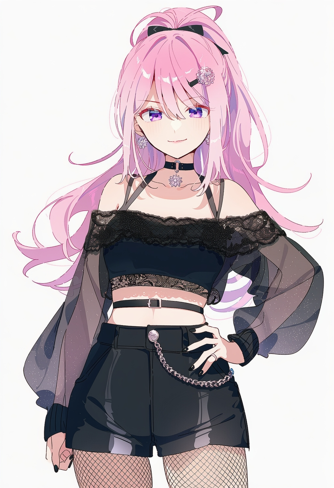

[在线例图](https://assets.quicktagcloud.com/images/raven_composition/raven_composition-3367.jpg?v=ae30a2b4511d1dfa)

<a id="raven_composition-3368"></a>

## 黑色颈链

ID：`raven_composition-3368`；分类：颈部配饰 / 颈圈/项圈；来源标记：`safe`。

来源说明：

> 黑色 Choker；纯颜色款只留这一种代表。

正向提示词：

```text
black_choker
```

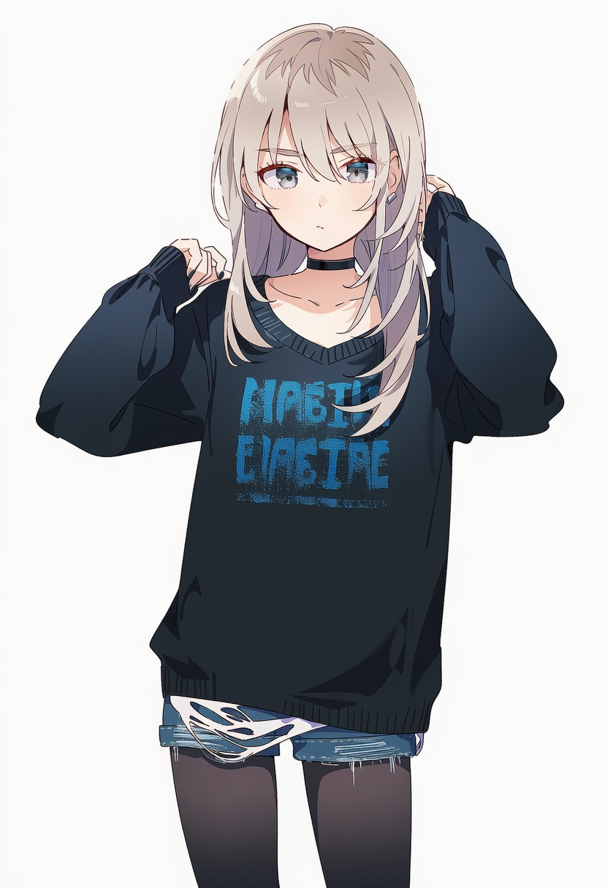

[在线例图](https://assets.quicktagcloud.com/images/raven_composition/raven_composition-3368.jpg?v=85782cdfb95265f7)

<a id="raven_composition-3369"></a>

## 蕾丝颈链

ID：`raven_composition-3369`；分类：颈部配饰 / 颈圈/项圈；来源标记：`safe`。

来源说明：

> 主要由蕾丝构成的 Choker。

正向提示词：

```text
lace_choker
```

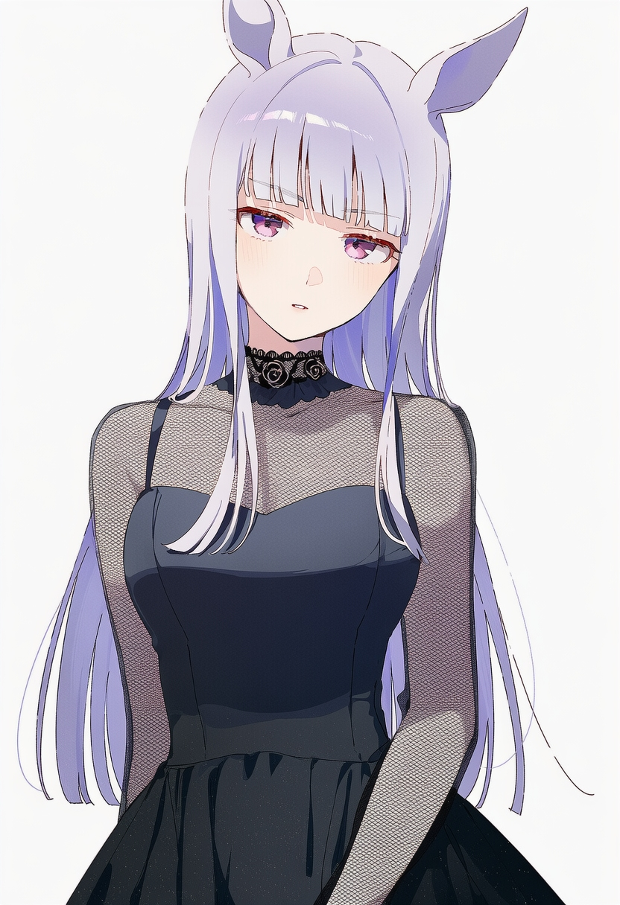

[在线例图](https://assets.quicktagcloud.com/images/raven_composition/raven_composition-3369.jpg?v=af2b450d38ec0c8b)

<a id="raven_composition-3370"></a>

## 蕾丝边颈链

ID：`raven_composition-3370`；分类：颈部配饰 / 颈圈/项圈；来源标记：`safe`。

来源说明：

> 边缘带蕾丝装饰的 Choker。

正向提示词：

```text
lace-trimmed_choker
```

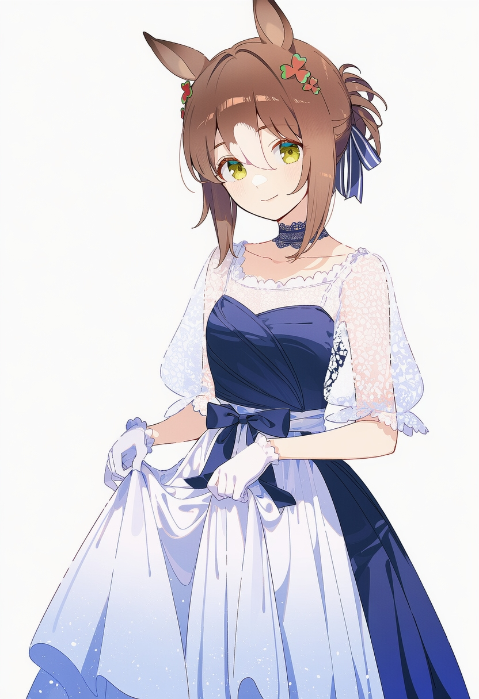

[在线例图](https://assets.quicktagcloud.com/images/raven_composition/raven_composition-3370.jpg?v=8526e64ed0f14e13)

<a id="raven_composition-3371"></a>

## 褶边颈链

ID：`raven_composition-3371`；分类：颈部配饰 / 颈圈/项圈；来源标记：`safe`。

来源说明：

> 带褶边或荷叶边的 Choker。

正向提示词：

```text
frilled_choker
```

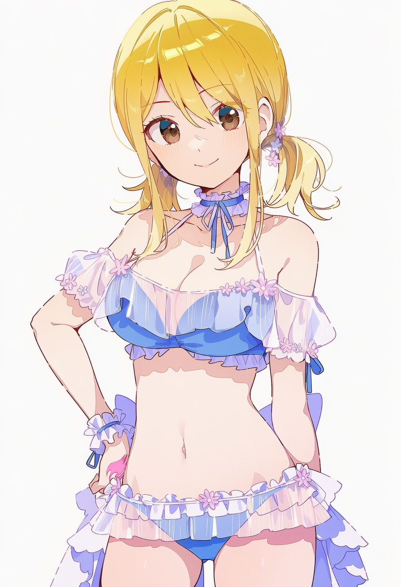

[在线例图](https://assets.quicktagcloud.com/images/raven_composition/raven_composition-3371.jpg?v=b463ec720b820841)

<a id="raven_composition-3372"></a>

## 毛绒颈链

ID：`raven_composition-3372`；分类：颈部配饰 / 颈圈/项圈；来源标记：`safe`。

来源说明：

> 主要由毛皮或毛绒构成的 Choker。

正向提示词：

```text
fur_choker
```

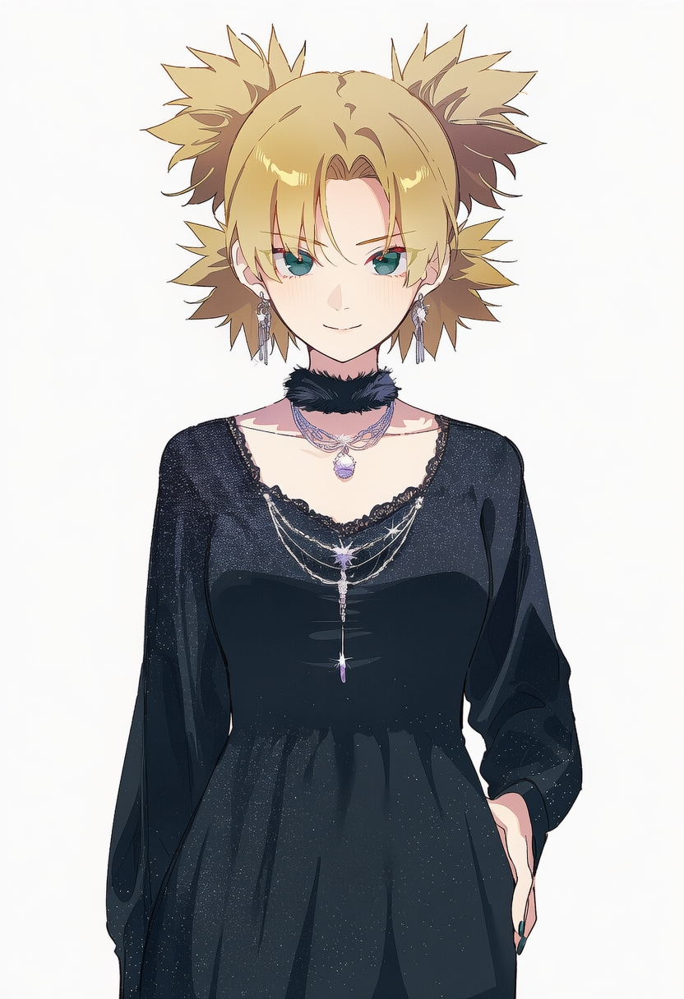

[在线例图](https://assets.quicktagcloud.com/images/raven_composition/raven_composition-3372.jpg?v=9d213b5f66c743b6)

<a id="raven_composition-3373"></a>

## 尖刺颈链

ID：`raven_composition-3373`；分类：颈部配饰 / 颈圈/项圈；来源标记：`safe`。

来源说明：

> 带明显尖刺的 Choker。

正向提示词：

```text
spiked_choker
```

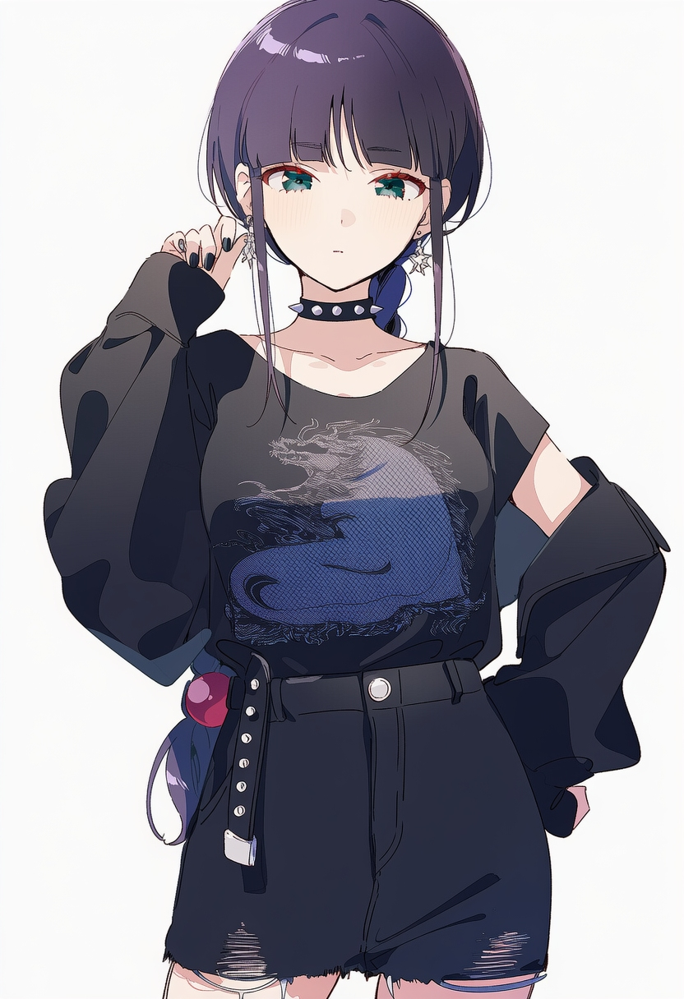

[在线例图](https://assets.quicktagcloud.com/images/raven_composition/raven_composition-3373.jpg?v=1cc57371af0aa4e8)

<a id="raven_composition-3374"></a>

## 丝带颈链

ID：`raven_composition-3374`；分类：颈部配饰 / 颈圈/项圈；来源标记：`safe`。

来源说明：

> 用丝带紧贴脖子形成的 Choker。

正向提示词：

```text
ribbon_choker
```

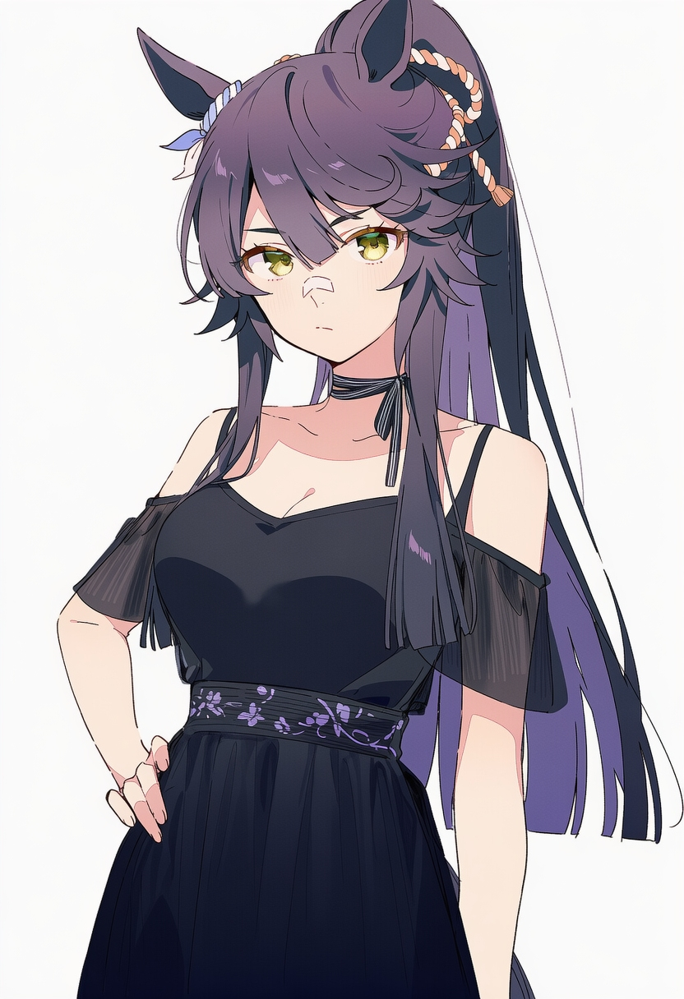

[在线例图](https://assets.quicktagcloud.com/images/raven_composition/raven_composition-3374.jpg?v=493d6d9dafd476f9)

<a id="raven_composition-3375"></a>

## 蝴蝶结颈链

ID：`raven_composition-3375`；分类：颈部配饰 / 颈圈/项圈；来源标记：`safe`。

来源说明：

> 带蝴蝶结装饰的 Choker。

正向提示词：

```text
bow_choker
```

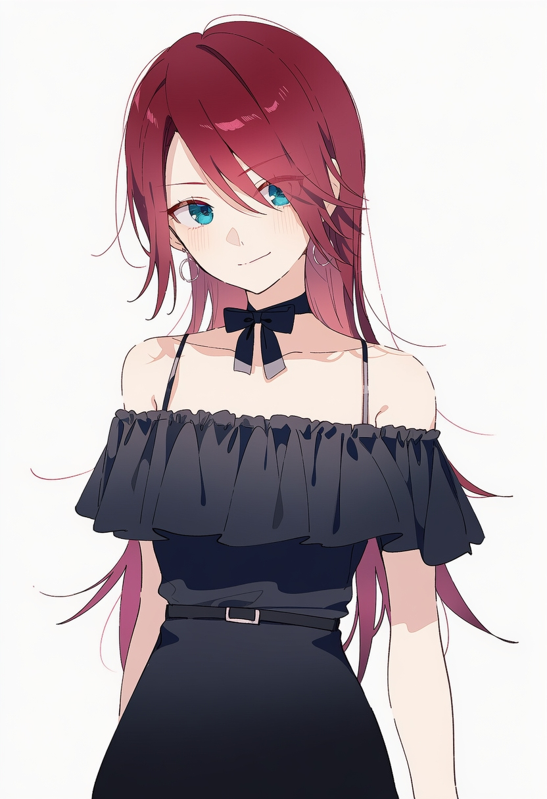

[在线例图](https://assets.quicktagcloud.com/images/raven_composition/raven_composition-3375.jpg?v=4066cf1500b7ccc1)

<a id="raven_composition-3376"></a>

## 爱心颈链

ID：`raven_composition-3376`；分类：颈部配饰 / 颈圈/项圈；来源标记：`safe`。

来源说明：

> 带爱心元素的 Choker。

正向提示词：

```text
heart_choker
```

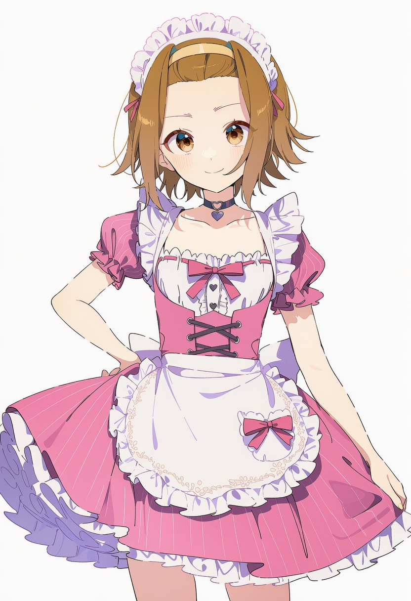

[在线例图](https://assets.quicktagcloud.com/images/raven_composition/raven_composition-3376.jpg?v=12284b779f4545d3)

<a id="raven_composition-3377"></a>

## 十字颈链

ID：`raven_composition-3377`；分类：颈部配饰 / 颈圈/项圈；来源标记：`safe`。

来源说明：

> 带十字架吊坠的 Choker。

正向提示词：

```text
cross_choker
```

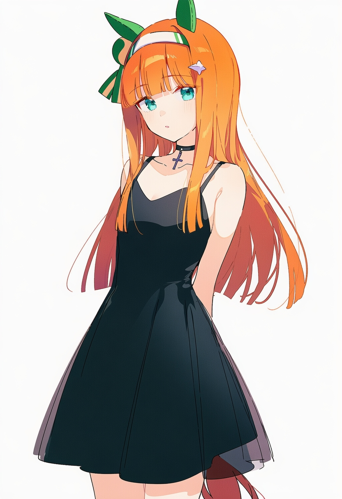

[在线例图](https://assets.quicktagcloud.com/images/raven_composition/raven_composition-3377.jpg?v=dfe79c6c50d9abc3)

<a id="raven_composition-3378"></a>

## 爱心环颈链

ID：`raven_composition-3378`；分类：颈部配饰 / 颈圈/项圈；来源标记：`safe`。

来源说明：

> 带爱心形 O 环的 Choker。

正向提示词：

```text
heart_ring_choker
```

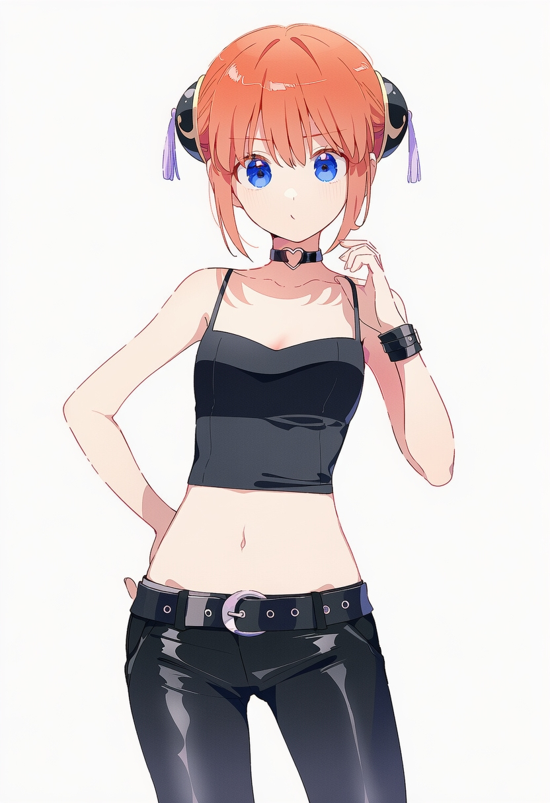

[在线例图](https://assets.quicktagcloud.com/images/raven_composition/raven_composition-3378.jpg?v=bd1330b62fe11cef)

<a id="raven_composition-3379"></a>

## O环颈链

ID：`raven_composition-3379`；分类：颈部配饰 / 颈圈/项圈；来源标记：`safe`。

来源说明：

> 正面带圆形金属环的 Choker。

正向提示词：

```text
o-ring_choker
```

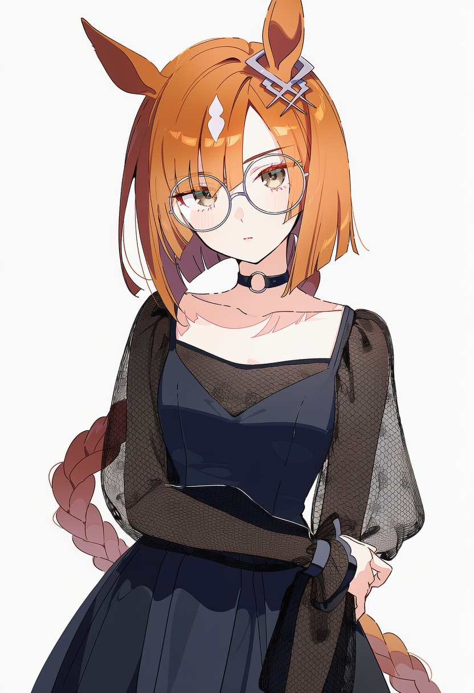

[在线例图](https://assets.quicktagcloud.com/images/raven_composition/raven_composition-3379.jpg?v=f39818a3d461008a)

<a id="raven_composition-3380"></a>

## 吊坠颈链

ID：`raven_composition-3380`；分类：颈部配饰 / 颈圈/项圈；来源标记：`safe`。

来源说明：

> 正面带明显吊坠的 Choker。

正向提示词：

```text
pendant_choker
```

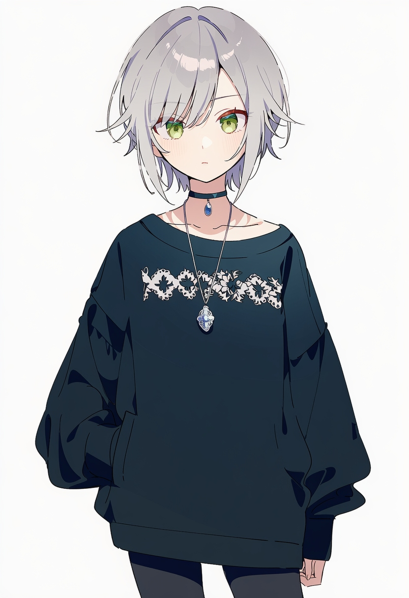

[在线例图](https://assets.quicktagcloud.com/images/raven_composition/raven_composition-3380.jpg?v=ab7b8deeca78ac01)

<a id="raven_composition-3381"></a>

## 细绳颈链

ID：`raven_composition-3381`；分类：颈部配饰 / 颈圈/项圈；来源标记：`safe`。

来源说明：

> 由一根或多根细绳组成的 Choker。

正向提示词：

```text
string_choker
```

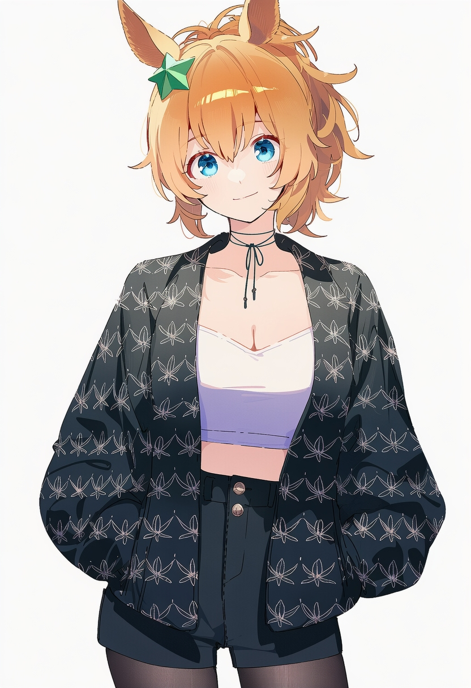

[在线例图](https://assets.quicktagcloud.com/images/raven_composition/raven_composition-3381.jpg?v=77a8584dc18a1f84)

<a id="raven_composition-3382"></a>

## 独立项圈

ID：`raven_composition-3382`；分类：颈部配饰 / 颈圈/项圈；来源标记：`safe`。

来源说明：

> 单独戴在脖子上的项圈，不是衣服领子。

正向提示词：

```text
collar
```

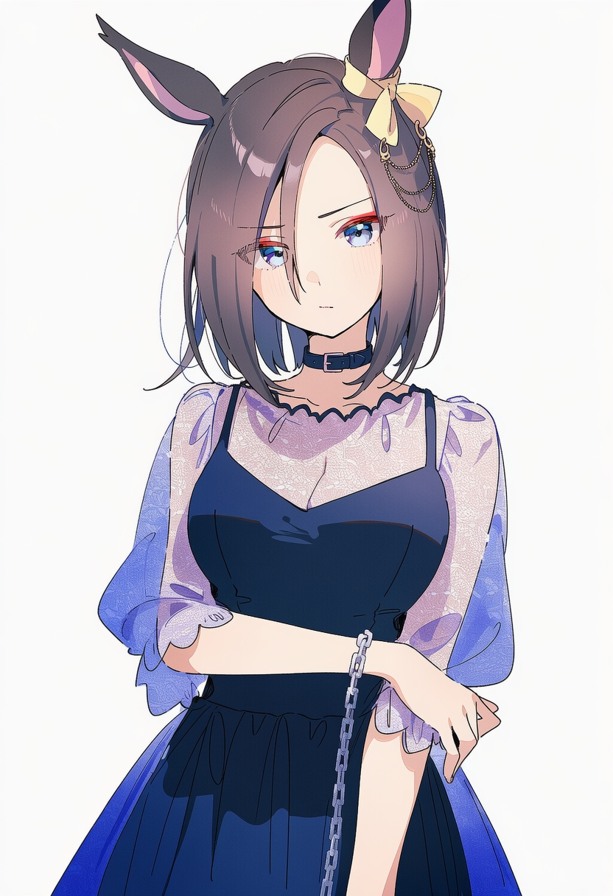

[在线例图](https://assets.quicktagcloud.com/images/raven_composition/raven_composition-3382.jpg?v=3a3441c7fae7cff5)

<a id="raven_composition-3383"></a>

## 黑色项圈

ID：`raven_composition-3383`；分类：颈部配饰 / 颈圈/项圈；来源标记：`safe`。

来源说明：

> 黑色独立项圈；纯颜色款只留这一种代表。

正向提示词：

```text
black_collar
```

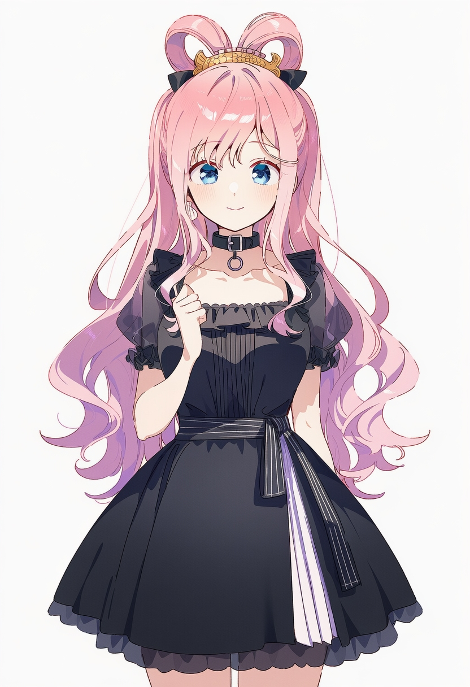

[在线例图](https://assets.quicktagcloud.com/images/raven_composition/raven_composition-3383.jpg?v=753b55db0c24e290)

<a id="raven_composition-3384"></a>

## 独立衣领

ID：`raven_composition-3384`；分类：颈部配饰 / 颈圈/项圈；来源标记：`safe`。

来源说明：

> 与上衣分开的独立领子。

正向提示词：

```text
detached_collar
```

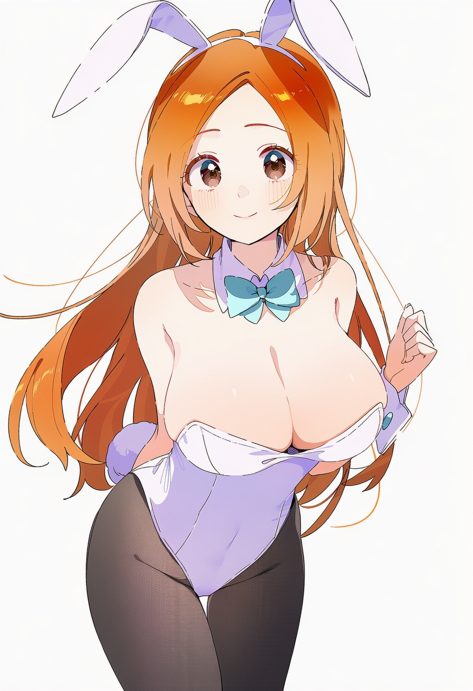

[在线例图](https://assets.quicktagcloud.com/images/raven_composition/raven_composition-3384.jpg?v=0d1f923865a6f836)

<a id="raven_composition-3385"></a>

## 褶边领圈

ID：`raven_composition-3385`；分类：颈部配饰 / 颈圈/项圈；来源标记：`safe`。

来源说明：

> 带明显褶边或荷叶边的独立领圈。

正向提示词：

```text
frilled_collar
```

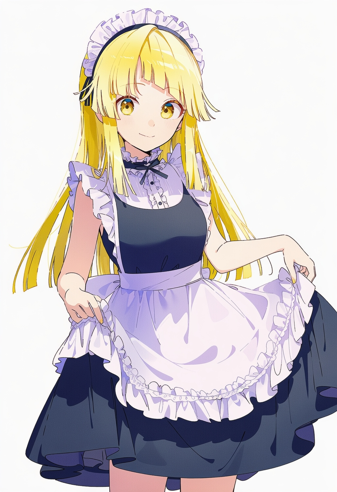

[在线例图](https://assets.quicktagcloud.com/images/raven_composition/raven_composition-3385.jpg?v=dd48ba2f89c3e937)

<a id="raven_composition-3386"></a>

## 蕾丝领圈

ID：`raven_composition-3386`；分类：颈部配饰 / 颈圈/项圈；来源标记：`safe`。

来源说明：

> 主要由蕾丝构成的独立领圈。

正向提示词：

```text
lace_collar
```

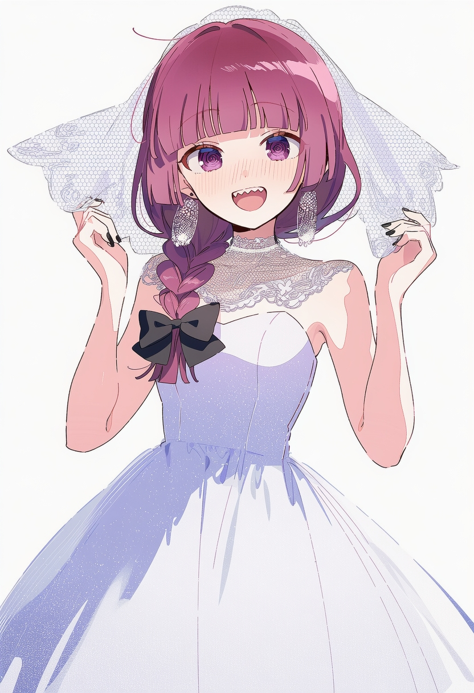

[在线例图](https://assets.quicktagcloud.com/images/raven_composition/raven_composition-3386.jpg?v=235e7512909c5e3e)

<a id="raven_composition-3387"></a>

## 蕾丝边领圈

ID：`raven_composition-3387`；分类：颈部配饰 / 颈圈/项圈；来源标记：`safe`。

来源说明：

> 边缘带蕾丝装饰的领圈。

正向提示词：

```text
lace-trimmed_collar
```

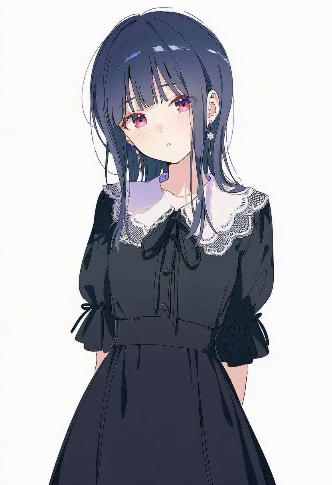

[在线例图](https://assets.quicktagcloud.com/images/raven_composition/raven_composition-3387.jpg?v=c99d5977a566a966)

<a id="raven_composition-3388"></a>

## 金属项圈

ID：`raven_composition-3388`；分类：颈部配饰 / 颈圈/项圈；来源标记：`safe`。

来源说明：

> 金属材质或金属质感的项圈。

正向提示词：

```text
metal_collar
```

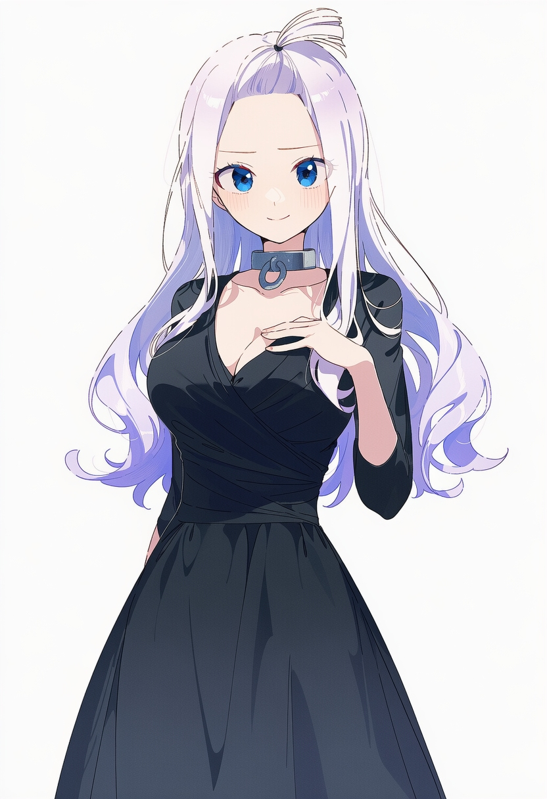

[在线例图](https://assets.quicktagcloud.com/images/raven_composition/raven_composition-3388.jpg?v=d28173390b3fe6e6)

<a id="raven_composition-3389"></a>

## 尖刺项圈

ID：`raven_composition-3389`；分类：颈部配饰 / 颈圈/项圈；来源标记：`safe`。

来源说明：

> 带尖刺的项圈。

正向提示词：

```text
spiked_collar
```

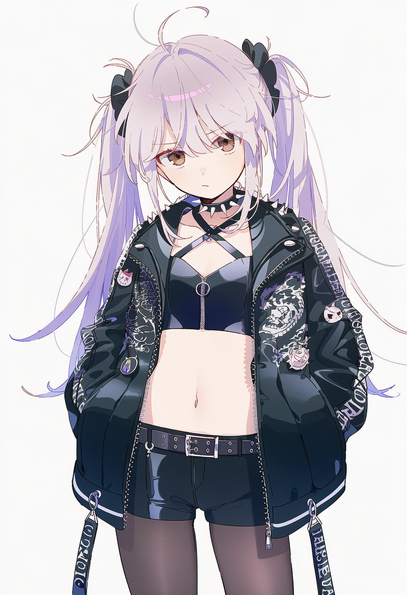

[在线例图](https://assets.quicktagcloud.com/images/raven_composition/raven_composition-3389.jpg?v=e7b1974ce8bf9446)

<a id="raven_composition-3390"></a>

## 宠物项圈

ID：`raven_composition-3390`；分类：颈部配饰 / 颈圈/项圈；来源标记：`safe`。

来源说明：

> 猫狗等宠物风格的项圈。

正向提示词：

```text
animal_collar
```

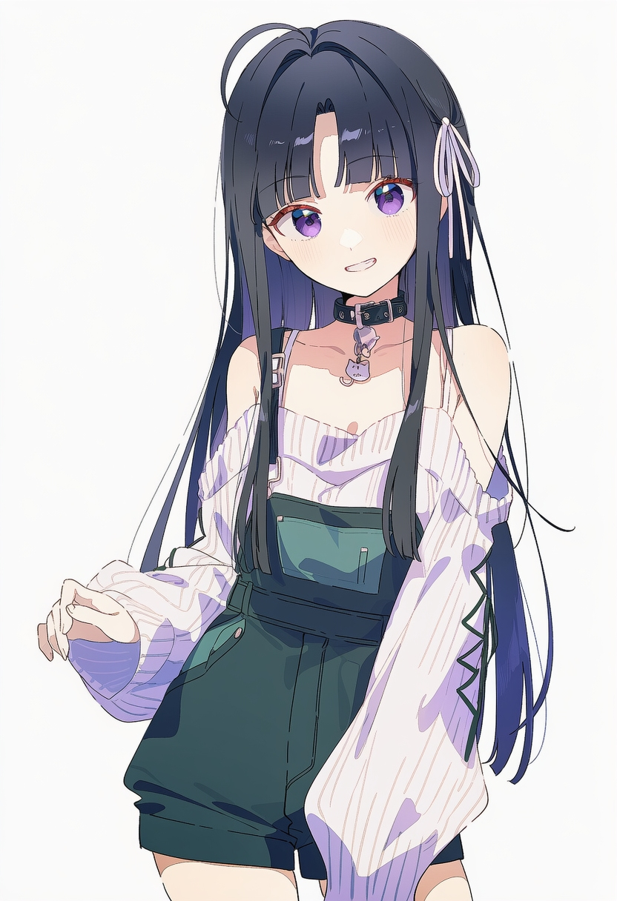

[在线例图](https://assets.quicktagcloud.com/images/raven_composition/raven_composition-3390.jpg?v=7e4512f9076c839b)

<a id="raven_composition-3391"></a>

## O环项圈

ID：`raven_composition-3391`；分类：颈部配饰 / 颈圈/项圈；来源标记：`safe`。

来源说明：

> 正面带圆形金属环的项圈。

正向提示词：

```text
o-ring_collar
```

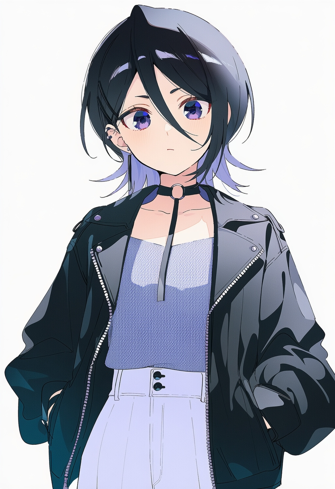

[在线例图](https://assets.quicktagcloud.com/images/raven_composition/raven_composition-3391.jpg?v=7f717de5cf0e3f8c)

<a id="raven_composition-3392"></a>

## 棋盘格项圈

ID：`raven_composition-3392`；分类：颈部配饰 / 颈圈/项圈；来源标记：`safe`。

来源说明：

> 带棋盘格图案的项圈。

正向提示词：

```text
checkered_collar
```

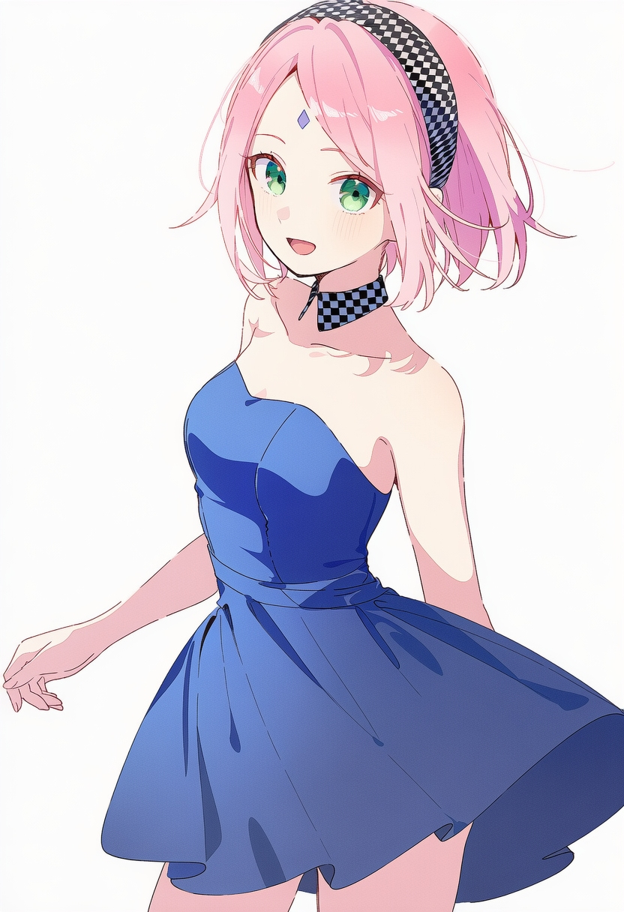

[在线例图](https://assets.quicktagcloud.com/images/raven_composition/raven_composition-3392.jpg?v=1909fcc3b68c2d56)

<a id="raven_composition-3393"></a>

## 颈铃

ID：`raven_composition-3393`；分类：颈部配饰 / 颈圈/项圈；来源标记：`safe`。

来源说明：

> 项圈或颈部饰品上挂着铃铛。

正向提示词：

```text
neck_bell
```

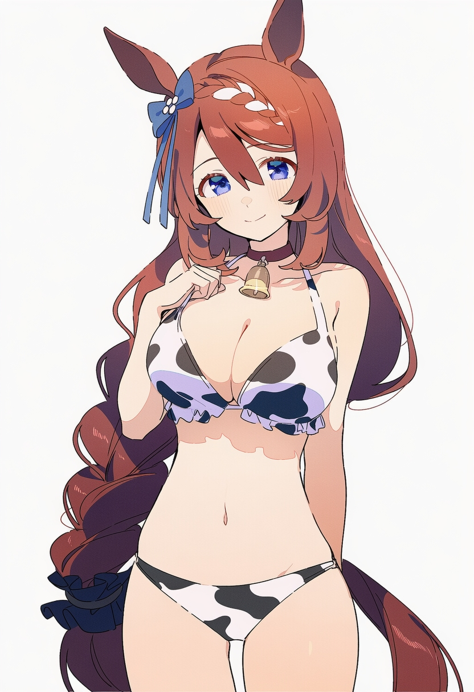

[在线例图](https://assets.quicktagcloud.com/images/raven_composition/raven_composition-3393.jpg?v=fd828fc0facb3511)
