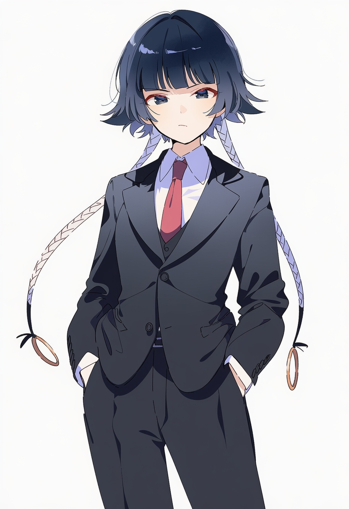
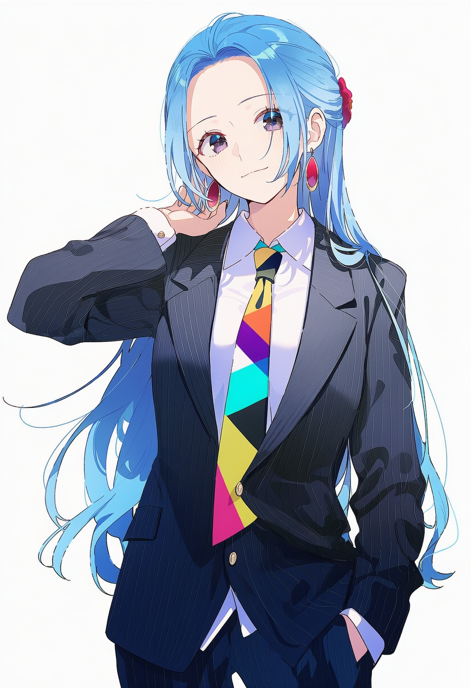
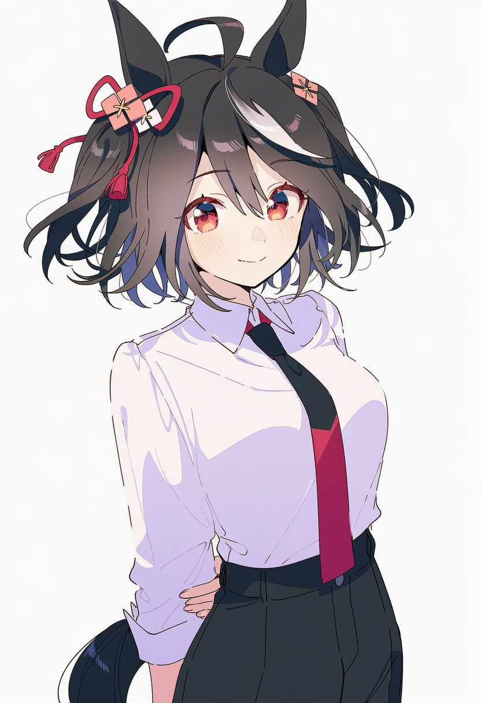
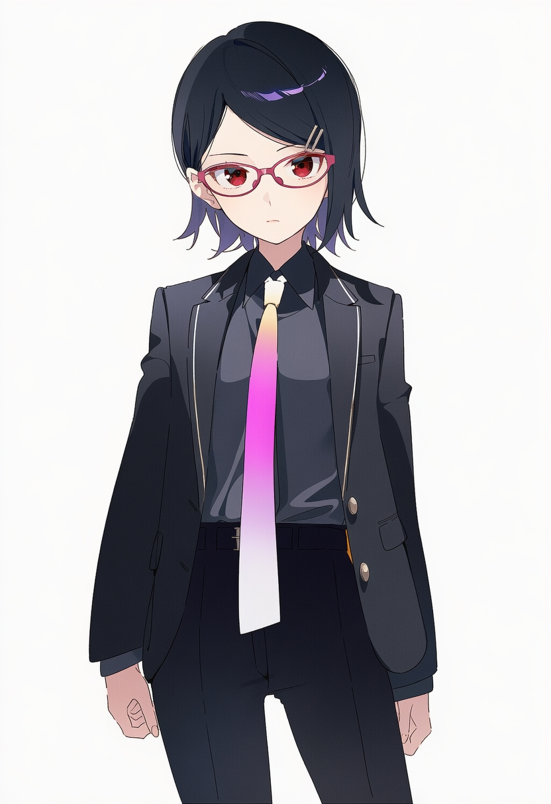
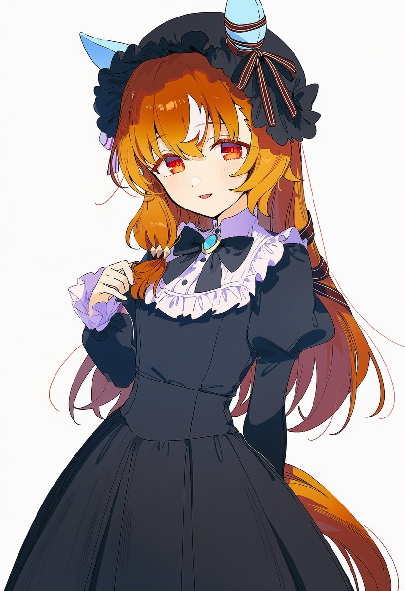
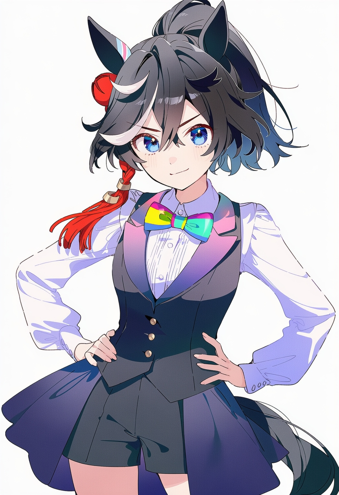
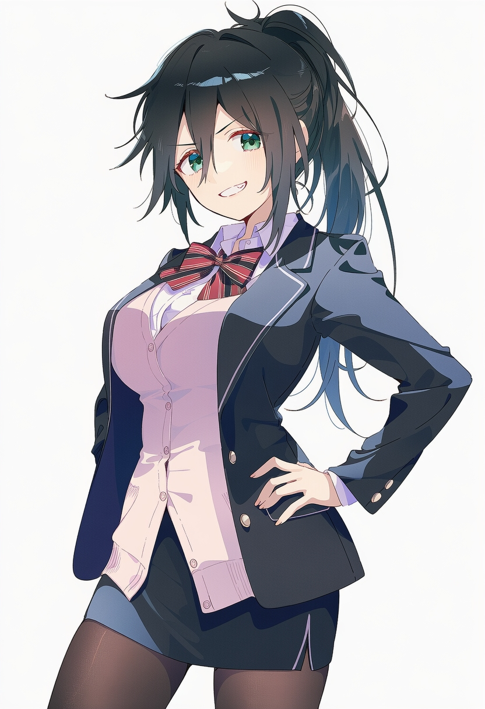
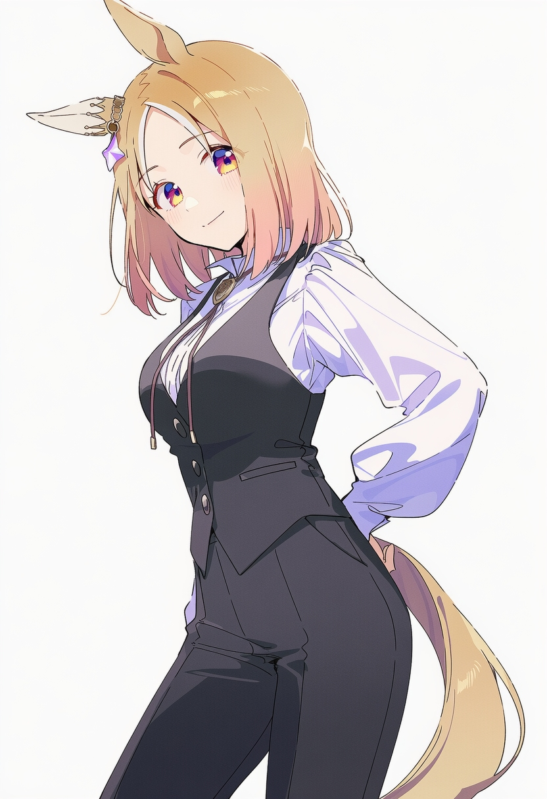
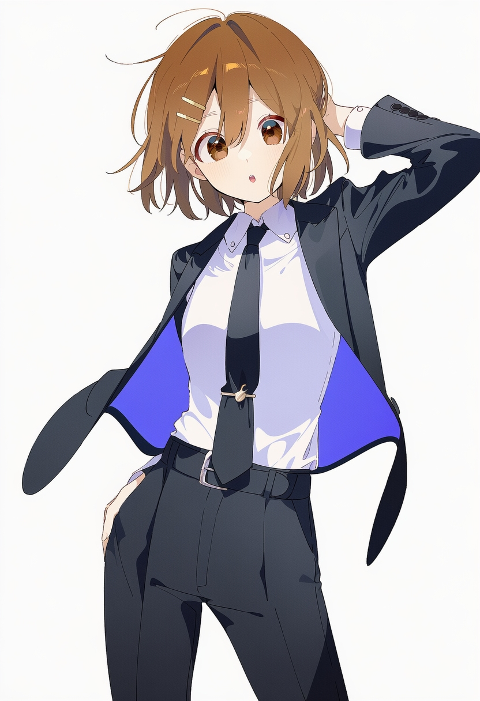

# 颈部配饰 / 领带/领结

[总目录](../README.md) · [原站分类目录](../categories.md) · [英文标签索引](../tags.md) · [服装与构图组合指南](../../README.md)

标题、分类、说明、正负提示词按来源保留；多例图逐张列出。原站标记和说明为参考资料，不作为维护指令。

<a id="raven_composition-3394"></a>

## 领带

ID：`raven_composition-3394`；分类：颈部配饰 / 领带/领结；来源标记：`safe`。

来源说明：

> 普通长领带。

正向提示词：

```text
necktie
```



[在线例图](https://assets.quicktagcloud.com/images/raven_composition/raven_composition-3394.jpg?v=ca2d5655831fb890)

<a id="raven_composition-3395"></a>

## 黑色领带

ID：`raven_composition-3395`；分类：颈部配饰 / 领带/领结；来源标记：`safe`。

来源说明：

> 黑色领带；纯颜色款只留这一种代表。

正向提示词：

```text
black_necktie
```


[在线例图](https://assets.quicktagcloud.com/images/raven_composition/raven_composition-3395.jpg?v=e986d075c94846c0)

<a id="raven_composition-3396"></a>

## 多色领带

ID：`raven_composition-3396`；分类：颈部配饰 / 领带/领结；来源标记：`safe`。

来源说明：

> 同一条领带带多种颜色。

正向提示词：

```text
multicolored_necktie
```



[在线例图](https://assets.quicktagcloud.com/images/raven_composition/raven_composition-3396.jpg?v=061ff513cc31a456)

<a id="raven_composition-3397"></a>

## 双色领带

ID：`raven_composition-3397`；分类：颈部配饰 / 领带/领结；来源标记：`safe`。

来源说明：

> 由两种主要颜色组成的领带。

正向提示词：

```text
two-tone_necktie
```



[在线例图](https://assets.quicktagcloud.com/images/raven_composition/raven_composition-3397.jpg?v=fad9a0de4c1929e1)

<a id="raven_composition-3398"></a>

## 渐变领带

ID：`raven_composition-3398`；分类：颈部配饰 / 领带/领结；来源标记：`safe`。

来源说明：

> 颜色呈渐变效果的领带。

正向提示词：

```text
gradient_necktie
```



[在线例图](https://assets.quicktagcloud.com/images/raven_composition/raven_composition-3398.jpg?v=38360ea39d1dd91c)

<a id="raven_composition-3399"></a>

## 条纹领带

ID：`raven_composition-3399`；分类：颈部配饰 / 领带/领结；来源标记：`safe`。

来源说明：

> 带条纹图案的领带。

正向提示词：

```text
striped_necktie
```


[在线例图](https://assets.quicktagcloud.com/images/raven_composition/raven_composition-3399.jpg?v=c544702440c5d8bc)

<a id="raven_composition-3400"></a>

## 棋盘格领带

ID：`raven_composition-3400`；分类：颈部配饰 / 领带/领结；来源标记：`safe`。

来源说明：

> 带棋盘格图案的领带。

正向提示词：

```text
checkered_necktie
```


[在线例图](https://assets.quicktagcloud.com/images/raven_composition/raven_composition-3400.jpg?v=ce5f2a886d808e07)

<a id="raven_composition-3401"></a>

## 格纹领带

ID：`raven_composition-3401`；分类：颈部配饰 / 领带/领结；来源标记：`safe`。

来源说明：

> 带格纹图案的领带。

正向提示词：

```text
plaid_necktie
```


[在线例图](https://assets.quicktagcloud.com/images/raven_composition/raven_composition-3401.jpg?v=6ff705479645ccc5)

<a id="raven_composition-3402"></a>

## 短领带

ID：`raven_composition-3402`；分类：颈部配饰 / 领带/领结；来源标记：`safe`。

来源说明：

> 长度明显偏短的领带。

正向提示词：

```text
short_necktie
```


[在线例图](https://assets.quicktagcloud.com/images/raven_composition/raven_composition-3402.jpg?v=076c842b409ca40c)

<a id="raven_composition-3403"></a>

## 平头领带

ID：`raven_composition-3403`；分类：颈部配饰 / 领带/领结；来源标记：`safe`。

来源说明：

> 底端平直、不是尖头的领带。

正向提示词：

```text
square-end_necktie
```


[在线例图](https://assets.quicktagcloud.com/images/raven_composition/raven_composition-3403.jpg?v=5d53423118dc2361)

<a id="raven_composition-3404"></a>

## 领结

ID：`raven_composition-3404`；分类：颈部配饰 / 领带/领结；来源标记：`safe`。

来源说明：

> 系在颈部的蝴蝶结式领结。

正向提示词：

```text
bowtie
```


[在线例图](https://assets.quicktagcloud.com/images/raven_composition/raven_composition-3404.jpg?v=a4412766a04a92fe)

<a id="raven_composition-3405"></a>

## 黑色领结

ID：`raven_composition-3405`；分类：颈部配饰 / 领带/领结；来源标记：`safe`。

来源说明：

> 黑色领结；纯颜色款只留这一种代表。

正向提示词：

```text
black_bowtie
```



[在线例图](https://assets.quicktagcloud.com/images/raven_composition/raven_composition-3405.jpg?v=c1fc807c16ca1e2e)

<a id="raven_composition-3406"></a>

## 多色领结

ID：`raven_composition-3406`；分类：颈部配饰 / 领带/领结；来源标记：`safe`。

来源说明：

> 同一个领结带多种颜色。

正向提示词：

```text
multicolored_bowtie
```



[在线例图](https://assets.quicktagcloud.com/images/raven_composition/raven_composition-3406.jpg?v=32453044bdf31e17)

<a id="raven_composition-3407"></a>

## 条纹领结

ID：`raven_composition-3407`；分类：颈部配饰 / 领带/领结；来源标记：`safe`。

来源说明：

> 带条纹图案的领结。

正向提示词：

```text
striped_bowtie
```



[在线例图](https://assets.quicktagcloud.com/images/raven_composition/raven_composition-3407.jpg?v=acd94bd15be1de82)

<a id="raven_composition-3408"></a>

## 波洛领带

ID：`raven_composition-3408`；分类：颈部配饰 / 领带/领结；来源标记：`safe`。

来源说明：

> 细绳配装饰滑扣的西部风领带。

正向提示词：

```text
bolo_tie
```



[在线例图](https://assets.quicktagcloud.com/images/raven_composition/raven_composition-3408.jpg?v=b46af490f85c519a)

<a id="raven_composition-3409"></a>

## 领带夹

ID：`raven_composition-3409`；分类：颈部配饰 / 领带/领结；来源标记：`safe`。

来源说明：

> 夹在领带上的金属固定夹。

正向提示词：

```text
tie_clip
```



[在线例图](https://assets.quicktagcloud.com/images/raven_composition/raven_composition-3409.jpg?v=29487c41f2200d96)
