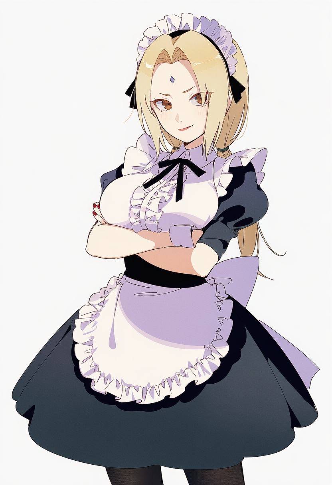
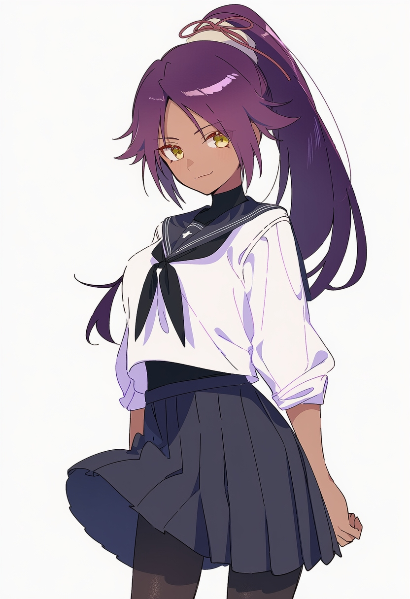
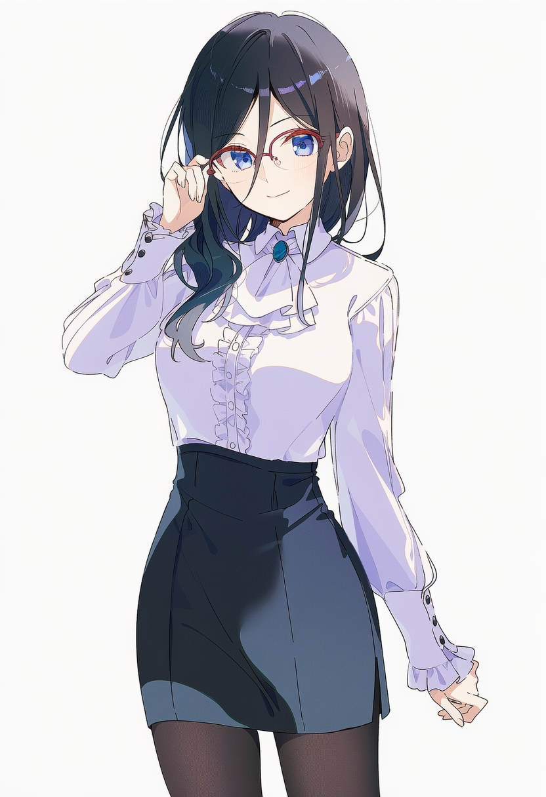
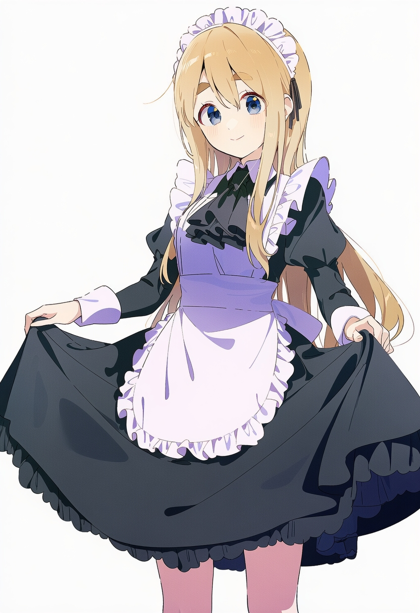
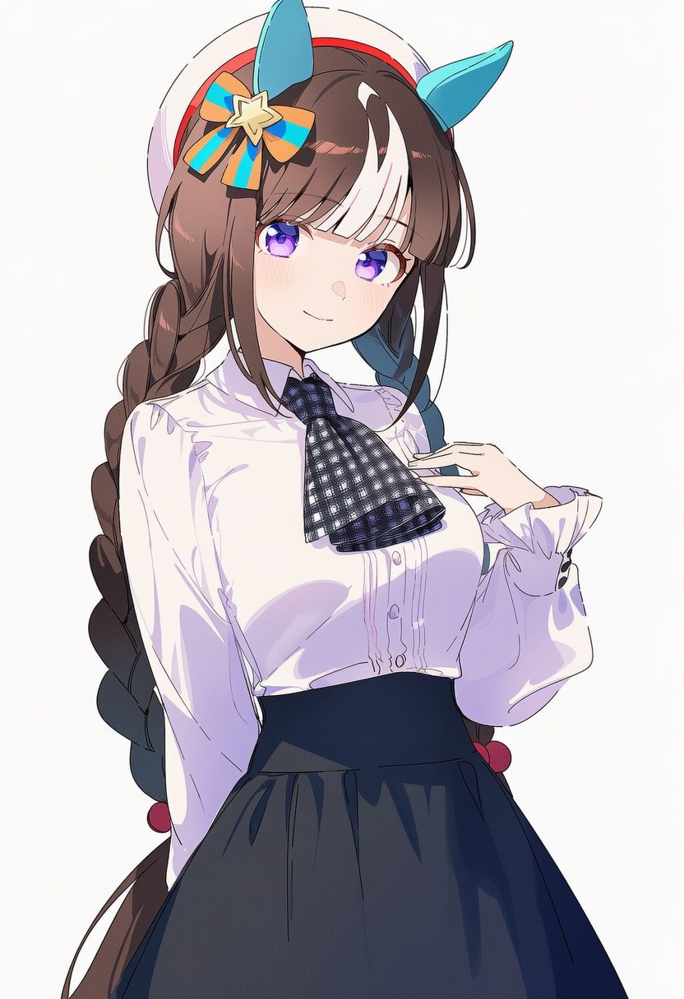
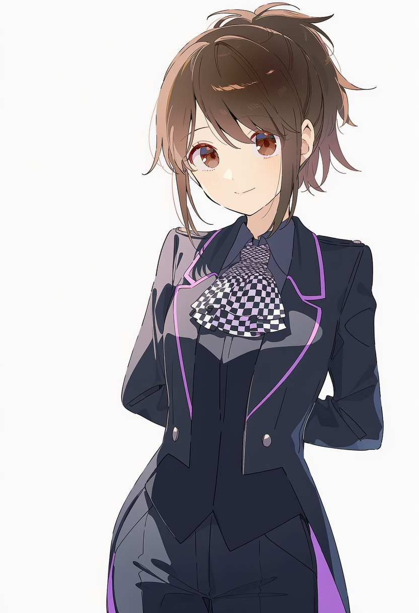
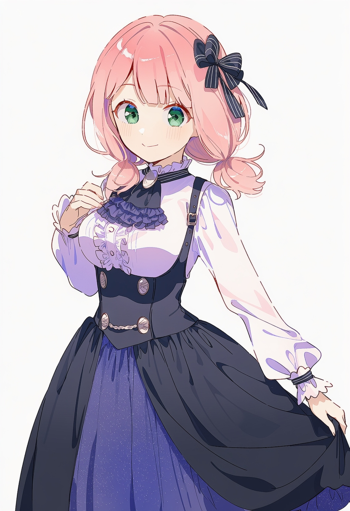
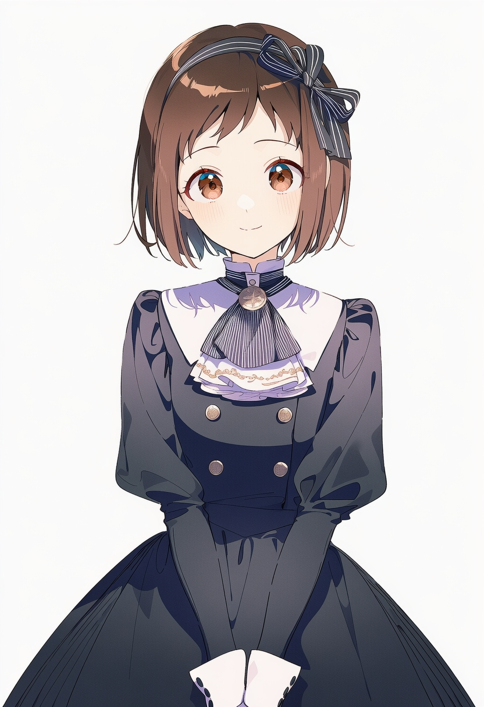
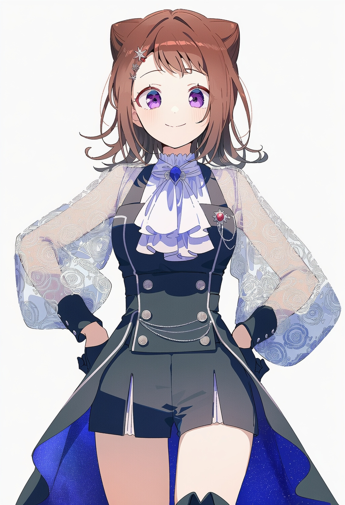

# 颈部配饰 / 领巾/丝带

[总目录](../README.md) · [原站分类目录](../categories.md) · [英文标签索引](../tags.md) · [服装与构图组合指南](../../README.md)

标题、分类、说明、正负提示词按来源保留；多例图逐张列出。原站标记和说明为参考资料，不作为维护指令。

<a id="raven_composition-3410"></a>

## 颈部丝带

ID：`raven_composition-3410`；分类：颈部配饰 / 领巾/丝带；来源标记：`safe`。

来源说明：

> 系在脖子上的装饰丝带。

正向提示词：

```text
neck_ribbon
```



[在线例图](https://assets.quicktagcloud.com/images/raven_composition/raven_composition-3410.jpg?v=67f38e7e072b846a)

<a id="raven_composition-3411"></a>

## 领巾

ID：`raven_composition-3411`；分类：颈部配饰 / 领巾/丝带；来源标记：`safe`。

来源说明：

> 系在颈部的小方巾或水手领巾。

正向提示词：

```text
neckerchief
```


[在线例图](https://assets.quicktagcloud.com/images/raven_composition/raven_composition-3411.jpg?v=ce437499061b9dcc)

<a id="raven_composition-3412"></a>

## 黑色领巾

ID：`raven_composition-3412`；分类：颈部配饰 / 领巾/丝带；来源标记：`safe`。

来源说明：

> 黑色领巾；纯颜色款只留这一种代表。

正向提示词：

```text
black_neckerchief
```



[在线例图](https://assets.quicktagcloud.com/images/raven_composition/raven_composition-3412.jpg?v=3bd02bcf4e1f8fd3)

<a id="raven_composition-3413"></a>

## 阿斯科特领巾

ID：`raven_composition-3413`；分类：颈部配饰 / 领巾/丝带；来源标记：`safe`。

来源说明：

> 颈部打结、下方垂出宽尾的领巾。

正向提示词：

```text
ascot
```



[在线例图](https://assets.quicktagcloud.com/images/raven_composition/raven_composition-3413.jpg?v=6b95068143344116)

<a id="raven_composition-3414"></a>

## 黑色阿斯科特领巾

ID：`raven_composition-3414`；分类：颈部配饰 / 领巾/丝带；来源标记：`safe`。

来源说明：

> 黑色 Ascot；纯颜色款只留这一种代表。

正向提示词：

```text
black_ascot
```



[在线例图](https://assets.quicktagcloud.com/images/raven_composition/raven_composition-3414.jpg?v=e0ae5e337997a3b2)

<a id="raven_composition-3415"></a>

## 格纹阿斯科特领巾

ID：`raven_composition-3415`；分类：颈部配饰 / 领巾/丝带；来源标记：`safe`。

来源说明：

> 带格纹图案的 Ascot。

正向提示词：

```text
plaid_ascot
```



[在线例图](https://assets.quicktagcloud.com/images/raven_composition/raven_composition-3415.jpg?v=85e4ce225c275221)

<a id="raven_composition-3416"></a>

## 棋盘格阿斯科特领巾

ID：`raven_composition-3416`；分类：颈部配饰 / 领巾/丝带；来源标记：`safe`。

来源说明：

> 带棋盘格图案的 Ascot。

正向提示词：

```text
checkered_ascot
```



[在线例图](https://assets.quicktagcloud.com/images/raven_composition/raven_composition-3416.jpg?v=761fa2b64cc8acdc)

<a id="raven_composition-3417"></a>

## 褶边阿斯科特领巾

ID：`raven_composition-3417`；分类：颈部配饰 / 领巾/丝带；来源标记：`safe`。

来源说明：

> 带多层褶边的 Ascot。

正向提示词：

```text
frilled_ascot
```



[在线例图](https://assets.quicktagcloud.com/images/raven_composition/raven_composition-3417.jpg?v=665998631c25a7af)

<a id="raven_composition-3418"></a>

## 条纹阿斯科特领巾

ID：`raven_composition-3418`；分类：颈部配饰 / 领巾/丝带；来源标记：`safe`。

来源说明：

> 带条纹图案的 Ascot。

正向提示词：

```text
striped_ascot
```



[在线例图](https://assets.quicktagcloud.com/images/raven_composition/raven_composition-3418.jpg?v=488d7a5f1490cc33)

<a id="raven_composition-3419"></a>

## 多层阿斯科特领巾

ID：`raven_composition-3419`；分类：颈部配饰 / 领巾/丝带；来源标记：`safe`。

来源说明：

> 由多层布料叠成的 Ascot。

正向提示词：

```text
layered_ascot
```



[在线例图](https://assets.quicktagcloud.com/images/raven_composition/raven_composition-3419.jpg?v=af22a4ecc89bd2fb)
