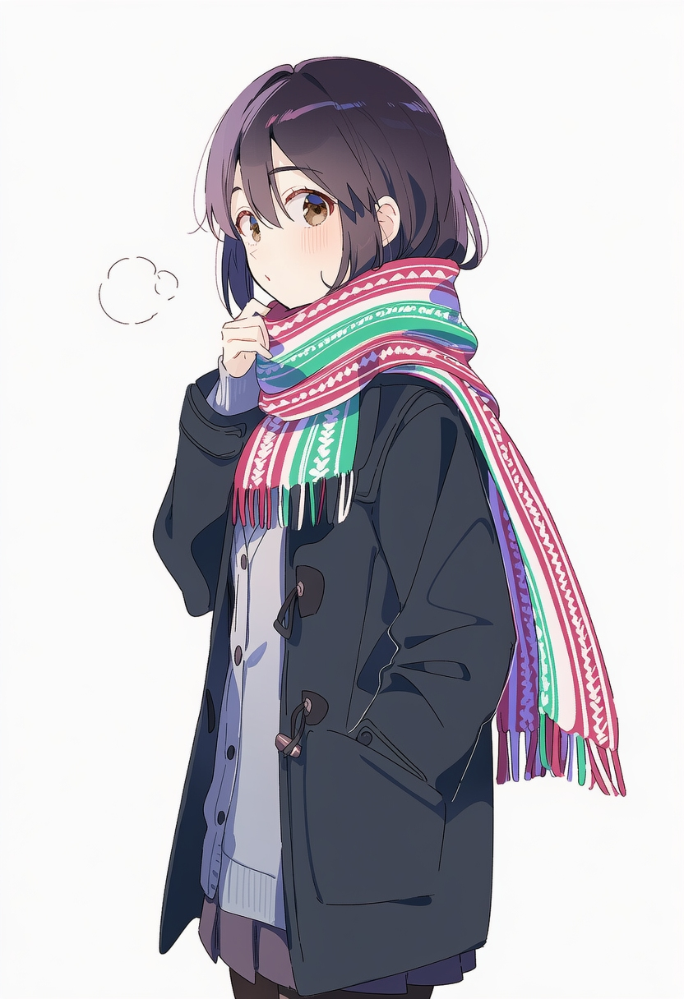
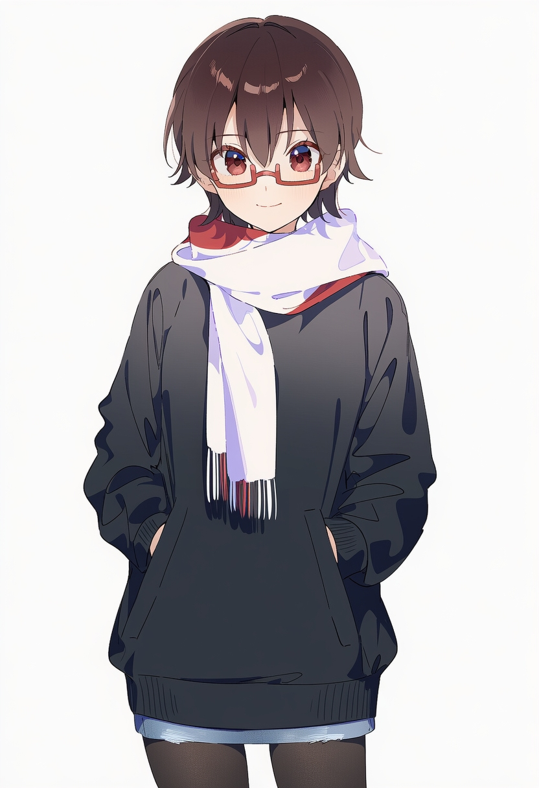
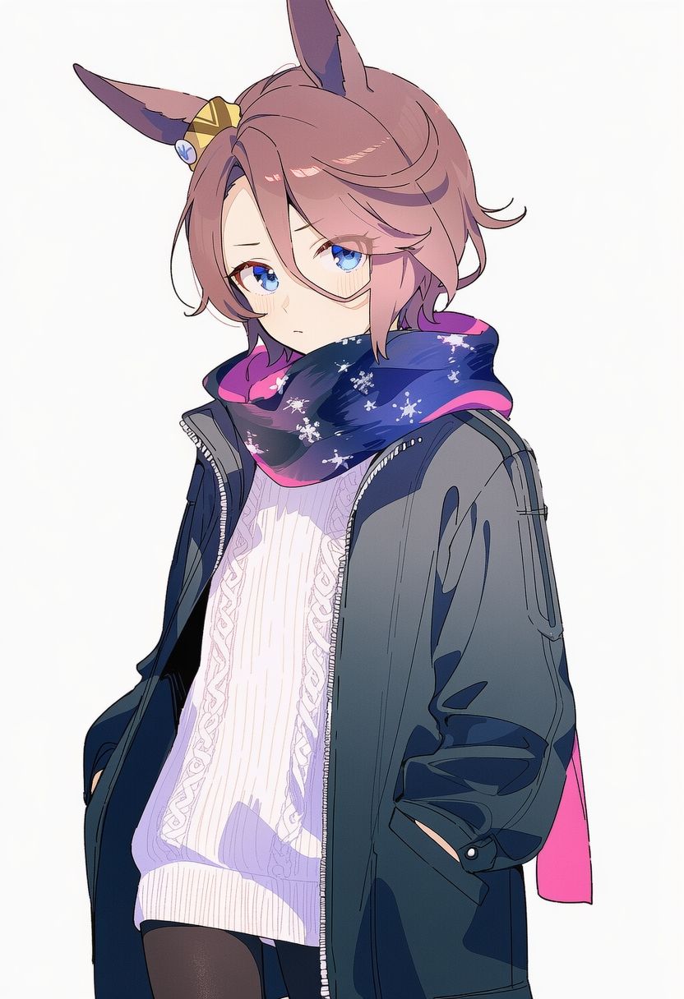
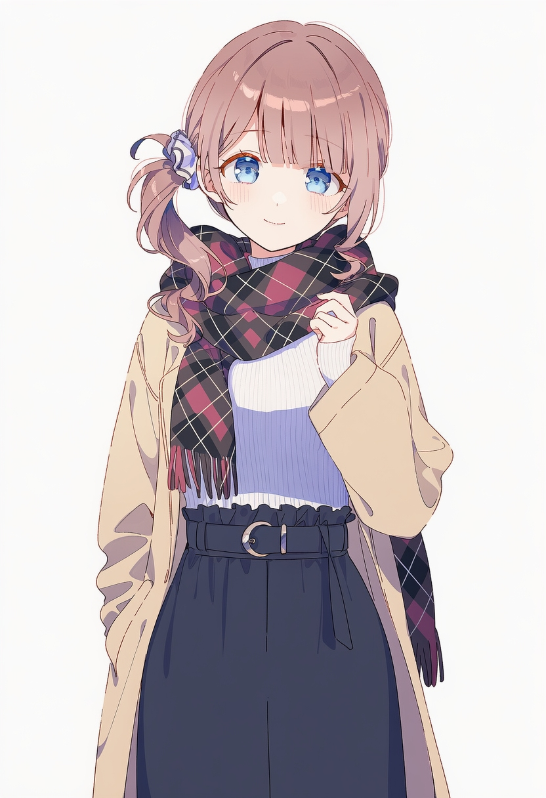
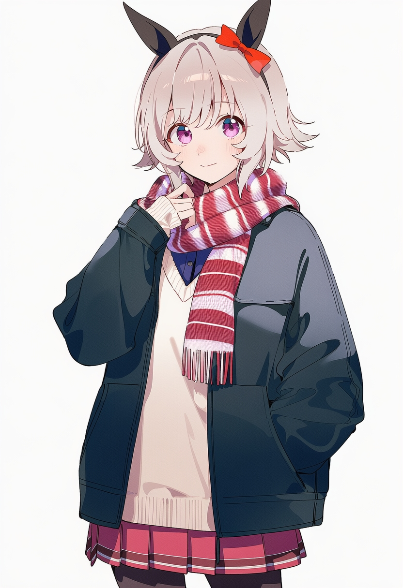
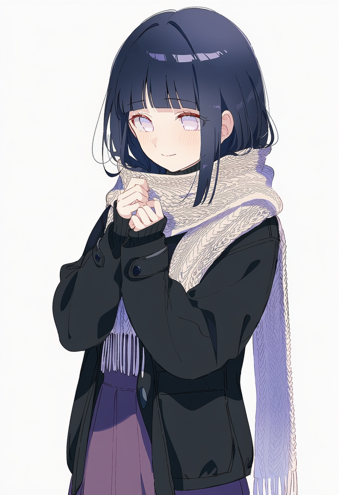
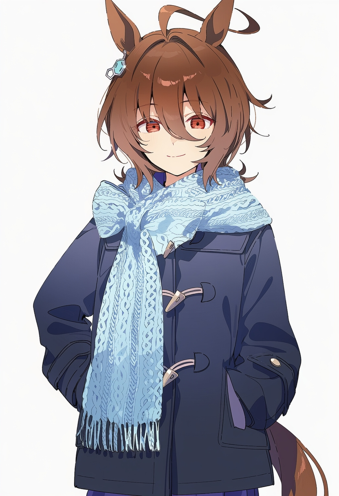
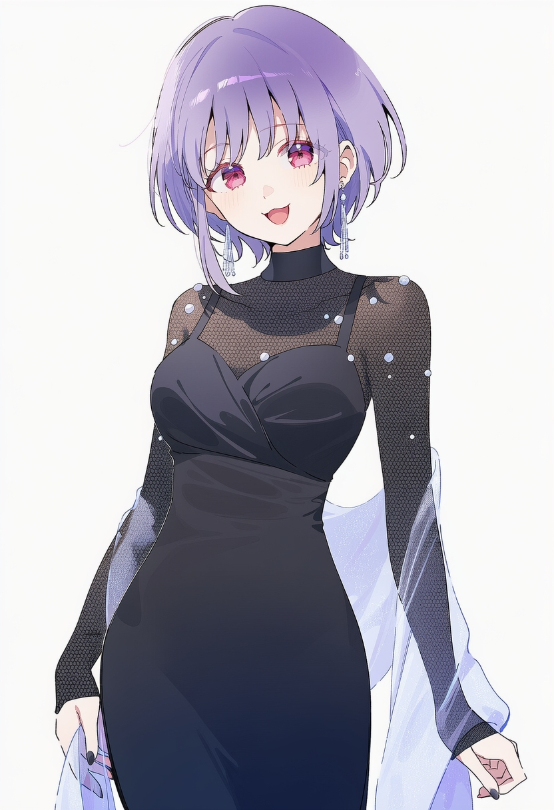
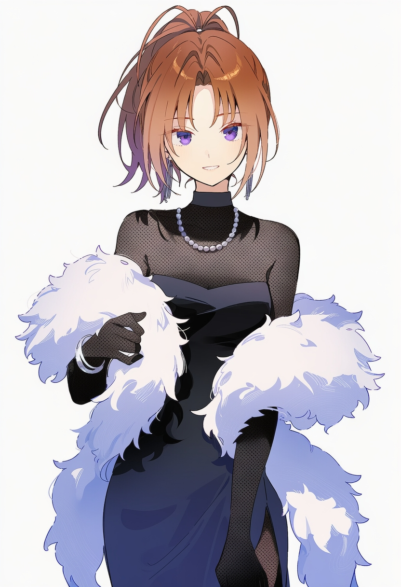
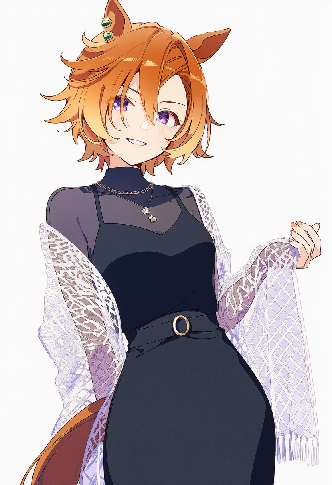

# 颈部配饰 / 围巾/披肩

[总目录](../README.md) · [原站分类目录](../categories.md) · [英文标签索引](../tags.md) · [服装与构图组合指南](../../README.md)

标题、分类、说明、正负提示词按来源保留；多例图逐张列出。原站标记和说明为参考资料，不作为维护指令。

<a id="raven_composition-3420"></a>

## 围巾

ID：`raven_composition-3420`；分类：颈部配饰 / 围巾/披肩；来源标记：`safe`。

来源说明：

> 围在脖子上的长条布料。

正向提示词：

```text
scarf
```


[在线例图](https://assets.quicktagcloud.com/images/raven_composition/raven_composition-3420.jpg?v=b0731ad1a4699e59)

<a id="raven_composition-3421"></a>

## 黑色围巾

ID：`raven_composition-3421`；分类：颈部配饰 / 围巾/披肩；来源标记：`safe`。

来源说明：

> 黑色围巾；纯颜色款只留这一种代表。

正向提示词：

```text
black_scarf
```


[在线例图](https://assets.quicktagcloud.com/images/raven_composition/raven_composition-3421.jpg?v=a2bb79966be3bc76)

<a id="raven_composition-3422"></a>

## 多色围巾

ID：`raven_composition-3422`；分类：颈部配饰 / 围巾/披肩；来源标记：`safe`。

来源说明：

> 同一条围巾带多种颜色。

正向提示词：

```text
multicolored_scarf
```



[在线例图](https://assets.quicktagcloud.com/images/raven_composition/raven_composition-3422.jpg?v=2fb48260859cc7e8)

<a id="raven_composition-3423"></a>

## 渐变围巾

ID：`raven_composition-3423`；分类：颈部配饰 / 围巾/披肩；来源标记：`safe`。

来源说明：

> 颜色呈渐变效果的围巾。

正向提示词：

```text
gradient_scarf
```


[在线例图](https://assets.quicktagcloud.com/images/raven_composition/raven_composition-3423.jpg?v=39fc35d76b83334a)

<a id="raven_composition-3424"></a>

## 双色围巾

ID：`raven_composition-3424`；分类：颈部配饰 / 围巾/披肩；来源标记：`safe`。

来源说明：

> 由两种主要颜色组成的围巾。

正向提示词：

```text
two-tone_scarf
```



[在线例图](https://assets.quicktagcloud.com/images/raven_composition/raven_composition-3424.jpg?v=dbe15358d3bc3cb5)

<a id="raven_composition-3425"></a>

## 双面围巾

ID：`raven_composition-3425`；分类：颈部配饰 / 围巾/披肩；来源标记：`safe`。

来源说明：

> 正反两面的设计或颜色不同。

正向提示词：

```text
two-sided_scarf
```



[在线例图](https://assets.quicktagcloud.com/images/raven_composition/raven_composition-3425.jpg?v=b6b0096dd5df8e71)

<a id="raven_composition-3426"></a>

## 彩虹围巾

ID：`raven_composition-3426`；分类：颈部配饰 / 围巾/披肩；来源标记：`safe`。

来源说明：

> 带彩虹式多色设计的围巾。

正向提示词：

```text
rainbow_scarf
```


[在线例图](https://assets.quicktagcloud.com/images/raven_composition/raven_composition-3426.jpg?v=1fa3f5fef1eeadfd)

<a id="raven_composition-3427"></a>

## 菱格围巾

ID：`raven_composition-3427`；分类：颈部配饰 / 围巾/披肩；来源标记：`safe`。

来源说明：

> 带 Argyle 菱格图案的围巾。

正向提示词：

```text
argyle_scarf
```



[在线例图](https://assets.quicktagcloud.com/images/raven_composition/raven_composition-3427.jpg?v=556cc7de1e4647f6)

<a id="raven_composition-3428"></a>

## 棋盘格围巾

ID：`raven_composition-3428`；分类：颈部配饰 / 围巾/披肩；来源标记：`safe`。

来源说明：

> 带棋盘格图案的围巾。

正向提示词：

```text
checkered_scarf
```


[在线例图](https://assets.quicktagcloud.com/images/raven_composition/raven_composition-3428.jpg?v=5a8052bb0b78f0b2)

<a id="raven_composition-3429"></a>

## 格纹围巾

ID：`raven_composition-3429`；分类：颈部配饰 / 围巾/披肩；来源标记：`safe`。

来源说明：

> 带格纹图案的围巾。

正向提示词：

```text
plaid_scarf
```


[在线例图](https://assets.quicktagcloud.com/images/raven_composition/raven_composition-3429.jpg?v=2cbefdece3f1fbd5)

<a id="raven_composition-3430"></a>

## 印花围巾

ID：`raven_composition-3430`；分类：颈部配饰 / 围巾/披肩；来源标记：`safe`。

来源说明：

> 表面带明显印花图案的围巾。

正向提示词：

```text
print_scarf
```


[在线例图](https://assets.quicktagcloud.com/images/raven_composition/raven_composition-3430.jpg?v=b6e3a7c1f9f8aa4d)

<a id="raven_composition-3431"></a>

## 波点围巾

ID：`raven_composition-3431`；分类：颈部配饰 / 围巾/披肩；来源标记：`safe`。

来源说明：

> 带波点图案的围巾。

正向提示词：

```text
polka_dot_scarf
```


[在线例图](https://assets.quicktagcloud.com/images/raven_composition/raven_composition-3431.jpg?v=c3258e029b9e5ea4)

<a id="raven_composition-3432"></a>

## 条纹围巾

ID：`raven_composition-3432`；分类：颈部配饰 / 围巾/披肩；来源标记：`safe`。

来源说明：

> 带条纹图案的围巾。

正向提示词：

```text
striped_scarf
```



[在线例图](https://assets.quicktagcloud.com/images/raven_composition/raven_composition-3432.jpg?v=849b48df04bf6b51)

<a id="raven_composition-3433"></a>

## 针织围巾

ID：`raven_composition-3433`；分类：颈部配饰 / 围巾/披肩；来源标记：`safe`。

来源说明：

> 针织材质的围巾。

正向提示词：

```text
knit_scarf
```


[在线例图](https://assets.quicktagcloud.com/images/raven_composition/raven_composition-3433.jpg?v=fdadac5caa70fd21)

<a id="raven_composition-3434"></a>

## 长围巾

ID：`raven_composition-3434`；分类：颈部配饰 / 围巾/披肩；来源标记：`safe`。

来源说明：

> 长度明显很长的围巾。

正向提示词：

```text
long_scarf
```



[在线例图](https://assets.quicktagcloud.com/images/raven_composition/raven_composition-3434.jpg?v=5ad2f19983c6d441)

<a id="raven_composition-3435"></a>

## 蝴蝶结围巾

ID：`raven_composition-3435`；分类：颈部配饰 / 围巾/披肩；来源标记：`safe`。

来源说明：

> 围巾在颈部系成明显蝴蝶结。

正向提示词：

```text
scarf_bow
```



[在线例图](https://assets.quicktagcloud.com/images/raven_composition/raven_composition-3435.jpg?v=5c2fe990a5d47040)

<a id="raven_composition-3436"></a>

## 透明围巾

ID：`raven_composition-3436`；分类：颈部配饰 / 围巾/披肩；来源标记：`safe`。

来源说明：

> 轻薄到能透出后方轮廓的围巾。

正向提示词：

```text
see-through_scarf
```



[在线例图](https://assets.quicktagcloud.com/images/raven_composition/raven_composition-3436.jpg?v=fc76ed9538dd9524)

<a id="raven_composition-3437"></a>

## 破损围巾

ID：`raven_composition-3437`；分类：颈部配饰 / 围巾/披肩；来源标记：`safe`。

来源说明：

> 有撕裂或破损边缘的围巾。

正向提示词：

```text
torn_scarf
```


[在线例图](https://assets.quicktagcloud.com/images/raven_composition/raven_composition-3437.jpg?v=b25fe1e81620f56b)

<a id="raven_composition-3438"></a>

## 披肩围巾

ID：`raven_composition-3438`；分类：颈部配饰 / 围巾/披肩；来源标记：`safe`。

来源说明：

> 较宽、披在肩颈位置的长条披巾。

正向提示词：

```text
stole
```


[在线例图](https://assets.quicktagcloud.com/images/raven_composition/raven_composition-3438.jpg?v=cb2a142571fe5572)

<a id="raven_composition-3439"></a>

## 羽毛围巾

ID：`raven_composition-3439`；分类：颈部配饰 / 围巾/披肩；来源标记：`safe`。

来源说明：

> 由羽毛组成的蓬松长围巾。

正向提示词：

```text
feather_boa
```



[在线例图](https://assets.quicktagcloud.com/images/raven_composition/raven_composition-3439.jpg?v=f0e9f32f50a38b08)

<a id="raven_composition-3440"></a>

## 披肩

ID：`raven_composition-3440`；分类：颈部配饰 / 围巾/披肩；来源标记：`safe`。

来源说明：

> 披在肩膀和颈部周围的大片布料。

正向提示词：

```text
shawl
```



[在线例图](https://assets.quicktagcloud.com/images/raven_composition/raven_composition-3440.jpg?v=0e11d2e57b42831d)

<a id="raven_composition-3441"></a>

## 轮状皱领

ID：`raven_composition-3441`；分类：颈部配饰 / 围巾/披肩；来源标记：`safe`。

来源说明：

> 环绕脖子的多层褶皱圆领。

正向提示词：

```text
neck_ruff
```


[在线例图](https://assets.quicktagcloud.com/images/raven_composition/raven_composition-3441.jpg?v=86a505d9ded349ed)
