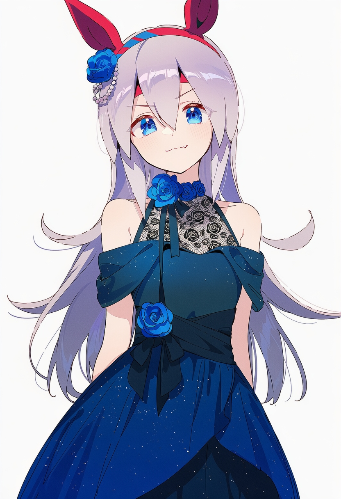
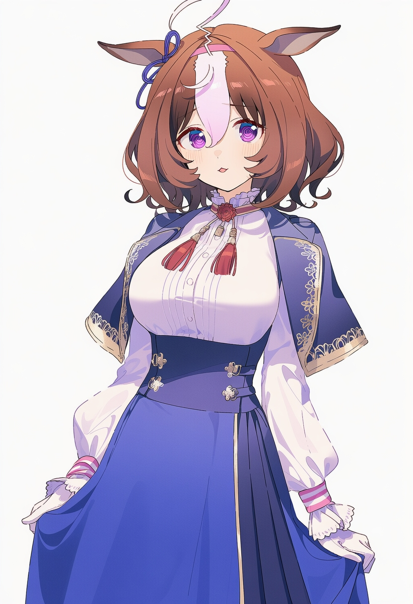
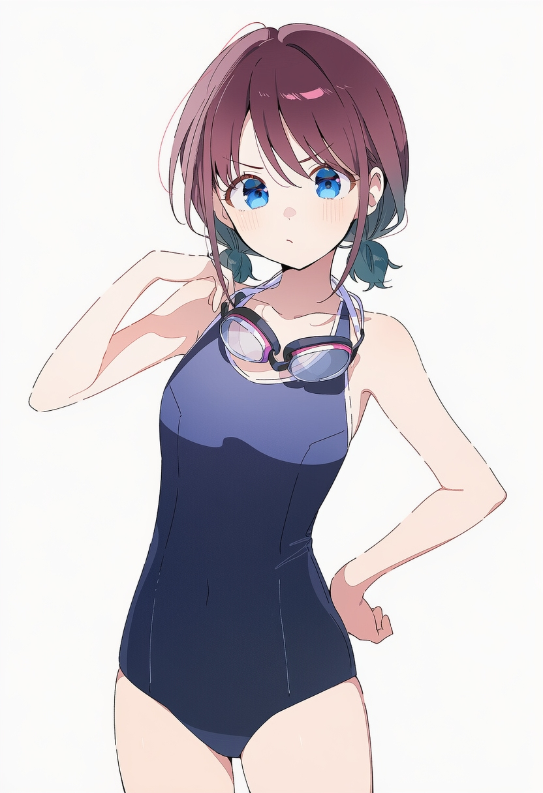
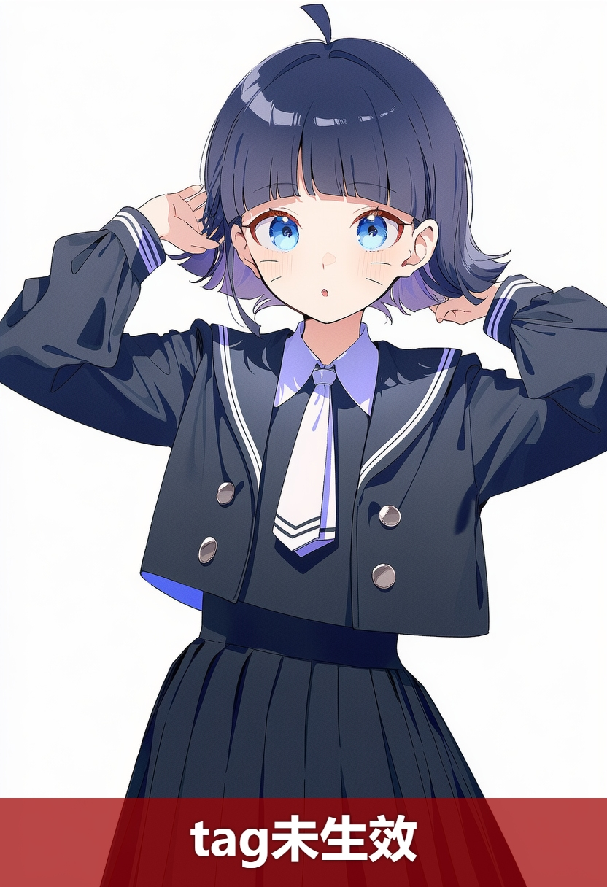
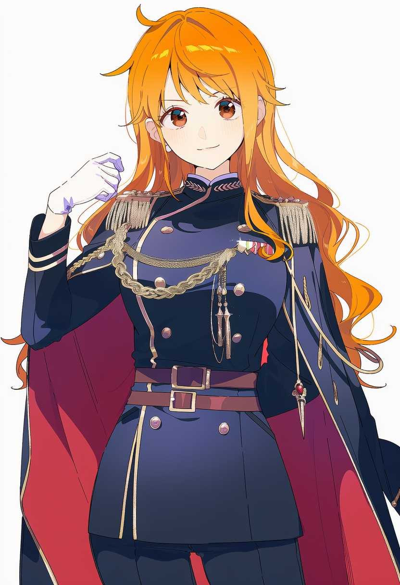

# 颈部配饰 / 其他颈饰

[总目录](../README.md) · [原站分类目录](../categories.md) · [英文标签索引](../tags.md) · [服装与构图组合指南](../../README.md)

标题、分类、说明、正负提示词按来源保留；多例图逐张列出。原站标记和说明为参考资料，不作为维护指令。

<a id="raven_composition-3442"></a>

## 颈花

ID：`raven_composition-3442`；分类：颈部配饰 / 其他颈饰；来源标记：`safe`。

来源说明：

> 花朵直接装饰在颈部位置。

正向提示词：

```text
neck_flower
```



[在线例图](https://assets.quicktagcloud.com/images/raven_composition/raven_composition-3442.jpg?v=44b66c3e3ccdd486)

<a id="raven_composition-3443"></a>

## 颈部流苏

ID：`raven_composition-3443`；分类：颈部配饰 / 其他颈饰；来源标记：`safe`。

来源说明：

> 颈部饰品上垂着明显流苏。

正向提示词：

```text
neck_tassel
```



[在线例图](https://assets.quicktagcloud.com/images/raven_composition/raven_composition-3443.jpg?v=58d311252c6f8fb6)

<a id="raven_composition-3444"></a>

## 挂绳

ID：`raven_composition-3444`；分类：颈部配饰 / 其他颈饰；来源标记：`safe`。

来源说明：

> 挂在脖子上的证件或物品挂绳。

正向提示词：

```text
lanyard
```


[在线例图](https://assets.quicktagcloud.com/images/raven_composition/raven_composition-3444.jpg?v=5202373298fa40d5)

<a id="raven_composition-3445"></a>

## 挂颈护目镜

ID：`raven_composition-3445`；分类：颈部配饰 / 其他颈饰；来源标记：`safe`。

来源说明：

> 护目镜挂在脖子上。

正向提示词：

```text
goggles_around_neck
```



[在线例图](https://assets.quicktagcloud.com/images/raven_composition/raven_composition-3445.jpg?v=0aaf57836c2d8b55)

<a id="raven_composition-3446"></a>

## 挂颈耳机

ID：`raven_composition-3446`；分类：颈部配饰 / 其他颈饰；来源标记：`safe`。

来源说明：

> 头戴式耳机挂在脖子上。

正向提示词：

```text
headphones_around_neck
```


[在线例图](https://assets.quicktagcloud.com/images/raven_composition/raven_composition-3446.jpg?v=2b76f62957558f7c)

<a id="raven_composition-3447"></a>

## 肩颈绶带

ID：`raven_composition-3447`；分类：颈部配饰 / 其他颈饰；来源标记：`safe`。

来源说明：

> 军服上绕过肩颈的编织绶带。

正向提示词：

```text
fourragere
```



[在线例图](https://assets.quicktagcloud.com/images/raven_composition/raven_composition-3447.jpg?v=fd950c254baf545c)

<a id="raven_composition-3448"></a>

## 军礼饰绳

ID：`raven_composition-3448`；分类：颈部配饰 / 其他颈饰；来源标记：`safe`。

来源说明：

> 军礼服肩颈位置的装饰编绳。

正向提示词：

```text
aiguillette
```



[在线例图](https://assets.quicktagcloud.com/images/raven_composition/raven_composition-3448.jpg?v=0ecca74498e5a8b0)
